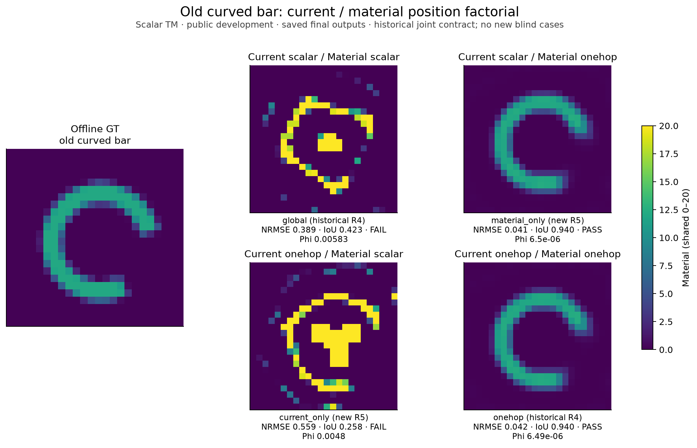
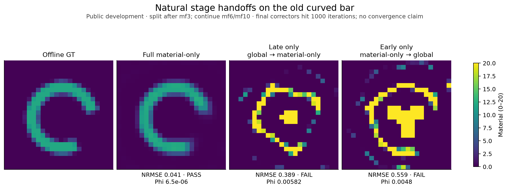
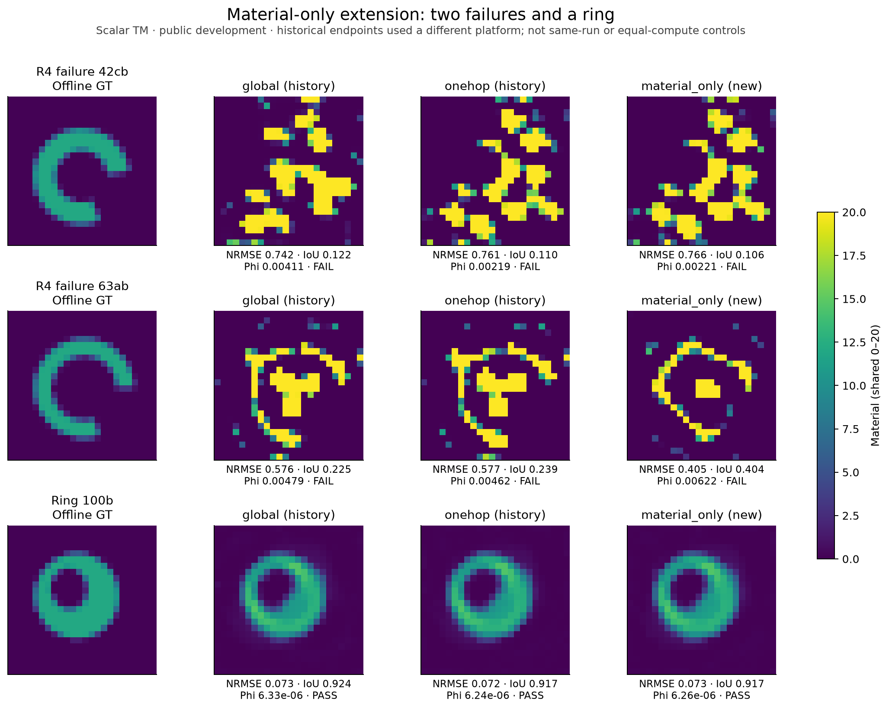
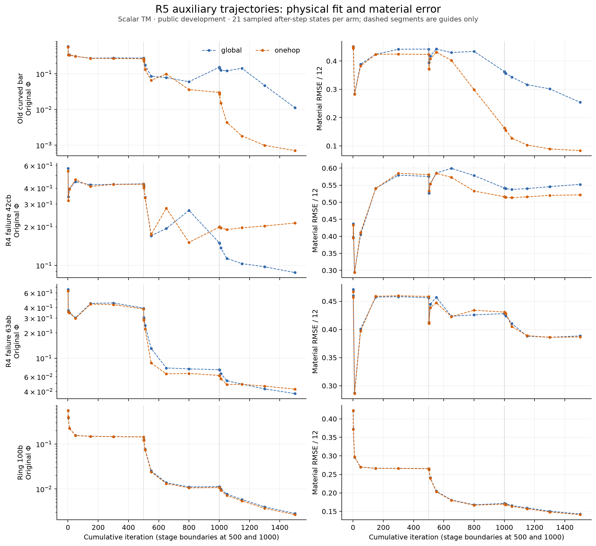
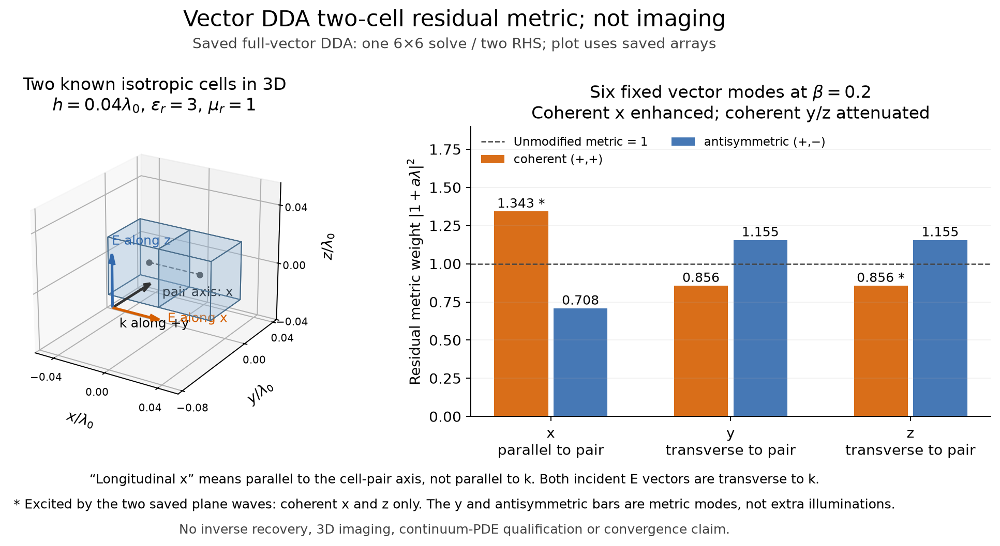

# MAX-STRUCT-R5：材料读出中的残差传播有效在哪里，失效在哪里

## 最终判断

**R5把旧弯条成功的作用位置定位到了非局部材料读出，并发现它依赖给定阶段路径；没有得到稳定超越成熟 CIE 的新成像算法。** 普通电流更新加上one-hop材料读出，已能复制旧正例；但两条新弯条仍失败。只在早期或后期使用这一读出也未复制成功。最有价值的产物是这组因果干预，以及解释其适用边界的有限缺陷导数和块谱分析。

本轮不是九数字新基准或三维成像论文。完成了四个公开开发对象的8条轨迹重放、174个状态诊断、120个同状态反事实读出、7次带共同原物理corrector的有限干预，以及一个真实三维vector-DDA两体素谱反例。未拟合成功分类器、未增加照明、未换prior、未用GT在线选候选。168个检查点不是168个独立材料样本。

## 四个必须回答的问题

### 1. 为什么R4在历史弯条上有效？

能够确定的是**作用位置和路径条件**，还不是几何充分条件。把one-hop分别放入current和material两块，得到：

| 电流更新 | 材料读出 | RMSE/12 | IoU | 完整物理相对残差 |
|---|---|---:|---:|---:|
| 普通global | 普通 | .389183 | .422680 | .107821 |
| one-hop | one-hop | .041672 | .939759 | .0009679 |
| one-hop | 普通 | .558514 | .257813 | .0976930 |
| 普通global | one-hop | **.041480** | **.939759** | **.0009692** |

前两行复用冻结历史端点，后两行为新R5干预；本地重放旧global/one-hop的各阶段状态与历史一致。四臂使用同数据、576个独立实材料、同box/prior/初始化、同mf3/6/10及每阶段500步，最终共同1000步original-Maxwell corrector。辅助运算量不同，不能称等wall或等全部算量优势。

材料读出的额外非局部项确实能改变路径，而current传播不是复制这个正例的必要部件。普通self项和反相控制此前均失败，排除了“只要改自项或加等强耦合就行”。这不是更多物理信息，也不是更高材料容量。



在第一个自然阶段结束后，完整搬运m、J和Fourier系数，再按原程序扩模/重置PR。普通global→material-only最终NRMSE=.388613；material-only→global为.558738；全程material-only为.041480。**早期状态单独不够，后期更换读出也不够**，仅对这一固定切换点成立。不能据此宣称证明了吸引盆地、必须每一步传播、或其他切换点都会失败。两切换corrector均耗尽1000步，未获渐近收敛证书。



### 2. 为什么两个新弯条失败？

R5没有找到能仅凭形状提前判定成败的规则，但排除了几个简单解释。失败对象具有与旧成功相同的正cross、同相残差占优和明显的metric导数项；这些量的存在本身不能解释成功。删除current传播的简化也未修复它们：

| 已公开对象 | R4 one-hop NRMSE | R5 material-only NRMSE | R5 IoU | R5原物理残差 |
|---|---:|---:|---:|---:|
| 弯条42cb | .761368 | .766323 | .106280 | .066004 |
| 弯条63ab | .576876 | .404823 | .403846 | .111383 |
| 正常环100b | .071621 | .072525 | .917355 | .001010 |

R4确认端点来自Windows，R5来自本地CPU；表中微小差异不能解释为算法优势。63ab的材料误差下降较大，但残差更差，仍未恢复；不得据GT在这些候选间选根。42cb几乎维持同类错误结构，正常环保持成功。



在one-hop最后辅助阶段的检查点，两个失败对象分别有37、23个材料上界活动cell，旧弯条和环为0；这些上界点的原物理负梯度也朝外，并非单纯“辅助目标顶住了一个物理梯度希望释放的box”。失败对象沿实际材料步的精确物理曲率为负，而两个成功对象为正；但这些检查点有非零投影梯度，不能叫驻点或证明局部极小。Gram中约1e−18的负小特征值是浮点现象，不是负物理曲率或精确零空间证据。

因此当前支持的是：**相同局部残差滤波在不同全波状态上会把材料路径引向不同区域；块内相位结构没有对接收数据方向或材料正确性的普遍保证。** 两失败端点还有显著原物理失配，不能用“不可辨识的等数据解”替它们开脱。预算不足、非凸路径和离散表示影响未完全分离；R4的延长corrector、32网格及分块平移结果继续约束结论。尚不能给出几何层面的完整失败定理。

### 3. 得到了什么可验证的新认识或简单改进？

**第一，根处加权LS不是离根实际读出的完整解释。** 固定辅助J，r=J−XQ，R=P(m)r，则

```text
dR[h] = −P C_mat h + (dP[h])r
g_state = −C_matᵀPᵀP r + a_r
<a_r,h> = <Pr,(dP[h])r>.
```

被根处公式省去的a_r可与甚至大于总state梯度，因为不同项会抵消。普通CIE的这一分量a_r非正，因此其负梯度方向指向提高contrast；它也存在于成功轨迹，不能当失败分类器。实际读出还含prior、box、非线性内层和current历史。

**第二，正cross并不反对one-hop有效。** 168个冻结检查点的base-plus全域cross全部为正，范围.000299至.107936；空间上仍有负cell。反相控制自身的cross符号应取反，不能把base-plus诊断误称反相目标值。加权LS transport与真实材料步的cosine范围−.495至.450，范数大不等于推动了实际步。样本中34次实际步出现Phi下降但材料误差上升，另19次相反；这只是相关轨迹的描述，不是独立统计显著性。

**第三，滤波的谱结构可明确写出。** 对均匀材料2×2正方块，四个几何固定Walsh模态的Green特征值为

```text
λ = (2ge+gd, −gd, −gd, −2ge+gd)
one-hop residual weights = |1+aλ|².
```

实际scalar-TM算子在β=.2、公开box上界m=20时，同相模态权重1.23674，两个交替模态.94677，棋盘格.90752。四对象三阶段末态的同相残差能量占.7095–.8344，贡献正cross，其余模态合计贡献负cross。它解释了总体符号，也解释反相为何改变优化；成功与失败都满足，所以没有得到新的可靠成败预测器。非均匀材料会混合这些模态，分析保留了真实混合项。

**第四，简单改进只获得局部资格。** material-only少了current块中的残差变换，保留旧例恢复，值得作为机制控制保存；它不是已成熟的普适新算法，也没有等实际成本胜出的证据。



### 4. 是否已具备二维、三维和公开基准上的稳定成本优势？

**没有。** 二维只有公开开发对象上的作用定位与有限干预，未开展新独立确认；R4六对象4/6共同结果和32网格优势消失仍有效。历史九数字成熟CIE已全恢复，本轮没有把它们重跑成新创新证据，完整历史映射/状态见[基准合同](BENCHMARKS.md)。

三维复用了R1真实dyadic Green，以两个相邻体素、ε=3、两种合法横向入射极化作6维全波解。它给出一个有区分力的反例：β=.2时，沿两体素连线的同相电场模态权重1.34284，而横向同相模态为.85619。这里“纵向”相对于体素连线，不是非法的入射纵向极化。一个同相模态被加强、另一个被减弱；二维scalar解释不能无条件搬到三维。仅1 LU/2 RHS，**不是三维成像或连续PDE精度认证**。



Fresnel/eispy2d完成官方来源、物理约定、文件格式和标定缺口调查，未完成实测文件下载/标定/反演。没有伪造实测材料NRMSE，也未以合成数据冒充实测结果。

## 证据、计算与执行边界

所有online候选由同一原Phi选择；辅助目标不代替Phi。GT在预测/诊断封存后由独立评分脚本访问；modal分析在评分后提出，明确为post-score development且自身不读GT。[原封存理论前六节](audit/THEORY_DERIVATIONS_AT_FIRST_SEAL.md)和[文档演化记录](audit/POST_SEAL_DOCUMENT_EVOLUTION.json)分别保留；后续理论附节不是预注册内容。具体记录见[复现](REPRODUCE.md)和[账本](COST_LEDGER.md)。

新增物理共 **7717 LU、183686 complex RHS**，其中7716次为576维二维系统，1次为6维矢量系统；维度不可混同为等成本。二维各任务wall合计290.396秒，另加三维约.274秒；这是任务计时之和，不是并行历时，更不是包含文献/绘图/Agent的完整总时长。全部本地CPU；无需为这些小任务占用i9/4060。LLM及货币费用未获计量，保持null。失败尝试已收费，历史预计算只引用不重计。

## 论文价值与下一轮选择

标准恒等式、Walsh谱、dyadic纵横分解均不主张原创。较有价值的是**可复现的作用位置消融、自然阶段路径依赖、有限缺陷导数与受约束物理曲率的区分**。目前适合作为方法学机制研究/负结果证据，尚不足以支持IEEE TAP级“稳定优于成熟CIE”主张。

下一轮优先的问题不是再调β，而是：在给定物理预算下，如何构造能与接收数据方向关联、并尊重box切锥的材料更新？公式起点应是完整有限响应与残差加权曲率，而非单独cross符号：

```text
dF[h] = S(I−XG)⁻¹ diag(h) E
d²Phi[h,h] = ||W dF[h]||²
             + Re< W(F−Y), W d²F[h,h] > + d²R[h,h].
```

R4候选C已表明，把无约束负曲率方向投影到box可能毁掉它的协同作用，不能照搬重跑。最小下一步应先在失败端点的合法自由面/切锥，检验是否还存在可产生有限Phi下降的耦合方向，并同时对成功控制检查；只有出现新证据才接更多corrector与新盲测。若这一步仍无效，应保留本轮“局部残差滤波不充分”的反例，转向物理可见材料子空间，而不是扩大图像或超参数数量。

## 直接证据入口

- [轨迹与反事实完整分析](TRAJECTORY_ANALYSIS.md)
- [推导及成立条件](THEORY_DERIVATIONS.md)
- [研究循环](RESEARCH_LOOP.md)、[完整负结果](FAILURES.md)
- [R4原Chat候选A/B/C结论](../research_max_struct_r4/ABC_VALIDATION_ZH.md)：A局部正例/泛化失败；B测试profile无成像优势；C受约束射线未逃离。R5只深化A，不重命名或隐藏B/C。
- [文献与原创性账本](literature/PRIOR_ART.md)

