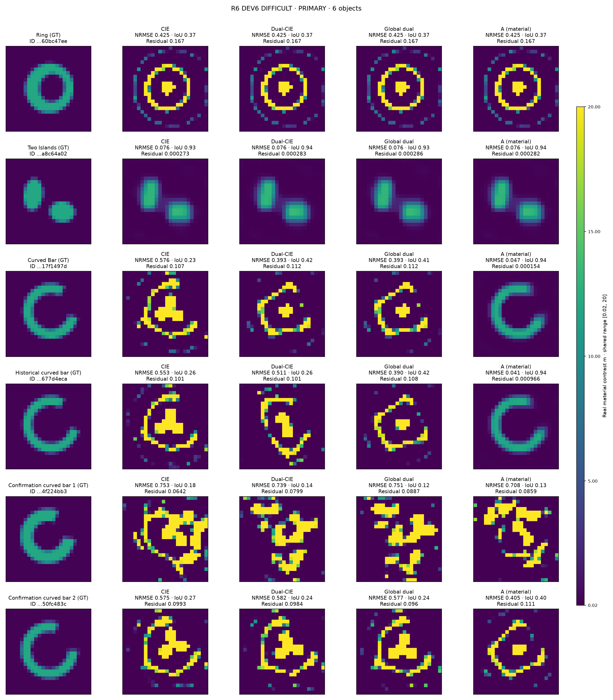
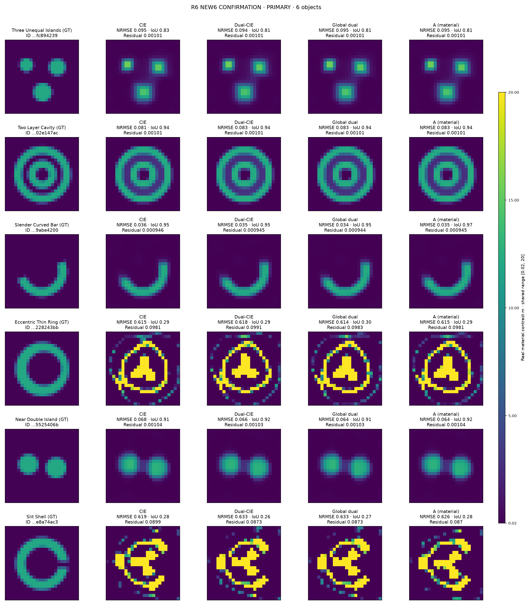
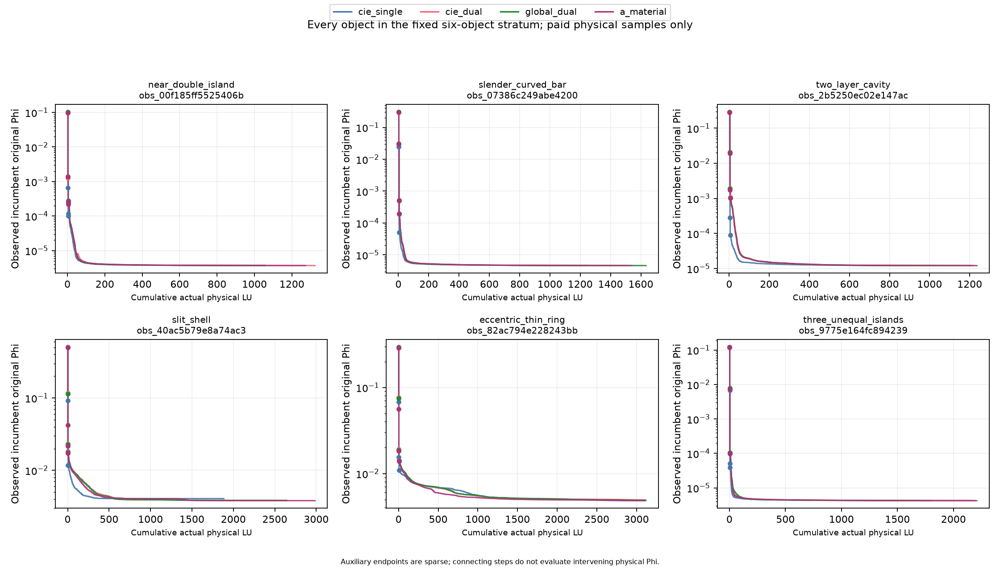
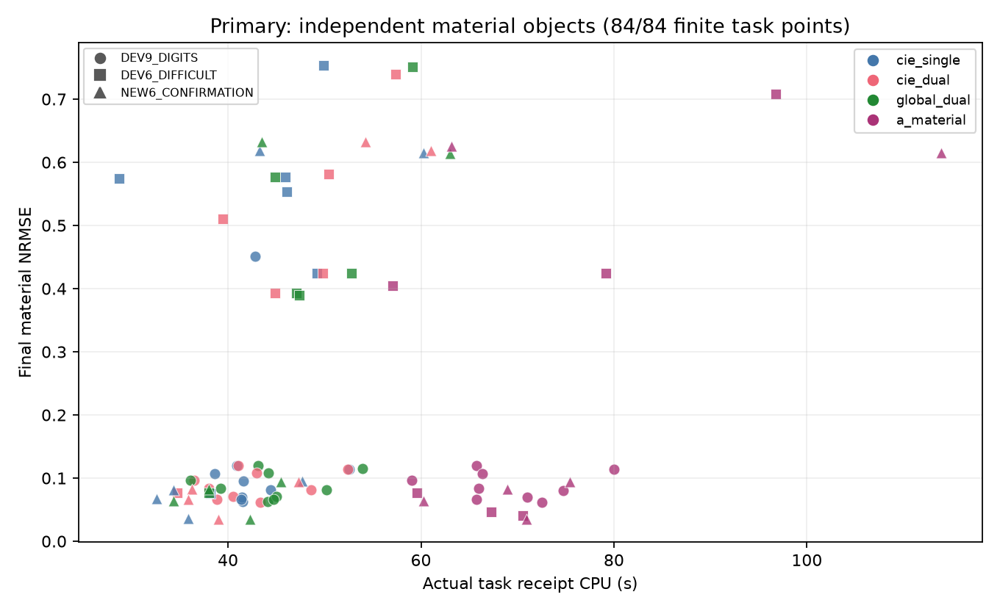
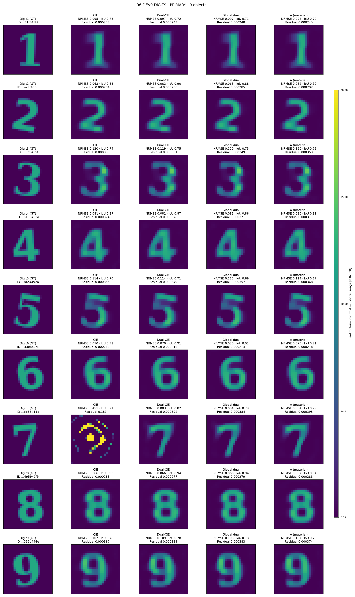

# MAX-STRUCT-R6：A路径扩大对照与FFT-TSOM接入

## 最终判断

**A-material 已成为可运行的 CIE/FFT-TSOM 材料更新插件，能补偿两个历史困难弯条上的失败；目前证据不足以把它作为稳定优于 Dual-CIE 的默认替代算法。** 本轮实际完成21个材料×4方法＝84个主任务，另完成2个预指定材料×2方法＝4个真正FFT工程任务。数字1–9全部纳入；六个新对象由独立端生成，GT保持隔离时冻结求解日程，预测全部封存后才打开GT。实际生成回执早于最终config冻结约5分钟，不声称先冻结config再生成数据；失败与额外成本均保留。

| 分层联合成功 | CIE | Dual-CIE | Global-Dual | A-material |
|---|---:|---:|---:|---:|
| 公开历史数字1–9 | 8/9 | **9/9** | 8/9 | 8/9 |
| 公开历史困难对象 | 1/6 | 1/6 | 1/6 | **3/6** |
| 六个独立新对象 | 4/6 | 4/6 | 4/6 | 4/6 |

联合标志沿用材料NRMSE≤.15、预测自身Otsu IoU≥.7及相应数据/合法性合同；历史clean门与新CN99噪声门分开，不混成同分布成功率。连续指标和所有对象见[完整逐例表](RESULTS/analysis/ALL_CASES.md)。A在数字5的NRMSE=.1142、数据拟合合格，但IoU=.6667，不能把8/9误读为它完全没有成像出数字5；Dual-CIE同例IoU=.7091。普通CIE在数字7则是明显的材料和数据失败。

**可以build upon FFT-TSOM，而且本轮已经实现并跑完。** A的材料读出不依赖显式Fourier矩阵。真实FFT版本替换了U/G及伴随作用，保留非周期自由空间Green、自项、接收和完整Maxwell验收。两例A的总CPU下降约16%和23%，但仍比同FFT的Dual-CIE贵；长轨迹终点有浮点敏感性，不能说仅是完全相同算法轨迹的免费加速。

## 1. 实际改了什么，保留了什么

固定公式是

```text
r = J − mQ,    Q = Einc + GJ,
d = 1 + (β−Gii)m,   u = βr/d,
RA = [I + diag(m/d)Goff]u.
```

Goff是实际Green在预定2×2 cell邻域内的非对角部分。A只用RA作材料块残差；current仍用普通global PR CIE，精确材料导数包括d随m变化的项。R5缓存仅减少重复求值。最终候选全都由完整物理F(m)和共同公开prior评分，不以辅助损失或GT选根。

四臂同24×24网格、576独立实材料未知量、12源48收、box [.02,20]、host .1、原smooth/TV prior；mf3/6/10各500步，再自然续接mf12共1500步。共同原物理corrector最多3000接受迭代，原停止精度不改、没有45秒墙限。CIE为每阶段current/material同β；Dual-CIE为分块β，二者都保留成熟sourcewise PR；Global-Dual用来拆分global PR本身的影响。没有GT字体/support降维或训练。

mf12仍受DPCS affine约束，并非无约束current；同迭代数也不等实际费用。原Phi=.5||F(m)−Y||²/||Y||²+R(m)沿用基线，不冒称σ白化后的Gaussian likelihood；σ用于独立discrepancy。详见[数学推导](THEORY_DERIVATIONS.md)、[基线审查](BASELINE_AUDIT.md)及[冻结协议](BENCHMARK_PROTOCOL.md)。

## 2. 历史困难对象：正面结果确实扩大，但范围有限

以下NRMSE均用公开contrast幅度归一化，数字越小越好。

| 对象 | CIE | Dual-CIE | Global-Dual | A |
|---|---:|---:|---:|---:|
| FBG曲条7b8d | .57618 | .39313 | .39313 | **.04686** |
| R4旧弯条b20d | .55310 | .51072 | .38955 | **.04128** |
| 已公开失败弯条42cb | .75341 | .73918 | .75081 | .70840 |
| 已公开失败弯条63ab | .57463 | .58186 | .57730 | .40475 |
| 环e499 | .42483 | .42478 | .42480 | .42484 |
| 双岛437d | .07595 | .07649 | .07639 | .07641 |

两个成功弯条上，A的原物理相对残差分别为.000154与.000966；Dual-CIE约.112与.101。它们不是仅辅助目标下降，也不是仅材料误差稍小。Global-Dual同样失败，因而global PR本身不能解释这两个正例。**新增的经验认识是：材料块传播的补偿效果可以在第二个公开弯条复现。** 这些都是历史开发对象，不能宣布两次独立盲测突破。

42cb和63ab仍失败；63ab尤其说明指标不可混淆：A的NRMSE下降到.405，但物理残差.1114反而高于Dual-CIE的.0984。环的四种终点几乎一致。故不存在“弯条都受益”或“空腔都失败”的简单形状规则。



## 3. 六个新对象：没有新增确认优势

| 新对象 | CIE NRMSE | Dual-CIE | Global-Dual | A | 四臂结果 |
|---|---:|---:|---:|---:|---|
| 非等三岛 | .09500 | .09376 | .09471 | .09474 | 均合格 |
| 双层空腔 | .08110 | .08272 | .08258 | .08282 | 均合格 |
| 细弯条 | .03627 | .03475 | .03437 | .03532 | 均合格 |
| 偏心薄环 | .61473 | .61841 | .61436 | .61507 | 均失败 |
| 近邻双岛 | .06773 | .06583 | .06434 | .06438 | 均合格 |
| 开缝壳 | .61904 | .63312 | .63310 | .62596 | 均失败 |

新六例中，A对Dual-CIE的NRMSE有3低3高，对Global-Dual只有1低5高；多数差值很小，不能拿全21例13个较低制造统计显著性。新细弯条、双层腔和近邻耦合对象都成功，也反驳仅靠“有曲率/有孔/有强邻域耦合”就预测A优势的解释。



六例为同离散合成数据，噪声为.1%复RMS，非独立网格或实测验证。现在GT随报告公开，后续使用只能标公开回归。新材料、噪声、先验和评分合同见[数据合同](DATA_CONTRACT.md)。

## 4. 失败来自哪里：可行目标见证与停止状态

仅在封存后，用生成端已保存的合法真材料和Yclean计算原Phi，不新增正演、不改候选。偏心薄环的可行Phi为8.70e−6，四臂却停在约4.85e−3；开缝壳的可行Phi为8.55e−6，四臂约3.81e−3至4.07e−3。算法残差分别约为真材料噪声残差的102–103倍、91–94倍。这说明它们**没有到达已存在的低目标可行区**，不能把本次失败直接解释为数据不可辨识；这同样不证明反演唯一。

两者还必须区分：薄环四臂都达到3000 corrector上限，最终投影梯度约2.8e−6至5.9e−6，预算/慢收敛影响仍未排除；开缝壳四臂按投影梯度条件结束，范数约9e−9，是更清楚的差局部驻点证据。全84任务共76个梯度停止、6个迭代上限、2个相对目标变化停止；另外两个上限是历史42cb的Dual/Global，梯度仍为3.84e−6/1.66e−7。不能把所有失败都写成已收敛，也不能把所有失败都归咎预算。

在四个成功新对象上，重建Phi反而略低于真材料Phi：公开平滑prior与噪声使真材料不必是正则化目标极小点。更小Phi不自动意味着更准确GT。原始见证见[离线可行目标诊断](RESULTS/scoring_primary/GT_FEASIBLE_WITNESS.json)。



曲线只连接已付费的host/阶段真实物理验收及corrector点，辅助迭代间没有偷补forward或把代理目标当Phi。CPU曲线与原始CSV也随包保存。

## 5. 真正FFT接入：已运行，成本收益有界

已有NIE/CIE/FFT-TSOM先例不能记为本轮发明。新的工程入口用

```text
UA = Qd IFFT(mask·A),
U*z = mask* FFT(Qd z),
GJ = crop[ padded free-space Toeplitz convolution(J) ].
```

材料读出保持原A公式，因此确实可以在FFT-TSOM上build upon。接收S和最终物理LU仍dense；没有把完整反演标成O(N log N)，也没有把二维FFT堆成三维。接线与浮点边界详见[FFT实现说明](FFT_TSOM_INTEGRATION.md)。

| 预指定对象/方法 | 显式Fourier CPU秒 | FFT CPU秒 | 显式NRMSE→FFT NRMSE | 完整联合结果 |
|---|---:|---:|---:|---|
| 数字1 Dual-CIE | 36.51 | 34.14 | .09656→.09592 | 均合格 |
| 数字1 A | 59.02 | 49.76 | .09598→.09644 | 均合格 |
| 旧b20d Dual-CIE | 39.48 | 38.02 | .51072→.38957 | 均失败 |
| 旧b20d A | 70.58 | 54.44 | .04128→.04049 | 均合格 |

A总CPU分别减少15.7%、22.9%，其辅助阶段分别41.76→35.51秒、53.53→43.97秒。两例FFT的物理LU反而增加，说明总时间节省来自辅助实现等实际差异，不能说所有计算项都减少。Dual-CIE在b20d上的Phi变高而NRMSE变低，再次显示残差与材料质量不同；浮点作用差异可能改变长轨迹，不能用这张图宣称FFT本身提高了信息量。

在同FFT后端中，A仍比Dual-CIE多约46%和43%总CPU。这里只有两例工程比较，没有做大网格复杂度实测或六新对象FFT再确认。NIE原2016全文已取得，但独立成熟NIE重现未完成；故本轮诚实使用已审计的CIE/Dual-CIE主基线，详见[NIE审计](NIE_BASELINE_AUDIT.md)。

## 6. 成本、九数字与完整负结果

| 主臂：21对象 | 总CPU秒 | 辅助CPU秒 | corrector CPU秒 |
|---|---:|---:|---:|
| CIE | 897.22 | 394.98 | 492.12 |
| Dual-CIE | 932.81 | 401.97 | 520.70 |
| Global-Dual | 956.57 | 466.37 | 480.51 |
| A | **1504.32** | **1049.64** | 444.91 |

A物理corrector总费用稍低，但材料内循环开销使整组CPU约为Dual-CIE的1.61倍；没有同实际CPU预算的普遍优势主张。主84任务157418 LU、3773976 complex RHS；四FFT任务6607 LU、158376 RHS。主有限四worker队列两段实际运行历时合计1140.37秒，另有修复间隔41.26秒；FFT队列55.36秒，不能用任务wall之和代替这些并行历时。生成、接线、失败、评分、画图另列[成本账本](COST_LEDGER.md)。



九数字全部图如下，保留CIE的数字7失败以及A/Global的数字5 IoU不足，不只展示成功样本。



## 7. 科学判断与下一步

**有价值的经验结果**：只改变材料块的局部离流形几何，在相同数据、prior和global current控制下，额外恢复两个历史弯条；因此A可以作为有成本的补偿候选。现有数据不支持把它直接设为通用默认，更不支持论文级“稳定击败成熟Dual-CIE”的标题。FFT组合已落地，有两例有限工程收益；这属于实现贡献，不能占用已有FFT-TSOM/NIE的原创性。

**真正值得追的公式问题**仍是材料可解释方向与非局部传播的关系：RA=P(m)r 的精确导数为P dr+(dP)r。R5已排除仅看交叉项符号或H/L²尾就预测成功的简单解释；R6进一步显示相近局部几何可落到同一错误全局结构。局部四cell传播能改搜索路径，却未必能改变跨空腔的全局场模式，这是下一项待验证假说，当前不是定理。

下一轮宜选成功7b8d与失败开缝壳这一对已公开对象，在相同已存状态上比较“材料切向正交补的传播”与“跨腔Green作用”是否产生不同有效材料步，再预注册一项简单修改并用全新材料确认。薄环另作预算/曲率诊断，不能与已近驻点的开缝壳混为同类。先回答这个有区分力的问题，不默认扫β、加NN或再堆更多同类图。

本轮未新增3D成像、Fresnel实测或独立NIE复现；不以空模板伪装完成。R4 B/C的既有否证与边界保留在[R4 A/B/C报告](../research_max_struct_r4/ABC_VALIDATION_ZH.md)，R6只扩展用户指定的A。完整复现见[REPRODUCE](REPRODUCE.md)，独立审查见[audit](audit/INDEPENDENT_METHOD_REVIEW.md)。
