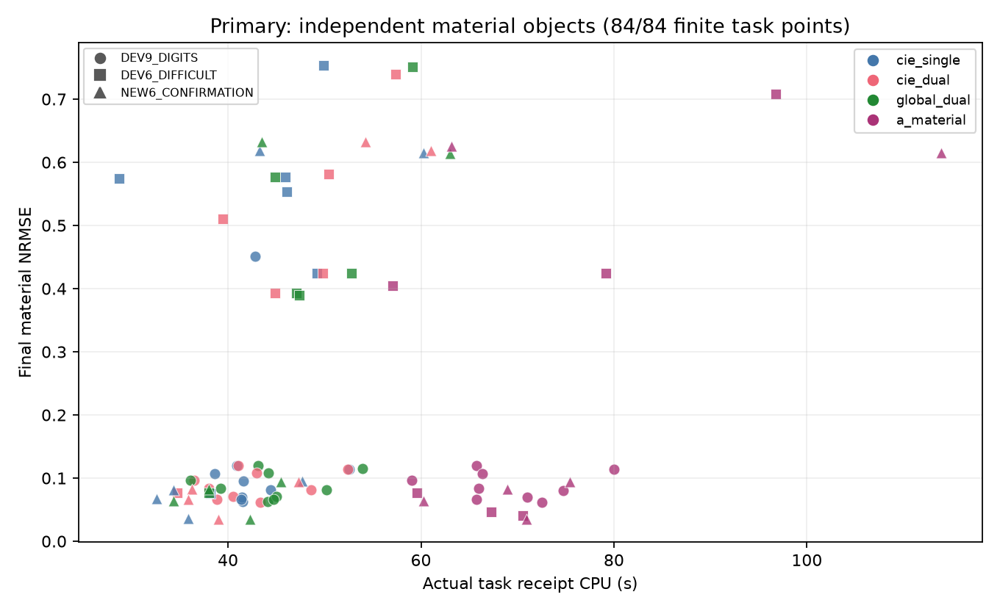
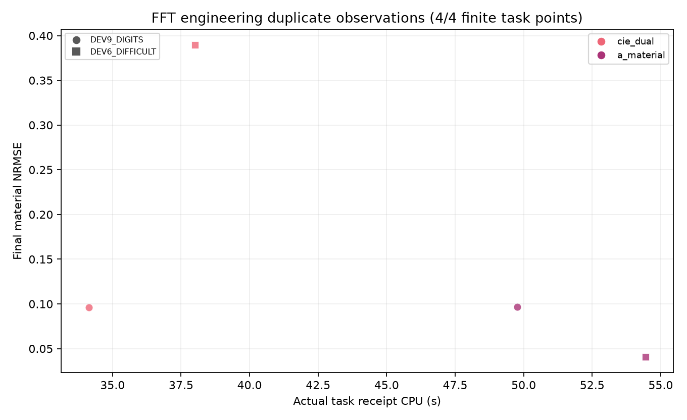
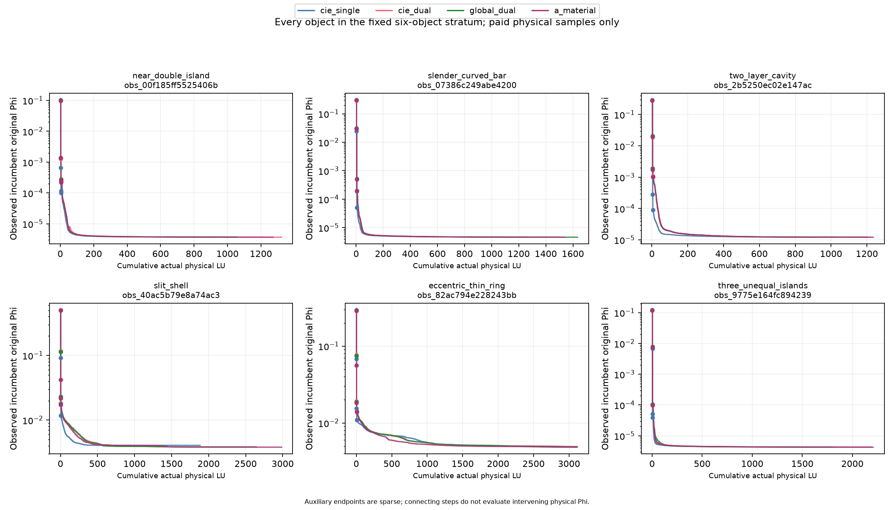
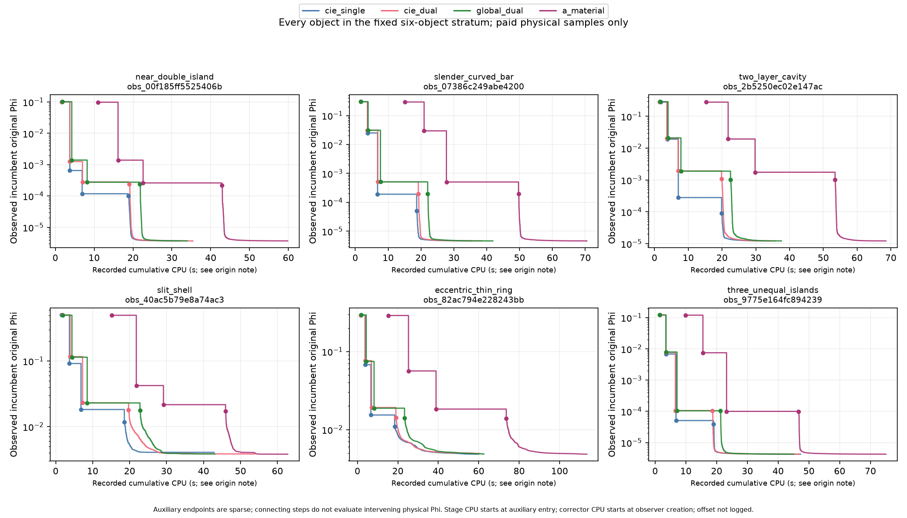

# R6 offline data and cost tables

This artifact reports arithmetic, measured costs and accounting gaps. Scientific interpretation is reserved for the parent review.

## Object and task denominators

| Batch | Unique observed objects | Additional independent objects | Tasks | Workers | Batch elapsed s | Sum task wall s | Sum task CPU s | Physical LU | Complex RHS |
| --- | ---: | ---: | ---: | ---: | ---: | ---: | ---: | ---: | ---: |
| primary | 21 | 21 | 84 | [4] | 1140.4 | 4372.2 | 4290.9 | 1.5742e+05 | 3.774e+06 |
| fft | 2 | 0 | 4 | [4] | 55.36 | 178.88 | 176.36 | 6607 | 1.5838e+05 |

## Charged attempts including preserved failures

| Batch | Final tasks | Extra attempts | All charged attempts | Charged CPU s | Charged task wall s | Charged LU | Charged RHS |
| --- | ---: | ---: | ---: | ---: | ---: | ---: | ---: |
| primary | 84 | 1 | 85 | 4291.3 | 4372.6 | 1.5742e+05 | 3.774e+06 |
| fft | 4 | 0 | 4 | 176.36 | 178.88 | 6607 | 1.5838e+05 |

| Additional attempt | Status | Receipt CPU s | Receipt wall s | Outer process wall s (overlaps) | LU | RHS | Evidence |
| --- | --- | ---: | ---: | ---: | ---: | ---: | --- |
| obs_9775e164fc894239__cie_single | FAILED | 0.37381 | 0.38256 | 0.49768 | 0 | 0 | KNOWN_ZERO_BEFORE_MODEL_CONSTRUCTION |

## Pairwise A material arithmetic

Positive NRMSE delta means baseline NRMSE minus A NRMSE is positive. Missing pairs remain missing.

| Batch | Stratum | Baseline | Paired objects | Known NRMSE pairs | A lower | A higher | Equal | Median NRMSE delta |
| --- | --- | --- | ---: | ---: | ---: | ---: | ---: | ---: |
| primary | ALL | cie_dual | 21 | 21 | 13 | 8 | 0 | 0.00023203 |
| primary | DEV9_DIGITS | cie_dual | 9 | 9 | 5 | 4 | 0 | 9.5593e-05 |
| primary | DEV6_DIFFICULT | cie_dual | 6 | 6 | 5 | 1 | 0 | 0.10394 |
| primary | NEW6_CONFIRMATION | cie_dual | 6 | 6 | 3 | 3 | 0 | 0.00067304 |
| primary | ALL | global_dual | 21 | 21 | 13 | 8 | 0 | 0.00036895 |
| primary | DEV9_DIGITS | global_dual | 9 | 9 | 8 | 1 | 0 | 0.00065562 |
| primary | DEV6_DIFFICULT | global_dual | 6 | 6 | 4 | 2 | 0 | 0.10748 |
| primary | NEW6_CONFIRMATION | global_dual | 6 | 6 | 1 | 5 | 0 | -0.00014434 |
| fft | ALL | cie_dual | 2 | 2 | 1 | 1 | 0 | 0.17428 |
| fft | DEV9_DIGITS | cie_dual | 1 | 1 | 0 | 1 | 0 | -0.00051264 |
| fft | DEV6_DIFFICULT | cie_dual | 1 | 1 | 1 | 0 | 0 | 0.34908 |

## All primary case tasks

| Stratum | Object label | Case | Arm | Status | NRMSE | IoU | Original Phi | CPU s | Wall s | LU | RHS | Joint |
| --- | --- | --- | --- | --- | ---: | ---: | ---: | ---: | ---: | ---: | ---: | --- |
| DEV9_DIGITS | digit1 | obs_b2449bfb61f845bf | cie_single | SEALED_PUBLIC_PREDICTION | 0.094883 | 0.73171 | 3.1037e-06 | 41.615 | 42.258 | 1753 | 42024 | PASS |
| DEV9_DIGITS | digit1 | obs_b2449bfb61f845bf | cie_dual | SEALED_PUBLIC_PREDICTION | 0.096561 | 0.72289 | 3.1108e-06 | 36.512 | 37.038 | 1320 | 31632 | PASS |
| DEV9_DIGITS | digit1 | obs_b2449bfb61f845bf | global_dual | SEALED_PUBLIC_PREDICTION | 0.09694 | 0.71084 | 3.1201e-06 | 36.073 | 36.618 | 1108 | 26544 | PASS |
| DEV9_DIGITS | digit1 | obs_b2449bfb61f845bf | a_material | SEALED_PUBLIC_PREDICTION | 0.095982 | 0.72289 | 3.1127e-06 | 59.019 | 59.823 | 1298 | 31104 | PASS |
| DEV9_DIGITS | digit2 | obs_9cffd133ec9f435d | cie_single | SEALED_PUBLIC_PREDICTION | 0.063012 | 0.88421 | 5.3865e-06 | 41.503 | 42.237 | 1793 | 42984 | PASS |
| DEV9_DIGITS | digit2 | obs_9cffd133ec9f435d | cie_dual | SEALED_PUBLIC_PREDICTION | 0.062206 | 0.90323 | 5.3807e-06 | 43.378 | 43.98 | 1939 | 46488 | PASS |
| DEV9_DIGITS | digit2 | obs_9cffd133ec9f435d | global_dual | SEALED_PUBLIC_PREDICTION | 0.062766 | 0.88421 | 5.3855e-06 | 44.127 | 44.788 | 1816 | 43536 | PASS |
| DEV9_DIGITS | digit2 | obs_9cffd133ec9f435d | a_material | SEALED_PUBLIC_PREDICTION | 0.06211 | 0.90323 | 5.3803e-06 | 72.555 | 74.224 | 2012 | 48240 | PASS |
| DEV9_DIGITS | digit3 | obs_1fec27ea36f6455f | cie_single | SEALED_PUBLIC_PREDICTION | 0.1202 | 0.74038 | 4.8036e-06 | 40.923 | 42.096 | 1538 | 36864 | PASS |
| DEV9_DIGITS | digit3 | obs_1fec27ea36f6455f | cie_dual | SEALED_PUBLIC_PREDICTION | 0.11929 | 0.75 | 4.8054e-06 | 41.047 | 42.062 | 1576 | 37776 | PASS |
| DEV9_DIGITS | digit3 | obs_1fec27ea36f6455f | global_dual | SEALED_PUBLIC_PREDICTION | 0.11991 | 0.75 | 4.8023e-06 | 43.089 | 44.058 | 1522 | 36480 | PASS |
| DEV9_DIGITS | digit3 | obs_1fec27ea36f6455f | a_material | SEALED_PUBLIC_PREDICTION | 0.11954 | 0.75 | 4.8046e-06 | 65.743 | 66.65 | 1484 | 35568 | PASS |
| DEV9_DIGITS | digit4 | obs_ecee0e7c6193402a | cie_single | SEALED_PUBLIC_PREDICTION | 0.081381 | 0.86607 | 4.5622e-06 | 44.407 | 45.038 | 2025 | 48552 | PASS |
| DEV9_DIGITS | digit4 | obs_ecee0e7c6193402a | cie_dual | SEALED_PUBLIC_PREDICTION | 0.081203 | 0.86607 | 4.56e-06 | 48.629 | 49.321 | 2321 | 55656 | PASS |
| DEV9_DIGITS | digit4 | obs_ecee0e7c6193402a | global_dual | SEALED_PUBLIC_PREDICTION | 0.08142 | 0.85841 | 4.5595e-06 | 50.19 | 50.861 | 2190 | 52512 | PASS |
| DEV9_DIGITS | digit4 | obs_ecee0e7c6193402a | a_material | SEALED_PUBLIC_PREDICTION | 0.08041 | 0.88991 | 4.5587e-06 | 74.722 | 75.847 | 2223 | 53304 | PASS |
| DEV9_DIGITS | digit5 | obs_43c2258384c4492a | cie_single | SEALED_PUBLIC_PREDICTION | 0.11443 | 0.7 | 5.0391e-06 | 52.563 | 53.365 | 2508 | 60144 | PASS |
| DEV9_DIGITS | digit5 | obs_43c2258384c4492a | cie_dual | SEALED_PUBLIC_PREDICTION | 0.1141 | 0.70909 | 5.0389e-06 | 52.417 | 53.175 | 2467 | 59160 | PASS |
| DEV9_DIGITS | digit5 | obs_43c2258384c4492a | global_dual | SEALED_PUBLIC_PREDICTION | 0.11491 | 0.69369 | 5.0404e-06 | 53.971 | 54.757 | 2423 | 58104 | FAIL |
| DEV9_DIGITS | digit5 | obs_43c2258384c4492a | a_material | SEALED_PUBLIC_PREDICTION | 0.11418 | 0.66667 | 5.0392e-06 | 79.98 | 81.377 | 2533 | 60744 | FAIL |
| DEV9_DIGITS | digit6 | obs_b4ad35a543e842f4 | cie_single | SEALED_PUBLIC_PREDICTION | 0.07037 | 0.91057 | 6.1114e-06 | 41.418 | 41.903 | 1761 | 42216 | PASS |
| DEV9_DIGITS | digit6 | obs_b4ad35a543e842f4 | cie_dual | SEALED_PUBLIC_PREDICTION | 0.070482 | 0.91129 | 6.112e-06 | 40.548 | 41.032 | 1687 | 40440 | PASS |
| DEV9_DIGITS | digit6 | obs_b4ad35a543e842f4 | global_dual | SEALED_PUBLIC_PREDICTION | 0.070401 | 0.91057 | 6.1118e-06 | 45.056 | 45.663 | 1848 | 44304 | PASS |
| DEV9_DIGITS | digit6 | obs_b4ad35a543e842f4 | a_material | SEALED_PUBLIC_PREDICTION | 0.07025 | 0.91057 | 6.1156e-06 | 71.006 | 72.827 | 1676 | 40176 | PASS |
| DEV9_DIGITS | digit7 | obs_7170e45adb88411c | cie_single | SEALED_PUBLIC_PREDICTION | 0.45147 | 0.21277 | 0.016426 | 42.782 | 43.989 | 1804 | 43248 | FAIL |
| DEV9_DIGITS | digit7 | obs_7170e45adb88411c | cie_dual | SEALED_PUBLIC_PREDICTION | 0.083377 | 0.81579 | 4.0729e-06 | 38.016 | 39.046 | 1351 | 32376 | PASS |
| DEV9_DIGITS | digit7 | obs_7170e45adb88411c | global_dual | SEALED_PUBLIC_PREDICTION | 0.083916 | 0.79487 | 4.074e-06 | 39.198 | 40.317 | 1351 | 32376 | PASS |
| DEV9_DIGITS | digit7 | obs_7170e45adb88411c | a_material | SEALED_PUBLIC_PREDICTION | 0.08372 | 0.79487 | 4.0693e-06 | 65.969 | 67.152 | 1530 | 36672 | PASS |
| DEV9_DIGITS | digit8 | obs_59e18034495941f9 | cie_single | SEALED_PUBLIC_PREDICTION | 0.066299 | 0.93007 | 6.3445e-06 | 41.338 | 42.203 | 1740 | 41712 | PASS |
| DEV9_DIGITS | digit8 | obs_59e18034495941f9 | cie_dual | SEALED_PUBLIC_PREDICTION | 0.066074 | 0.94406 | 6.3476e-06 | 38.859 | 39.413 | 1628 | 39024 | PASS |
| DEV9_DIGITS | digit8 | obs_59e18034495941f9 | global_dual | SEALED_PUBLIC_PREDICTION | 0.06586 | 0.93706 | 6.344e-06 | 44.738 | 45.348 | 1841 | 44136 | PASS |
| DEV9_DIGITS | digit8 | obs_59e18034495941f9 | a_material | SEALED_PUBLIC_PREDICTION | 0.066774 | 0.94406 | 6.353e-06 | 65.76 | 66.701 | 1461 | 35016 | PASS |
| DEV9_DIGITS | digit9 | obs_5a741997052d446e | cie_single | SEALED_PUBLIC_PREDICTION | 0.10657 | 0.77778 | 5.7099e-06 | 38.594 | 39.149 | 1455 | 34872 | PASS |
| DEV9_DIGITS | digit9 | obs_5a741997052d446e | cie_dual | SEALED_PUBLIC_PREDICTION | 0.10855 | 0.78358 | 5.7016e-06 | 42.982 | 43.685 | 1810 | 43392 | PASS |
| DEV9_DIGITS | digit9 | obs_5a741997052d446e | global_dual | SEALED_PUBLIC_PREDICTION | 0.10813 | 0.78358 | 5.7023e-06 | 44.187 | 44.856 | 1740 | 41712 | PASS |
| DEV9_DIGITS | digit9 | obs_5a741997052d446e | a_material | SEALED_PUBLIC_PREDICTION | 0.10746 | 0.78358 | 5.7061e-06 | 66.396 | 67.446 | 1528 | 36624 | PASS |
| DEV6_DIFFICULT | curved_bar | obs_7b8d5df517f1497d | cie_single | SEALED_PUBLIC_PREDICTION | 0.57618 | 0.23404 | 0.0057373 | 45.964 | 46.841 | 2048 | 49104 | FAIL |
| DEV6_DIFFICULT | curved_bar | obs_7b8d5df517f1497d | cie_dual | SEALED_PUBLIC_PREDICTION | 0.39313 | 0.41748 | 0.0062784 | 44.86 | 45.704 | 1913 | 45864 | FAIL |
| DEV6_DIFFICULT | curved_bar | obs_7b8d5df517f1497d | global_dual | SEALED_PUBLIC_PREDICTION | 0.39313 | 0.40777 | 0.0062784 | 47.066 | 47.797 | 2056 | 49296 | FAIL |
| DEV6_DIFFICULT | curved_bar | obs_7b8d5df517f1497d | a_material | SEALED_PUBLIC_PREDICTION | 0.046859 | 0.94382 | 5.8905e-06 | 67.284 | 68.281 | 1378 | 33024 | PASS |
| DEV6_DIFFICULT | obs_42cb233e4f224bb3 | obs_42cb233e4f224bb3 | cie_single | SEALED_PUBLIC_PREDICTION | 0.75341 | 0.18182 | 0.0020966 | 49.885 | 50.828 | 2435 | 58392 | FAIL |
| DEV6_DIFFICULT | obs_42cb233e4f224bb3 | obs_42cb233e4f224bb3 | cie_dual | SEALED_PUBLIC_PREDICTION | 0.73918 | 0.135 | 0.0032159 | 57.351 | 58.304 | 3073 | 73704 | FAIL |
| DEV6_DIFFICULT | obs_42cb233e4f224bb3 | obs_42cb233e4f224bb3 | global_dual | SEALED_PUBLIC_PREDICTION | 0.75081 | 0.12438 | 0.0039588 | 59.14 | 60.084 | 3054 | 73248 | FAIL |
| DEV6_DIFFICULT | obs_42cb233e4f224bb3 | obs_42cb233e4f224bb3 | a_material | SEALED_PUBLIC_PREDICTION | 0.7084 | 0.13158 | 0.0037221 | 96.742 | 98.51 | 2816 | 67536 | FAIL |
| DEV6_DIFFICULT | obs_63abafa750fc483c | obs_63abafa750fc483c | cie_single | SEALED_PUBLIC_PREDICTION | 0.57463 | 0.2695 | 0.0049594 | 28.748 | 29.449 | 748 | 17904 | FAIL |
| DEV6_DIFFICULT | obs_63abafa750fc483c | obs_63abafa750fc483c | cie_dual | SEALED_PUBLIC_PREDICTION | 0.58186 | 0.23611 | 0.0048656 | 50.438 | 51.443 | 2574 | 61728 | FAIL |
| DEV6_DIFFICULT | obs_63abafa750fc483c | obs_63abafa750fc483c | global_dual | SEALED_PUBLIC_PREDICTION | 0.5773 | 0.23776 | 0.0046309 | 44.856 | 45.715 | 2051 | 49176 | FAIL |
| DEV6_DIFFICULT | obs_63abafa750fc483c | obs_63abafa750fc483c | a_material | SEALED_PUBLIC_PREDICTION | 0.40475 | 0.4 | 0.0062239 | 57.062 | 58.039 | 783 | 18744 | FAIL |
| DEV6_DIFFICULT | obs_b20d5a55677d4eca | obs_b20d5a55677d4eca | cie_single | SEALED_PUBLIC_PREDICTION | 0.5531 | 0.25581 | 0.0051511 | 46.063 | 46.646 | 2145 | 51432 | FAIL |
| DEV6_DIFFICULT | obs_b20d5a55677d4eca | obs_b20d5a55677d4eca | cie_dual | SEALED_PUBLIC_PREDICTION | 0.51072 | 0.2562 | 0.0050961 | 39.479 | 40.007 | 1619 | 38796 | FAIL |
| DEV6_DIFFICULT | obs_b20d5a55677d4eca | obs_b20d5a55677d4eca | global_dual | SEALED_PUBLIC_PREDICTION | 0.38955 | 0.42268 | 0.0058324 | 47.401 | 48.276 | 2025 | 48552 | FAIL |
| DEV6_DIFFICULT | obs_b20d5a55677d4eca | obs_b20d5a55677d4eca | a_material | SEALED_PUBLIC_PREDICTION | 0.041275 | 0.94048 | 6.4758e-06 | 70.582 | 71.706 | 1342 | 32160 | PASS |
| DEV6_DIFFICULT | ring | obs_e499ed9660bc47ee | cie_single | SEALED_PUBLIC_PREDICTION | 0.42483 | 0.36885 | 0.014027 | 49.233 | 49.925 | 2315 | 55512 | FAIL |
| DEV6_DIFFICULT | ring | obs_e499ed9660bc47ee | cie_dual | SEALED_PUBLIC_PREDICTION | 0.42478 | 0.36885 | 0.014027 | 49.822 | 50.527 | 2390 | 57312 | FAIL |
| DEV6_DIFFICULT | ring | obs_e499ed9660bc47ee | global_dual | SEALED_PUBLIC_PREDICTION | 0.4248 | 0.36885 | 0.014027 | 52.826 | 53.535 | 2401 | 57576 | FAIL |
| DEV6_DIFFICULT | ring | obs_e499ed9660bc47ee | a_material | SEALED_PUBLIC_PREDICTION | 0.42484 | 0.36885 | 0.014027 | 79.2 | 80.612 | 2516 | 60336 | FAIL |
| DEV6_DIFFICULT | two_islands | obs_437dc8fea8c64a02 | cie_single | SEALED_PUBLIC_PREDICTION | 0.075955 | 0.93056 | 3.3064e-06 | 38.156 | 38.813 | 1494 | 35808 | PASS |
| DEV6_DIFFICULT | two_islands | obs_437dc8fea8c64a02 | cie_dual | SEALED_PUBLIC_PREDICTION | 0.076485 | 0.94366 | 3.3117e-06 | 34.745 | 35.414 | 1220 | 29232 | PASS |
| DEV6_DIFFICULT | two_islands | obs_437dc8fea8c64a02 | global_dual | SEALED_PUBLIC_PREDICTION | 0.076392 | 0.93056 | 3.3082e-06 | 38.047 | 38.697 | 1308 | 31344 | PASS |
| DEV6_DIFFICULT | two_islands | obs_437dc8fea8c64a02 | a_material | SEALED_PUBLIC_PREDICTION | 0.076413 | 0.94366 | 3.3088e-06 | 59.605 | 60.71 | 1339 | 32088 | PASS |
| NEW6_CONFIRMATION | eccentric_thin_ring | obs_82ac794e228243bb | cie_single | SEALED_PUBLIC_PREDICTION | 0.61473 | 0.29319 | 0.0048444 | 60.278 | 61.422 | 3099 | 74328 | FAIL |
| NEW6_CONFIRMATION | eccentric_thin_ring | obs_82ac794e228243bb | cie_dual | SEALED_PUBLIC_PREDICTION | 0.61841 | 0.29319 | 0.0049497 | 61.038 | 62.13 | 3115 | 74712 | FAIL |
| NEW6_CONFIRMATION | eccentric_thin_ring | obs_82ac794e228243bb | global_dual | SEALED_PUBLIC_PREDICTION | 0.61436 | 0.30159 | 0.0048685 | 63.029 | 64.344 | 3120 | 74832 | FAIL |
| NEW6_CONFIRMATION | eccentric_thin_ring | obs_82ac794e228243bb | a_material | SEALED_PUBLIC_PREDICTION | 0.61507 | 0.29167 | 0.0048475 | 113.93 | 116.99 | 3106 | 74496 | FAIL |
| NEW6_CONFIRMATION | near_double_island | obs_00f185ff5525406b | cie_single | SEALED_PUBLIC_PREDICTION | 0.067729 | 0.90909 | 3.6938e-06 | 32.618 | 33.248 | 1060 | 25392 | PASS |
| NEW6_CONFIRMATION | near_double_island | obs_00f185ff5525406b | cie_dual | SEALED_PUBLIC_PREDICTION | 0.065834 | 0.91892 | 3.687e-06 | 35.844 | 36.661 | 1324 | 31728 | PASS |
| NEW6_CONFIRMATION | near_double_island | obs_00f185ff5525406b | global_dual | SEALED_PUBLIC_PREDICTION | 0.064336 | 0.90909 | 3.6988e-06 | 34.363 | 35.11 | 1059 | 25368 | PASS |
| NEW6_CONFIRMATION | near_double_island | obs_00f185ff5525406b | a_material | SEALED_PUBLIC_PREDICTION | 0.064383 | 0.91892 | 3.6898e-06 | 60.272 | 62.427 | 1273 | 30504 | PASS |
| NEW6_CONFIRMATION | slender_curved_bar | obs_07386c249abe4200 | cie_single | SEALED_PUBLIC_PREDICTION | 0.036269 | 0.95312 | 4.6372e-06 | 35.865 | 36.603 | 1260 | 30192 | PASS |
| NEW6_CONFIRMATION | slender_curved_bar | obs_07386c249abe4200 | cie_dual | SEALED_PUBLIC_PREDICTION | 0.034752 | 0.95312 | 4.6344e-06 | 38.975 | 39.891 | 1506 | 36096 | PASS |
| NEW6_CONFIRMATION | slender_curved_bar | obs_07386c249abe4200 | global_dual | SEALED_PUBLIC_PREDICTION | 0.034369 | 0.95312 | 4.6353e-06 | 42.267 | 43.162 | 1634 | 39168 | PASS |
| NEW6_CONFIRMATION | slender_curved_bar | obs_07386c249abe4200 | a_material | SEALED_PUBLIC_PREDICTION | 0.03532 | 0.96825 | 4.6346e-06 | 70.904 | 72.393 | 1540 | 36912 | PASS |
| NEW6_CONFIRMATION | slit_shell | obs_40ac5b79e8a74ac3 | cie_single | SEALED_PUBLIC_PREDICTION | 0.61904 | 0.28261 | 0.0040672 | 43.254 | 44.991 | 1886 | 45216 | FAIL |
| NEW6_CONFIRMATION | slit_shell | obs_40ac5b79e8a74ac3 | cie_dual | SEALED_PUBLIC_PREDICTION | 0.63312 | 0.26486 | 0.0038414 | 54.277 | 56.276 | 2643 | 63384 | FAIL |
| NEW6_CONFIRMATION | slit_shell | obs_40ac5b79e8a74ac3 | global_dual | SEALED_PUBLIC_PREDICTION | 0.6331 | 0.2663 | 0.0038414 | 43.484 | 44.361 | 2646 | 63456 | FAIL |
| NEW6_CONFIRMATION | slit_shell | obs_40ac5b79e8a74ac3 | a_material | SEALED_PUBLIC_PREDICTION | 0.62596 | 0.2766 | 0.0038129 | 63.197 | 64.15 | 2986 | 71616 | FAIL |
| NEW6_CONFIRMATION | three_unequal_islands | obs_9775e164fc894239 | cie_single | SEALED_PUBLIC_PREDICTION | 0.094999 | 0.82609 | 4.2724e-06 | 47.687 | 48.724 | 2209 | 52968 | PASS |
| NEW6_CONFIRMATION | three_unequal_islands | obs_9775e164fc894239 | cie_dual | SEALED_PUBLIC_PREDICTION | 0.093758 | 0.81159 | 4.2726e-06 | 47.341 | 48.355 | 2165 | 51912 | PASS |
| NEW6_CONFIRMATION | three_unequal_islands | obs_9775e164fc894239 | global_dual | SEALED_PUBLIC_PREDICTION | 0.09471 | 0.81159 | 4.2781e-06 | 45.448 | 46.387 | 1800 | 43140 | PASS |
| NEW6_CONFIRMATION | three_unequal_islands | obs_9775e164fc894239 | a_material | SEALED_PUBLIC_PREDICTION | 0.094738 | 0.81159 | 4.2757e-06 | 75.448 | 76.998 | 2195 | 52632 | PASS |
| NEW6_CONFIRMATION | two_layer_cavity | obs_2b5250ec02e147ac | cie_single | SEALED_PUBLIC_PREDICTION | 0.081101 | 0.94382 | 1.2197e-05 | 34.326 | 35.133 | 1028 | 24624 | PASS |
| NEW6_CONFIRMATION | two_layer_cavity | obs_2b5250ec02e147ac | cie_dual | SEALED_PUBLIC_PREDICTION | 0.082716 | 0.94382 | 1.2197e-05 | 36.256 | 37.014 | 1220 | 29232 | PASS |
| NEW6_CONFIRMATION | two_layer_cavity | obs_2b5250ec02e147ac | global_dual | SEALED_PUBLIC_PREDICTION | 0.082579 | 0.94382 | 1.2197e-05 | 38.013 | 38.863 | 1205 | 28872 | PASS |
| NEW6_CONFIRMATION | two_layer_cavity | obs_2b5250ec02e147ac | a_material | SEALED_PUBLIC_PREDICTION | 0.082821 | 0.94382 | 1.2195e-05 | 68.947 | 70.424 | 1236 | 29616 | PASS |

## All fft case tasks

| Stratum | Object label | Case | Arm | Status | NRMSE | IoU | Original Phi | CPU s | Wall s | LU | RHS | Joint |
| --- | --- | --- | --- | --- | ---: | ---: | ---: | ---: | ---: | ---: | ---: | --- |
| DEV9_DIGITS | digit1 | obs_b2449bfb61f845bf | cie_dual | SEALED_PUBLIC_PREDICTION | 0.095924 | 0.73171 | 3.1065e-06 | 34.139 | 34.588 | 1493 | 35784 | PASS |
| DEV9_DIGITS | digit1 | obs_b2449bfb61f845bf | a_material | SEALED_PUBLIC_PREDICTION | 0.096437 | 0.73171 | 3.1068e-06 | 49.758 | 50.51 | 1730 | 41472 | PASS |
| DEV6_DIFFICULT | obs_b20d5a55677d4eca | obs_b20d5a55677d4eca | cie_dual | SEALED_PUBLIC_PREDICTION | 0.38957 | 0.42268 | 0.0058324 | 38.016 | 38.491 | 1974 | 47328 | FAIL |
| DEV6_DIFFICULT | obs_b20d5a55677d4eca | obs_b20d5a55677d4eca | a_material | SEALED_PUBLIC_PREDICTION | 0.040494 | 0.95181 | 6.4736e-06 | 54.444 | 55.297 | 1410 | 33792 | PASS |

## Accounting notes

- Each unique manifest task receipt is counted once. Scoring rows are not a second cost source.
- Preserved additional failed attempts are charged separately and never add material objects or final benchmark tasks. Outer queue process-wall measurements overlap each attempt receipt wall and are not added to it.
- Task CPU/wall totals are the original receipt scope, not OS-measured whole-process usage.
- Auxiliary and corrector timers are successive disjoint solver phases. Their sum excludes setup, interphase serialization and other receipt overhead.
- Other time = task total - auxiliary - corrector; it is not an independently measured timer and may be null or show small negative roundoff/coverage differences.
- Setup is inside task total and other time. Physics sub-operation timers and execution-receipt timers are nested; never add them to task or phase timers.
- Physical LU/RHS totals come only from physical_model_cost. Auxiliary operation counts and corrector evaluations are different quantities and are never added to LU/RHS.
- Four-worker queue elapsed is elapsed batch time; summed task wall is overlapping process time and is not batch elapsed. Their ratio is descriptive overlap only.
- Primary unique material object counts are independent-object denominators. Repeated arms, source columns and FFT duplicates add no independent material objects.
- Arm/stratum object counts are overlapping group denominators, not additive independent-object counts.
- All failed tasks stay in manifest denominators. Missing metrics/timers remain null and are not imputed as zeros, losses or successes.
- Material NRMSE comes only from the independent final score file. No intermediate material truth metrics are calculated.
- Original-Phi curves contain only already charged host/stage physical validations and corrector evaluations. Auxiliary per-iteration proxy objectives are not original Phi.
- Curve CPU is directly recorded: stage sidecars use auxiliary-start CPU; corrector evaluation history uses observer-creation CPU. The short intervening clock-origin offset was not logged, is not inferred, and is flagged in curve accounting.
- Sparse auxiliary physical endpoints do not establish a physical objective at every intermediate auxiliary update. Lines/steps only connect observed incumbents.
- No scientific conclusion or claim acceptance is supplied by this arithmetic/plotting script.

## Figures

