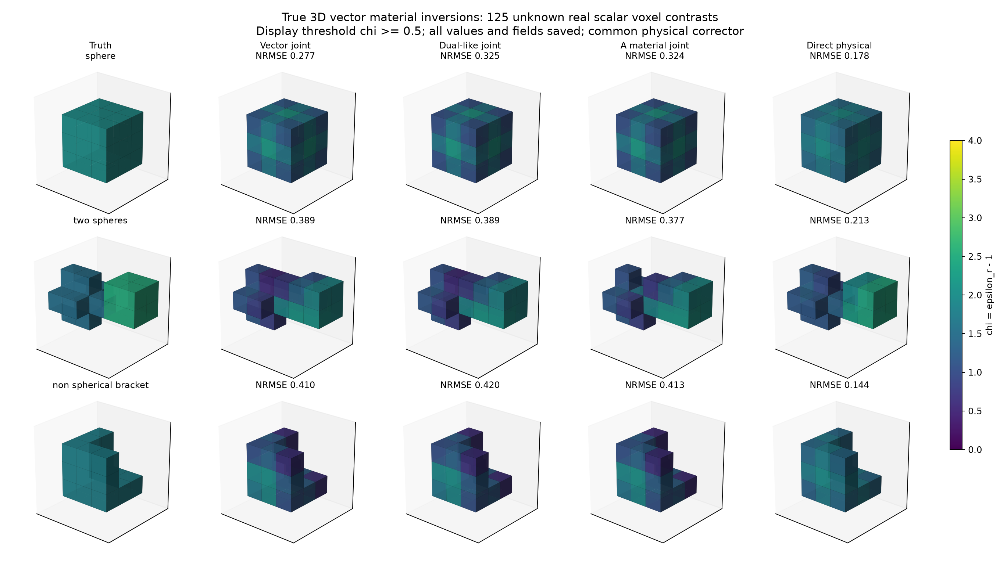
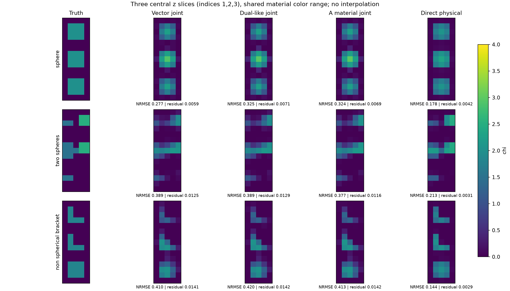
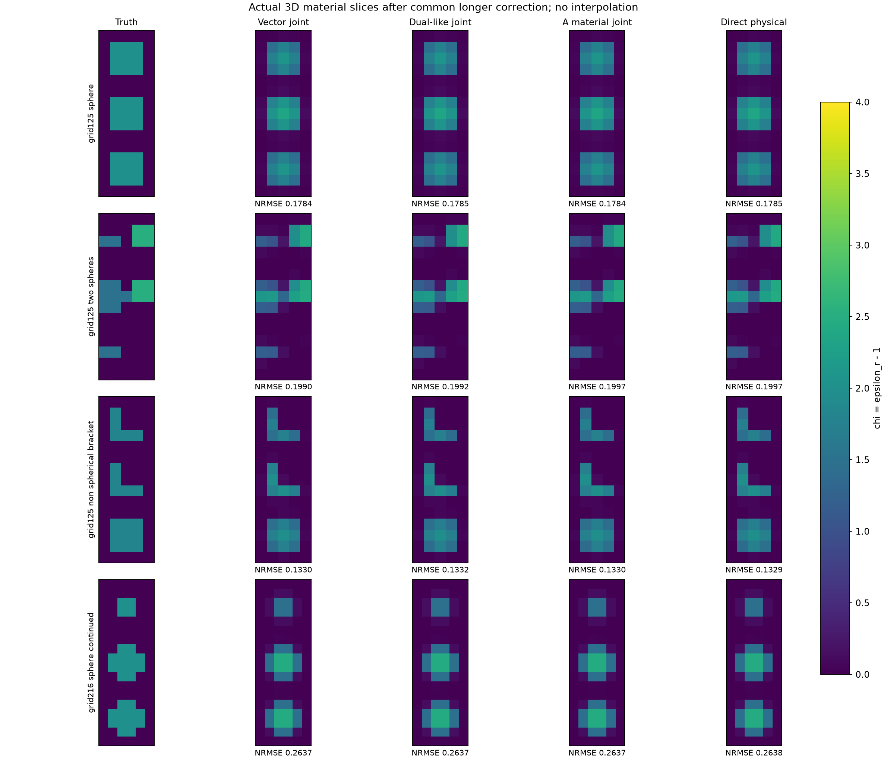
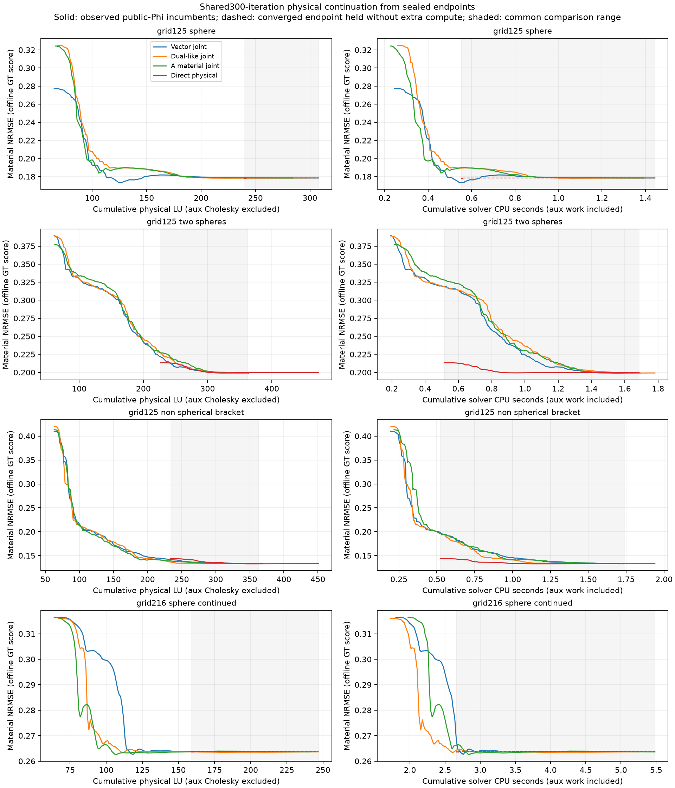
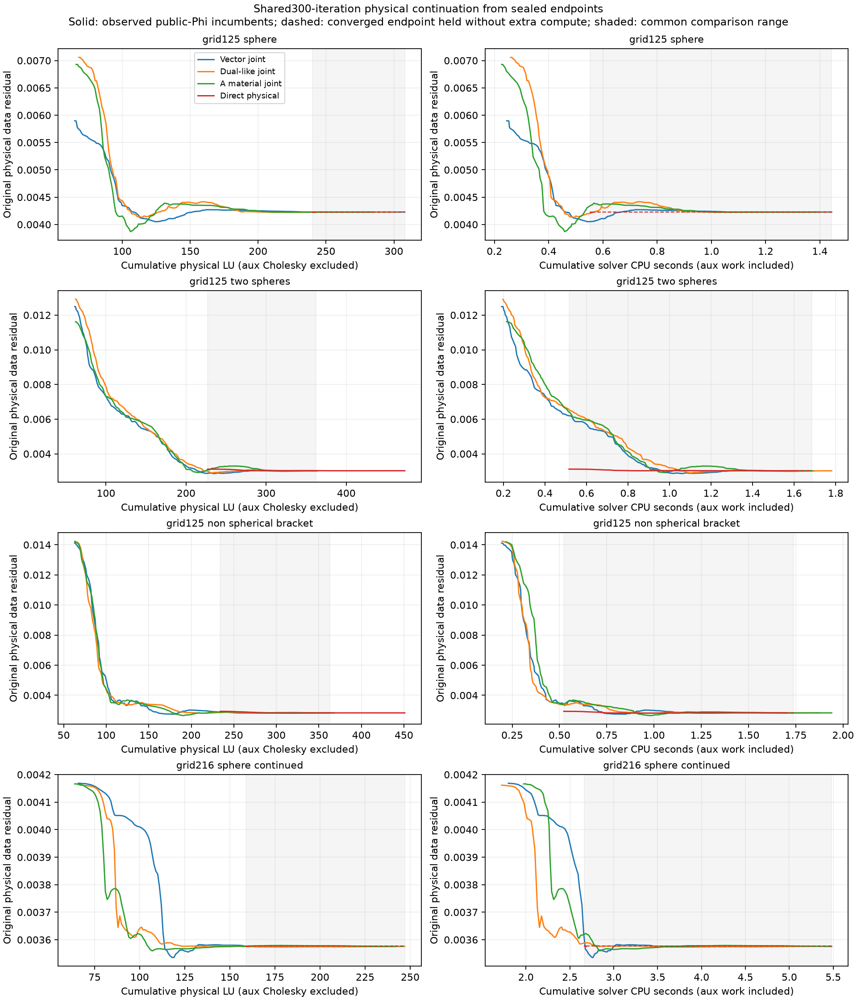

# R7: actual small 3D vector material imaging benchmark

**Status: COMPLETED: initial 12 reconstructions,216-DOF sphere 4 reconstructions, and 16 common long physical continuations.** The initially large direct-versus-joint recovery gaps mostly disappear after longer shared physical correction. All four methods approach the same regularized material solution in each tested problem; A has no durable 3D basin or recovery advantage here. This is bounded finite-DDA development evidence, not continuum imaging accuracy, blind recovery, uniqueness, or a mature vector CIE implementation. The initial 12 results and all costs remain archived below.

## Physical model and independent qualification

The inherited R1 `TensorDDA` is reused without alteration. For real χ≥0 its CM+RR polarizability obeys Im α=(k³/(6π))|α|², the lossless dipole radiation balance; no material gain is introduced. It uses the **full 3D electric dyadic Green**, including its longitudinal near-field term, for exp(−iωt), λ₀=Z₀=ε_b=μ_b=1 and k=2π. Every cell has three electric field/current components. Integrated cubic self blocks are `s I₃`, where `s=−1/3+i k³V/(6π)`. There are 125 independently unknown **real isotropic** material contrasts χ_i=ε_ri−1, not 125 scalar-TM fields. Passive lossless materials have ε_r in [1,5]; radiation reaction remains in s. μ_r=1. No anisotropic or absorbing material recovery is claimed.

With density current j=χE and dipole p=Vj, eliminating the Lorentz self gives the CM+RR polarizability `α(χ)=Vχ/(1−sχ)`. This is nonlinear in material; we optimize χ throughout and include its exact chain effect through the self-inclusive field equation. An independently assembled polarizability-coordinate solve agrees with density-coordinate p to **1.50e−15 relative error**. It uses one additional 375×375 LU and six complex RHS beyond the adapter-counted qualification calls.

Independent analytic Mie sphere verification is **reused**, not repeated: unchanged R1 radius .12λ, ε_r=3, h=.04/.03λ, N=123/257. Absolute far-vector relative errors decrease from **10.47% to 3.66%**, and scattering cross-section relative errors from **21.81% to 5.99%**. This is a bounded DDA qualification, not an H(curl) or continuum certificate. The present imaging cube has **h=.08λ**, coarser than that sphere check, so no quantitative continuum imaging claim follows. Exact source/receiver DDA data are used below; discretization error cancels in these development reconstructions. See [qualification and inherited receipt](RESULTS/vector_3d/QUALIFICATION.json).

The physical adjoint directional derivative relative error is **3.32e−9**. A later necessary off-root check has nonzero relative constitutive residual .2048 and tests the complete material-dependent A derivative (including dP/dχ): ordinary **3.95e−11**, Dual-like **2.21e−8**, A **8.68e−9**. The initial constitutive-root check is retained; it mainly tested the prior and was insufficient on its own. See [off-root receipt](RESULTS/vector_3d/NONROOT_DERIVATIVES.json). Both checks cost 5 physical LU/30 source RHS/18 adjoint RHS in the adapter, plus the separate CM-coordinate LU/6 RHS and 18 material calls. No formula sweep or error-floor study was run.

## Frozen experiment and methods

A 5×5×5 cube has center spacing .08λ, 125 material DOFs and a **375-dimensional vector Maxwell system**. There are six distinct transverse plane-wave illuminations from ±x, ±y, ±z, with declared polarizations and 30 external receiver points on radius .8λ measuring all three scattered electric components: 540 complex observations. The three nontrivial dev targets are a staircase sphere, unequal two spheres, and a non-spherical three-arm bracket. All use the same box χ∈[0,4], uniform χ=.25 initialization, quadratic nearest-neighbor smoothing λ=2e−4 and l₂=1e−6, source normalization, and common physical corrector (L-BFGS-B maximum 40 iterations). The complete config was written before execution. No target-specific tuning, noise, extra starts, GT-based selection, or support information enters a solver.

The three joint controls share a current update that exactly minimizes the same ordinary data/state quadratic by one complex Hermitian Cholesky factorization with all six source RHS. At each of 15 fixed cycles the material block uses maximum 12 L-BFGS-B iterations. For `Q=Einc+Gj`, `r=j−χQ`, `b=β−s`, `d=1+bχ`, `a=χ/d`, β=1:

- **ordinary_joint:** material state residual r; labeled *vector-adapted joint baseline*, not mature 2D global CIE.
- **dual_like_joint:** material residual `u=βr/d`; this is a local resolvent control, not a faithful implementation of a named historical Dual algorithm.
- **A_material_joint:** material residual `(I+D_a H)u`. H retains actual full 3×3 dyadic off-diagonal blocks inside disjoint 2×2×2 voxel blocks and has zero 3×3 self blocks. Each scalar isotropic a_i multiplies its three-vector block. This correctly retains self via d and cross-polarization via H; it does not extend the scalar arc solver to tensor-valued material.
- **direct_physical:** exact self-inclusive Maxwell adjoint L-BFGS-B, maximum 180 iterations before the same 40-iteration corrector.

Every candidate selection uses the original physical data objective plus the identical prior. The direct-control iteration cap is comparable to the maximum 15×12 material iterations but **not equal physical LU, wall time, or linear algebra work**. Candidate predictions are saved before the scoring file is loaded; GT is used only after all four methods for a target have sealed predictions. The three targets are disclosed development objects, not blind holdouts. The common corrector may substantially improve the weak raw joint candidates; raw scores are explicitly retained.

## Initial12 reconstruction results (preserved; longer correction below)

Material NRMSE is `||χhat−χGT||₂/||χGT||₂`; residual is `||S j(χhat)−Y||F/||Y||F`. Lower is better. Raw means public-physical-selected candidate before the shared corrector. The arrays include all 125 material values plus full vector fields/current, not just a chosen voxel or illustrative plot.

|Target|Method|Raw NRMSE|Final NRMSE|Physical residual|Wall s|Physical LU|Source RHS|Adjoint RHS|Aux Cholesky|Material calls|
|---|---|---:|---:|---:|---:|---:|---:|---:|---:|---:|
|sphere|ordinary_joint|0.7525|0.2775|0.00590|0.244|64|384|270|15|76|
|sphere|dual_like_joint|0.7558|0.3252|0.00706|0.260|67|402|288|15|134|
|sphere|A_material_joint|0.7518|0.3243|0.00693|0.224|65|390|276|15|138|
|sphere|direct_physical|0.1782|0.1785|0.00423|0.557|239|1434|1410|0|0|
|two_spheres|ordinary_joint|0.7977|0.3892|0.01249|0.191|60|360|246|15|92|
|two_spheres|dual_like_joint|0.8006|0.3890|0.01291|0.195|61|366|252|15|164|
|two_spheres|A_material_joint|0.8033|0.3773|0.01162|0.215|61|366|252|15|156|
|two_spheres|direct_physical|0.2187|0.2134|0.00312|0.517|226|1356|1332|0|0|
|non_spherical_bracket|ordinary_joint|0.8075|0.4100|0.01411|0.194|62|372|258|15|78|
|non_spherical_bracket|dual_like_joint|0.8102|0.4200|0.01423|0.190|62|372|258|15|144|
|non_spherical_bracket|A_material_joint|0.8081|0.4133|0.01420|0.218|62|372|258|15|144|
|non_spherical_bracket|direct_physical|0.1467|0.1436|0.00293|0.526|233|1398|1374|0|0|





## Costs, failures, and scope

The complete sequential benchmark took **3.607 s wall / 3.556 s CPU**, with **102,449,152 bytes peak process RSS** (macOS ru_maxrss; benchmark process including setup/qualification; per-method peaks NOT_MEASURED). Setup cost was .0150 s wall / .0142 s CPU, one dyadic Green assembly and one external-receiver assembly. Each joint method/target uses 15 auxiliary Cholesky factorizations and 90 current RHS, in addition to its listed physical costs. The three public-data simulation calls cost 3 physical LU and 18 source RHS. The necessary later nonroot check costs .0175 s wall and is separate from the 3.607-s benchmark timing. Figure/report generation is not included in solver timing.

No failed physical or optimization calls occurred. Optimizer cap exits are preserved verbatim in per-method receipts and are **not convergence certificates**. No GPU work, GT-based online choice, repeated Mie runs, mesh sweeps, external training, or model-specific parameter scans occurred. Peak hardware telemetry beyond process RSS was NOT_MEASURED. No 3D finite-element/H(curl) continuum acceptance or independent discretization inverse test was performed.

The decisive evidence is modest: full vector 3D inversion runs, valid exact derivatives and honest physical forward validation provenance now exist; **A material recovery superiority does not survive this three-object test consistently**. Fine-grained baseline maturity and unequal physical compute restrict any ranking. These results cannot be rebranded as scalar-TM theorem validation, generic material uniqueness, or a broadly superior 3D method.

## Reproduction and artifact inventory

Run from repository root with `OPENBLAS_NUM_THREADS=1 OMP_NUM_THREADS=1` and the project Python:

```sh
python research/research_max_struct_r7/experiments/vector_3d_reconstruct.py
python research/research_max_struct_r7/experiments/vector_derivative_nonroot.py
python research/research_max_struct_r7/experiments/vector_plot_report.py
```

The reconstruction runner refuses to overwrite a completed benchmark. Preserve/archive the original result folder before a deliberate reproduction. Each target directory contains `public_observations.npz`, scorer-only `truth_for_scoring.npz`, four `*_prediction.npz` files (initial/raw/final materials, j,E), and four `*_receipt.json` files. Shared config, qualification, simulation costs, scores, completion/memory receipt and off-root derivative receipt are under [RESULTS/vector_3d](RESULTS/vector_3d/). Source is [vector_inverse.py](src/vector_inverse.py); execution log is [delegated/vector/run.log](delegated/vector/run.log).

## Shared longer physical correction and necessary 216-DOF case

The initial 12 were retained intact. At the reviewer's request, **each of the four sealed final endpoints** received the same additional physical L-BFGS-B allowance: maximum 300 iterations, ftol 1e−13, gtol 1e−9, same material box and prior. No auxiliary objective was used in this continuation; every source/adjoint solve used the original complete Maxwell model. The public physicalPhi incumbent determines every selection. Trial material arrays, physical costs, and CPU times were sealed before their entire curves were scored offline against truth.

One additional sphere uses a 6×6×6 grid (**216 material DOFs,648 vector components**) with the same physical cube width .4λ, h=.4/6, same sources, receivers, initialization, priors, box, original iteration caps and common correction. No geometry or prior scan was done. It is a same-grid synthetic development inversion; it is not an independent-discretization inverse validation.

|Case|Method|Before long correction NRMSE|After long correction NRMSE|Physical residual|Total physical LU|Aux Cholesky|Total solver CPU s|Stop|
|---|---|---:|---:|---:|---:|---:|---:|---|
|grid125_sphere|ordinary_joint|0.27749|0.17845|0.004228|309|15|1.450|optimizer tolerance|
|grid125_sphere|dual_like_joint|0.32521|0.17846|0.004228|300|15|1.400|optimizer tolerance|
|grid125_sphere|A_material_joint|0.32429|0.17844|0.004227|285|15|1.395|optimizer tolerance|
|grid125_sphere|direct_physical|0.17849|0.17849|0.004229|242|0|0.564|optimizer tolerance|
|grid125_two_spheres|ordinary_joint|0.38921|0.19900|0.003016|365|15|1.698|cap300|
|grid125_two_spheres|dual_like_joint|0.38897|0.19916|0.003022|363|15|1.788|cap300|
|grid125_two_spheres|A_material_joint|0.37726|0.19965|0.003025|366|15|1.692|cap300|
|grid125_two_spheres|direct_physical|0.21344|0.19968|0.003026|474|0|1.613|optimizer tolerance|
|grid125_non_spherical_bracket|ordinary_joint|0.41000|0.13305|0.002830|369|15|1.744|cap300|
|grid125_non_spherical_bracket|dual_like_joint|0.41998|0.13316|0.002833|365|15|1.879|cap300|
|grid125_non_spherical_bracket|A_material_joint|0.41328|0.13300|0.002832|364|15|1.945|cap300|
|grid125_non_spherical_bracket|direct_physical|0.14362|0.13291|0.002831|452|0|1.704|optimizer tolerance|
|grid216_sphere_continued|ordinary_joint|0.31650|0.26365|0.003576|230|15|4.822|optimizer tolerance|
|grid216_sphere_continued|dual_like_joint|0.31606|0.26367|0.003576|248|15|5.283|optimizer tolerance|
|grid216_sphere_continued|A_material_joint|0.31646|0.26365|0.003576|242|15|5.498|optimizer tolerance|
|grid216_sphere_continued|direct_physical|0.26375|0.26375|0.003577|161|0|2.696|optimizer tolerance|

The sphere solutions agree in NRMSE to roughly5e−5 across methods at 125 DOF and 1e−4 at 216 DOF. Two-sphere/bracket joint continuations reach the300 cap, while direct reaches its numerical tolerance; their remaining differences are small, and **not a proof of identical mathematical minima or full convergence**. There is no robust A recovery advantage. The initial direct-control ranking largely reflected the limited 40-step corrector on joint endpoints.



### Equal-cost curves

These plots show public-physicalPhi incumbents versus **cumulative physical LU** and cumulative actual solver CPU. Truth is used only to score the sealed curves. LU excludes the15 auxiliary Cholesky factorizations of each joint baseline; CPU includes auxiliary work and measured overhead. Dashed horizontal lines only retain an already-converged endpoint without inventing additional computation. Capped endpoints are not extended. Grey regions mark the ranges where all methods have observations or a converged endpoint. The initial-stage trajectories were not stored, so the comparison ranges start only after every method's continuation has begun. This prevents a claim about earlier equal-cost performance.





Three matched budgets inside each common range, for both cost axes, are saved in [MATCHED_COST_SCORES.json](RESULTS/vector_continuation/MATCHED_COST_SCORES.json). Selecting by public physicalPhi can worsen material NRMSE slightly; the truth score is never used to choose an iterate.

### Actual-grid independent Mie validation and one geometry correction

The new check uses the actual 125/216 grids, radius .145λ and ε_r=3, with exact analytic Mie far vectors. Binary center-occupancy has 27 occupied cells at 125 DOF (a3³ staircase cube), 32 at 216 DOF. Occupied volume changes from .013824 to .0094815 versus analytic .0127701. Far-vector relative error **6.584%→27.588%**: **FAIL for monotone refinement**. Both original errors and arrays are retained in [MIE_ACTUAL_GRIDS.json](RESULTS/vector_continuation/MIE_ACTUAL_GRIDS.json). A small linear residual does not erase this physical geometry error.

A single physically motivated correction was authorized **for forward validation only**: a fixed 24³ midpoint subcell rule estimates sphere volume fraction in every cell on both grids; isotropic volume-averaged contrast is χ_i=f_i(3−1). This is an interface/pulse approximation, not exact cut-cell Maxwell homogenization. There was no geometry sweep, subcell-resolution search, fitted parameter, or inverse support reduction. Effective volumes become .0127639/.0127788, and Mie far errors become **8.396%→8.199%**. The marginal decrease confirms that geometry aliasing contributes substantially; the remaining≈8% error prevents a strong continuum qualification. Neither inversion data nor inverse unknowns were altered. See [fractional validation receipt](RESULTS/vector_fractional_validation/RECEIPT.json).

### Additional costs and retained limits

The continuation/216/Mie-actual-grid process took **36.444 s wall /34.375 s CPU**, with 161,185,792bytes process peak RSS. It includes four original 216-grid reconstructions,16 continuations, two binary-sphere Mie forward solves, setup and scoring; plot generation is excluded. The separate fixed-fraction geometry check took **.2230 s wall /.2185 s CPU**, with 268,042,240bytes peak RSS including its subcell temporary array; it used two physical LU and 12 source RHS. These are separate process peaks, not summed memory. All physical costs, trial arrays and stop messages are retained; there were no failed calls, and capped exits remain visible.

Reproduce the added work, after preserving the archived outputs:

```sh
python research/research_max_struct_r7/experiments/vector_continuation.py
python research/research_max_struct_r7/experiments/vector_fractional_sphere_validation.py
python research/research_max_struct_r7/experiments/vector_plot_continuation.py
```

**Final 3D scope:** actual 125- and 216-DOF vector material inversions are implemented and measured. Exact material-dependent A derivatives are supported. A did not establish durable recovery or basin superiority; longer physical optimization largely removes the early differences. Physical sphere accuracy is quantitatively bounded and geometry-sensitive. No continuum-qualified 3D advantage is claimed.
