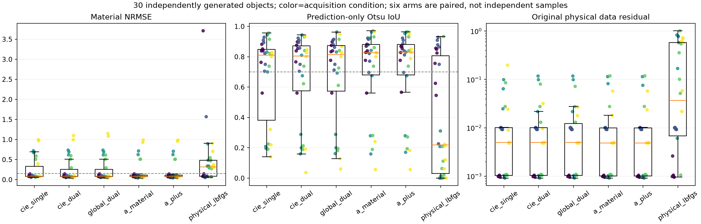
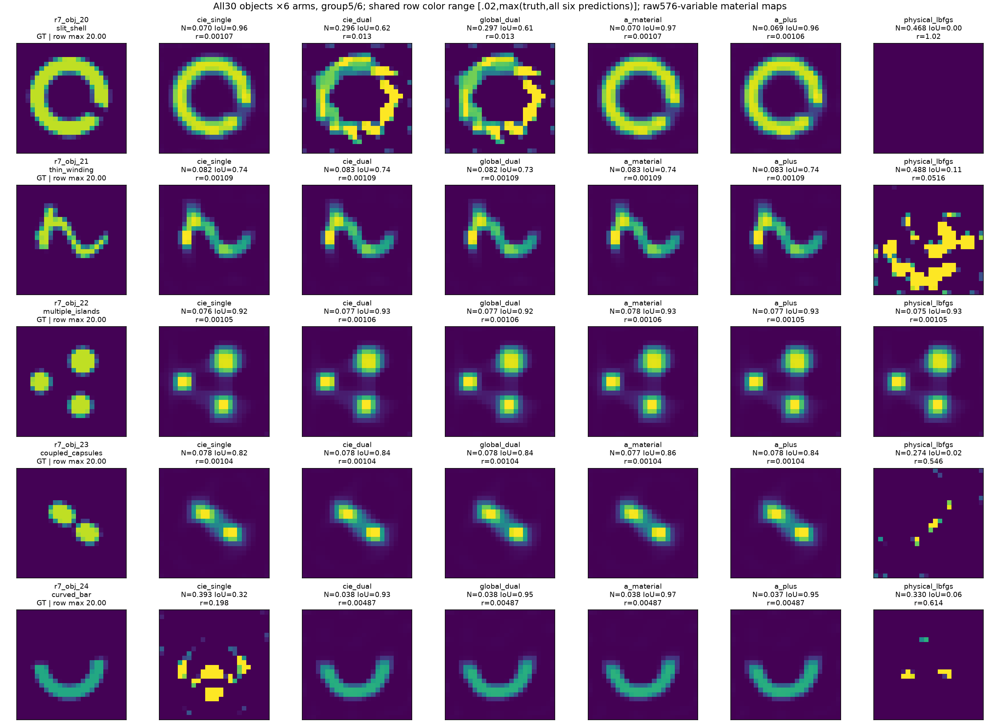
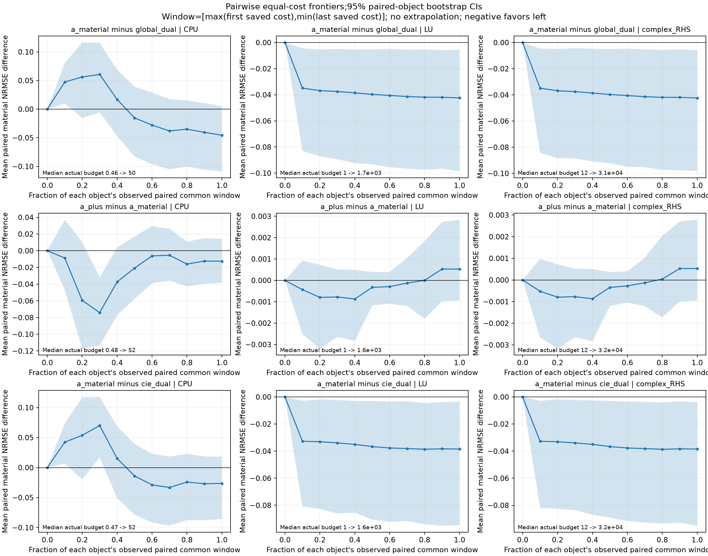
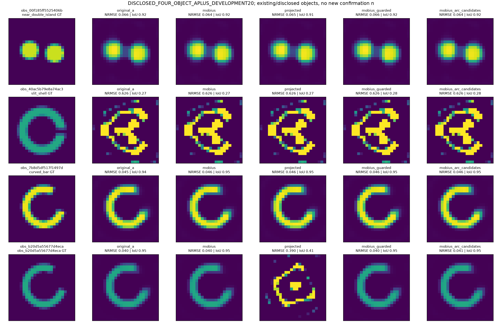
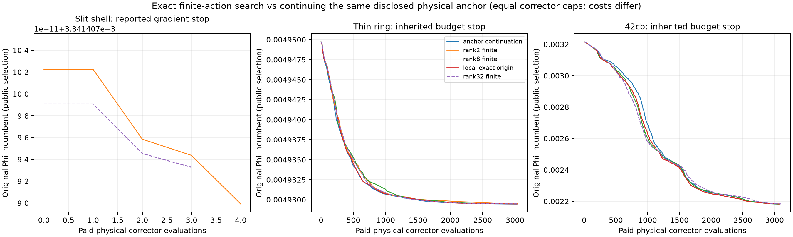
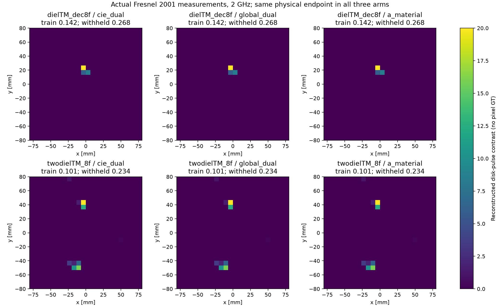
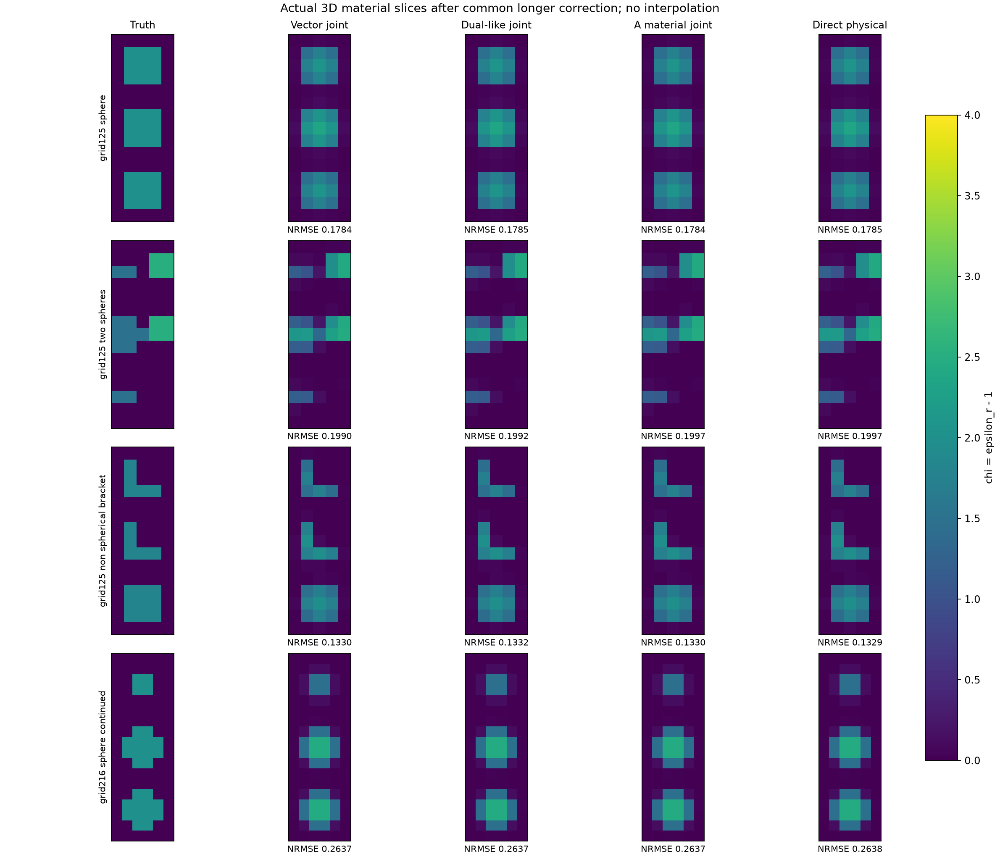
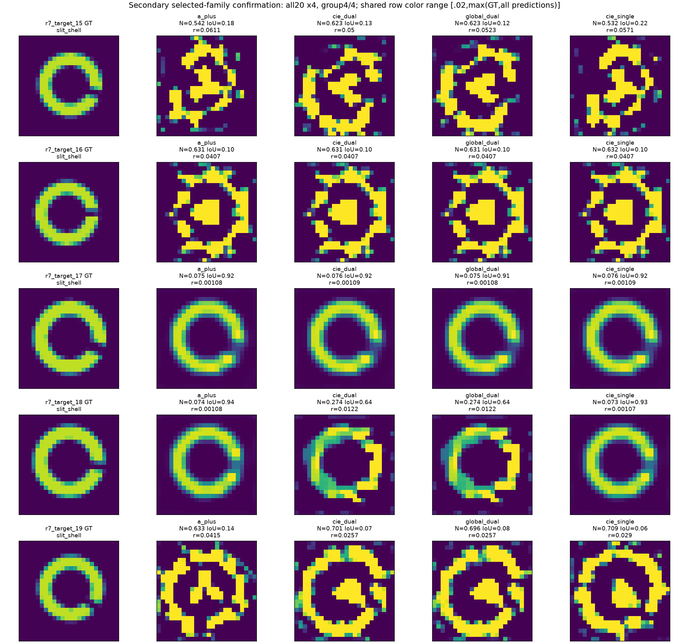

# MAX-STRUCT-R7：低成本A+、有理材料动作与论文资格

## 最终判断

本轮已得到一个有实际计算收益的简单算法：**A+用Möbius状态项的二次驻点候选，加原先验的MM接受，替代昂贵的材料非线性读出。** 新30个材料上，原A和A+成功对象完全相同（21/30），A+总CPU降低约31.4%；相对成熟Dual-CIE仍多约11.2%CPU。A/A+在两个新对象上显著改善Dual/Global失败，平均NRMSE有改善证据；成功率的普遍提升尚未成立。

**精确有理搜索没有在所测真实失败锚点提供独有的跨盆地能力。** 实测与小型3D反演已实际完成，均没有建立A的可重复优势；3D连续物理精度和Fresnel天线校准仍有明确缺口。论文应围绕低成本条件读出、适用范围和反例，不应包装成“极点学习解决全局Maxwell反演”的统一框架。

追加的20个选定家族新材料中，A+为12/20、Dual/Global各9/20、single8/20；曲条有重复收益，开缝壳仍失败居多，且壳体成功可由single解释。

所有新代码、原始结果、失败、图、成本、证明、论文初稿与复现入口独立保存；R1–R6未改写。全部算法用同一公开数据和原物理Phi选候选，GT只在预测封存后评分。输入ZIP的算法建议只作为待审查材料，没有当作已运行证据或额外执行授权。

## 1. 实际完成与分母

30个独立材料×6方法=180个主反演，追加后选家族20个新材料×4方法=80个确认反演；另有6个相同对象×3方法的初始值对照18run、九数字A+回归9run、四披露对象×5readout的完整开发20run。30是独立材料簇，不把照明、迭代态或重复初始值当新材料。

24个新对象同网格生成/反演；6个36网格生成、24网格反演，仍使用同一disk-pulse物理族。六形状各五个独立几何实现，五条件捆绑contrast/噪声/源数/孔径/网格；没有单因素因果设计。数据/先验/噪声约定见[BENCHMARKS](BENCHMARKS.md)。基线、原A先冻结；A+只用四个旧对象开发并在新对象A+反演前冻结，生成早于最终A+选择，未声称全算法冻结后才生成数据。

三个公开失败锚点各做rank2/rank8搜索、原点局部对照和相同corrector续跑，另做一次rank32结构修正；两个真实Fresnel对象×3方法=6个实际实测反演；真实3D完成125/216材料DOF、375/648矢量系统的16个初始反演和16个长校正结果。它们不混入30个二维材料的统计分母。

## 2. 新30对象：完整强基线比较

|方法|材料成功/30|同网格材料+CN99 /24|中位NRMSE|总CPU秒|LU|复RHS|
|---|---:|---:|---:|---:|---:|---:|
|成熟CIE|21/30|15/24|0.08722|1543.60|54873|1154196|
|成熟Dual-CIE|20/30|14/24|0.08584|1539.15|53408|1137060|
|Global-Dual|20/30|14/24|0.08653|1512.97|53923|1137684|
|原A-material|21/30|14/24|0.08177|2495.14|54384|1148820|
|A+|21/30|14/24|0.08233|1711.34|52156|1103040|
|原物理L-BFGS-B|10/30|9/24|0.31489|838.18|47754|1009764|

全体方法都输出576个真实材料自由度；原current Fourier/DPCS表示未按形状缩减。

“材料成功”沿用幅度归一化NRMSE≤.15、预测自身Otsu IoU≥.7、合法box；数据CN99另列。成功数不是统计显著性的代名词。跨网格六例的sigma不包含模型误差，不能称完整误差证书。全部连续逐例指标见[评分CSV](RESULTS/scoring/primary/SCORES.csv)，全部180张材料图分为[1](FIGURES/primary/all30_group_01.png)、[2](FIGURES/primary/all30_group_02.png)、[3](FIGURES/primary/all30_group_03.png)、[4](FIGURES/primary/all30_group_04.png)、[5](FIGURES/primary/all30_group_05.png)、[6](FIGURES/primary/all30_group_06.png)，没有只挑正例。

与同global-current的Global-Dual相比，A平均NRMSE差−.04382，对象配对bootstrap95%区间[−.10088,−.00568]；中位配对差的区间跨0，成功率差+1/30的区间[−.0667,+.1333]。平均误差改善主要由少数大幅恢复贡献，不能据此写成各几何稳定胜出。无多重比较调整，区间仅针对本冻结混合条件下的材料抽样，不是普遍Maxwell保证。

A+−A平均NRMSE差+.000604，区间[−.000923,+.002872]；同样21个成功对象不等于未来等价证明，也未预注册非劣性margin。A+每对象CPU少26.13秒，区间[−33.82,−18.62]。与Dual相比，A+平均NRMSE差−.03778[−.09292,−.00309]，每对象CPU多5.74秒[1.92,9.54]。完整[统计审查](RESULTS/scoring/analysis/ANALYSIS.md)及[独立次要A+对Dual比较](RESULTS/scoring/analysis/SECONDARY_APLUS_VS_DUAL.md)保留。

两个具有实质幅度的正例：

|新对象|Global-Dual NRMSE|Dual NRMSE|A NRMSE|A+ NRMSE|A+数据残差|解释|
|---|---:|---:|---:|---:|---:|---|
|12曲条，contrast12/六源|.73511|.73500|.03965|.03914|.000942|普通single CIE也失败，支持本材料路径增量|
|20开缝壳，contrast18/半孔径|.29655|.29636|.06981|.06872|.001057|single CIE已约.07022成功，不能称A独占|

相反，09细弯结构A+ IoU=.69663、Global=.71264，NRMSE都约.095–.098；这是阈值边界loss，不是灾难性材料失败。17的A+也未过IoU，而single通过；24跨网格曲条single失败但Dual/Global/A/A+通过。单β、双β和global的短板不同，不能只挑最弱一臂。

## 3. 相同实际成本改变了什么判断

完整endpoint上A约为Dual的1.62倍CPU，A+约1.11倍。单看相同3000辅助/3000corrector上限不公平；direct6000没有辅助工作，也常很早停在差点。30个direct均报告数值收敛（28梯度、2相对函数），但材料只10/30通过；低CPU不等于成功反演。

逐对象取双方已观测重叠CPU/LU/RHS窗口，按不超预算的最后已支付Phi incumbent评分，不按GT挑迭代。A对Global在成对共同最大CPU时为17/30对20/30，平均NRMSE差区间跨0，额外辅助工作抵消了一部分endpoint收益。A+对A在共同CPU为21/30对17/30。A+对Dual的共同最大CPU/LU/RHS为22/30对20/30，平均NRMSE差区间仍为负；但某些中间检查点的IoU通过会在最后更低Phi后丢失，不能把22改成最终成功数。

预算材料为float32、每10次物理记录与稀疏辅助stage端点，存在检查点分辨率和unused budget。等LU没有给昂贵材料求根免费，等CPU也不是孤立硬件wall基准。完整对象级曲线和次要比较见原始统计文件。

## 4. A+数学与开发：保留收益，压缩代数成本

A只在材料读出使用RA=β(I+DzGoff)(J−DzH)，其中z=m/[1+(β−Gii)m]。零对角Goff使其对单个z严格仿射，多个坐标仍双线性。实材料的z在合法圆弧上。原prior用相切MM上界保留，四颜色独立批处理。

精确正则化条件最小化需要五次驻点求根；最终A+只取**状态**二次驻点、box端点及旧值，用完整原prior-MM接受，因旧点在集合中仍有固定电流loss非增。它不是正则化条件全局最小、不是整体Phi单调，也没有消除Maxwell非线性。详细[推导](THEORY_DERIVATIONS.md)和[方法消融](METHODS_AND_ABLATIONS.md)列出适用条件。

四个披露对象原A CPU284.21秒，最终A+197.78秒，辅助CPU193.72→104.94秒；7b8d单例仍略慢4.8%。所有20开发run保留，60,000次readout留存loss上升0；最终quintic根为0。projected8虽然局部下降，却使b20d从Phi约6.47e−6退到.005832，说明便宜内下降与外路径保持不同。

封存后GT评分：最终A+和原A在四个开发对象都3/4材料通过，两旧弯条恢复保留；projected只2/4。九数字A+为8/9，旧Dual9/9保留为强历史参考；不把新FFT与旧dense差别当纯readout因果。六重复初值m=1时A/A+均5/6、Dual4/6，但这些不能新增分母，也不能GT选更好初值替换主表。

## 5. 精确有理搜索的能力与边界

背景resolvent给出的ΔF=OP(I−DKP)^−1DEP是已有标准精确有限响应。R7实现两cell四端口Gram和一般q小矩阵的精确端口二次型，保留完整背景多次散射；不是Taylor升阶。动作根据数据残差、源/收可见性、材料状态和合法box选择；两块各四cell是rank8，32cell两幅度是rank32，费用都按真实秩记录。

在开缝壳、薄环和42cb上，所测rank2/8/32动作均未产生独有材料恢复：原12个完整校正端点（含原anchor与local控制）及另3个rank32端点共15个，材料通过0/15；它们只涉及3个已披露失败锚点，不是15个独立材料或15个新proposal。开缝壳的有限改善只有约1e−11量级；自由face的最小计算Hessian值约4.34e−9不包含活动约束方向，不是局部极小证书。薄环/42cb续跑原anchor已达到Phi .00492946/.00218249，有限动作之后没有更好结果。预算不足/慢收敛与真正差驻点因此不能合并。

小响应精确不制造有用动作。神经网络若只拟合这些同一动作的响应，不会创造不存在的更好端点；学习更丰富proposal仍是未测问题。rational串行预算含前序对照，setup子计时也不是全部准备时间，不能据此宣称matchedCPU全局化优势。端点验证、所有拒绝动作和源/收列求解均记账。

## 6. 实测和真正3D：实际做了，优势尚未成立

Fresnel四个真实介质TM文件已从官方IOP取得；两个对象在2GHz各跑Dual/global/A，正确处理total−incident、时间共轭、原几何、缺失通道及target-absent标定，留出1530个实际通道预测。单/双圆柱训练残差.14193/.10062，留出.26755/.23444，三臂各自材料完全相同，且触box、双圆柱corrector达到上限。起始corrector目标等于共同host，与拒绝辅助候选一致，但aux候选数组未保存，不能严格认证argmin。原horn照明近似与模型失配未解决，不报告虚假逐像素GT误差。详见[Fresnel审计](FRESNEL_AUDIT.md)。

3D使用真正dyadic Green与3×3自项、六个严格横向平面波、外部矢量接收，125/216个独立实材料未知量；不是二维堆叠。16个初始反演和16个共同长校正显示主要排序由预算解释，充分校正后各方法接近：A在125-grid球/双球/非球括号NRMSE约.17844/.19965/.13300，没有持续恢复优势。三维采用其独立的quadratic+l2 prior、噪声/归一化和相对材料L2 NRMSE；“同prior/同Phi”只指各benchmark内部，不能将三维数值与二维幅度NRMSE直接合并。此处是vector-adapted joint/dual-like/A，不是成熟3D CIE，也未把二维A+强行当张量解析读出。

独立Mie比较暴露binary几何alias：误差6.58%→27.59%；一次固定体积分数修正变成8.40%→8.20%，仍不支持连续3D成像优势。数据、初始失败、修正及成本均在[3D合同](BENCHMARK_3D.md)。

## 7. 是否达到论文目标

Q1：A属于材料依赖的局部本构残差metric改变。固定全局current对照说明它确实可改变非根材料路径；新30有平均误差和少数大幅恢复收益，但成功率泛化区间、single基线、跨网格、实测和3D边界都限制普遍主张。它不是新增观测或普遍全局求解器。

Q2：A+已把昂贵quintic/通用内优化简化为圆弧状态候选与原prior接受。30新对象保持所观测成功集合，CPU降低31.4%，这是本轮最明确的算法正面成果；不能无margin称理论非劣性。

Q3：有限有理响应提供便宜准确的动作评价，但本轮未带来独有逃逸或额外材料成功。动作空间与预算的失败边界比极点拟合阶数更关键。

Q4：本轮解析读出/evaluator不需要学习；NN/MLP/LNO训练NOT_RUN，不意味着学习proposal普遍无用。没有凭同数据变换解除不可辨识性。

Q5：当前最合理稿件是**A-material低成本条件读出与适用边界的二维算法研究**，附真实测量/3D负证据；不是“极点搜索+学习”的全局统一论文。已提供完整[PAPER_DRAFT](PAPER_DRAFT.md)，但IEEE TAP/Inverse Problems层面的广泛物理恢复优势尚未建立。下一步应先解决真实照明校准和独立物理误差、确认可重复作用区域，而不是增加网络或Taylor阶数。

## 8. 成本、审查、复现与后续确认

主180任务共316,498个576维LU、6,690,564个复RHS；其CPU合计9,640.37秒，task wall之和不是并行历时。开发、生成、验证、有理分支、实测、初始化、九数字及绘图/发布费用另外列，不混算不同维度LU。完整[COST_LEDGER](COST_LEDGER.md)保留未测RSS/金额/能耗和审计成本缺口，未知不填零。

内部独立实现/评分与claim审查分别记录；实现A+的worker在claim review中披露作者角色，不能冒充外部同行评审。引用工作和证据等级见[PRIOR_ART](PRIOR_ART_AND_NOVELTY.md)。没有把标准MM、Woodbury、Möbius几何、GENOME、LSL或FFT当首创。

基于主30的两个正例，已在完全冻结算法下另生成曲条/开缝壳各10个新对象，比较A+、single-CIE、Dual-CIE、Global-Dual共80任务，作为**事后选定家族**的独立确认；另列全部结果与费用，不并入原30分母，不重新选择已有对象。该扩展回答局部收益是否重复，不能把某个样本数当作科学结束gate。

### 追加20家族确认：收益有重复，普通基线仍重要

这20对象是在原30评分后选定家族，再按固定分布独立生成；算法、预算、prior和规则不改。原先3臂后依据原30结果、在targeted GT未开之前补single-CIE，全部80任务完成，没有筛样本或替换原30分母。

|方法|材料成功/20|材料+CN99/20|平均NRMSE|CPU秒|LU|复RHS|
|---|---:|---:|---:|---:|---:|---:|
|A+|12|9|.28525|1089.69|43594|849516|
|Dual-CIE|9|8|.35356|1061.57|46876|909312|
|Global-Dual|9|8|.35604|1027.61|45126|870528|
|single-CIE|8|6|.37375|855.19|43013|836184|

曲条10例A+/Dual/Global/single为9/8/8/5，开缝壳为3/1/1/3。壳体中A+与single的成功集完全相同；不能把相对Dual的两个壳体增益说成A独有。曲条target03仅A+成功，是新的有条件算法路径增量，不是整个家族保证。

A+对Dual平均NRMSE差−.06831，配对20对象bootstrap95%区间[−.14213,−.01242]；成功率差+.15，区间[0,.30]，下界触零。CPU均值差每对象+1.41秒，区间[−1.65,+3.86]，不能以区间跨零宣称等价。对Global相同成本范围也保留平均误差改善；对single在相同CPU时仅10/20对8/20，平均差区间[−.16501,+.00548]跨0。完整endpoint对single更好，不能冒充等CPU优势。

A+的8个失败（1曲条、7壳体）全部保留，均未过CN99；2壳体报告数值收敛，6例达预算。每例都存在离线更低的GT可行Phi，不能直接称为信息不可辨识。详见[条件确认统计](RESULTS/targeted_analysis/ANALYSIS.md)和[成本及失败](RESULTS/targeted_analysis/COST_AND_FAILURES.md)。全部20×4材料图：[1](FIGURES/targeted/all20_group_01.png)、[2](FIGURES/targeted/all20_group_02.png)、[3](FIGURES/targeted/all20_group_03.png)、[4](FIGURES/targeted/all20_group_04.png)。

这次扩展支持“低成本A路径的部分曲条收益可以重复”，也否定“开缝壳普遍更好”。它仍不是独立物理/实测高contrast优势证据。原30与后选20分别报告，不计算一个漂亮的50对象混合胜率。

代码入口与获取大型原始轨迹的方法见[REPRODUCE](REPRODUCE.md)；所有新GT评分后公开，之后不得重复标新盲测。失败链见[FAILURES](FAILURES.md)。
