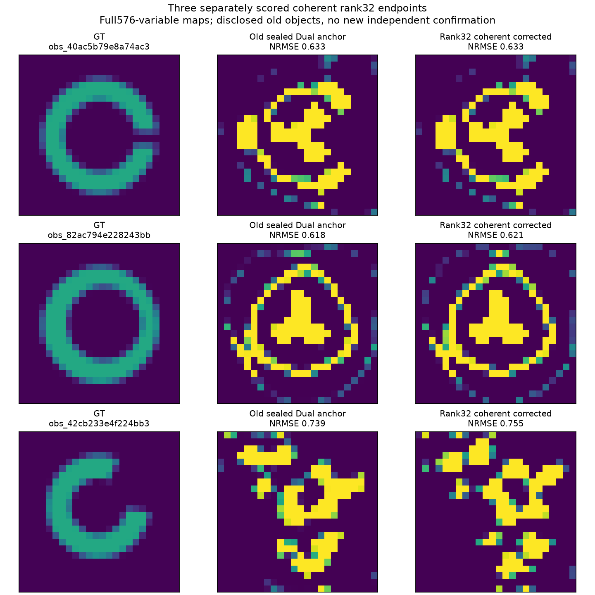

# Separate coherent rank32 endpoint scores

Three complete576-variable endpoints were independently scored after parent post-seal authorization, with0new physical calls. Existing12 endpoint scores/seal remain unchanged.

|Case|NRMSE|Otsu IoU|Material pass|Saved-Y Phi minus receipt|
|---|---:|---:|---|---:|
|obs_40ac5b79e8a74ac3|0.633123136|0.264864865|False|-8.67e-19|
|obs_82ac794e228243bb|0.620664306|0.300000000|False|8.67e-19|
|obs_42cb233e4f224bb3|0.755091380|0.123152709|False|-4.34e-19|

Coherent3:0/3 material passes. Together with the separately preserved original12 endpoint scores, there are0/15 material passes across these15 corrected endpoints on only3 disclosed old failed anchors. The original12 includes continued-anchor/local controls;15 is not the number of new rational proposals or independent objects.

