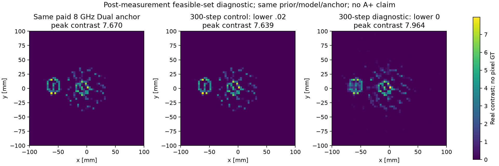
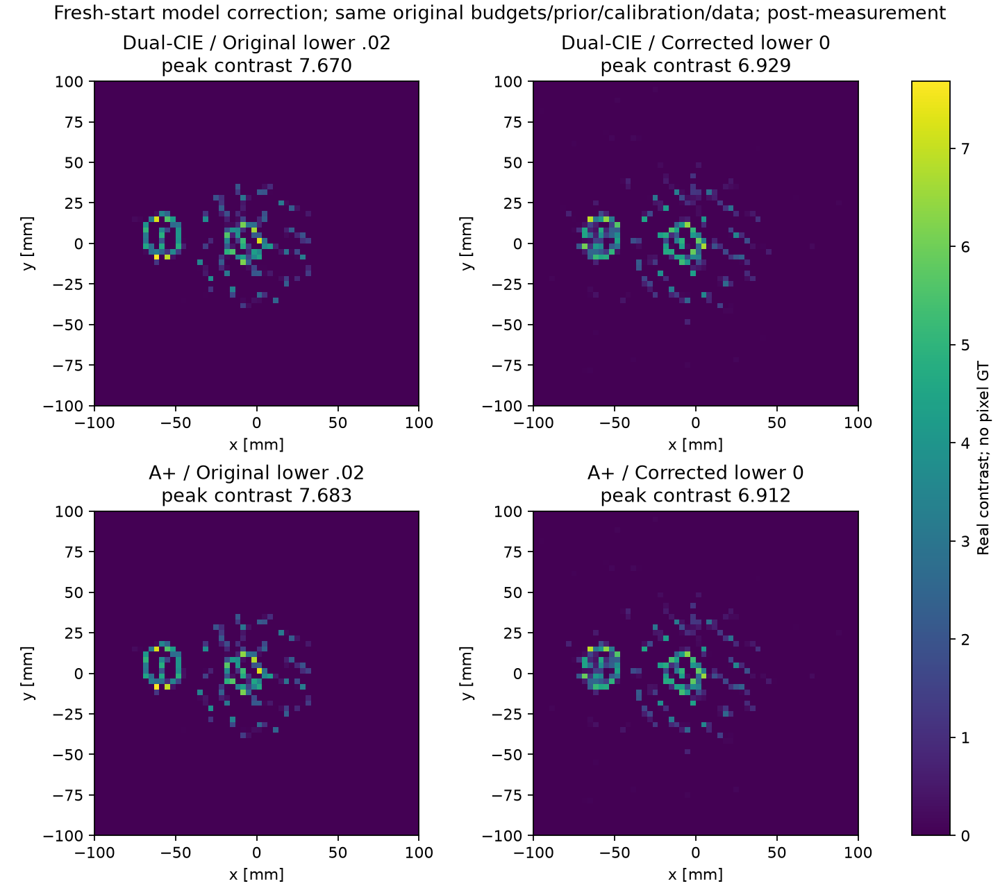
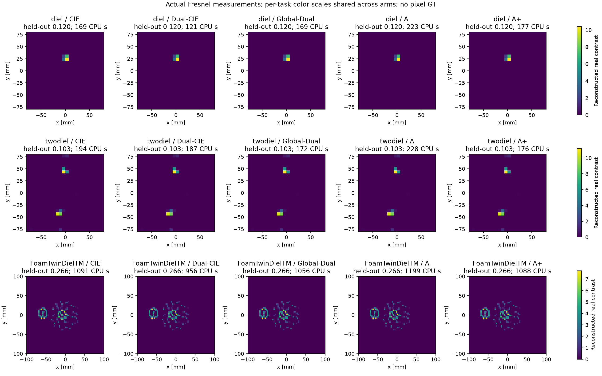
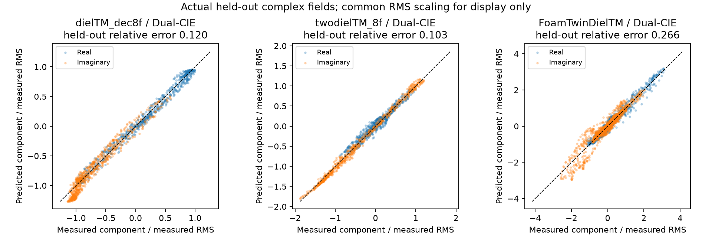
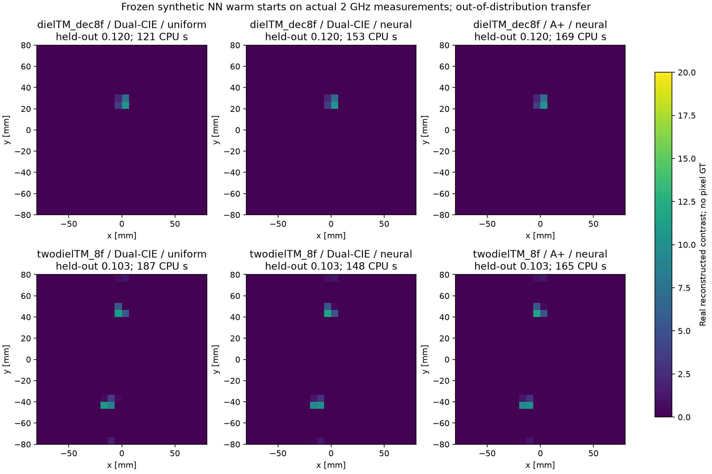
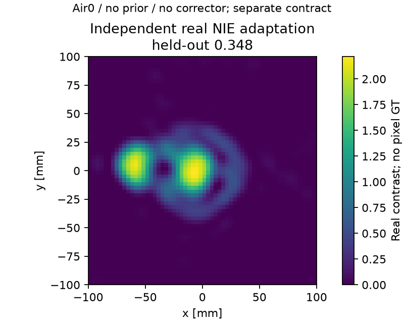
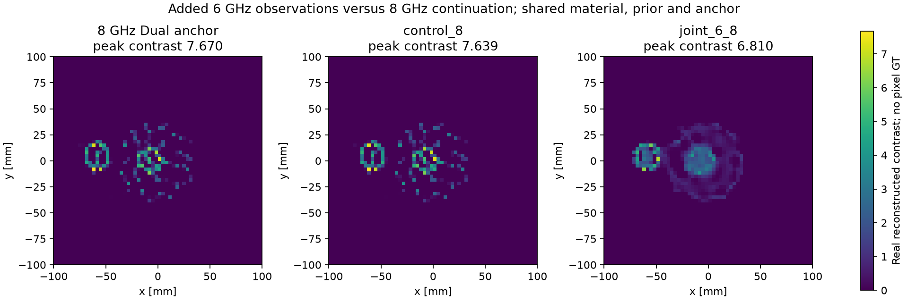

# R8 Fresnel 实测：源相关算子、入射场修复与实测留出预测

本工作区已在3个实测目标上完成19条主表执行、1条独立实材料NIE适配及2条有限多频跟进，原22条实际执行已保留；先另完成1条事后air0可行域诊断、再完成2条fresh-start修正；原23条保留，现共25条实际执行。结论是 **实测预测和数值适配已完成，但未获得绝对材料标定或A/A+成像优越性证据**。2005 FoamTwinDiel 原始文件从项目既有本地测量档案实际复用；当前官方重新下载仍被阻止。8GHz、60²的源相关FFT/GMRES五臂及6+8GHz联合物理实验均已完成，仍不能将其称为NIE2016作者算法的完整复现。

## 数据与物理合同

2001 原始 `dielTM_dec8f.exp`、`twodielTM_8f.exp` 来自 R7 留存的官方原件，原始 ASCII 头及七列数据实际读取。2 GHz 每个对象包含 36 个源、每源49个实际接收通道；其余通道为缺失。原始总场减 target-absent 场得到散射场；按原文 `exp(+iωt)` 约定共轭至继承的 outgoing-H1 模型。源/接收半径为0.720/0.760m。电场的绝对标定单位、接收喇叭指向图和噪声协方差未给出。[原始2001描述与文件合同](https://www.fresnel.fr/perso/belkebir/Articles/Ip01Introduction_Belkebir.pdf)。

2005 文件的七列含义与上一版相同，但几何是1.67m双半径、18个源、每源241个接收器、2–10GHz。材料近似无损；原作者也仅以对向接收器处的一个复系数校准，并明确保留校准问题。[Geffrin等作者上传原文，§4–5](https://www.researchgate.net/publication/231069726_Free_space_experimental_scattering_database_continuation_experimental_set-up_and_measurement_precision)。NIE2016 的8GHz、60²、DPCS rank5、mf6/10/16、beta6/2/.5 合同由 `delegated/paper_baselines/PAPER_CONTRACTS.json` 另行提取；本任务继承其8GHz、60²、rank5和mf/beta合同开展CIE/A比较；共享box、初值、prior和物理修正器仍与原NIE不同，必须保留差异。

本次官方 S09 正文、`/`、`/meta`、`/data` 均返回HTTP200但内容是明确的人类验证页面；已识别为失败，未求解或绕过挑战。另一个根据2001布局推断的出版商存储路径探测返回403；它不是从2005官方页面解析出的下载链接，不能据此断言原数据不可取得。`delegated/fresnel/ACCESS_RECEIPT.json` 与 `DIRECT_ACCESS_RECEIPT.json` 保留请求和失败耗时。获取脚本 `src/fresnel_fetch.py` 明确拒绝把200验证页当成数据。随后通过连接GitHub搜索发现本项目既有 `research/delegated/a2_literature/data/2005_iop_21_6_S09/FoamTwinDielTM.exp`，实际读取其June2004原始头、18源241接收器和七列测量。旧审计记录2026-09-06从IOP自有beta镜像的公开supp.zip获取；该镜像来源 caveat 完整保留。此处是已有原始实测复用，不能写成新下载成功。`LOCAL_2005_PROVENANCE.json` 记录来源。原始数据、论文和下载HTML仅在忽略的 `data_local/`、`*.local.*` 中；公开交付派生重建、模型预测、掩码、汇总及下载脚本，不重新分发原始测量。

## 修复的算子与空目标入射场

每个源独立定义实际接收算子

\[
S_s=P_sS,\quad \widehat y_s=S_sj_s,\quad S_s^*r_s=S^*P_s^*r_s.
\]

没有把缺失数据填成零测量。训练源为去除每第四个源后的27个全周向视角；每源实际49个接收器按相对角顺序保留39个训练、10个接收留出。共1053训练通道、711留出通道，其中441属于完全未训练的9个源、270属于训练源的未训练接收器。这是新的观测合同；不能把它与R7狭窄9源、234训练通道的数值误差直接解释为单一算法增益。

每源在对向接收器附近±30°弧段，用只含空目标场的 outgoing 源多极展开拟合入射场：

\[
E_s^{inc}(x)=\sum_{n=-2}^{2}c_{n,s}\frac{i}{4}H^{(1)}_{|n|}(k|x-t_s|)e^{in\arg_s(x-t_s)}.
\]

所有奇点在目标域外，因此目标域内严格满足源自由 Helmholtz 方程。固定相对奇异值截断1e-4；每三点保留一点独立空场验证。未使用材料、目标散射或其留出残差设置该拟合。空目标验证中位相对误差为：单圆柱 **.02515**、双圆柱 **.02408**；原R7对向单点柱面波分别为 **.39066/.38388**。内部场范数约为原柱面波模型的.924/.925倍。详见 `RESULTS/fresnel/INCIDENT_FIT_AUDIT.json`。

这仍然不是唯一的真实喇叭照明恢复：接收器对空场也有指向响应，有限弧段拟合不能独立分离发射和接收天线因素。空场预测改善不构成内部场或材料正确性的证明。

24²网格覆盖.16m方域；以 `a=h/sqrt(pi)` 的等面积圆盘积分取代R7的 `.45h` 圆盘。该规则是面积等效的 Richmond 配点积分，不声称构造互不相交的物理圆盘。原R7面积填充率约.636，本次每个基函数积分面积等于h²。

## 独立前向与几何诊断

用圆柱边界上连续的E_z及其法向导数构造独立 outgoing 多极/内部Bessel界面配点解，不调用材料网格VIE。与该参考相比，24→36网格的等面积VIE误差为单圆柱 **2.43%→1.29%**、双圆柱 **1.89%→1.20%**。这是离散前向的独立数值证据，不是测量拟合或材料真值证据。接收伴随点积相对偏差约2e-15，真实材料目标的一个方向导数与有限差分一致至记录精度；测试针对新增掩码梯度，不重做无关代数误差门槛。

初始诊断直接把原文无明确x/y轴标签的示意图解释成x轴圆柱，其测量误差超过100%。该失败完整保留在 `REFERENCE_VALIDATION.json`。只按训练数据比较有限的示意图方位解释（单圆柱±x/±y；双圆柱x/y），选出单圆柱+y30mm、双圆柱y±45mm：未调整复增益的训练残差为 **.18894/.30603**。仅用于诊断的训练复增益约为1.042+.100i /1.024+.102i，对应留出误差 **.16073/.29543**。这不是逐像素GT，也不是新增的逆问题校准；所有主比较反演均未使用这个名义几何、选择的方向或复增益。相关记录 `REFERENCE_POSE_DIAGNOSTIC.json`。

## 2005 FoamTwinDiel 8GHz 主实验补充合同

2005相位约定另由同一期、处理同一Foam数据的[Dubois等原文§2/Eq2](https://www.fresnel.fr/perso/belkebir/Articles/IP_Dubois05.pdf)独立确认：采用exp(+iωt)及outgoing第二类Hankel。因此对原始两类复电场共同取共轭以接入H1模型具有本次测量系列的原始依据。

实际读取原始2005测量，在.20m方域60²网格执行五臂比较。每源用实际241个接收器构造S_s；18源中留出每第四源，共13训练源×192接收器=2496训练通道，1842留出通道。DPCS每源rank5，native Fourier mf6/10/16，材料beta6/2/.5；Dual/Global/A/A+当前beta固定为第一阶段6，CIE-single的当前beta随材料beta变化。原文delta2D为系数相对平方变化的平方根，因此实现中平方阈值是1e-4/1e-6/1e-6；每阶段最多1000步，总上限3000。v1/v2把原文阈值直接用于平方量是已纠正的资格错误，相关partial状态/成本不进入最终v3比较，且修复决定发生在它们的留出终点评估之前。

Foam空目标多极拟合独立保留弧段中位误差为.11490，原对向柱面波为.64417；保留4个奇异方向，内部场范数约1.0713倍原模型，仍有不可分离的接收喇叭响应。不能把2001的.025空场数值用于2005。

名义Foam几何由原测量描述和[Dubois等2005原文Fig7](https://www.fresnel.fr/perso/belkebir/Articles/IP_Dubois05.pdf)给出近似位置。独立分区多极界面解满足空气/泡沫/塑料区域的E_z及法向导数连续；界面拟合残差.00222。40→60网格VIE相对该参考为.1372→.0743，表明60²仍有可见离散误差。名义连续模型train/heldout残差.3959/.3894；仅作诊断的训练复增益降低heldout到.3075，未进入任何主反演。该参考不是逐像素GT。

物理计算复用已有等面积Toeplitz FFT、完整VIE的GMRES及解析伴随。纯迭代v1在corrector trial停滞，真实失败成本保留。最终v3统一最多200个预条件GMRES步；难RHS触发同一离散算子的行块组装和库LU，一次LU服务全部源及匹配adjoint。返回解保持原残差资格，不更改物理目标、精度或corrector规则。该策略不能写成“LU0”。每个已付费改进材料保存为paid_incumbent.npz；后续中断也能保存材料与计数。

## 成熟路径与共同物理修正器

`src/fresnel_solver.py` 是成熟 PR-CIE 的源相关接收扩展，逐源执行原始 SVD-DPCS，并保留原始非正交Fourier系数坐标：

\[
J_{D,s}=V_s\Sigma_s^{-1}U_s^*y_s,\qquad U_{A,s}=(I-V_sV_s^*)F.
\]

保留 sourcewise/global PR+、精确二次线步、标量CIE和原onehop材料读出；A+直接复用R7合法的实材料Möbius/MM读出。本实测合同只使用实、近似无损的介质描述，不把实圆弧未经推广用于复材料。与原NIE独立原算法的资格分开：本实现不命名为NIE2016。

2001回归的五路径共用box `[.02,20]`、初始`.1`、DPCS阈值`.001`、继承先验、500/500/500/1500辅助迭代及mf3/6/10/12。2005使用上一节的单独冻结合同。两任务的原物理修正器仍为R4 L-BFGS-B（1000 accepted上限、4000函数上限、原ftol/gtol/maxls/scale）。原物理得分含初始候选并决定辅助选择；每个实际阶段材料候选都保留。实材料梯度使用同一完整Maxwell算子的状态/伴随解及逐源接收伴随（2001保留LU；2005为已声明的FFT/GMRES与必要LU）：

共享的主比较box下界.02排除了精确空气对比度0，初值.1也不同于NIE原文air0；该选择继承比较合同，保留潜在背景偏差，不构成原文绝对材料恢复复现。独立NIE适配将使用其单独的air0、box[0,20]、无额外prior合同，不与主比较混为相同实验。

\[
A=I-\operatorname{diag}(m)G,\quad A^*a_s=S_s^*(\widehat y_s-y_s),\quad \nabla_i f=\Re\sum_s\overline{a_{i,s}}Q_{i,s}/\|Y\|_F^2+\nabla_i R.
\]

全部heldout散射只用于终点报告，不选择增益、端点、迭代次数、NN权重或超参数。冻结NN仅做合成训练到实测的分布外初始化试验，固定网络与特征合同；不能称通用迁移或实测学习。

## 有限多频跟进：新增6GHz观测

在主比较、NN回归和独立NIE完成后，另行执行6+8GHz共享实材料的纯物理联合L-BFGS；共同锚点为8GHz Dual最终训练物理最优材料。对照从同一锚点仅继续8GHz。每频独立空目标校准及原始source mask，仍60²及原box/prior，均最多300 accepted/1000函数评估。定义 `d_f=.5||F_f(m)-Y_f||²/||Y_f||²`，联合目标为 `.5(d_6+d_8)+R(m)`；平均两模型各自的value/gradient恰好使同一个prior只计一次。各频Green/自项/伴随分别计算，不拼接不同频率的Möbius读出。

该跟进加入已有数据集中6GHz的额外观测，不是A+优势或相同信息下的纯算法增益。8GHz留出在本次跟进前已暴露；6GHz留出不参与参数或频率选择。目标材料近似无色散的原文描述支持共享实材料建模，但不能代替材料GT。终点报告两频各自的训练/源留出/接收留出、峰值及有效面积等分布统计和真实费用/停止状态，后两类统计不是NRMSE/IoU或材料精度证据。

## 空气下界的单次事后诊断

父线程在查看完整材料图后，针对主合同 `m≥.02` 在5.33λ大ROI中排除已知空气这一物理问题，授权且仅执行一次 `DEV_MODEL_DIAGNOSTIC`。它从多频对照使用的同一个已付费8GHz Dual锚点出发，保留原模型、各频空目标校准、真实source mask、prior、上界20、L-BFGS-B及300 accepted/1000 eval，唯一改变是材料下界由.02变0。原.02对照直接复用；没有新增辅助/训练、扫参或观测。两频留出此前已暴露，故不能把这一事后模型诊断当作新封存测试或A+优势。

8GHz train/heldout由 0.225527/0.265972 变为 0.081613/0.136126；未用于反演的6GHz heldout由 0.336521 变为 0.293819。峰值由 7.6393 变为 7.9642。统一按 `max(m-.02,0)` 定义的excess有效面积由 0.00103536 变为 0.00138877 m²；这只是分布统计，不是GT面积或材料精度。

固定外圈 `max(|x|,|y|)≥85mm` 仅用于事后描述，不参与优化，也不等于真实物体支持。air0外圈均值/中位数/95%分位为 0.000585/0.000000/0.000000；全ROI有 88.78% 在零下界、91.42% 低于原.02。完整原对照及新端点的分布/原始有效面积/下界比例保存在 `RESULTS/fresnel/AIR0_CONTROL_SUMMARY.json`。

新运行实际 300 accepted/302 eval，optimizer success=False（STOP: TOTAL NO. OF ITERATIONS REACHED LIMIT），新增 395.335368 CPU s。它隔离了原正背景约束这一可行域因素；预测和图像变化仍不能证明绝对材料恢复，也不能排除入射/收发端模型误差或其他不可辨识性。实际field留出近乎减半而峰值上升，说明原正背景约束是显著的拟合偏差来源，却不能作为全部高峰的解释。共享色阶图显示外圆环部分填充/变软，内部尖峰仍在；这不是材料恢复认证。未再做任何搜索或追加反演。

## 两条fresh-start空气下界修正

单次续跑已经表明主合同的正背景约束显著影响预测，因此父线程进一步授权且仅执行Dual-CIE/A+两个最小修正。两条均从原初值.1重新开始，沿用60²/8GHz、原source mask及空目标校准、DPCS rank5、mf6/10/16、material beta6/2/.5、固定current beta6、原prior、每阶段最多1000（总3000）辅助步及原1000 accepted/4000eval corrector。仅将辅助/readout/corrector的材料下界由.02改为0，上界仍20。Dual仍为原sourcewise PR，A+仍为原global PR；没有另加epsilon floor。

这是已查看主结果后的DEV_MODEL_CORRECTION，不是新blind比较或A+胜利声明；6/8GHz留出均此前已暴露，6GHz只在固定8GHz终点作事后预测。原23条及其费用/QA封存保留，新增两条不覆盖原五臂表。

A+零端点满足 `z=m/(1+(beta-Gii)m)`、`z(0)=0`、`z′(0)=1`。实际8GHz60² `Gii=.0864483905+.0771235448i`，三个beta均满足Re(beta−Gii)>0，故实区间[0,20]分母模≥1；端点、候选评价、原prior及fallback均合法。详细数学/代码审计见 `delegated/fresnel/AIR0_MOBIUS_DOMAIN_AUDIT.json`。

- cie_dual：8GHz train/heldout 0.081337/0.137237（原floor.02为0.225536/0.265894）；事后6GHz heldout 0.309838；peak 6.929247；统一旧floor-excess有效面积 0.00124325m²，原始材料有效面积 0.00126263m²。全ROI零下界比例 90.94%，低于旧.02比例 93.22%；外85mm圈mean/median/95%为 0.000598/0.000000/0.000000。实际辅助 483步，训练物理目标选择stage=2；各辅助stage停止为['COEFFICIENT_TOL', 'COEFFICIENT_TOL', 'COEFFICIENT_TOL']；corrector 1000 accepted/1009eval，success=False（STOP: TOTAL NO. OF ITERATIONS REACHED LIMIT）；CPU 741.180164s，其中辅助及准备49.707575s。
- a_plus：8GHz train/heldout 0.081342/0.137128（原floor.02为0.225530/0.265870）；事后6GHz heldout 0.309035；peak 6.912432；统一旧floor-excess有效面积 0.00125346m²，原始材料有效面积 0.00127246m²。全ROI零下界比例 91.25%，低于旧.02比例 93.17%；外85mm圈mean/median/95%为 0.000611/0.000000/0.000000。实际辅助 567步，训练物理目标选择stage=2；各辅助stage停止为['COEFFICIENT_TOL', 'COEFFICIENT_TOL', 'COEFFICIENT_TOL']；corrector 1000 accepted/1014eval，success=False（STOP: TOTAL NO. OF ITERATIONS REACHED LIMIT）；CPU 750.057715s，其中辅助及准备64.046646s。

两支修正后8GHz留出约.137，数值接近且均触及1000 accepted上限；峰值仍约6.9。共享色阶图显示两支修正材料形态也接近，不能把这一小残差差异解释为A+材料优势；正下界偏差修正并未消除异常高峰。分布/峰值/有效面积不等于GT精度，外圈只作描述而非支持约束。优化器CAP/收敛及离散state精度按真实receipt保留；不同选择stage或更长动力学不是恢复认证。没有继续扩展算法、扫参、训练或反演。

## 计算和失败

计时是共享主机上、最多两个物理进程/每进程一线程的真实运行费用，未做CPU绑定或主机隔离。初次2001 Dual单独运行，后续Foam、回归和NN按有限队列交叠；因此小幅CPU差不能解释成隔离基准下的算法速度胜负。数值算法合同、物理RHS/LU/GMRES及读出操作计数分别保留；并发边界见 `delegated/fresnel/EXECUTION_CONCURRENCY.json`。

成本对齐限制：2001的原A回归复用了R4默认uncached材料value/gradient，数值方法及材料/预测回归有效，但重复计算较多，不能用其CPU与A+作“成熟优化A加速”主张。2005 Foam v3 五臂共同启用原R6的材料缓存设置，正式A/A+成本比较限于该对齐合同及R8合成主表。最终表将逐行注明cost scope，不为不对齐或未知项填写胜负。

`paid_incumbent.npz` 持续覆盖为最新已付费最佳材料检查点，不是逐步材料档案；完整目标值/费用history另行保存。循环内必要的检查点、轨迹和辅助候选写入按实际计时已计入，末端序列化及绘图另计。

单例反演计时从Python初始模块导入之后开始；包含数据/校准/算子准备、辅助、corrector和预测。NN在计时阶段导入并推断，其实际额外开销计入单例，但共享NN的合成训练与验证选epoch成本在R8训练receipt另计，不包含在Fresnel单例CPU中。

每进程BLAS/PyTorch1线程；首次单进程，修复后使用有限双进程队列，与父线程协调资源。第一完整尝试因非连续源相关数组导致NumPy矩阵乘法退化，在已观测>302秒后中断；没有阶段材料输出，精确CPU未保留，绝不记成零。`INTERRUPTED.json` 留存失败，修复为连续源主序数组以及与原H相同的因式化乘法；不改变科学合同。成功反演总CPU包含每次数据解析/入射校准/算子准备、辅助阶段、物理修正及全源预测；写文件/绘图另计。独立参考和下载耗时单列，不能把成功运行总CPU冒充所有研究成本。

## 实际比较结果

下方汇总由 `experiments/fresnel_report.py` 在所有实际运行结束后写入；未运行和失败均需保留。实测无可信逐像素GT，禁止给出材料NRMSE/IoU或把名义示意图命名为GT。

<!-- RESULTS_START -->
| 数据/网格 | 路径/初值 | train | 全留出 | 未见源 | 未见接收 | CPU s | cost scope | corrector accepted / stop |
|---|---|---:|---:|---:|---:|---:|---|---|
| 2005 Foam8GHz/60² | CIE/uniform | 0.225527 | 0.265939 | 0.284046 | 0.230325 | 1090.77 | Foam cached common protocol | 1000 / CAP/FAIL |
| 2005 Foam8GHz/60² | Dual-CIE/uniform | 0.225536 | 0.265894 | 0.283980 | 0.230326 | 956.12 | Foam cached common protocol | 877 / CONVERGED |
| 2005 Foam8GHz/60² | Global-Dual/uniform | 0.225527 | 0.266089 | 0.284263 | 0.230331 | 1056.34 | Foam cached common protocol | 1000 / CAP/FAIL |
| 2005 Foam8GHz/60² | A/uniform | 0.225525 | 0.265929 | 0.284027 | 0.230336 | 1199.39 | Foam cached common protocol | 1000 / CAP/FAIL |
| 2005 Foam8GHz/60² | A+/uniform | 0.225530 | 0.265870 | 0.283942 | 0.230332 | 1088.39 | Foam cached common protocol | 1000 / CAP/FAIL |
| 2001 single2GHz/24² | CIE/uniform | 0.118227 | 0.120103 | 0.119283 | 0.121440 | 168.67 | 2GHz regression | 107 / CONVERGED |
| 2001 single2GHz/24² | Dual-CIE/uniform | 0.118227 | 0.120103 | 0.119283 | 0.121440 | 121.06 | 2GHz regression | 107 / CONVERGED |
| 2001 single2GHz/24² | Global-Dual/uniform | 0.118227 | 0.120103 | 0.119283 | 0.121440 | 169.42 | 2GHz regression | 107 / CONVERGED |
| 2001 single2GHz/24² | A/uniform | 0.118227 | 0.120103 | 0.119283 | 0.121440 | 223.22 | 2GHz uncached A readout; no optimized-A speed claim | 107 / CONVERGED |
| 2001 single2GHz/24² | A+/uniform | 0.118227 | 0.120103 | 0.119283 | 0.121440 | 177.25 | 2GHz regression | 107 / CONVERGED |
| 2001 single2GHz/24² | Dual-CIE/neural | 0.118227 | 0.120103 | 0.119283 | 0.121440 | 152.83 | OOD NN regression; training separate | 103 / CONVERGED |
| 2001 single2GHz/24² | A+/neural | 0.118227 | 0.120103 | 0.119283 | 0.121440 | 168.88 | OOD NN regression; training separate | 103 / CONVERGED |
| 2001 twin2GHz/24² | CIE/uniform | 0.096608 | 0.103080 | 0.099191 | 0.109158 | 194.44 | 2GHz regression | 700 / CONVERGED |
| 2001 twin2GHz/24² | Dual-CIE/uniform | 0.096608 | 0.103080 | 0.099191 | 0.109158 | 186.79 | 2GHz regression | 700 / CONVERGED |
| 2001 twin2GHz/24² | Global-Dual/uniform | 0.096608 | 0.103080 | 0.099191 | 0.109158 | 171.66 | 2GHz regression | 700 / CONVERGED |
| 2001 twin2GHz/24² | A/uniform | 0.096608 | 0.103080 | 0.099191 | 0.109158 | 228.03 | 2GHz uncached A readout; no optimized-A speed claim | 700 / CONVERGED |
| 2001 twin2GHz/24² | A+/uniform | 0.096608 | 0.103080 | 0.099191 | 0.109158 | 176.47 | 2GHz regression | 700 / CONVERGED |
| 2001 twin2GHz/24² | Dual-CIE/neural | 0.096633 | 0.103101 | 0.099193 | 0.109208 | 147.80 | OOD NN regression; training separate | 207 / CONVERGED |
| 2001 twin2GHz/24² | A+/neural | 0.096633 | 0.103101 | 0.099193 | 0.109208 | 165.16 | OOD NN regression; training separate | 207 / CONVERGED |

成功运行CPU之和为 **7842.69 s**，不包括上列未闭合的开发失败与检索/绘图成本。各阶段候选、真实物理修正器停止状态与逐步成本均在对应目录。

两类2001回归与2005主实验采用不同频率/孔径/网格/停止合同，不能把跨任务残差当算法优势。NN初始化为独立合成网络的分布外试验。实测无逐像素GT；预测改善、参考几何相容性、材料准确性及算法优势必须分别判断。

独立实材料NIE方程适配另行完成：train 0.291772，留出 0.347940，CPU 50.36s；air0、box[0,20]、无prior/无corrector。该独立实现具有不同合同，非作者代码或成熟NIE复现，不混入上述五臂公平比较。

多频有限跟进采用同一个8GHz Dual实材料锚点，6+8GHz等权归一化data loss加一次原prior，与仅8GHz继续优化对照。两支各最多300accepted/1000eval。6GHz是新增观测；8GHz留出已暴露，不称A+优势或相同信息下纯算法增益。

| 跟进 | 6GHz train / heldout | 8GHz train / heldout | 两频平均heldout | peak contrast | CPU s | accepted / success |
|---|---:|---:|---:|---:|---:|---|
| control_8 | 0.313402 / 0.336521 | 0.225527 / 0.265972 | 0.303305 | 7.6393 | 285.20 | 300 / False |
| joint_6_8 | 0.172215 / 0.186446 | 0.236085 / 0.270722 | 0.232436 | 6.8102 | 538.92 | 300 / False |

跟进CPU为新增成本；共同8GHz锚点成本已计入主比较，不对两支重复计入。对照的6GHz“train”数值仅指既定训练空间mask上的事后预测，未用于对照反演。峰值/有效面积等只是材料分布统计，不是GT精度指标。各频校准、state残差、费用与停止状态单独保存。

`dielTM_dec8f` 已完成5/5个uniform路径；所有保存材料逐位相同：True；辅助选择阶段：`{'cie_single': -1, 'cie_dual': -1, 'global_dual': -1, 'a_material': -1, 'a_plus': -1}`。

`twodielTM_8f` 已完成5/5个uniform路径；所有保存材料逐位相同：True；辅助选择阶段：`{'cie_single': -1, 'cie_dual': -1, 'global_dual': -1, 'a_material': -1, 'a_plus': -1}`。

`FoamTwinDielTM` 已完成5/5个uniform路径；所有保存材料逐位相同：False；辅助选择阶段：`{'cie_single': 2, 'cie_dual': 2, 'global_dual': 2, 'a_material': 2, 'a_plus': 2}`。

仅下界改变的事后模型诊断（DEV_MODEL_DIAGNOSTIC）：同锚点/原prior/upper20/300accepted/1000eval；复用原floor.02对照，不重跑。两频留出此前已暴露，不是新测试或A+优势。外圈固定为max(|x|,|y|)≥85mm，仅描述分布，不作为GT支持或优化约束。

| 8GHz物理对照 | train / heldout 8GHz | heldout 6GHz（事后） | peak | excess有效面积m² | 全ROI下界比例 | 外圈均值 / 中位数 / 95% | CPU s | accepted / success |
|---|---:|---:|---:|---:|---:|---:|---:|---|
| 原floor.02 | 0.225527 / 0.265972 | 0.336521 | 7.6393 | 0.00103536 | 0.9536 | 0.02000 / 0.02000 / 0.02000 | 285.20 | 300 / False |
| air0 | 0.081613 / 0.136126 | 0.293819 | 7.9642 | 0.00138877 | 0.8878 | 0.00058 / 0.00000 / 0.00000 | 395.34 | 300 / False |

随后仅追加两个fresh-start模型修正（DEV_MODEL_CORRECTION）：初值仍.1，原3000aux/1000corrector及prior/calibration/data，全部辅助/readout/corrector下界改0。原23条封存；两频留出已暴露，不称blind/A+胜利。Dual沿用sourcewise_cg=True，A+沿用sourcewise_cg=False（global PR），current beta固定6。

| air0 fresh-start | 8GHz train / heldout | 6GHz heldout（事后） | peak | excess有效面积m² | aux steps / 选择stage | corrector accepted/eval/success | CPU s |
|---|---:|---:|---:|---:|---:|---:|---:|
| Dual-CIE | 0.081337 / 0.137237 | 0.309838 | 6.9292 | 0.00124325 | 483 / 2 | 1000 / 1009 / False | 741.18 |
| A+ | 0.081342 / 0.137128 | 0.309035 | 6.9124 | 0.00125346 | 567 / 2 | 1000 / 1014 / False | 750.06 |
<!-- RESULTS_END -->

## 已核看的派生图

主比较共享每任务色阶；高峰、ring和spike按真实保存材料显示，未用名义几何替换重建。CPU为实际运行费用，scope限制见上文。

真实留出复场仅为显示共同除以测量RMS，不重新拟合增益。场相关性不等于材料准确度。

冻结NN的分布外初始化及最终物理解；没有真实逐像素GT。

独立real NIE采用单独合同，不混入五臂公平比较。

新增6GHz与8GHz续跑的同锚点比较；材料分布变化不能单独证明GT改善。

## 结果的可支持范围

Foam五臂留出误差仅在.26587–.26609之间，四臂触及1000 accepted上限；Dual按ftol停止。共同cached的A/A+均542个辅助current步，材料inner evaluations从11135降到2710，辅助CPU从76.93降到57.74s。这支持本实现降低A材料读出工作量的局部工程证据；完整管线CPU仍由物理corrector主导，且A+未优于Dual。计时为共享主机运行费用，不作隔离速度胜负。图中ring/spike及7.58–7.72的高对比度峰值不构成名义介质的材料恢复成功。

2001的五个uniform路径在每个对象上保存的材料逐位相同，辅助候选均退回初始host；不能把五个管线当作五次独立成像成功。NN单圆柱终点材料相对差仅1.27e-5；双圆柱材料相对差9.86%，但实际通道预测只差.1307%。这些是估计之间的变化，不是GT误差或严格basin切换证明。固定3000辅助和共享主机条件下，NN总费用没有一致改善证据。

独立real NIE的peak2.217、较平滑形态及较高的.34794留出误差，应与air0/无prior/无corrector和独立实现资格同时阅读，不能据此判定材料准确度胜者。主比较较低的field residual也不能替代材料GT。

增加6GHz后，两频平均留出由.30330降至.23244：6GHz由.33652降至.18645，8GHz由.26597略升至.27072。peak由7.6393降至6.8102，有效面积由.0010354增至.0021412m²，但仍保留异常高峰，两个跟进均达到300 accepted上限。可观察到新增频率约束改变了集中结构和预测折中，不能称伪结构已消除、真实材料已恢复，或A+获得算法优势。

原22条成功执行累计8717.167454 CPU s已原样保留；新增单次air0事后诊断395.335368 CPU s，原23条合计9112.502822 CPU s；新增两条fresh-start修正1491.237879 CPU s，25条总计10603.740701 CPU s；另有开发数值失败至少405.52 CPU s，以及首次布局失败CPU未知、wall至少302s。检索、初始模块导入、参考诊断、绘图和共享NN训练按各自scope另列。费用并未伪装成完全闭合的全研究账本。表中的CONVERGED仅指优化器声明的停止条件；CAP不是已收敛，离散state精度不是实物材料认证。

## 复现入口

先在仓库既有Python环境执行 `src/fresnel_fetch.py --campaign 2001` / `--campaign 2005`，或把自己合法取得的原始文件置于 `data_local/fresnel/`。当前2005官方入口仍可能返回验证页；获取失败会明确记录。文件原始头和七列字段必须保留，不能用生成数据替代。

相对于本R8目录，先运行 `experiments/fresnel_validate.py`、`experiments/fresnel_reference_poses.py`、`experiments/fresnel_foam_validate.py`。五臂主入口为 `experiments/fresnel_invert.py --case dielTM_dec8f --arm cie_dual`（同样执行twin及其余四臂）和 `experiments/fresnel_foam_invert.py --side 60 --arm cie_dual`（同样执行其余四臂）。NN回归在2001入口添加 `--initialization neural`，使用已冻结的 `RESULTS/training/physics/weights.pt`，不训练或调参。独立NIE入口是 `experiments/fresnel_foam_nie.py`，其不同合同单列。

输出目录已存在时入口拒绝覆盖，重放需显式提供新的 `--attempt`。两条batch脚本只管理有限任务、每进程一线程；需要恢复其他队列时必须显式提供属于本次任务的controller PID，公开脚本没有固定PID。运行结束后执行 `experiments/fresnel_illumination_diagnostics.py`、`experiments/fresnel_report.py` 生成派生汇总及图。所有原始测量/第三方论文和原图仍保持本地忽略，不随公开派生结果重分发。

追加事后诊断唯一入口是 `experiments/fresnel_air0_control.py`，固定唯一输出目录并拒绝覆盖；`experiments/fresnel_air0_finalize.py` 只汇总已付费端点、检查同锚点/配置及更新QA，不运行物理反演。原22条费用及QA封存为 `COST_AND_SELECTION_BASE22.json` / `FINAL_QA_BASE22.json`。

两条fresh-start修正入口为 `experiments/fresnel_foam_air0_correction.py --arm cie_dual` / `--arm a_plus`（固定默认dev_air0、60²，拒绝覆盖）；`experiments/fresnel_foam_air0_finalize.py` 只汇总和核对已完成端点，不运行物理反演。
