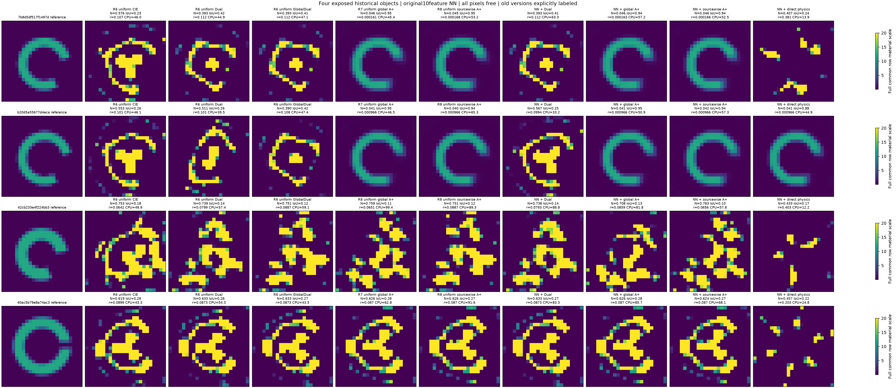

# 历史困难对象的Neural Warm Start有限回归

本轮仅复查已公开的7b8d、b20d、42cb、40ac四个旧开发对象，21个新任务（含唯一补充42cb uniform global A+配对控制）；不是20个新材料，也不加入新42确认集。第四对象40ac是不同拓扑开缝壳，由父线程在任何NN结果前选定；R6另一历史组合的第四63ab未纳入，R7原四对象还含简单近双岛00f1，集合差异不隐藏。

原10feature physics/weights.pt冻结，未使用domain_augmented权重；FeatureOperator按旧.96米域坐标和真实公开G/E/S/Y直接计算。没有用初始Phi拒绝NN。所有NN只初始化材料，关闭可选physical-current projection；Dual及sourcewise A+对每一源列分别计算current共轭梯度系数；global A+以所有源的联合current计算一个系数。两种A+均使用同一个Mobius-material arc候选与原Phi选择，sourcewise不是把方法名字改成global，也不是增加可观测信息。单数值进程、每BLAS一个线程串行执行；首批20项与补充1项分两次串行调用，互不并行，未重跑已封存项。NN在前处理一次装载，冷装载与features/推理费用另列。

原solver.json未改：mf3/6/10各500步＋mf12×1500（共3000辅助上限），共同实材料[.02,20]、原prior、原DPCS和Polak–Ribiere更新；corrector最多3000，direct最多6000。本轮没有重新生成Y、几何或噪声，沿用原离散，不能当成独立网格或真实测量验证。主预测仍按原Phi选取，GT只在21个新端点全部封存后由本评分器打开上述四个历史路径；没有读取新42 GT或新增物理评分调用。

## 初始材料距离和初始原物理目标

| 对象 | 初值 | amplitudeNRMSE | 初始原Phi | 初始residual |
|---|---|---:|---:|---:|
|obs_7b8d5df517f1497d|nn|0.29915|0.434221|0.9319|
|obs_7b8d5df517f1497d|uniform|0.36235|0.526356|1.026|
|obs_b20d5a55677d4eca|nn|0.2902|0.430875|0.9283|
|obs_b20d5a55677d4eca|uniform|0.3551|0.523523|1.0233|
|obs_42cb233e4f224bb3|nn|0.33173|0.509795|1.0097|
|obs_42cb233e4f224bb3|uniform|0.39942|0.532955|1.0324|
|obs_40ac5b79e8a74ac3|nn|0.35303|0.475953|0.97565|
|obs_40ac5b79e8a74ac3|uniform|0.4464|0.529487|1.0291|

NN初始原Phi是否更高不决定其去留；所有固定预算完整执行。初始GT距离只在封存后报告，不能用它在线选择NN或uniform。

## 全部端点

| 对象 | 版本/方法 | amplitudeNRMSE | OtsuIoU | residual | 原Phi | CPU(s) | LU | complexRHS | corrector步 | stop |
|---|---|---:|---:|---:|---:|---:|---:|---:|---:|---|
| obs_7b8d5df517f1497d | R6_uniform_cie_single | 0.57618 | 0.23404 | 0.10688 | 0.0057373 | 45.964 | 2048 | 49104 | 2018 | CONVERGENCE: NORM OF PROJECTED GRADIENT <= PGTOL |
| obs_7b8d5df517f1497d | R6_uniform_cie_dual | 0.39313 | 0.41748 | 0.11188 | 0.0062784 | 44.86 | 1913 | 45864 | 1887 | CONVERGENCE: NORM OF PROJECTED GRADIENT <= PGTOL |
| obs_7b8d5df517f1497d | R6_uniform_global_dual | 0.39313 | 0.40777 | 0.11188 | 0.0062784 | 47.066 | 2056 | 49296 | 1987 | CONVERGENCE: NORM OF PROJECTED GRADIENT <= PGTOL |
| obs_7b8d5df517f1497d | R6_uniform_a_material | 0.046859 | 0.94382 | 0.00015353 | 5.8905e-06 | 67.284 | 1378 | 33024 | 1327 | CONVERGENCE: NORM OF PROJECTED GRADIENT <= PGTOL |
| obs_7b8d5df517f1497d | R7_uniform_global_Aplus | 0.046078 | 0.95455 | 0.00016095 | 5.8894e-06 | 45.361 | 1218 | 29184 | 1177 | CONVERGENCE: NORM OF PROJECTED GRADIENT <= PGTOL |
| obs_7b8d5df517f1497d | R8_nn_cie_dual | 0.3931 | 0.40777 | 0.11188 | 0.0062784 | 63.333 | 2120 | 50832 | 2081 | CONVERGENCE: NORM OF PROJECTED GRADIENT <= PGTOL |
| obs_7b8d5df517f1497d | R8_nn_a_plus | 0.045593 | 0.94382 | 0.00016318 | 5.8818e-06 | 57.233 | 1495 | 35832 | 1443 | CONVERGENCE: NORM OF PROJECTED GRADIENT <= PGTOL |
| obs_7b8d5df517f1497d | R8_nn_a_plus_sourcewise | 0.045506 | 0.94382 | 0.0001664 | 5.883e-06 | 52.45 | 1454 | 34848 | 1398 | CONVERGENCE: NORM OF PROJECTED GRADIENT <= PGTOL |
| obs_7b8d5df517f1497d | R8_nn_physical_lbfgs | 0.40726 | 0.23762 | 0.38077 | 0.072508 | 13.918 | 943 | 22632 | 933 | CONVERGENCE: NORM OF PROJECTED GRADIENT <= PGTOL |
| obs_7b8d5df517f1497d | R8_uniform_a_plus_sourcewise | 0.045348 | 0.95455 | 0.00016829 | 5.8838e-06 | 53.167 | 1373 | 32904 | 1327 | CONVERGENCE: NORM OF PROJECTED GRADIENT <= PGTOL |
| obs_b20d5a55677d4eca | R6_uniform_cie_single | 0.5531 | 0.25581 | 0.10126 | 0.0051511 | 46.063 | 2145 | 51432 | 2135 | CONVERGENCE: NORM OF PROJECTED GRADIENT <= PGTOL |
| obs_b20d5a55677d4eca | R6_uniform_cie_dual | 0.51072 | 0.2562 | 0.10073 | 0.0050961 | 39.479 | 1619 | 38796 | 1598 | CONVERGENCE: NORM OF PROJECTED GRADIENT <= PGTOL |
| obs_b20d5a55677d4eca | R6_uniform_global_dual | 0.38955 | 0.42268 | 0.10782 | 0.0058324 | 47.401 | 2025 | 48552 | 2003 | CONVERGENCE: NORM OF PROJECTED GRADIENT <= PGTOL |
| obs_b20d5a55677d4eca | R6_uniform_a_material | 0.041275 | 0.94048 | 0.00096624 | 6.4758e-06 | 70.582 | 1342 | 32160 | 1309 | CONVERGENCE: NORM OF PROJECTED GRADIENT <= PGTOL |
| obs_b20d5a55677d4eca | R7_uniform_global_Aplus | 0.040606 | 0.95181 | 0.00096585 | 6.4739e-06 | 46.525 | 1402 | 33600 | 1367 | CONVERGENCE: NORM OF PROJECTED GRADIENT <= PGTOL |
| obs_b20d5a55677d4eca | R8_nn_cie_dual | 0.56656 | 0.25 | 0.099434 | 0.0049692 | 33.218 | 574 | 13728 | 542 | CONVERGENCE: RELATIVE REDUCTION OF F <= FACTR*EPSMCH |
| obs_b20d5a55677d4eca | R8_nn_a_plus | 0.04096 | 0.95181 | 0.000966 | 6.4742e-06 | 50.893 | 1374 | 32928 | 1340 | CONVERGENCE: NORM OF PROJECTED GRADIENT <= PGTOL |
| obs_b20d5a55677d4eca | R8_nn_a_plus_sourcewise | 0.041792 | 0.94048 | 0.0009661 | 6.481e-06 | 57.306 | 1343 | 32184 | 1303 | CONVERGENCE: NORM OF PROJECTED GRADIENT <= PGTOL |
| obs_b20d5a55677d4eca | R8_nn_physical_lbfgs | 0.041025 | 0.87912 | 0.00096645 | 6.4703e-06 | 44.925 | 2508 | 60192 | 2452 | CONVERGENCE: NORM OF PROJECTED GRADIENT <= PGTOL |
| obs_b20d5a55677d4eca | R8_uniform_a_plus_sourcewise | 0.040376 | 0.94048 | 0.00096583 | 6.4711e-06 | 65.279 | 1587 | 38040 | 1548 | CONVERGENCE: NORM OF PROJECTED GRADIENT <= PGTOL |
| obs_42cb233e4f224bb3 | R6_uniform_cie_single | 0.75341 | 0.18182 | 0.064236 | 0.0020966 | 49.885 | 2435 | 58392 | 2404 | CONVERGENCE: NORM OF PROJECTED GRADIENT <= PGTOL |
| obs_42cb233e4f224bb3 | R6_uniform_cie_dual | 0.73918 | 0.135 | 0.079862 | 0.0032159 | 57.351 | 3073 | 73704 | 3000 | STOP: TOTAL NO. OF ITERATIONS REACHED LIMIT |
| obs_42cb233e4f224bb3 | R6_uniform_global_dual | 0.75081 | 0.12438 | 0.088674 | 0.0039588 | 59.14 | 3054 | 73248 | 3000 | STOP: TOTAL NO. OF ITERATIONS REACHED LIMIT |
| obs_42cb233e4f224bb3 | R6_uniform_a_material | 0.7084 | 0.13158 | 0.08594 | 0.0037221 | 96.742 | 2816 | 67536 | 2742 | CONVERGENCE: NORM OF PROJECTED GRADIENT <= PGTOL |
| obs_42cb233e4f224bb3 | R8_nn_cie_dual | 0.73767 | 0.14356 | 0.079277 | 0.0031687 | 88.841 | 3045 | 73032 | 3000 | STOP: TOTAL NO. OF ITERATIONS REACHED LIMIT |
| obs_42cb233e4f224bb3 | R8_nn_a_plus | 0.70839 | 0.13158 | 0.08594 | 0.0037221 | 81.807 | 2662 | 63840 | 2605 | CONVERGENCE: NORM OF PROJECTED GRADIENT <= PGTOL |
| obs_42cb233e4f224bb3 | R8_nn_a_plus_sourcewise | 0.76314 | 0.10145 | 0.065592 | 0.0021826 | 57.848 | 1258 | 30132 | 1211 | CONVERGENCE: RELATIVE REDUCTION OF F <= FACTR*EPSMCH |
| obs_42cb233e4f224bb3 | R8_nn_physical_lbfgs | 0.43324 | 0.16964 | 0.40294 | 0.081189 | 12.154 | 565 | 13560 | 554 | CONVERGENCE: NORM OF PROJECTED GRADIENT <= PGTOL |
| obs_42cb233e4f224bb3 | R8_uniform_a_plus_sourcewise | 0.75099 | 0.1194 | 0.088672 | 0.0039588 | 89.307 | 3054 | 73248 | 3000 | STOP: TOTAL NO. OF ITERATIONS REACHED LIMIT |
| obs_42cb233e4f224bb3 | R8_uniform_a_plus | 0.75888 | 0.11111 | 0.06505 | 0.0021463 | 99.373 | 3066 | 73524 | 3000 | STOP: TOTAL NO. OF ITERATIONS REACHED LIMIT |
| obs_40ac5b79e8a74ac3 | R6_uniform_cie_single | 0.61904 | 0.28261 | 0.08988 | 0.0040672 | 43.254 | 1886 | 45216 | 1867 | CONVERGENCE: NORM OF PROJECTED GRADIENT <= PGTOL |
| obs_40ac5b79e8a74ac3 | R6_uniform_cie_dual | 0.63312 | 0.26486 | 0.087308 | 0.0038414 | 54.277 | 2643 | 63384 | 2599 | CONVERGENCE: NORM OF PROJECTED GRADIENT <= PGTOL |
| obs_40ac5b79e8a74ac3 | R6_uniform_global_dual | 0.6331 | 0.2663 | 0.087308 | 0.0038414 | 43.484 | 2646 | 63456 | 2607 | CONVERGENCE: NORM OF PROJECTED GRADIENT <= PGTOL |
| obs_40ac5b79e8a74ac3 | R6_uniform_a_material | 0.62596 | 0.2766 | 0.087001 | 0.0038129 | 63.197 | 2986 | 71616 | 2937 | CONVERGENCE: NORM OF PROJECTED GRADIENT <= PGTOL |
| obs_40ac5b79e8a74ac3 | R7_uniform_global_Aplus | 0.62597 | 0.2766 | 0.087001 | 0.0038129 | 62.756 | 2767 | 66360 | 2751 | CONVERGENCE: NORM OF PROJECTED GRADIENT <= PGTOL |
| obs_40ac5b79e8a74ac3 | R8_nn_cie_dual | 0.63309 | 0.2663 | 0.087308 | 0.0038414 | 83.287 | 2908 | 69744 | 2869 | CONVERGENCE: NORM OF PROJECTED GRADIENT <= PGTOL |
| obs_40ac5b79e8a74ac3 | R8_nn_a_plus | 0.62595 | 0.2766 | 0.087001 | 0.0038129 | 85.656 | 2841 | 68136 | 2814 | CONVERGENCE: NORM OF PROJECTED GRADIENT <= PGTOL |
| obs_40ac5b79e8a74ac3 | R8_nn_a_plus_sourcewise | 0.62416 | 0.27128 | 0.08701 | 0.0038134 | 68.115 | 1906 | 45696 | 1870 | CONVERGENCE: RELATIVE REDUCTION OF F <= FACTR*EPSMCH |
| obs_40ac5b79e8a74ac3 | R8_nn_physical_lbfgs | 0.45657 | 0.22464 | 0.20286 | 0.020591 | 24.757 | 1255 | 30120 | 1238 | CONVERGENCE: NORM OF PROJECTED GRADIENT <= PGTOL |
| obs_40ac5b79e8a74ac3 | R8_uniform_a_plus_sourcewise | 0.62594 | 0.27128 | 0.087001 | 0.0038129 | 91.593 | 2873 | 68904 | 2835 | CONVERGENCE: NORM OF PROJECTED GRADIENT <= PGTOL |

R6 uniform CIE/Dual/Global/A为原封存旧版本，R7 final-arc A+在7b8d/b20d/40ac直接复用原封存预测；42cb没有相同预算的R7 final-arc A+文件，因此仅补一个R8 uniform global A+配对控制；原R6 A仍独立列出，不把rational额外校正端点改名作A+。R6 explicit/dense算子wiring与R8 nativeFFT存在实现/长期roundoff路径差异，不能把跨版本差异全部归因为初始化。R7与R8关闭初始current投影后的FFT数值主体一致；原配置与来源在BASELINE_PROVENANCE.json。

图中每行GT及全部候选使用共同完整幅度范围，没有只显示成功对象或截断高峰材料。NRMSE=RMSE/12；IoU使用预测自身256bin Otsu阈值，原R7材料判据NRMSE≤.15且IoU≥.7并合法，仅作历史可比标签，不是新实验停止gate。

新增21任务solverCPU合计1274.461s，LU=40204，complexRHS=964056；另加一次公开features/装载/推理CPU=0.077402s。原权重训练另计CPU387.690s、wall283.448s，训练数据生成成本见原训练receipt引用的generation receipts；旧baseline费用不再次计入新花费。完整CPU/wall/LU/RHS和初值费用见RESULTS/history_warm/COST_LEDGER.json。

## 有限历史回归的结果解释

这四个旧对象上，冻结原10通道、材料初始化且APCS初始为零的NN没有替代A更新在两个困难弯条上的收益：NN+Dual为0/4成功；NN+global A+、NN+sourcewise A+各2/4；NN+direct physics为1/4；uniform sourcewise A+也是2/4。这里成功仅指原历史材料指标，不是新确认、统计泛化或唯一性结论。

- 7b8d：旧uniform original A和R7 final global A+成功，新增uniform sourcewise A+也成功。NN+global/sourcewise A+保留成功（NRMSE .04559/.04551，IoU均.94382），NN+Dual仍停在错误结构（.39310/.40777），NN+direct也失败（.40726/.23762）。NN没有把Dual移到A达到的材料解。
- b20d：NN+global/sourcewise A+保留成功（.04096/.04179，IoU .95181/.94048），NN+Dual失败（.56656/.25000）。NN+direct独立成功（.04102/.87912），这是本回归中唯一不使用A的NN成功；不能将它推广到另外三个对象。
- 42cb：同版本同预算新增uniform global A+为.75888/.11111，NN+global A+为.70839/.13158，两者均失败。NN+Dual、NN+sourcewise A+和NN+direct亦全部失败；NN direct的较低NRMSE .43324伴随IoU仅.16964和residual .40294，不能称为恢复。
- 40ac开缝壳：所有旧基线及本轮四NN臂均失败。NN+global A+ .62595/.27660与R7 uniform global A+ .62597/.27660几乎相同；NN+sourcewise .62416/.27128没有修复拓扑。

四个NN初始材料NRMSE均比uniform更低，初始原Phi也均较低；最终42cb与40ac仍失败，说明本回归中的初始接近并不足以保证原非线性校正恢复。所有初值均完整执行，未因初始Phi拒绝。

源方向选择的效应也有条件：sourcewise A+没有在这四对象上增加成功数；其CPU/终止路径随对象和初始化不同。逐方法的原Phi、corrector实际步数、终止原因和CPU已在完整表中列出。PGTOL/relative-F是数值停止，并非材料成功证书；42cb部分路径达到3000步上限，不称为充分收敛。

比较采用相同预设最大预算，实际CPU并不相等。R7旧uniform global A+在两个bar上分别45.36/46.53 CPU秒；NN global A+为57.23/50.89秒，此处没有测得NN加速。新增uniform sourcewise A+两个bar为53.17/65.28秒，NN sourcewise为52.45/57.31秒；这些有限路径差异不足以作通用加速结论。direct最多6000步，其停止与辅助臂3000+3000预算不同。

全批21项solver CPU1274.461107秒、任务wall之和1583.460057秒，串行wrapper CPU1275.020020秒、wall1584.147680秒；前处理另0.077402 CPU秒、0.142219 wall秒。计入LU40204、复数RHS964056；共享features含4次receiver SVD，公开Green动作/接收adjoint各48源列，无额外LU。原网络训练387.690002 CPU秒及训练数据生成费用属于复用外部成本，不藏入零成本。

上述结果只检验固定的material-only warm start。未来保留NN物理APCS偏置的初始化属于另一协议；本次没有补跑、重选或根据历史GT改动当前21项。
