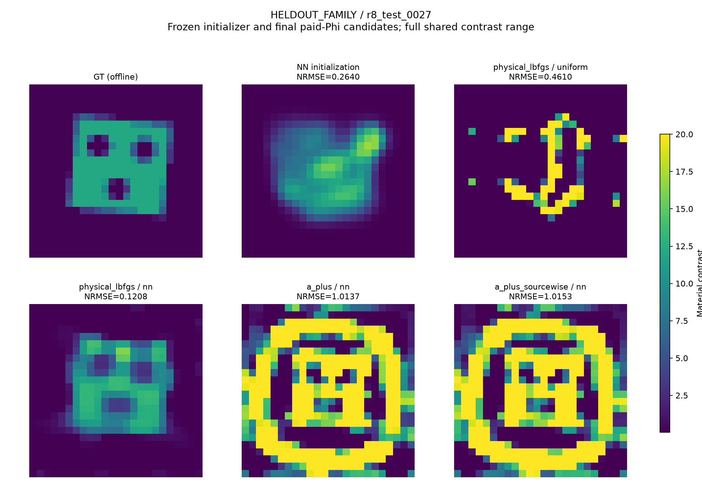

# R8：轻量NN初始化到底帮助了谁？

**已经实际训练并接入CIE、Dual-CIE、Global-Dual、sourcewise A+、global A+和直接原物理优化。最清楚的独立确认收益来自NN＋直接物理；简单接入A+经常损失这个收益。** 固定物理电流偏置产生部分修复，但没有成为稳定胜过直接物理的算法。所有结果来自先封存、后评分的876项预测，统计单位是42个材料对象。

## 模型、数据和公开选择

主模型为24,737参数两尺度CNN，16通道，十个物理/几何输入。1536训练、192验证对象独立生成，覆盖8类材料、contrast 2.5/6/12/18、复RMS噪声.001/.01/.03、6/12源及半/全孔径。输入含Born/DPCS复读出、场能量和几何，不含测试GT。CPU完成120epoch；独立验证选择权重，另训练同结构Born-only控制。代码和权重路径见[复现](REPRODUCE.md)，完整冻结条件见[协议](NEURAL_PROTOCOL.md)。

42个新材料分为24个训练家族内、12个未训练家族、6个36²生成→24²反演对象。每个保留576实材料自由度；不以形状或GT support缩减。材料box与prior沿用公开合成合同。主630=42×15臂，额外120仅在预先指定8对象上做初始化消融，偏置扩展126=42×3。两套全部完成后才开测试GT；未因NN初始Phi较高而拒绝运行。

所有最终端点取已支付原Maxwell Phi的incumbent。辅助方法最多3000步辅助＋3000步共同物理校正，直接方法最多6000步；另给同实际CPU/LU/RHS allowance下的已执行端点，不能把相同最大步数当相同成本。没有把GT用于初值、阶段、根或停止选择。

## 独立确认结果

下表是幅度归一NRMSE均值，括号是继承复合标签成功数；标签还要求IoU≥.7和合法性，不能只凭这个二值数判断连续材料质量。

|方法|家族内24|家族外12|跨网格6|
|---|---:|---:|---:|
|均匀＋直接物理|.24966 (2)|.40474 (1)|.19593 (2)|
|NN原始材料|.14690|.21898|.12052|
|NN＋直接物理|**.09647 (9)**|**.16245 (6)**|**.08431 (2)**|
|均匀＋Dual-CIE|.36843 (7)|.63825 (1)|.32821 (2)|
|NN＋Dual-CIE|.32822 (7)|.56779 (2)|.32835 (2)|
|NN＋Global-Dual|.28919 (8)|.60481 (1)|.32834 (2)|
|NN＋global A+|.29609 (7)|.59393 (2)|.32933 (2)|
|NN＋sourcewise A+|.32182 (7)|.59164 (2)|.32811 (2)|
|NN固定偏置＋Dual|.29007 (7)|.52299 (4)|.25988 (2)|
|NN固定偏置＋global A+|.31395 (5)|.51831 (4)|.22800 (2)|
|NN固定偏置＋sourcewise A+|.31293 (6)|.50160 (4)|.22833 (2)|

完整15臂、固定8对象的m=.1/1、Born、DPCS、随机、两个NN和joint状态消融、按对象配对区间与停止原因在[原数字备忘录](delegated/warm_analysis/FINAL_NUMERIC_MEMO.md)。不能把固定8对象的Born-only NN局部优势拿来事后替换42对象的冻结网络。所有42对象及所有失败见[主图集](FIGURES/warm_material_all_42.pdf)、[原NN与后续物理图集](FIGURES/neural_initial_to_final_all42.pdf)、[偏置图集](FIGURES/warm_anchor_confirmation_all_materials.pdf)。

## 数学解释与被否定的简单预测器

令物理电流为`jp=jphys(mNN)`，硬数据投影为Pd，早期Fourier可调空间投影为Pu。投影初始化的差可拆成

`δjD = Jd − Pd jp`，`δjN = Pu jp − (I−Pd)jp`。

两项在欧氏current范数下正交，但Maxwell本构缺陷是`(I−XG)(δjD+δjN)`，强耦合可以放大、混合这两个方向。因此NN材料很有用，并不意味着送入硬DPCS/低模态辅助族后仍保留其搜索轨迹。

最小修正是固定`Ja=Jd+(I−Pd)jp`，只继续优化原Fourier系数。它不增加优化DOF，不额外求初始LU，但完整current存储、投影和所有后续求解仍计费；最后完整APCS空间与原法相同。8个验证对象的初始本构缺陷全部下降，材料却不都改善，已经否定该标量诊断作为独立成功预测器。确认集显示它可以部分修复家族外/跨网格退化，但仍远逊于NN直接物理。

预定对象0027展示另一个反例：NN初Phi=.30965，global A+把校正前Phi降至.01565。然而NN直接物理在1814 accepted steps按投影梯度停机，得到NRMSE=.12082；global A+用满3000校正步仍为1.01370。这里直接支路实际少于3000步，所以不能仅用6000上限解释；仍不能据此证明错误吸引域不可逃逸。

再保留两条完整支路并按最终Phi选择也不够。NN直接＋global A+的均值变成.07754/.34498/.22882：家族内改善，另外两总体恶化，CPU为单NN直接的2.38–3.17倍。Global-Dual组合出现相似现象，不是A+专有机制。此选择完全不读GT；它说明增加候选和降低数据目标本身不能保证更准确材料。

## 成本与摊销

相对均匀直接物理，NN直接的最终平均CPU增加1.06–2.74倍；均匀初值常较快停在坏材料。因而这一比较支持质量提升，**不支持最终时间加速**。同对象共同CPU/LU/RHS allowance下，五个硬件/总体层的平均误差仍较低，置信区间、未用完预算及稀疏快照间距完整报告。

相对五种均匀和五种NN辅助方法，NN直接在全部五层的最终平均CPU和误差都更低。这十组细比较是在看主结果后加入的描述分析，没有重新调算法；小层区间常跨零，不宣称普遍统计胜出。同CPU也有反例：ID/i9的NN直接减NN Global-Dual平均误差差为+.00281，区间[−.06069,+.06401]。

例如Mac ID部署CPU为NN直接32.03秒、均匀Dual62.12秒；家族外分别39.12/69.89秒。物理特征与推理都收费。主physics网络训练加训练/验证生成为402.558889 Mac累计CPU秒；Born-only和采集域修复训练另列全研究账本。相对均匀直接没有有限CPU摊销盈亏平衡点；相对较贵辅助法的条件性成本收益也不能免去训练、加载、候选验证或跨硬件价比。详见[成本对照](delegated/warm_direct_budget_analysis/REPORT.md)与[全账本](COST_LEDGER.md)。

若明确改用**均匀Dual-CIE**作为成本参照，三组Mac平均每次节省约30.09/30.77/31.82 CPU秒。主网络及训练/验证生成402.56 CPU秒的条件性warm部署摊销为14/14/13次。它只按本次对象均值记CPU账，排除冷加载，不是经济盈亏或等质量保证；全研究中Born/domain训练仍全部收费。两机器之间没有指定CPU价格比，不给混合硬件经济摊销数。计算见[条件性摊销表](delegated/warm_direct_budget_analysis/CONDITIONAL_DEPLOYMENT_AMORTIZATION.json)。

## 与A+互补还是替代？

历史7b8d和b20d上NN＋两A+仍能恢复，NN＋Dual不能，属于已公开对象的条件互补。新42对象则主要是NN直接更好，不能继续把“NN＋A+”当默认组合。两种情况都保留；不存在一个从历史两例外推的通用关系。

Austria采集域另外训练了无Austria标签的轻量修复模型并实际下游求解，长校正仍没有稳定收益。Fresnel两圆柱也实际试过NN，没有解决测量模型问题；主网络没有3D输入/训练，未声称3D迁移。

最值得继续的不是加深网络，而是处理**有噪声DPCS约束与学习物理状态之间的冲突**，并研究什么时候应保留直接物理轨迹。现有投影分解是可测诊断，尚不是能可靠预测材料恢复的规则。若新方法不能在冻结新对象、同实际费用下超过NN直接物理，就不能把一个更复杂接口称为新突破。
