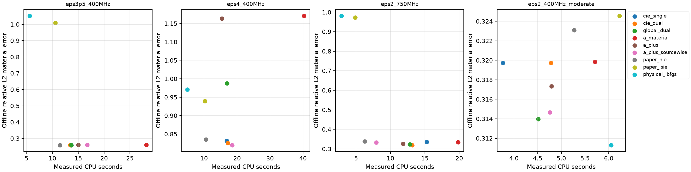

# R8 原论文二维物理基准：实际执行与边界

本轮实际生成原2016论文的150×150细网格数据，并完成四个 Austria 物理条件 × 九个求解臂的32×32全像素反演。保持2米成像区域、20个均匀平面波、40个半径3.75米接收点、原频率/介电常数/beta/Fourier阶数与10%复白噪声。反演网格缩小是明确适配；不是把同形状放回历史0.96米/柱面源几何。

来源：[NIE2016原论文](https://doi.org/10.1109/TAP.2016.2535492)，作者全文§IV pp1794–1797。完整原文合同在 `delegated/paper_baselines/PAPER_CONTRACTS.json`。本轮重新实现的独立paper_nie/paper_lsie以原始状态方程、DPCS和native Fourier APCS/sourcewise PR交替更新；不调用CIE的readout/current loop，也不冒称成熟作者软件。

## 与原文的实际差异

- 数据为原150²细网格，主九臂比较为32²反演，附加original64运行单独报告。等面积圆盘半径h/√π近似方形MoM单元，解析disk self-term；原文未给出可逐项比对的单元积分源码。这里不是继承旧.45h占空率。
- 噪声先抽取独立实/虚高斯样本，再整体缩放为noise/cleanY的Frobenius范数比精确0.1；四个公开case使用固定seed8600+i。这是明确的噪声实现合同，不假称拿到原论文的同一随机实现，也不把固定范数噪声套入未核实的IID-CN99成功证书。
- CIEfamily与物理L-BFGS的实材料contrast逐像素独立在[0,20]，有共同smooth+TV prior；原论文通常恢复复材料。没有固定真值support、分区材料或轮廓参数化。
- 独立paper_nie/paper_lsie保留论文无额外材料prior版本，故与带prior六臂的结果不能被解释为只有积分方程不同；其80步physical corrector也保持各自prior。
- 每阶段最多300个auxiliary步骤，使用论文delta阈值：首轮.01、后续.001（代码内部delta²门限对应平方）；每臂相同最多80个L-BFGS-B corrector accepted steps。原论文没有这些统一有限上限。
- sourcewise PR的delta²是逐源相对系数变化平方的平均；global PR采用继承的global Frobenius相对变化平方。二者是明确的算法/停止语义差异，不能仅因使用同一个数值阈值就称为完全相同的paper stop。
- 原文以air/zeroAPIC初始化，本轮亦如此；Dual/global/A/A+的current beta固定首阶段值，material beta按论文下降。CIEsingle current/material都按论文下降。A/A+原global current与新增sourcewiseA+分别明确列出。
- 每臂从阶段端点仅依原physical data+prior选候选；不读GT。预测material、Y和seal写完后才单独offline评分。这里四个条件仍是同一已公开几何家族，不能计作四种新独立拓扑或NN确认集。

## 全部离线结果

材料误差的两种分母明确区分：relativeL2=‖mhat−m‖/‖m‖；R7兼容amplitudeNRMSE=‖mhat−m‖/√N/(eps_r−1)。早期JSON的NRMSE键保留为relativeL2别名，不能直接与R7 amplitudeNRMSE合并。IoU同时报告预测自身256-bin Otsu阈值和预定half-contrast阈值；JSON另有绝对contrast>0.3控制。Otsu只是离线评分，不参与优化。

| 对象 | 方法 | relativeL2 | amplitudeNRMSE | OtsuIoU | half-contrastIoU | 数据残差 | CPU(s) | wall(s) | LU | complex RHS |
|---|---|---:|---:|---:|---:|---:|---:|---:|---:|---:|
| austria_eps3p5_400MHz | cie_single | 0.2583 | 0.136 | 0.9454 | 0.9418 | 0.09342 | 13.64 | 13.85 | 89 | 3400 |
| austria_eps3p5_400MHz | cie_dual | 0.2595 | 0.1367 | 0.9322 | 0.945 | 0.0934 | 13.42 | 13.7 | 89 | 3400 |
| austria_eps3p5_400MHz | global_dual | 0.2594 | 0.1366 | 0.9354 | 0.945 | 0.09341 | 13.66 | 13.84 | 89 | 3400 |
| austria_eps3p5_400MHz | a_material | 0.2596 | 0.1367 | 0.9386 | 0.9483 | 0.09341 | 28.17 | 28.74 | 89 | 3400 |
| austria_eps3p5_400MHz | a_plus | 0.26 | 0.1369 | 0.9322 | 0.945 | 0.0934 | 14.98 | 15.39 | 89 | 3400 |
| austria_eps3p5_400MHz | a_plus_sourcewise | 0.2597 | 0.1368 | 0.9386 | 0.9483 | 0.0934 | 16.73 | 16.95 | 89 | 3400 |
| austria_eps3p5_400MHz | paper_nie | 0.2584 | 0.1361 | 0.942 | 0.9418 | 0.09343 | 11.46 | 11.65 | 88 | 3380 |
| austria_eps3p5_400MHz | paper_lsie | 1.009 | 0.5316 | 0.04545 | 0.06552 | 0.6557 | 10.59 | 10.85 | 89 | 3420 |
| austria_eps3p5_400MHz | physical_lbfgs | 1.052 | 0.5538 | 0.02083 | 0.0274 | 0.7182 | 5.601 | 5.666 | 85 | 3360 |
| austria_eps4_400MHz | cie_single | 0.8316 | 0.438 | 0.6789 | 0.69 | 0.09902 | 16.85 | 17.1 | 89 | 3400 |
| austria_eps4_400MHz | cie_dual | 0.8257 | 0.4348 | 0.6994 | 0.7052 | 0.09801 | 17.22 | 17.45 | 89 | 3400 |
| austria_eps4_400MHz | global_dual | 0.9874 | 0.52 | 0.7166 | 0.7484 | 0.1004 | 16.94 | 17.45 | 89 | 3400 |
| austria_eps4_400MHz | a_material | 1.171 | 0.6164 | 0.3765 | 0.5152 | 0.1264 | 40.32 | 41.05 | 89 | 3400 |
| austria_eps4_400MHz | a_plus | 1.163 | 0.6126 | 0.3889 | 0.5179 | 0.1264 | 15.39 | 15.96 | 90 | 3440 |
| austria_eps4_400MHz | a_plus_sourcewise | 0.8197 | 0.4317 | 0.716 | 0.7301 | 0.0974 | 18.48 | 18.73 | 89 | 3400 |
| austria_eps4_400MHz | paper_nie | 0.835 | 0.4397 | 0.6533 | 0.6879 | 0.09972 | 10.6 | 10.95 | 89 | 3420 |
| austria_eps4_400MHz | paper_lsie | 0.9397 | 0.4949 | 0.1354 | 0.1349 | 0.4849 | 10.25 | 10.36 | 88 | 3380 |
| austria_eps4_400MHz | physical_lbfgs | 0.9705 | 0.5111 | 0.07586 | 0.08621 | 0.5464 | 4.96 | 5.007 | 85 | 3360 |
| austria_eps2_750MHz | cie_single | 0.3351 | 0.1765 | 0.878 | 0.9031 | 0.08909 | 15.29 | 15.56 | 89 | 3400 |
| austria_eps2_750MHz | cie_dual | 0.3189 | 0.1679 | 0.9059 | 0.9129 | 0.08918 | 13.17 | 13.44 | 89 | 3400 |
| austria_eps2_750MHz | global_dual | 0.3231 | 0.1702 | 0.9059 | 0.9164 | 0.08915 | 12.82 | 12.98 | 89 | 3400 |
| austria_eps2_750MHz | a_material | 0.3338 | 0.1758 | 0.885 | 0.9097 | 0.08909 | 19.82 | 20.11 | 89 | 3400 |
| austria_eps2_750MHz | a_plus | 0.3258 | 0.1716 | 0.9024 | 0.9097 | 0.08914 | 11.82 | 11.98 | 89 | 3400 |
| austria_eps2_750MHz | a_plus_sourcewise | 0.3334 | 0.1756 | 0.885 | 0.9097 | 0.08912 | 7.936 | 8.036 | 89 | 3400 |
| austria_eps2_750MHz | paper_nie | 0.3379 | 0.178 | 0.8746 | 0.9062 | 0.08906 | 6.227 | 6.312 | 88 | 3380 |
| austria_eps2_750MHz | paper_lsie | 0.9729 | 0.5123 | 0.07904 | 0.08904 | 0.8339 | 4.883 | 4.948 | 54 | 2020 |
| austria_eps2_750MHz | physical_lbfgs | 0.9808 | 0.5165 | 0.07343 | 0.08651 | 0.8318 | 2.862 | 2.898 | 84 | 3320 |
| austria_eps2_400MHz_moderate | cie_single | 0.3197 | 0.1684 | 0.8993 | 0.9066 | 0.09619 | 3.768 | 3.951 | 84 | 3300 |
| austria_eps2_400MHz_moderate | cie_dual | 0.3197 | 0.1684 | 0.8993 | 0.9066 | 0.09619 | 4.781 | 4.894 | 84 | 3300 |
| austria_eps2_400MHz_moderate | global_dual | 0.314 | 0.1654 | 0.9031 | 0.9069 | 0.0962 | 4.51 | 4.591 | 84 | 3300 |
| austria_eps2_400MHz_moderate | a_material | 0.3198 | 0.1684 | 0.9024 | 0.9066 | 0.09619 | 5.706 | 5.774 | 84 | 3300 |
| austria_eps2_400MHz_moderate | a_plus | 0.3173 | 0.1671 | 0.8993 | 0.9066 | 0.09619 | 4.79 | 4.83 | 84 | 3300 |
| austria_eps2_400MHz_moderate | a_plus_sourcewise | 0.3147 | 0.1657 | 0.8997 | 0.9066 | 0.0962 | 4.756 | 4.802 | 84 | 3300 |
| austria_eps2_400MHz_moderate | paper_nie | 0.3231 | 0.1702 | 0.899 | 0.8997 | 0.09619 | 5.268 | 5.372 | 83 | 3280 |
| austria_eps2_400MHz_moderate | paper_lsie | 0.3246 | 0.1709 | 0.8927 | 0.9031 | 0.09619 | 6.228 | 6.292 | 83 | 3280 |
| austria_eps2_400MHz_moderate | physical_lbfgs | 0.3113 | 0.1639 | 0.9059 | 0.9129 | 0.09621 | 6.051 | 6.141 | 89 | 3520 |

A+相对原A-material的CPU改善在四个条件约1.19–2.62倍，中位约1.78倍；没有由这些结果建立A+对成熟Dual-CIE的统一材料优势。eps4的global A/A+劣于sourcewiseA+和Dual，current更新选择的影响不能归因于材料读出本身。

## 费用与解释

每臂CPU/wall包括该臂辅助求解、full-wave候选验收、common corrector和prediction写入前计算；不包括共享几何组装、细网格合成数据和训练。共享组装另存在每份receipt，数据生成成本在DATA_RECEIPT。FFT auxiliary与GMRES forward成本分开记录，不能只报LU为零就称没有物理费用。未有NN训练在此分支发生。初步64²forward准备也保留在delegated/forward64_setup_attempt，没有丢掉准备费用。

下表是封存后才在32²网格代入解析Austria参考材料的同数据残差，用于量化跨网格边界/单元离散影响；它没有参与在线模型或候选选择。

| 对象 | coarse truth physical residual |
|---|---:|
| austria_eps3p5_400MHz | 0.2359 |
| austria_eps4_400MHz | 0.22526 |
| austria_eps2_750MHz | 0.30059 |
| austria_eps2_400MHz_moderate | 0.11643 |

## 资格与未执行项

2016的其他有损涂层矩形只引用2011 FFT-TSOM论文并省略结果，原2016全文没有完整材料/边界尺寸合同，未臆造一个同名目标。2019论文给出有损coated cube和四立方体完整数值合同，本轮3D分支另行报告；不能把二维程序当成3D复现。IMSA-CIE的受限全文/作者源码未取得，因此没有用普通网格加密程序冒充IMSA。Fresnel FoamTwinDiel的实测合同与执行见独立Fresnel分支。

实际代码：`src/paper_physics.py`、`src/paper_nie.py`、`src/paper_cie_fft.py`、`experiments/paper_benchmark.py`、`experiments/paper_original64.py`。paper_cie_fft是保留R7数值算法的R8副本，仅开放相应物理Green对象与逐阶段论文stop；历史R1–R7未修改。

复现：从worktree根运行指定Python，以`python -m research.research_max_struct_r8.experiments.paper_benchmark build --forward 150`生成；`... paper_benchmark solve`执行九臂；全部seal存在后运行`... paper_report`。original64使用`... paper_original64`。一数值进程、BLAS一线程。
