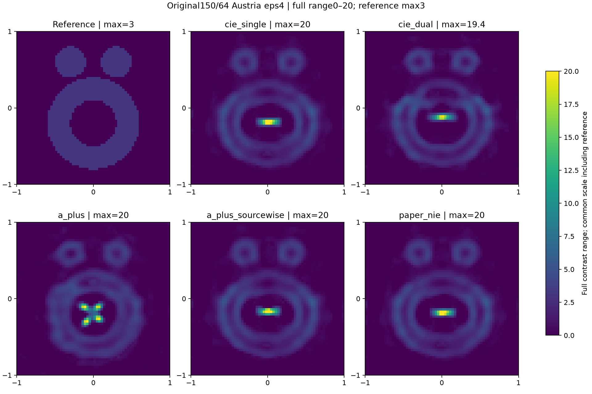
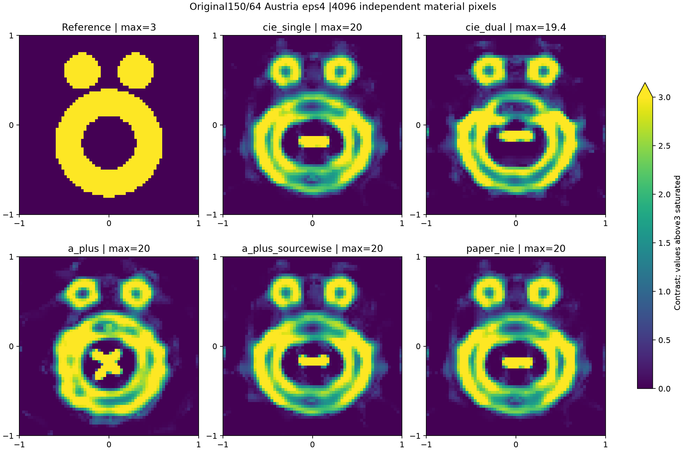
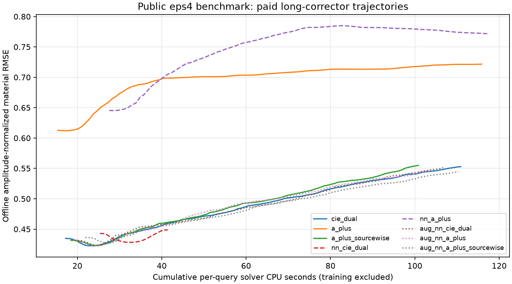

# R8 原论文基准后续：64网格、较长物理迭代与NN OOD

本文件是已封存预测的离线评分；只有存在PREDICTION_SEAL的项目才进入表。没有seal的正在运行/失败项目不是成功或零误差。详细原合同、早期36次比较及分母定义见PAPER_BENCHMARKS。

| 组别 | 对象 | 方法 | relativeL2 | amplitudeNRMSE | OtsuIoU | halfContrastIoU | 数据残差 | 新增CPU(s) | 新增wall(s) | 新增LU | 新增complexRHS | 停止 |
|---|---|---|---:|---:|---:|---:|---:|---:|---:|---:|---:|---|
| original64 | austria_eps4_400MHz | a_plus | 0.95518 | 0.50126 | 0.77409 | 0.79124 | 0.09885 | 368.94 | 432.49 | 2 | 3427 | STOP: TOTAL NO. OF ITERATIONS REACHED LIMIT |
| original64 | austria_eps4_400MHz | cie_dual | 0.8143 | 0.42733 | 0.6517 | 0.67305 | 0.1006 | 318.12 | 441.25 | 2 | 3462 | STOP: TOTAL NO. OF ITERATIONS REACHED LIMIT |
| original64 | austria_eps4_400MHz | a_plus_sourcewise | 0.83839 | 0.43997 | 0.69356 | 0.70945 | 0.099072 | 326.98 | 377.66 | 2 | 3422 | STOP: TOTAL NO. OF ITERATIONS REACHED LIMIT |
| original64 | austria_eps4_400MHz | paper_nie | 0.84047 | 0.44106 | 0.69237 | 0.71286 | 0.098746 | 316.11 | 440.45 | 1 | 3461 | STOP: TOTAL NO. OF ITERATIONS REACHED LIMIT |
| original64 | austria_eps4_400MHz | cie_single | 0.84035 | 0.441 | 0.69961 | 0.71757 | 0.098469 | 349.77 | 445.18 | 1 | 3441 | STOP: TOTAL NO. OF ITERATIONS REACHED LIMIT |
| original64 | austria_eps3p5_400MHz | cie_single | 0.25998 | 0.13643 | 0.93277 | 0.93236 | 0.093294 | 234.14 | 251.85 | 0 | 3380 | STOP: TOTAL NO. OF ITERATIONS REACHED LIMIT |
| strong_corrector | austria_eps2_750MHz | physical_lbfgs | 0.98263 | 0.51749 | 0.076655 | 0.086505 | 0.8317 | 10.222 | 13.953 | 89 | 3580 | CONVERGENCE: RELATIVE REDUCTION OF F <= FACTR*EPSMCH |
| strong_corrector | austria_eps2_400MHz_moderate | physical_lbfgs | 1.2967 | 0.68291 | 0.25263 | 0.37671 | 0.095701 | 103.19 | 129.72 | 1018 | 40740 | STOP: TOTAL NO. OF ITERATIONS REACHED LIMIT |
| strong_corrector | austria_eps4_400MHz | nn_cie_dual | 0.85202 | 0.4487 | 0.75163 | 0.7871 | 0.094843 | 16.092 | 18.844 | 174 | 6980 | CONVERGENCE: RELATIVE REDUCTION OF F <= FACTR*EPSMCH |
| strong_corrector | austria_eps4_400MHz | a_plus | 1.3701 | 0.72156 | 0.299 | 0.44611 | 0.10176 | 100.44 | 132 | 1020 | 40820 | STOP: TOTAL NO. OF ITERATIONS REACHED LIMIT |
| strong_corrector | austria_eps4_400MHz | cie_dual | 1.0498 | 0.55286 | 0.49671 | 0.57053 | 0.093894 | 93.667 | 118.98 | 1018 | 40740 | STOP: TOTAL NO. OF ITERATIONS REACHED LIMIT |
| strong_corrector | austria_eps4_400MHz | a_plus_sourcewise | 1.0539 | 0.55501 | 0.49032 | 0.55901 | 0.093873 | 82.343 | 101.99 | 1008 | 40340 | STOP: TOTAL NO. OF ITERATIONS REACHED LIMIT |
| strong_corrector | austria_eps4_400MHz | aug_nn_a_plus | 1.0362 | 0.54568 | 0.52288 | 0.5768 | 0.093907 | 84.512 | 108.29 | 1017 | 40700 | STOP: TOTAL NO. OF ITERATIONS REACHED LIMIT |
| strong_corrector | austria_eps4_400MHz | aug_nn_a_plus_sourcewise | 1.0345 | 0.54482 | 0.5114 | 0.58385 | 0.093891 | 88.451 | 114.76 | 1015 | 40620 | STOP: TOTAL NO. OF ITERATIONS REACHED LIMIT |
| strong_corrector | austria_eps4_400MHz | physical_lbfgs | 0.98656 | 0.51956 | 0.055556 | 0.092466 | 0.54568 | 55.302 | 73.552 | 463 | 18540 | CONVERGENCE: NORM OF PROJECTED GRADIENT <= PGTOL |
| strong_corrector | austria_eps4_400MHz | nn_a_plus | 1.4652 | 0.77163 | 0.21136 | 0.39039 | 0.10251 | 89.797 | 107.23 | 1013 | 40540 | STOP: TOTAL NO. OF ITERATIONS REACHED LIMIT |
| strong_corrector | austria_eps4_400MHz | aug_nn_cie_dual | 1.0469 | 0.55135 | 0.48387 | 0.57143 | 0.093871 | 87.322 | 101.1 | 1011 | 40460 | STOP: TOTAL NO. OF ITERATIONS REACHED LIMIT |
| strong_corrector | austria_eps3p5_400MHz | physical_lbfgs | 1.0552 | 0.5557 | 0.020761 | 0.027586 | 0.71798 | 28.584 | 34.996 | 229 | 9180 | CONVERGENCE: RELATIVE REDUCTION OF F <= FACTR*EPSMCH |
| NN_OOD_early80 | austria_eps4_400MHz | nn_cie_dual | 0.84116 | 0.44298 | 0.65257 | 0.67069 | 0.099135 | 25.326 | 28.696 | 86 | 3340 | 80step physical corrector |
| NN_OOD_early80 | austria_eps4_400MHz | nn_a_plus | 1.2253 | 0.64529 | 0.32493 | 0.39788 | 0.12577 | 27.554 | 33.33 | 88 | 3420 | 80step physical corrector |
| NN_DOMAIN_REPAIR_early80 | austria_eps4_400MHz | aug_nn_cie_dual | 0.81931 | 0.43148 | 0.73171 | 0.73556 | 0.097354 | 19.361 | 22.278 | 86 | 3340 | 80step physical corrector |
| NN_DOMAIN_REPAIR_early80 | austria_eps4_400MHz | aug_nn_a_plus | 0.8212 | 0.43247 | 0.72086 | 0.72171 | 0.097602 | 19.017 | 22.468 | 87 | 3380 | 80step physical corrector |
| NN_DOMAIN_REPAIR_early80 | austria_eps4_400MHz | aug_nn_a_plus_sourcewise | 0.82851 | 0.43632 | 0.71341 | 0.72121 | 0.098159 | 21.884 | 25.773 | 86 | 3340 | 80step physical corrector |

NN初始材料amplitudeNRMSE=0.625489，air初值=0.526634；初始原Phi NN=0.693106而air=0.5。没有因NN初始Phi更高而丢弃它，所有后续物理迭代均实际完成。一次共享feature/SVD+weights装载/推理CPU约0.0173s（不含Python/PyTorch导入与训练费用）。

## 轻量域扩充修复的实际对照

主线程另行冻结25,025参数12通道网络：在原数据上增加256个随机非Austria训练材料＋64独立验证材料；混合后总1792训练/256验证。新增论文采集为400/750MHz、2米域、20plane/40receiver；没有把Austria GT用作训练或epoch选择。原10feature权重不覆盖，新增两公共通道仅为2k/(2π)电尺寸与plane-wave=1。实际运行同eps4、同300辅助上限、同80步early checkpoint，再以同一fresh L-BFGS实现追加1000步，与uniform/旧NN的80＋1000协议相同。新sourcewise A+组合没有旧10feature NN对应臂；uniform sourcewise A+追加1000作控制。此为公开开发对象上的合理轻量修复，不能称新盲确认。训练CPU约499s及旧训练成本均另加主线程训练/数据生成receipts；不能把这些成本藏在推理之外。

修复后NN材料初值amplitudeNRMSE=0.395358，初始原Phi=0.520947；一次共享feature/装载/推理CPU=0.021516s。

较长corrector的费用是从各自封存early80端点继续的新增费用，必须加回early80和辅助求解成本才能比较完整使用成本。初始direct使用均匀air，不把80步预算未完成的轨迹称为成熟物理baseline终点。新增1000accepted-step ceiling、原R7 scale1e6/ftol1e-12/gtol.01，实际stop和terminal projected gradient保留。

NN只用于预先指定的eps4/32网格两个材料初始化臂，使用主线程已冻结24,737参数十通道CNN及weights；不在论文对象上训练/选epoch/调参。论文2米/400MHz、20平面波/40接收、air背景与训练.96米域/柱面波等条件不同，属于明确的跨物理OOD。仅把公共坐标特征规范为x/1米、y/1米，之后按原训练均值/方差。初始Phi不用于丢弃NN。DPCS/APCS仍按合法原算法构造，没有把NN材料当成辅助电流。特征SVD、装载/推理一次共享成本在NN_INITIALIZATION/RECEIPT，训练成本另加主训练receipt。

64网格使用实际完整4096个独立像素、同150²观测、同20plane/40receiver/3.75米以及原beta/mf。物理状态/adjoint用严格残差控制FFT-GMRES，源RHS独立Krylov求解；不声称Krylov复用一个LU。最终五臂统一采用每RHS最多1000 GMRES迭代，数值stagnation时按相同离散算子行块组装完整矩阵并采用SciPy LU，立即共享该匹配材料LU给所有source/adjoint RHS；所有失败Krylov与回退LU/setup/RHS都计费。已发生一次未带LU回退的corrector试点失败、一次短中断，以及一次昂贵通用fallback链的中断修复，独立attempt目录保留，必须计入工程准备/失败成本。最终CIEsingle从已付费auxiliary材料重新开始同80步L-BFGS，属于fresh history，不伪称连续resume。该早期auxiliary的FFT/currentloop细计数未在中断前落盘，已在RECOVERED receipt标明协议缺口；其明确auxiliary_complete进度保留CPU/wall与物理RHS，最终完整使用费用加回一次。停止于80步骤的64结果不是无预算限制物理收敛证书。

## 已封存eps3.5的物理网格诊断

固定原论文解析材料，不做优化；各网格重新组装同一种equal-area disk算子。

| grid | noisy observed residual | clean field difference to150 | clean difference to200 |
|---|---:|---:|---:|
|32|0.235898|0.211908|0.209763|
|48|0.154242|0.118318|0.103269|
|64|0.139085|0.0995965|0.08031|
|96|0.111448|0.0494573|0.0458583|
|150|0.0997423|0|0.0371506|
|200|0.106076|0.0371147|0|

64网格明显减小离散场偏差，但其与150网格的约10%clean场差仍约等于噪声尺度。150→200场差约3.7%，不应把150网格当连续Maxwell真值。网格改善并不自动消除由prior、有限预算或非凸搜索造成的材料误差。上述诊断没有反馈给已封存预测的选取。

## 64网格的幅度与形态必须同时读

上图统一从0显示到全部候选的最大contrast20，GT也使用同一尺。真材料contrast3，而反演峰值约19.4–20，幅度偏差不能被较好的轮廓IoU掩盖。下图仅用于形态细节，把0–3以外材料饱和显示，并以箭头和各面板max标记；它不是幅度恢复成功图。

## 实际性能—费用轨迹

曲线从已付费early80点开始，后续每10个已付费原物理evaluation复制一次在线Phi最优材料，最后加入封存终点；没有为了画曲线增加forward/adjoint。横轴加回各自辅助与early80CPU，NN再加每次输入一次feature/推理费用；训练和训练数据生成费用另计，故此图不是单次总训练摊销收益证明。材料评分只在封存后进行，没有反向选择更好的GT checkpoint。两phase重启与observed不同stop保留，不伪称同一连续L-BFGS轨迹。

64五臂中sourcewise A+与Dual可比较相同current更新下的材料读出；此64子集没有独立global普通材料读出臂，因此global A+与Dual的差异不能单独归因于A+材料块。32九臂完整矩阵保留该对照。sourcewise/global停止的源平均与global Frobenius语义差异沿用并披露。
