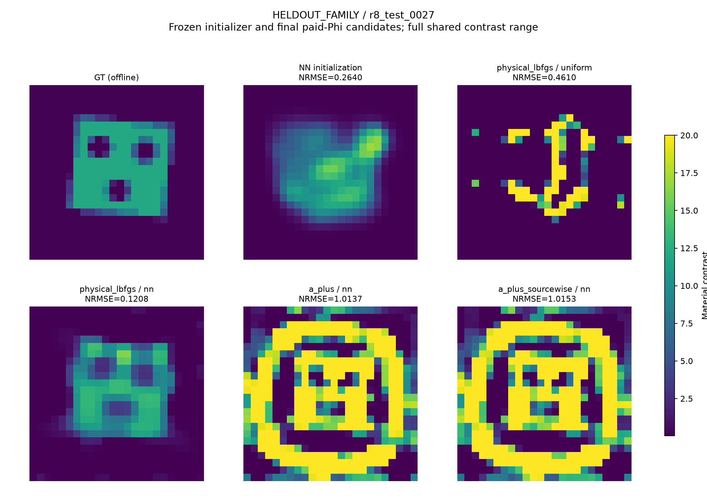
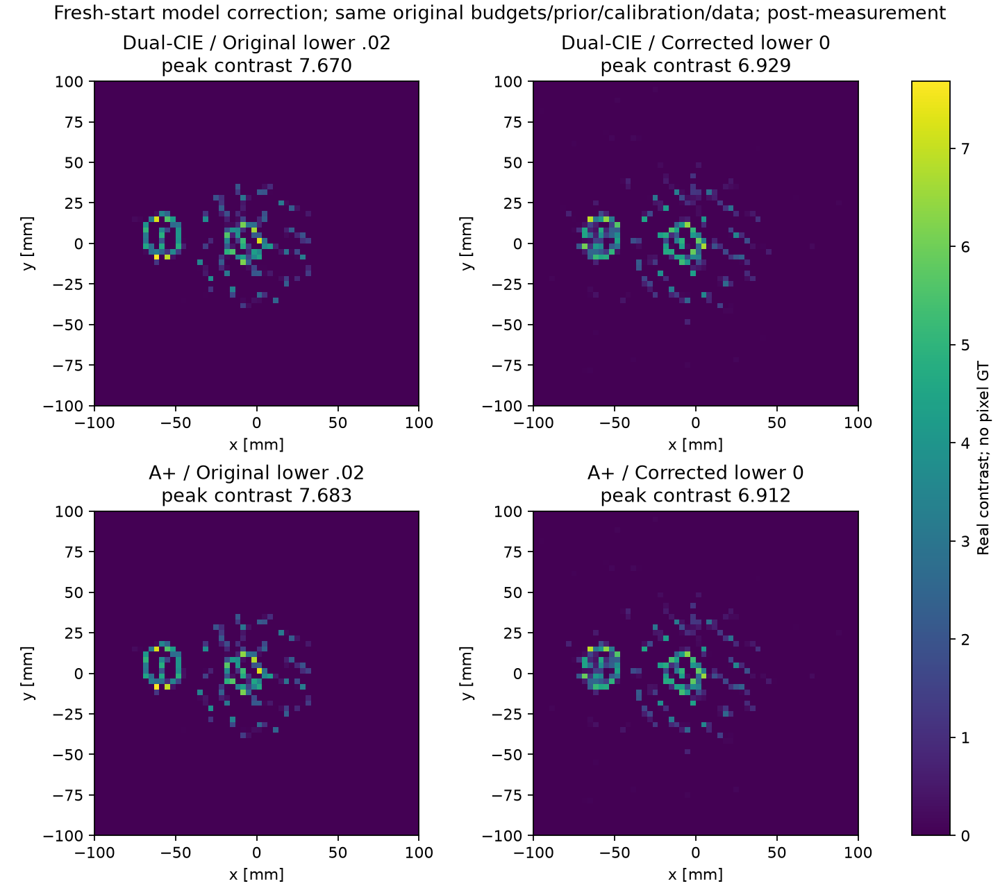

# MAX-STRUCT-R8：神经初值如何进入 CIE/A+，以及物理模型如何限制成像

本轮实际执行、评分和研究分析已完成；所有新增工作位于R8，R1–R7保持不变。750项原比较与126项机制扩展先分别完整封存，再统一开测试真值评分。已运行、探索性尝试和未完成的原尺度任务分别标记。

## 先给判断

**本轮已经完成轻量NN训练、接入成熟FFT-TSOM/CIE及sourcewise/global A+、原论文Austria合同实验、Fresnel真实测量反演和真正的3D矢量材料反演。现有跨合同证据不足以支持“A+普遍优于成熟CIE”。** 更有价值的认识是：材料初值携带的信息会被硬DPCS、早期Fourier截断以及校正前的候选选择改变。一个好的NN材料初值不一定能完整进入辅助current迭代；更精确地传递current，也不保证到达更好的材料终点。

此外，Fresnel发现了一个实质性物理约束问题：沿用合成任务的正contrast下界，会排除实测ROI中的空气。在同一已支付锚点上仅将下界从.02改为0，8GHz留出误差从.266降到.136，但内部高峰并未消失。这是可行材料集合的修正，不能记为A+或NN的收益。

**独立确认的主要正结果来自NN接直接原物理优化，而非NN接A+。** 同分布/未训练家族/跨网格的平均幅度NRMSE分别为.0965/.1624/.0843；NN接global A+为.2961/.5939/.3293，sourcewise A+为.3218/.5916/.3281。固定APCS偏置在部分对象改善，但没有稳定保住NN直接物理支路的收益。原A+在历史弯条上的作用仍存在，不能推广成普遍优势。

NN直接物理相对均匀初始化的同一物理算法改善了材料质量，但平均花费更多时间，不能称该比较中加速；相对本轮CIE/A+辅助管线，它在每个硬件/cohort层的最终平均CPU与NRMSE都更低。相同已支付预算的比较仍有反例和宽区间，不主张逐对象普胜或通用SOTA。NN训练分布是额外先验，费用和物理适用域必须保留。

## 1. 实际完成了什么

|证据组|实际工作|不能据此宣称什么|
|---|---|---|
|轻量初始化器|1536训练、192验证；24737参数，120epoch；另有同容量Born特征网络及论文域适配网络|通用神经逆散射发明，或训练先验不算额外信息|
|独立确认|42新材料，24同分布、12未训练家族、6跨网格；750原任务+126机制扩展|876个独立样本，或开发对象重新变盲测|
|开发诊断|8验证材料，48原始轨迹+32仿射偏置对照|靠开发胜例证明泛化|
|历史回归|4公开困难材料、21新端点，复用19旧端点|新的独立确认成功率|
|原论文对象|59个实际端点，包含150²生成/64²反演Austria、较长corrector及域偏移修复|59个独立材料，或独立NIE实现就是作者成熟软件|
|Fresnel|真实2001单/双圆柱、2005 FoamTwinDiel；校准、逐源接收、五方法、NN迁移、NIE、多频及air0诊断|逐像素GT精度，或同算子synthetic冒充实测|
|真3D|TensorDDA全矢量，52个小尺度端点；独立Mie与网格、另3λ原电尺寸实际尝试|2D堆叠、原论文60³/30³已完整复现，或3D NN已训练|

明细分别见[数据合同](BENCHMARKS.md)、[原论文实验](PAPER_BENCHMARKS.md)、[后续分析](PAPER_FOLLOWUPS.md)、[Fresnel](FRESNEL_REPORT.md)、[三维](VECTOR3D_REPORT.md)。同对象的算法、噪声、初始化和网格变体不增加统计对象数。

## 2. 从公式得到的实际机制

### 2.1 NN材料与辅助电流不是同一个初值

原全波模型为`J=X(Einc+GJ)`，观测`F=S(I−XG)⁻¹XEinc`。FFT-TSOM的电流族为`J=Jd+UA`，其中`U=(I−Pd)F_k`，`Pd`是保留接收奇异子空间的正交投影。NN只给材料m0时，原辅助初始化仍是Jd；直接把物理电流jp投影到这个截断族，也会损失一部分信息。

投影位移精确分成`δjD=Jd−Pd jp`和`δjN=Pu jp−(I−Pd)jp`。第一项来自硬DPCS与NN端口预测的不一致；第二项来自Fourier截断。两项在电流欧氏范数中正交，但Maxwell本构缺陷是`(I−X0G)(δjD+δjN)`，传播算子之后不再保证正交。因此“电流更接近物理解”不推出“本构残差更小”，更不推出材料恢复更好。

本轮实现了简单接法：固定`Ja=Jd+(I−Pd)jp`，再优化`J=Ja+UA`、`A0=0`。它保留初始物理电流的整个APCS分量，优化未知量不增加，最终完整APCS可行族也不变；早期截断仿射族发生平移。jp复用已有初值forward，新增投影与存储照实收费。该接法同样适用于普通Dual-CIE，不能把其全部收益归给A+。

这不是新的Maxwell恒等式。正交投影、学习current再接TSOM等均有先例；本轮可能成立的增量是明确定位投影损失、展示简单修复的作用及反例，并检验总成本后的恢复效果。[完整推导](THEORY_DERIVATIONS.md)保留条件和反例。

### 2.2 校正前选根并不保持校正后的排序

设C为相同original-Maxwell corrector。即使C对每个输入都下降，`Phi(a)<Phi(b)`也不意味着`Phi(C(a))<Phi(C(b))`。辅助阶段可能选到一个当时目标更低、但后续比NN直接物理优化更差的起点。

因此既运行NN+CIE/A+，也运行NN+直接物理优化，并在开GT前冻结两支路终点按原Phi选择的组合。两条支路全部收费。这是标准的保留候选控制，不是免费增加一次corrector，也不是新的全局收敛定理。

开发对象0003上，原NN global A+的幅度NRMSE=.4249，截断联合初始化=.7420，固定偏置后的Dual/global A+/sourcewise A+=.0315/.0326/.0326；然而NN直接物理优化=.0297且更便宜。0002、0005的偏置结果改善来自最终选择stage−1，实质上保留NN初值再校正，不能算辅助current解的贡献。

反例0006更重要：原联合初始化=.0527，偏置Dual/global/sourcewise却=.6846/.5844/.6036。全部8个初始本构缺陷都改善，材料终点却不统一改善。这否定了“初始缺陷降低可单独预测恢复”的推断。没有用这些开发结果修改确认集评分或挑选测试对象。

### 2.3 A+与sourcewise/global的作用位置

A+保留普通CIE current更新，仅对材料读出使用R7的Möbius条件结构和MM接受。`z_i=m_i/[1+(β−Gii)m_i]`下，零自作用传播使单坐标状态残差对z_i条件仿射。其接受只控制固定电流材料子问题，不认证原Phi或GT误差。

本轮实际比较sourcewise/global × ordinary/A+，每一格同时有均匀与NN材料初始化。主确认还保留原A-material及直接物理优化。用户提出的NN接入sourcewise/global A+已经作为完整42对象比较执行，并非只在好看的对象上展示。

## 3. 神经初始化与独立确认

以下为**完整预算端点的平均幅度NRMSE；括号为继承复合材料标签的成功数**。标签要求NRMSE≤.15、Otsu IoU≥.7及box合法，只用于评分。不同总体不合并；相同端点预算上限不等于相同实际计算费用。

|方法|同分布24|未训练家族12|跨网格6|
|---|---:|---:|---:|
|均匀→原物理|.2497（2/24）|.4047（1/12）|.1959（2/6）|
|NN→原物理|**.0965（9/24）**|**.1624（6/12）**|**.0843（2/6）**|
|均匀→single CIE|.3443（8/24）|.6101（3/12）|.3275（2/6）|
|均匀→Dual-CIE|.3684（7/24）|.6383（1/12）|.3282（2/6）|
|均匀→Global-Dual|.3569（8/24）|.6254（2/12）|.3287（2/6）|
|均匀→原A-material|.3389（8/24）|.6359（2/12）|.3288（2/6）|
|均匀→global A+|.3406（8/24）|.6375（1/12）|.3283（2/6）|
|NN→Dual-CIE|.3282（7/24）|.5678（2/12）|.3283（2/6）|
|NN→Global-Dual|.2892（8/24）|.6048（1/12）|.3283（2/6）|
|NN→global A+|.2961（7/24）|.5939（2/12）|.3293（2/6）|
|NN→sourcewise A+|.3218（7/24）|.5916（2/12）|.3281（2/6）|
|NN固定偏置→Dual|.2901（7/24）|.5230（4/12）|.2599（2/6）|
|NN固定偏置→global A+|.3140（5/24）|.5183（4/12）|.2280（2/6）|
|NN固定偏置→sourcewise A+|.3129（6/24）|.5016（4/12）|.2283（2/6）|

其余完整臂及全部逐对象值保留在[630主比较表](delegated/warm_analysis/PRIMARY_630_object_rows.csv)、[126偏置结果](delegated/warm_anchor_analysis/CONFIRMATION_SCORES.json)和[全部42材料图](FIGURES/warm_material_all_42.pdf)。NN原始初值的平均NRMSE为.1469/.2190/.1205，后续直接物理优化改善到上表值；不是只把网络输出当作最终重建。ID中15个NNdirect未达复合标签的对象，有12个仅IoU未过，因此不能把标签失败全称为高连续材料误差。

固定偏置的结果与开发预测相符的是“有条件修复”，不支持“保留更多物理current必然更好”：未训练家族成功从原NN A+的2/12升到4/12，但仍低于NNdirect的6/12；ID global A+反而从7/24降到5/24。普通Dual也得到相近修复，不能归为A+专属结构。

### 3.1 一个具体的路径反例

预先选定展示对象0027中，NN初值Phi=.30965，global A+给出的校正前候选Phi=.01565，看起来更好。但NN直接物理优化在1814 accepted步按PGTOL正常停止，最终Phi=.00042866、NRMSE=.12082、IoU=.84967；global A+校正3000步到上限，最终Phi=.00046350、NRMSE=1.01370。sourcewise A+同样失败；固定偏置Dual在2789步达到数值PGTOL仍NRMSE=1.06415。

该例中NN直接支路实际少于3000步，不能简单用它的6000步上限解释优势；它支持“校正前更低Phi可以丢失更好后续轨迹”。但没有证明辅助支路永远不能逃出某盆地。全组的严格符号差计数可能包括浮点微差，不能全部称为实质失败。

### 3.2 同预算与完整成本

按对象取两方法最终实付成本的较小者作为共同上限，并只用该上限内已保存的原Phi incumbent，不按GT挑迭代。CPU、LU、complex RHS各自比较；稀疏checkpoint造成的未用预算与间隔均公开。NNdirect相对均匀direct的五个硬件/cohort层，同CPU上限下平均NRMSE差均为负，但它的最终CPU是均匀direct的1.06–2.74倍：均匀支路经常较早停在较差结果，不能把它的失败快停当作完成相同质量任务。

相对辅助算法，NNdirect在五个硬件/cohort层的最终平均CPU约为：ID Mac32.03、ID i969.77、未训练家族Mac39.12、i9128.52、跨网格Mac30.82秒；对应均匀Dual为62.12、144.84、69.89、159.74、62.65秒。该比较包含部署特征/推理，未把训练当免费。后续补充的十个直接对照属于**看到结果后的描述性成本分析**，不是新预注册显著性检验。同CPU上限下也有小反例：ID/i9 NNdirect对NN Global-Dual平均NRMSE差+.00281，95%描述区间[−.06069,+.06401]；不能称普遍优势。不同硬件层包含不同对象，不能把层间差异归因于硬件。

完整区间及费用见[数字备忘录](delegated/warm_analysis/FINAL_NUMERIC_MEMO.md)与[直接物理成本对照](delegated/warm_direct_budget_analysis/REPORT.md)。许多小分层区间跨零，未经多重比较修正；结论限定在本次冻结对象和模型。

### 3.3 保留候选也不能用低Phi代替材料选择

两条完整NN支路按最终原Phi选择的global A+组合，在ID达到NRMSE=.07754、13/24，比NNdirect的.09647、9/24改善；但未训练家族变为.34498，跨网格变为.22882，均比单NNdirect差。费用是单NNdirect的2.38–3.17倍。Global-Dual组合有非常接近的结果，不能把组合收益归为A+唯一作用。

这不是GT挑根或隐藏了免费corrector：两个候选在开GT前已按Phi封存选择，两条支路全部收费。负结果表明，末端较低Phi也不能保证正确材料；不能为了保住算法主张改成离线best@K。

额外120项只覆盖预定8对象（ID4、未训练家族2、跨网格2），实际完成均匀1、Born、DPCS、随机和Born-only网络消融。Born-only NN接global A+在ID4上4/4，physics NN为3/4，但两者在这2个未训练家族对象上都0/2；不据这个小子集回选正式权重或宣称42对象优势。全部负例与训练费用保留。

网络输入是公开测量的Born/DPCS反投影、场能量和采集参数，不含GT、支撑、形状名或真实contrast。1536训练与192验证按独立材料种子划分，12个未训练家族对象另外保留。NN提供了训练分布先验，即便最后显式prior相同，也不能称没有额外先验。

原physics网络训练CPU387.69秒，含自身训练/验证生成的边际训练成本402.56秒；Born及域适配开发另计。推理成本只是总成本的一小部分，真正要看完整辅助与物理迭代是否节省，以及节省能否摊销训练。训练耗时不能只取最佳epoch之前的一小段。

## 4. 历史A收益保留了吗

在7b8d、b20d两条已公开困难弯条上，NN global A+的幅度NRMSE=.04559/.04096，NN sourcewise A+=.04551/.04179，都保留原有恢复。NN Dual-CIE两例未恢复；NN直接物理优化仅恢复b20d。42cb与开缝壳40ac仍共同失败。

这说明在这些历史对象上，NN没有自动替代A+改变轨迹的作用；它们存在互补的机制证据。但4对象不能证明普适优势；旧R6与新R8实现有FFT数值细节差别，严格初始化比较以同版本新增臂为准。[全部四对象及失败图](HISTORICAL_WARM_STARTS.md)不做成功筛选。

## 5. 原始NIE/CIE对象与跨物理泛化

Austria不是仅画一个近似图案：实际采用论文2m区域、20平面波、40接收、10%复RMS噪声，并运行150²生成/64²反演。εr=4、400MHz下，CIE/Dual/global A+/sourcewise A+/独立NIE的幅度NRMSE约.441/.427/.501/.440/.441。数据残差接近.10，但内部环伪影和接近contrast20的峰值仍存在，真contrast只有3。

原合同4096个独立实材料变量只有800复观测。Jacobian实核维数至少2496；恒秩、内点等条件下可讨论局部等数据族，但不能据此证明该有空气活动边界的特定Austria真值存在同box多解。跨网格误差又与噪声共同存在。这里越来越低的数据残差不能独立决定材料选择。

原NN在论文采集上域偏移明显，因此实际补训256个论文域随机材料和64验证对象，包含不同家族但不含Austria真值。25025参数网络训练80epoch，与原训练数据平衡混合。它改善若干早期A+结果，但较长共同校正又可能降低residual、恶化材料；没有因此宣称域适配解决了问题。原确认权重未被替换。

独立NIE按原式和停止规则实现，但不称作者认证的成熟代码。原论文预算、坐标、prior与适配差异均在对照报告中列明。

## 6. Fresnel为什么失败，修正到哪一步

本轮使用真实原始测量，而非合成替代。逐源mask和adjoint保留全部合法通道；用target-absent数据拟合满足背景方程的入射场，替换R7单一柱面波近似。单/双圆柱空场留出误差约.025/.024，旧近似约.391/.384；Foam约.115，旧近似约.644。独立圆柱/多体散射检查量化了网格误差，不能把校准拟合本身叫物理验证。

Foam原五方法的8GHz留出误差都约.266，材料都有不可信的环/尖峰。A+把A的材料内评价11135次降到2710次，辅助CPU76.93秒降到57.74秒；这只是该合同上的局部费用改进，不能掩盖共同的材料问题和总费用。真实数据无可信逐体素GT，因此不报告伪造的NRMSE或IoU。

固定NN迁移到2001单圆柱后几乎回到相同终点，没有建立总成本收益。双圆柱存在不同材料终点而测量预测很相近，但这不是严格连续多解证书。独立NIE使用air0、无额外prior、无共同corrector的另一个合同，较平滑但留出误差约.348，不能直接称材料更准。

从相同锚点加入6GHz数据，两频留出RMS从.3033降到.2324，6GHz改善、8GHz略恶化；峰值虽降低仍偏高。这是新增信息的收益与权衡，不能记作同数据A+提升。

随后发现原[.02,20]下界排除了真实空气。保持同一锚点、prior、校准、通道与上界，只有下界改为0，300步物理校正将8GHz train .2255降到.0816、heldout .2660降到.1361；6GHz事后预测也改善。外缘区域98.27%可回到0，说明先前人为背景具有实质影响。但峰值从7.639升到7.964，内部尖峰仍未解决。此项为事后模型诊断，不能声称材料已恢复。

进一步从共同初值.1重新运行air0 Dual-CIE和A+，保持原3000辅助/1000校正预算、prior、校准、通道和各自PR规则。两支8GHz留出分别.137237/.137128，CPU741.18/750.06秒，均达到1000步上限；材料相对差2.35%、实际通道预测差.1215%，峰值仍约6.93/6.91。修正后的材料图接近，没有可信A+恢复增量。两支都改善原合同的拟合，说明首先需要修正物理可行集合。现25项实测运行完整保留，总已测CPU10603.74秒，失败成本另计。

## 7. 三维不是二维堆叠，但还没有稳定优势

三维采用真实dyadic Green、三分量current/field、60个外部电偶极及矢量接收，包含实材料四立方体、空腔/棒、有损包覆体。实scalar体素在sI3自项下可以推导A+条件结构；复介电不能直接使用实圆弧，本轮采用合法复参数读出，未假装复A+已完成。

原投影IDFT系数PR下，四立方体LSIE/CIE/Dual/Global/A/A+的relative-L2材料误差约.4632/.4620/.4638/.4630/.4624/.4608；A+ CPU40.84秒，其余约17.47–22.09秒。误差差异很小，费用更高，未形成竞争力。8³反演/10³生成后误差约.249，各方法仍相近；空心立方体仍失败。

Mie球参考中，极化率保持的部分单元修正把5³/6³/8³误差降到6.38%/4.88%/3.88%。这是标准有效介质结构的应用，不能把这些误差贴到不同尺寸的全部成像对象。3λ论文原电尺寸也进行了真实16³生成/12³反演尝试，因内波长解析不足及费用保留截断结果；未完成60³/30³成熟复现。

重复callback导致的多余LU经过缓存修正，同结果的8³ LSIE CPU从227.39秒降到101.28秒，LU653降到350。这是真实工程改进，所有最终臂共享，失败和旧费用保留。

## 8. 成本、公平性与论文资格

所有新确认对象的全部方法在同一机器运行；Mac/i9绝对CPU分层，同对象配对。材料、源、网格不同的LU不能直接当等成本。辅助FFT、材料内循环、feature/SVD、推理、训练、拒绝候选、两支路和失败均计费。并行线程wall之和不是研究历时；缺失计时为null或已知下界，不能填零。

完整预测和候选选择先封存，再开测试GT。新集算法冻结后不按评分回调网络、β或预算。126项固定偏置扩展是在公开验证上提出、测试GT仍未读取时追加，保留时间及原750项，不伪装最初一次性预注册。部分公开测试Phi已在执行期间可见，材料评分始终隔离。

目前最合理的论文定位是**学习初值的辅助状态传递、候选排序与模型适配边界的机制研究**，结合低成本NN直接物理优化的冻结基准证据和A+条件更新的费用分析；不是已经成立的通用更强Maxwell反演器。CS-Net、learned warm start、NeuralBIM、CIE-SOM-NET等已有直接先例，泛称“NN+CIE”不具有足够新颖性。

实验规模、原数据和反例已足够形成可审查的完整初稿，但尚不支持以“广泛击败成熟CIE的A+算法”作为IEEE TAP/Inverse Problems论文主张。还缺一个原创且可预测的状态传递/选择机制，在新确认中既保留NNdirect收益又提供其没有的材料增量，并在合格实测/3D合同下重复。完整初稿不等于已满足期刊新颖性和接受要求，见[新颖性审计](PRIOR_ART_AND_NOVELTY.md)和[英文初稿](PAPER_DRAFT.md)。

## 9. 下一步应继续哪条公式

优先研究`(I−XG)δj`与材料切向读出的联系，以及`C(argmin Phi)`和`argmin Phi(C)`在实际预算中的差别。现有反例提示：仅降低current投影误差不够；需要保留有价值的物理分支，并找出无需GT、无需昂贵双路全跑的选择依据。此处尚无成熟预测器或全局保证，不以更高阶Taylor或更深网络替代这个问题。

实测下一步应围绕合法air背景、照明/接收校准与离散误差，三维则围绕内波长/界面解析和模型误差下的材料选择。没有证据支持继续盲扫β、只加corrector或扩大网络深度。

复现、全部数组、失败、费用和独立对象图分别见[REPRODUCE](REPRODUCE.md)、[RESULTS](RESULTS/)、[FAILURES](FAILURES.md)、[COST_LEDGER](COST_LEDGER.md)、[FIGURES](FIGURES/)。最终公开归档链接将在发布核验后加入交接文件。
