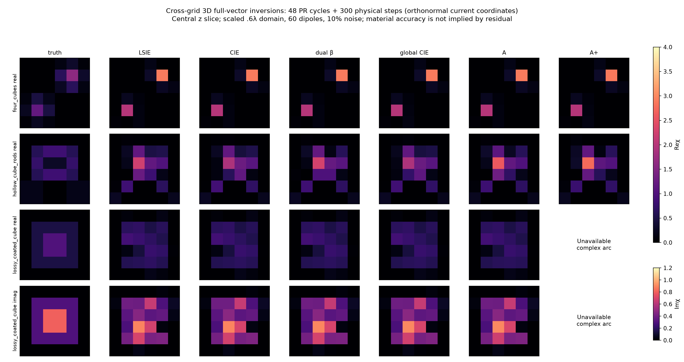
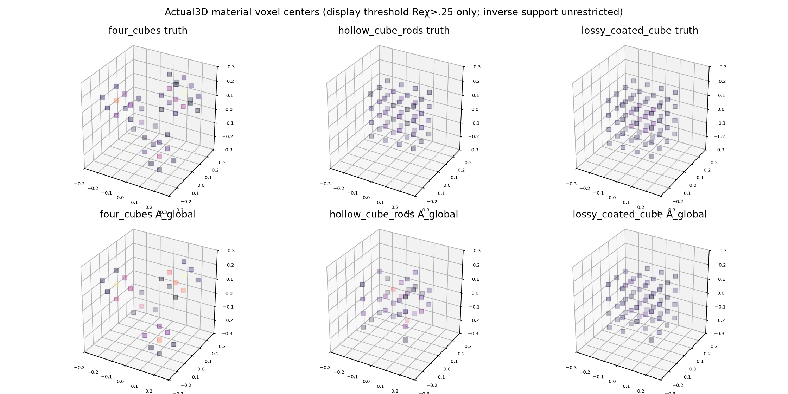
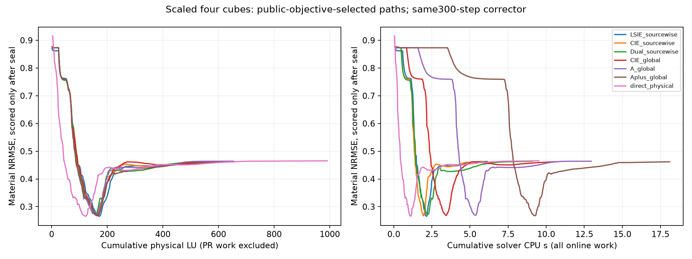
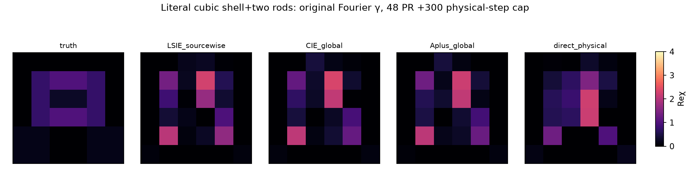
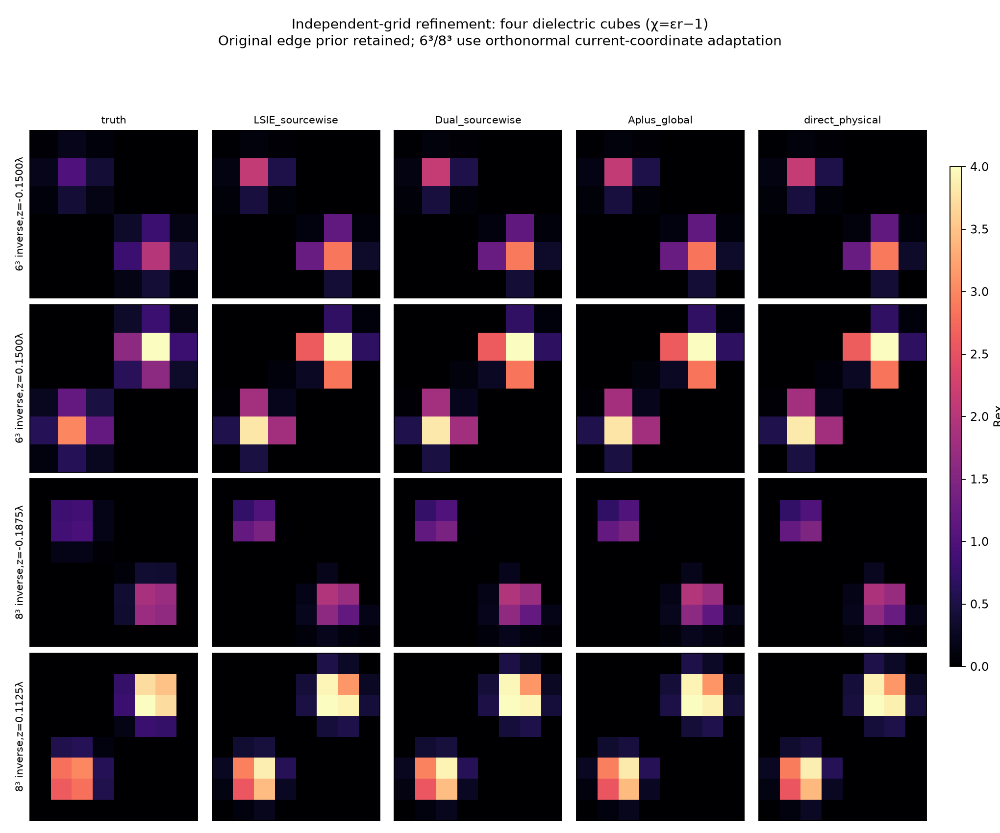
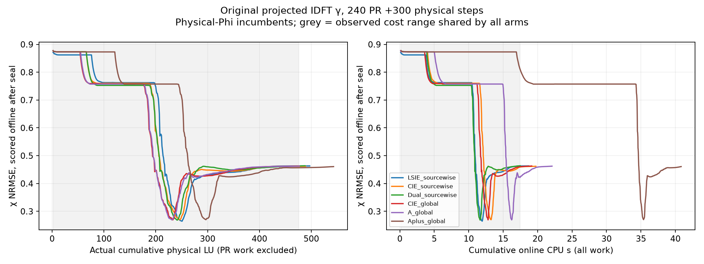

# R8 genuine 3D vector material inversion refinement

**Status: actual cross-grid multi-object inversions; no 3D A superiority established.** Material scores use exposed development targets, not blind holdouts. Every prediction and trajectory is written before scorer access. R1–R7 remain untouched.

## Original 2019 physical and algorithmic contract

[Zhong and Xu 2019, DOI10.3390/jimaging5020027](https://pmc.ncbi.nlm.nih.gov/articles/PMC8320915/) uses a 3λ cuboid, 60 dipole illuminations and 60 colocated vector receivers on three offset circles of radius3λ, all three electric components (10800 complex observations), fine60³ synthetic/inverse30³ grids and10% additive noise. Four cubes have side.8λ, eps2/3/4/5 and centers (−.7,.7,−.7),(.7,−.7,−.7),(−.7,−.7,.7),(.7,.7,.7)λ. The coated cube outer side2λ has eps1.5+.3i, inner side1λ eps2+.8i. The hollow cube+two rods use eps2.5; exact dimensions are not provided in the article prose, so our declared dimensions are an adaptation. Paper CIE uses SVD DPCS, projected low-frequency FFT APCS, source-normalized objectives, beta6→1, and optional distinct current/material beta.

## Implemented 3D contract and adaptations

The scaled set uses .6λ cube,6³ independent isotropic inverse material DOFs,8³ independently assembled synthetic physics,60 finite-distance electric dipoles and60 full-vector receivers with paper circle offsets scaled by.2,10% fixed-seed complex Gaussian noise. All object dimensions are scaled by.2 except the explicitly adapted hollow geometry. Full R1 dyadic near-field coupling, all three current/field components, CM+RR self and complex passive material convention exp(−iωt) are retained. Lossless chi is bounded[0,4]; lossy Rechi[0,4],Imchi[0,1.2]. Exact analytic box volume fractions stabilize declared geometry; volume-averaged chi is an interface approximation. This is smaller electrical size than the paper and is explicitly not a paper reproduction.

Receiver SVD threshold=.1 of largest singular value is fixed from public operator/noise scale. APCS= (I−VV*) IDFT(mask γ); actual3D inverse FFT constructs low-frequency columns with MF1→2. The first controls use an SVD orthonormal range of these projected columns: this preserves the affine family but preconditions the PR coefficient metric and is not the original Fourier gamma coordinates. The final six-arm240-cycle Fourier-coordinate run retains the original projected IDFT columns without whitening. Dense dyadic propagation remains; no FFT-complexity claim. First15 controls solve each reduced quadratic current problem exactly; these are development controls. Final sourcewise/global Polak–Ribiere implementations use the same DPCS/APCS affine family and exact quadratic step length. Global shares one coefficient over all source columns; sourcewise uses per-source coefficients. The dual control uses current beta3/material beta1 in stage2.

A uses self-stripped b=beta−s and the actual full3×3 off-diagonal dyadic H within disjoint2³ voxel blocks: u=beta(j−chi Q)/(1+bchi), R=u+zHu,z=chi/(1+bchi). A material updates include the complete material-dependent derivative. A+ uses real scalar-isotropic common self sI3: conditional R=C+D z_i across all three components and sources. State objective is q|z_i|²+2Re(h z_i); stationary numerator qx(1+Re(b)x)+Re[h(1+conj(b)x)²]. Two coordinate sweeps enumerate legal roots/endpoints/current, compare the complete original quadratic prior and retain the old state if the whole loss increases by more than the declared1e−13 numerical tolerance. This is a state-stationary proposal method, not exact regularized minimization. Complex chi spans a two-real-dimensional region; A+ is NOT_AVAILABLE for loss, while A uses bounded joint Re/Im optimization.

All candidates are selected by original full-Maxwell data loss plus the same smooth/l2 prior; truth never enters selection. Every arm receives max300 full-physics L-BFGS-B correction. Cap exits are not convergence. Direct control has192 initial physical steps plus same300 allowance. Equal iteration counts are not equal compute; LU/RHS, current factors/PR steps, CPU and full trajectories are preserved.

## Cross-grid discrepancy and physics qualification

- four_cubes: independently assembled8³→6³ forward discrepancy 15.16%; additive noise10%.
- hollow_cube_rods: independently assembled8³→6³ forward discrepancy 10.07%; additive noise10%.
- lossy_coated_cube: independently assembled8³→6³ forward discrepancy 4.46%; additive noise10%.

Complex off-root physical derivative relative error3.83e−9; LSIE/CIE/A errors≤5.62e−10. This necessary new complex adapter check is separate from frozen identities. Same LU with multiple sources is counted as one factorization with60 RHS, never independent validation. Cross-grid simulations use distinct meshes, assemblies and factorizations; they are distinct discretizations of the same DDA model, not independent continuum solvers.

One new physically motivated geometry correction addresses R7 boundary bias on its .4λ box (h=.08/.06667/.05λ for5³/6³/8³). These are not the R8 .6λ imaging grids (h=.1/.075λ), so the Mie percentages cannot be assigned to those reconstructions. The correction is: use electrostatic polarizability-preserving Maxwell–Garnett mixing chi_eff=3 f chi/[3+(1−f)chi] with fixed24³ midpoint cell fractions, no fitted parameter, volume rescaling or scan. This is not exact cut-cell interface physics.
- Sphere radius.145λ eps3: grid5³, h=0.08000λ, Mie far-vector error 6.378%, volume 0.0127639 versus 0.0127701.
- Sphere radius.145λ eps3: grid6³, h=0.06667λ, Mie far-vector error 4.882%, volume 0.0127788 versus 0.0127701.
- Sphere radius.145λ eps3: grid8³, h=0.05000λ, Mie far-vector error 3.875%, volume 0.0127646 versus 0.0127701.

## Actual scaled multi-object results

|Target|Method|Raw NRMSE|Final NRMSE|Residual|CPU s|Physical LU|Stop|
|---|---|---:|---:|---:|---:|---:|---|
|four_cubes|LSIE_sourcewise|0.7625|0.4632|0.1015|6.14|656|STOP: TOTAL NO. OF ITERATIONS REACHED LIMIT|
|four_cubes|CIE_sourcewise|0.7602|0.4626|0.1015|5.94|653|STOP: TOTAL NO. OF ITERATIONS REACHED LIMIT|
|four_cubes|Dual_sourcewise|0.7558|0.4637|0.1015|9.10|653|STOP: TOTAL NO. OF ITERATIONS REACHED LIMIT|
|four_cubes|CIE_global|0.7602|0.4623|0.1015|10.79|653|STOP: TOTAL NO. OF ITERATIONS REACHED LIMIT|
|four_cubes|A_global|0.7594|0.4640|0.1015|12.97|653|STOP: TOTAL NO. OF ITERATIONS REACHED LIMIT|
|four_cubes|Aplus_global|0.7594|0.4617|0.1015|18.12|656|STOP: TOTAL NO. OF ITERATIONS REACHED LIMIT|
|hollow_cube_rods|LSIE_sourcewise|0.4791|0.9961|0.1010|12.93|655|STOP: TOTAL NO. OF ITERATIONS REACHED LIMIT|
|hollow_cube_rods|CIE_sourcewise|0.4826|0.9945|0.1010|13.86|656|STOP: TOTAL NO. OF ITERATIONS REACHED LIMIT|
|hollow_cube_rods|Dual_sourcewise|0.4895|1.0280|0.1010|13.17|655|STOP: TOTAL NO. OF ITERATIONS REACHED LIMIT|
|hollow_cube_rods|CIE_global|0.4826|0.9936|0.1010|13.57|656|STOP: TOTAL NO. OF ITERATIONS REACHED LIMIT|
|hollow_cube_rods|A_global|0.4817|1.0487|0.1009|16.18|653|STOP: TOTAL NO. OF ITERATIONS REACHED LIMIT|
|hollow_cube_rods|Aplus_global|0.4817|1.0584|0.1009|17.78|654|STOP: TOTAL NO. OF ITERATIONS REACHED LIMIT|
|lossy_coated_cube|LSIE_sourcewise|0.3271|0.4228|0.0992|12.65|654|STOP: TOTAL NO. OF ITERATIONS REACHED LIMIT|
|lossy_coated_cube|CIE_sourcewise|0.3268|0.4196|0.0992|13.14|653|STOP: TOTAL NO. OF ITERATIONS REACHED LIMIT|
|lossy_coated_cube|Dual_sourcewise|0.3257|0.4217|0.0992|14.26|653|STOP: TOTAL NO. OF ITERATIONS REACHED LIMIT|
|lossy_coated_cube|CIE_global|0.3268|0.4187|0.0992|14.63|653|STOP: TOTAL NO. OF ITERATIONS REACHED LIMIT|
|lossy_coated_cube|A_global|0.3298|0.4187|0.0992|17.56|653|STOP: TOTAL NO. OF ITERATIONS REACHED LIMIT|

## Lossy real and imaginary material scores

|Method|Real χ NRMSE|Imaginary χ NRMSE|
|---|---:|---:|
|LSIE_sourcewise|0.3848|0.4951|
|CIE_sourcewise|0.3826|0.4902|
|Dual_sourcewise|0.3831|0.4951|
|CIE_global|0.3812|0.4902|
|A_global|0.3821|0.4887|
|direct_physical|0.3925|0.5193|

## Preserved exact-current adapted controls

|Target|Method|Raw NRMSE|Final NRMSE|Residual|CPU s|Physical LU|Stop|
|---|---|---:|---:|---:|---:|---:|---|
|four_cubes|LSIE_TSOM|0.7730|0.4633|0.1015|5.44|621|STOP: TOTAL NO. OF ITERATIONS REACHED LIMIT|
|four_cubes|CIE_TSOM|0.7706|0.4625|0.1015|5.47|621|STOP: TOTAL NO. OF ITERATIONS REACHED LIMIT|
|four_cubes|CIE_dualbeta_TSOM|0.7640|0.4644|0.1015|5.52|621|STOP: TOTAL NO. OF ITERATIONS REACHED LIMIT|
|four_cubes|A_TSOM|0.7690|0.4650|0.1015|6.46|622|STOP: TOTAL NO. OF ITERATIONS REACHED LIMIT|
|four_cubes|direct_physical|0.4519|0.4654|0.1015|9.52|992|STOP: TOTAL NO. OF ITERATIONS REACHED LIMIT|
|hollow_cube_rods|LSIE_TSOM|0.4915|0.9898|0.1010|5.57|626|STOP: TOTAL NO. OF ITERATIONS REACHED LIMIT|
|hollow_cube_rods|CIE_TSOM|0.4892|1.0225|0.1009|5.57|624|STOP: TOTAL NO. OF ITERATIONS REACHED LIMIT|
|hollow_cube_rods|CIE_dualbeta_TSOM|0.4956|0.9895|0.1010|5.53|623|STOP: TOTAL NO. OF ITERATIONS REACHED LIMIT|
|hollow_cube_rods|A_TSOM|0.4881|1.0050|0.1010|6.06|621|STOP: TOTAL NO. OF ITERATIONS REACHED LIMIT|
|hollow_cube_rods|direct_physical|0.9408|0.9688|0.1010|8.28|1002|STOP: TOTAL NO. OF ITERATIONS REACHED LIMIT|
|lossy_coated_cube|LSIE_TSOM|0.3718|0.4230|0.0992|5.62|621|STOP: TOTAL NO. OF ITERATIONS REACHED LIMIT|
|lossy_coated_cube|CIE_TSOM|0.3567|0.4196|0.0992|5.63|623|STOP: TOTAL NO. OF ITERATIONS REACHED LIMIT|
|lossy_coated_cube|CIE_dualbeta_TSOM|0.3532|0.4163|0.0992|7.25|622|STOP: TOTAL NO. OF ITERATIONS REACHED LIMIT|
|lossy_coated_cube|A_TSOM|0.3577|0.4177|0.0992|6.20|621|STOP: TOTAL NO. OF ITERATIONS REACHED LIMIT|
|lossy_coated_cube|direct_physical|0.3911|0.4366|0.0992|8.24|992|STOP: TOTAL NO. OF ITERATIONS REACHED LIMIT|

## Literal cubic shell and two rods: geometry correction

The earlier `hollow_cube_rods` folder used a .30×.26×.30λ cuboid with a .18×.16×.18λ void. Those arrays are preserved. This additional case uses actual cubes with outer/inner sides .30/.18λ and the same two rods, 60 dipoles, independent 8³ synthetic/6³ inverse grids and 10% noise. These dimensions are an explicit adaptation because the article prose does not specify them.

|Target|Method|Raw NRMSE|Final NRMSE|Residual|CPU s|Physical LU|Stop|
|---|---|---:|---:|---:|---:|---:|---|
|hollow_cubic_shell_rods|LSIE_sourcewise|0.5089|1.0690|0.1014|10.89|351|STOP: TOTAL NO. OF ITERATIONS REACHED LIMIT|
|hollow_cubic_shell_rods|CIE_global|0.5135|1.0250|0.1012|11.85|352|STOP: TOTAL NO. OF ITERATIONS REACHED LIMIT|
|hollow_cubic_shell_rods|Aplus_global|0.5117|1.0160|0.1013|14.22|356|STOP: TOTAL NO. OF ITERATIONS REACHED LIMIT|
|hollow_cubic_shell_rods|direct_physical|0.9906|0.9103|0.1014|12.20|496|STOP: TOTAL NO. OF ITERATIONS REACHED LIMIT|

## Necessary 8³ inverse / 10³ forward refinement

|Target|Method|Raw NRMSE|Final NRMSE|Residual|CPU s|Physical LU|Stop|
|---|---|---:|---:|---:|---:|---:|---|
|four_cubes_grid8|LSIE_sourcewise|0.8523|0.2493|0.1011|101.28|350|STOP: TOTAL NO. OF ITERATIONS REACHED LIMIT|
|four_cubes_grid8|Dual_sourcewise|0.8537|0.2515|0.1011|114.63|350|STOP: TOTAL NO. OF ITERATIONS REACHED LIMIT|
|four_cubes_grid8|Aplus_global|0.8533|0.2486|0.1011|115.50|351|STOP: TOTAL NO. OF ITERATIONS REACHED LIMIT|
|four_cubes_grid8|direct_physical|0.2399|0.2490|0.1011|121.52|495|STOP: TOTAL NO. OF ITERATIONS REACHED LIMIT|

Independent 10³→8³ forward mismatch is 10.607%, versus 15.161% for 8³→6³. The existing per-edge-mean discrete prior is retained; this is not an h⁻²-normalized continuum H1 comparison. See [simulation receipt](RESULTS/vector3d/refinement8/SIMULATION.json).

## Preserved 240-cycle PR budget with orthonormal coordinates

|Target|Method|Raw NRMSE|Final NRMSE|Residual|CPU s|Physical LU|Stop|
|---|---|---:|---:|---:|---:|---:|---|
|four_cubes|LSIE_sourcewise|0.7624|0.4634|0.1015|31.88|845|STOP: TOTAL NO. OF ITERATIONS REACHED LIMIT|
|four_cubes|CIE_sourcewise|0.7601|0.4646|0.1015|29.32|845|STOP: TOTAL NO. OF ITERATIONS REACHED LIMIT|
|four_cubes|Dual_sourcewise|0.7556|0.4620|0.1015|26.16|845|STOP: TOTAL NO. OF ITERATIONS REACHED LIMIT|
|four_cubes|CIE_global|0.7601|0.4623|0.1015|31.47|845|STOP: TOTAL NO. OF ITERATIONS REACHED LIMIT|
|four_cubes|A_global|0.7593|0.4636|0.1015|48.66|845|STOP: TOTAL NO. OF ITERATIONS REACHED LIMIT|
|four_cubes|Aplus_global|0.7593|0.4633|0.1015|73.16|845|STOP: TOTAL NO. OF ITERATIONS REACHED LIMIT|

## Final 240-cycle control with original Fourier coordinates

The original projected IDFT columns are retained without whitening. Sourcewise/global PR uses the original coefficient Euclidean metric. All arms share exact last-paid-state caching, 240 current updates and the 300-step physical corrector cap. This removes the coefficient-preconditioning difference; the port remains an adaptation of the original paper.

|Target|Method|Raw NRMSE|Final NRMSE|Residual|CPU s|Physical LU|Stop|
|---|---|---:|---:|---:|---:|---:|---|
|four_cubes|LSIE_sourcewise|0.7624|0.4632|0.1015|18.70|497|STOP: TOTAL NO. OF ITERATIONS REACHED LIMIT|
|four_cubes|CIE_sourcewise|0.7601|0.4620|0.1015|19.75|489|STOP: TOTAL NO. OF ITERATIONS REACHED LIMIT|
|four_cubes|Dual_sourcewise|0.7527|0.4638|0.1015|17.47|488|STOP: TOTAL NO. OF ITERATIONS REACHED LIMIT|
|four_cubes|CIE_global|0.7580|0.4630|0.1015|19.15|476|STOP: TOTAL NO. OF ITERATIONS REACHED LIMIT|
|four_cubes|A_global|0.7574|0.4624|0.1015|22.09|477|STOP: TOTAL NO. OF ITERATIONS REACHED LIMIT|
|four_cubes|Aplus_global|0.7574|0.4608|0.1015|40.84|543|STOP: TOTAL NO. OF ITERATIONS REACHED LIMIT|

## Original 3λ electrical-size attempt

A separate full-vector padded FFT adapter reuses the A18_C convolution form with the R1 dyadic/CM+RR convention, original60-source/60-receiver geometry and original four-cube dimensions. Synthetic16³/inverse12³ are much coarser than the paper60³/30³. At epsilon5, internal wavelength resolution is inadequate; original electrical size alone does not certify physical accuracy. Direct physical optimization is the only arm attempted at this size.
Measured attempt TRUNCATED after 20 initial iterations and 3 accepted corrector iterations out of the 30-step allowance. No convergence or completed-corrector claim. The sealed partial endpoint has χ NRMSE .24399 and physical data residual .27632. Independent 16³/12³ mismatch is 36.113%, so physical accuracy is not qualified. Total measured cost: 395.87 s wall, 379.59 s CPU, 356040704-byte peak RSS. The 16³ forward used 5292 FFT matvecs/60 primal RHS; the 12³ process used 232717 FFT matvecs, 3100 primal and 1560 adjoint RHS including the interrupted evaluation. No GMRES RHS failed; maximum paid linear residual was 2.00e−6. See [truncation](RESULTS/vector3d/original_size/TRUNCATION.json), [costs](RESULTS/vector3d/original_size/COSTS.json) and [offline score](RESULTS/vector3d/original_size/SCORE.json).

## Interpretation, costs and retained failures

Lower data residual does not establish better material recovery. In the exact-current controls, long physical correction worsens hollow material NRMSE from≈.49 to≈.99–1.02 while fitting the10% noise. Lossy correction also worsens material NRMSE; cross-grid model mismatch remains. Results do not establish A/A+ superiority, a better basin, uniqueness or mature full-scale3D CIE reproduction.

Exact-current process:99.743s wall/97.727s CPU,445923328-byte peak RSS. Per-arm receipts contain online cost; setup/SVD/FFT construction is counted separately inside the relevant method. The first PR process failed while serializing an already computed A+ receipt due to a numpy bool; its failure log was retained, bool conversion repaired, and that arm rerun. The first A+ prediction file was overwritten by the same-contract successful rerun; a separate initial-array snapshot is NOT_RETAINED, and bitwise equivalence is not claimed. Failed-attempt CPU was not instrumented separately and remains NOT_MEASURED; do not silently omit this overhead. Plot/report generation is outside solver timing.

Exact material/Y caching reduced the 8³ LSIE physical LU count from 653 to 350 (303 cache hits), and online CPU from 227.39 to 101.28 s, with the same reported residual. This is an engineering reuse benefit; it supplies no new physical information or independent validation.

The first 8³ attempt was interrupted to repair duplicate callback LU work. Its completed uncached LSIE receipt and partial-Dual OS CPU measurement are retained in `RESULTS/vector3d/refinement8_uncached_attempt/`. The observed 344.46 CPU seconds include the completed 227.39-second LSIE arm; these costs must not be double counted. All four final arms use the same state cache and unchanged 48+300 scientific budgets. The sealed 10³ observations were reused with zero new simulation LU. Engineering overhead remains separate from the online comparison.

Reproduce from repository root with project Python and one BLAS thread: `experiments/vector_benchmark.py`, `vector_pr_benchmark.py`, `vector_pr240_benchmark.py`, `vector_mie_geometry.py`, `vector_original_size.py`, then `vector_report.py`, all under `research/research_max_struct_r8/`. Preserve outputs before deliberate reproduction. No GPU, new service, provider change or R1–R7 modification.
