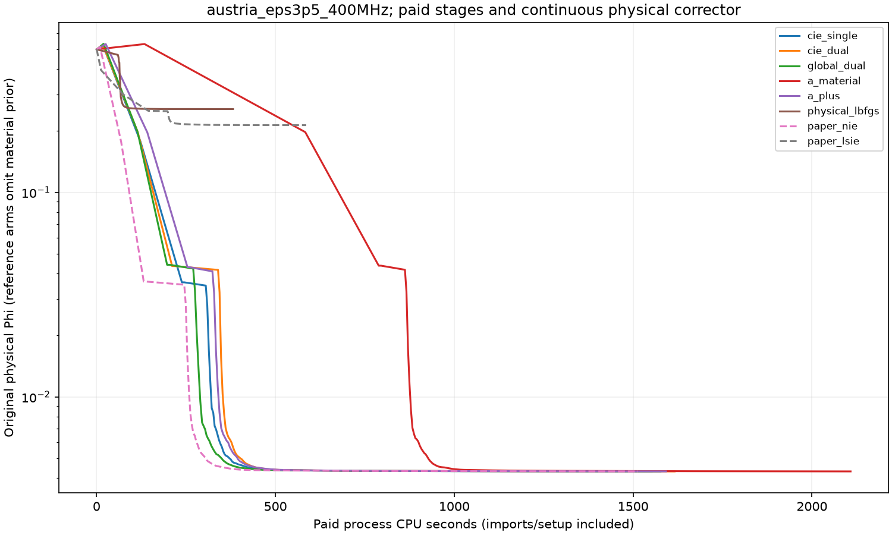
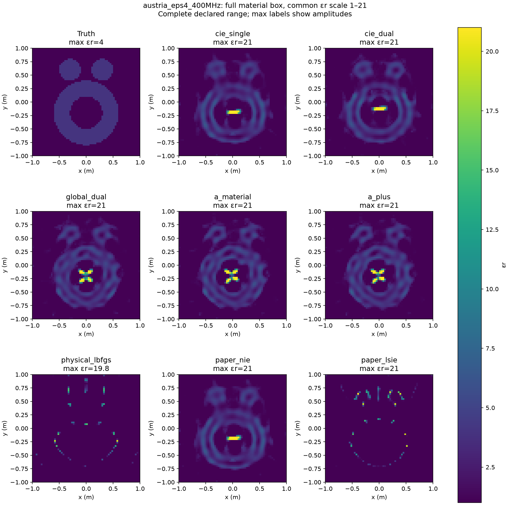
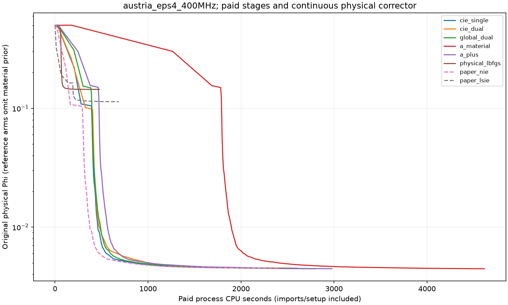
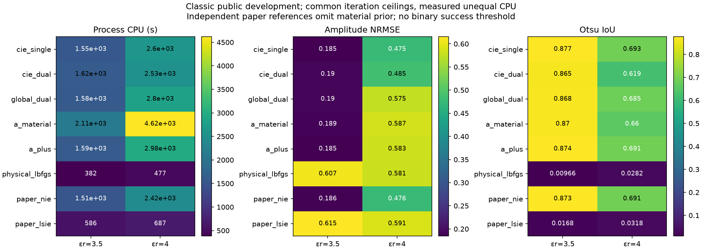

# 原始Austria二维采集合同比较（R9 phase2）

运行状态：**COMPLETED，16项Windows配方已全部terminal并先封存、后离线评分**。这是已公开论文对象的开发比较，不是新盲测确认集。原R9第一阶段113次反演的结论与成本账本保持冻结；本扩展单列 `RESULTS/classic_extension_xinan/PHASE2_COST_LEDGER.json`，保留其中主Windows与部分Mac的分项。

这两个条件没有显示A+相对CIE的一致优势。εr=3.5时，A+的amplitudeNRMSE为0.18450、single CIE为0.18513，差别很小；A+的Otsu IoU略低（0.87395／0.87678），费用略高（1591.95／1552.28 CPU秒）。独立NIE为0.18644，而LSIE为0.61526，保留了原论文正例中NIE与LSIE的明显差别，但不是原作者复材料代码的逐值复现。

εr=4是原文已知极限条件：A+的amplitudeNRMSE为0.58300，差于sourcewise single CIE的0.47475，也略差ordinary GlobalDual的0.57517。全幅图显示环内εr约21的假目标；接近的IoU不能掩盖幅度错误。A+比A的4617.39 CPU秒便宜（2977.95秒），仍比single CIE的2602.61秒贵。

所有16项physical corrector都到300步上限，不能称收敛。εr=3.5各CIE/A方法在预存80步时NRMSE约0.136，延长到300步后约0.185–0.190；single CIE保存的Φ仅从约0.0043534降到0.0043184。该Φ包含共同prior，不能将sqrt(2Φ)当成纯数据残差。这个已封存轨迹表明更低原物理目标和更多校正不自动提高材料质量；本轮没有按GT改选迭代、预算或输出。

硬件迁移：用户在运行中明确要求优先远端i9 P核。现按原科学合同完整重跑**全部16项Windows主cohort**，使用独立 `RESULTS/classic_extension_xinan/`；固定四个物理P核逻辑编号0/2/4/6，各一个单BLAS线程worker，进入NumPy前设置亲和性。本任务CPUonly、不使用GPU、不改其他进程。Mac派发器已停，两个当时在跑的子任务继续完成；最多9个Mac终点作为**单独的部分平台诊断及已付成本**，余7项为用户迁移后的NOT_RUN，不标算法失败。主费用比较不把Windows与Mac混在同一方法表中。两例Windows16项及遗留Mac两子任务全部terminal前，仍不读GT。迁移配置为 `configs/classic_extension_xinan.json`。

## 固定问题与对照

复用R8原始150²合成观测，未重生成、未换噪声。两个400 MHz Austria条件是εr=3.5原论文正例，以及εr=4已知接近方法极限的条件。完整2 m域、20个整圆平面波、40个半径3.75 m整圆接收点；64²反演，4096个独立实材料χ=εr−1∈[0,20]，从空气χ=0和零APCS开始。DPCS秩15；原mf/β：ε3.5用5/7/10与6/2/.5，ε4用5/8/10与8/2/.5。原频率键系数精确零填充跨stage传输。

六个匹配臂：sourcewise CIE single、sourcewise Dual、ordinary GlobalDual、A global、A+ global、direct physical。前三种与A/A+同smooth=1e−4、TV=1e−4先验。A和A+的current步骤与ordinary GlobalDual完全相同；A只换材料目标，A+再换材料读出，不增加优化自由度。另有独立paper NIE、paper LSIE参考，二者均不加材料prior，**不同合同，单列，不称作者代码**。

每stage最多500次并使用论文δ2D=0.01/0.001/0.001（内部平方阈值0.0001/1e−6/1e−6）。sourcewise用每源相对系数变化平方均值，global用整体Frobenius相对变化平方。所有stage材料、current、系数和物理Phi留存；候选只依初值及已付stage端点的原物理Phi选取。随后同一连续L-BFGS-B最多300 accepted iterations；direct也是300。保留连续history中的80步检查点，不以重启代替连续迭代。CAP与优化器收敛分别报告。

物理模型继承R8等面积圆盘脉冲、解析自项与padded FFT，GMRES每RHS最多1000次，检查相对线性残差≤2e−9，失败后同一离散算子exact dense LU。新adapter只缓存不可变dense Green，避免每个材料点重新计算Hankel矩阵；所有臂一致，失败迭代、组装、LU和全部RHS计费。不能把工程加速解读为科学改进。

## 限定与评分口径

原论文来源为[2016 NIE](https://doi.org/10.1109/TAP.2016.2535492)，详见 `delegated/classic_extension/AUDIT.md`。εr=4不是原文承诺稳定成功的条件；原文连无噪初跑也有环内伪影。所有论文对象都是公开开发对象，不能作为未见过几何的泛化证据。

原150²→64²仍有离散差异：R8已测ε3.5、400 MHz的64→150 clean场相对误差约9.96%，与10%噪声同量级。固定范数噪声只定义数据扰动，既不自动给出高斯似然覆盖率，也不包含模型误差上界。物理残差达到噪声量级不等于材料恢复；χ接近20的幅度偏差不能被IoU掩盖。

所有16项完成／显式失败、预测封存后，才单独离线构造公开几何真值并写 `sealed_truth/classic_extension/`。评分并列：论文逐像素相对ε的RMS、contrast relativeL2、R7兼容amplitudeNRMSE，以及Otsu／固定半对比度／绝对0.3阈值IoU。不新增总体二元成功阈值。包含各stage、80步和最终300上限内端点；共用εr=1–21全幅色轴，另有注明饱和的形态图。

在GT评分前另冻结 `configs/classic_extension_paid_budgets.json`：六个匹配臂的300/600/900 **inclusive CPU秒**前缀，只使用实际保存的stage、auxiliary、80步和final状态（以及真实使用过的规定零初值）。先按已付公开Phi选可用incumbent并保存选择记录，再读GT；另列最新可用保存点及覆盖缺口。不插值材料、不按GT选择迭代。checkpoint内部CPU加上 `wait4总CPU−最终内部CPU` 的保守上移，明确标记包含输出尾部；final使用完整wait4 CPU。300/600/900间没有保存材料的区间，真实优化器incumbent未知，不能把粗检查点结果当作精确等CPU截断实验。实际费用仍支付该前缀内全部工作，不只支付所选较早材料点。

## 复现入口

实际完整命令（包括Windows prepare/run/status/fetch及本地score/figures/ledger/report的output-root）见 [REPRODUCE](delegated/classic_extension/REPRODUCE.md)。

- 配置：`configs/classic_extension_main.json`；16项冻结于启动前。
- 公开数据：`data_public/classic_extension/`，从R8逐字节文件复制，运行只依仓库相对路径；原来源路径／size／mtime用于来源记录，不用于默认运行。未做SHA检查。
- 主程序：`experiments/classic_extension.py`，adapter：`src/classic_extension.py`；import复用仓库内R8/R7/R6代码，不依赖原工作树的绝对数组路径。
- 新任务入口：`python experiments/classic_extension.py solve --task-id <manifest task_id>`，从仓库根使用study前缀；已有terminal输出会拒绝覆盖。
- 一次有限队列：`python research/research_max_struct_r9/experiments/classic_extension.py queue --lanes 2`，最多两个进程、各1个BLAS线程，worker日志和wait4 inclusive CPU见 `RESULTS/classic_extension/queue/`。
- 若从原R8首次打包：`freeze --r8-repo <R8仓库根>`；已冻结配置拒绝覆盖。已经随包提供Y时，无需再次打包。
- 队列全部terminal之后：依次执行 `score`、`figures`、`ledger`。score内部先验证全部16项封存，再进入GT；只读既有预测，拒绝覆盖已有评分。
- Windows主cohort用 `delegated/classic_extension/remote_transport.py` 的prepare/run/status/fetch；SSH全程保持连接，远端有限FIFO为 `remote_fifo.py`。只传必要代码与公开Y/config，首包113,578bytes，无GT。抓回后加 `--output-root research/research_max_struct_r9/RESULTS/classic_extension_xinan` 执行score/figures/ledger。Windows完整child CPU来自GetProcessTimes user+kernel，Mac完整child CPU来自wait4，遗留两子任务如未被旧父进程回收则明确只报内部计时下界及未计尾部，不伪造外部精确CPU。

三维另属原3λ完整矢量合同，不以本二维结果代替。2019公式纯文本抽取曾丢掉根号，R9审计已按原MathML纠正；`data_public/classic_extension/PAPER_CONTRACT_CORRECTIONS.json` 留存更正，R8冻结证据不回写。

## 单点CUDA整回调测量（已完成，不改变16项队列）

在父线程给出的独占GPU／host P12时隙，只测已封存ε3.5 single的64²、80步材料。一次CPU FFT-model完整value+gradient为1.39984秒，一次resident cuSOLVER完整回调为1.10259秒，约1.27×；GPU冷setup为34.64241秒，主要是精确dense Green组装28.09880秒。GPU回调同一LU处理20source和20adjoint RHS，GPU setup另有原库reference LU与20RHS，均计费。梯度相对L2差3.3619e−8；CPU／GPU state残差6.43e−10／2.93e−15。GPU进程已退出，compute_apps空、0MiB。

这不是全优化器或四lane吞吐比较，也不是材料恢复测量。父线程另报三维FFT/GMRES约17×属于不同workload，不能外推到本二维dense-LU。按完整冷费用及小幅单点resident收益，继续原四P核16项CPU队列，不重启或自动迁移。原始回执和分项见 `RESULTS/classic_extension_cuda_callback/RECEIPT.json` 与 `delegated/classic_extension/CUDA_CALLBACK_BENCHMARK.md`；整进程内部CPU33.953125秒及传输费用另计，不把callback分项再加一遍。

## Windows主cohort最终材料结果

下表是两个公开条件；不是16个独立对象。`paper_*`是不加材料prior的独立参考，其余六臂同prior。

| εr | arm | amplitude NRMSE | contrast relativeL2 | paper ε RMS | Otsu IoU | half IoU | max εr | data residual |
|---|---|---:|---:|---:|---:|---:|---:|---:|
| 3.5 | cie_single | 0.18513 | 0.35278 | 0.26819 | 0.87678 | 0.87447 | 5.045 | 0.092927 |
| 3.5 | cie_dual | 0.19040 | 0.36282 | 0.27104 | 0.86521 | 0.86509 | 5.128 | 0.092933 |
| 3.5 | global_dual | 0.18962 | 0.36134 | 0.27103 | 0.86773 | 0.86605 | 5.124 | 0.092924 |
| 3.5 | a_material | 0.18922 | 0.36058 | 0.27224 | 0.86964 | 0.86712 | 5.102 | 0.092927 |
| 3.5 | a_plus | 0.18450 | 0.35159 | 0.26807 | 0.87395 | 0.87374 | 5.033 | 0.092933 |
| 3.5 | physical_lbfgs | 0.60683 | 1.15636 | 0.66681 | 0.00966 | 0.01385 | 21 | 0.714705 |
| 3.5 | paper_nie | 0.18644 | 0.35528 | 0.26918 | 0.87343 | 0.87195 | 5.067 | 0.092930 |
| 3.5 | paper_lsie | 0.61526 | 1.17242 | 0.57548 | 0.01680 | 0.03826 | 21 | 0.652692 |
| 4 | cie_single | 0.47475 | 0.90468 | 1.25615 | 0.69305 | 0.72104 | 21 | 0.094864 |
| 4 | cie_dual | 0.48472 | 0.92366 | 1.27018 | 0.61940 | 0.69329 | 21 | 0.094967 |
| 4 | global_dual | 0.57517 | 1.09602 | 1.62355 | 0.68505 | 0.73578 | 21 | 0.094384 |
| 4 | a_material | 0.58654 | 1.11770 | 1.64600 | 0.65966 | 0.72218 | 21 | 0.094400 |
| 4 | a_plus | 0.58300 | 1.11095 | 1.64080 | 0.69051 | 0.72892 | 21 | 0.094427 |
| 4 | physical_lbfgs | 0.58057 | 1.10631 | 0.59478 | 0.02822 | 0.04010 | 19.8 | 0.537210 |
| 4 | paper_nie | 0.47560 | 0.90630 | 1.25496 | 0.69126 | 0.71586 | 21 | 0.094858 |
| 4 | paper_lsie | 0.59125 | 1.12668 | 0.51496 | 0.03180 | 0.05507 | 21 | 0.476592 |

## 80步、最终端点与费用／停因

80点来自同一次连续L-BFGS-B；CPU80为含输出尾部的保守上移，最终CPU为完整GetProcessTimes。`MAXITER`不是paperδ收敛；physical CAP也不称收敛。

| εr | arm | NRMSE80→final | CPU80 upper→final(s) | final Phi | aux stages | corrector nit/nfev; stop | LU | attempted complex RHS |
|---|---|---:|---:|---:|---|---|---:|---:|
| 3.5 | cie_single | 0.13617→0.18513 | 656.70→1552.28 | 0.004318402 | COEFFICIENT_TOL/COEFFICIENT_TOL/COEFFICIENT_TOL | 300/304; STOP: TOTAL NO. OF ITERATIONS REACHED LIMIT | 1 | 12301 |
| 3.5 | cie_dual | 0.13638→0.19040 | 694.27→1616.23 | 0.004318978 | COEFFICIENT_TOL/COEFFICIENT_TOL/COEFFICIENT_TOL | 300/304; STOP: TOTAL NO. OF ITERATIONS REACHED LIMIT | 1 | 12301 |
| 3.5 | global_dual | 0.13614→0.18962 | 666.44→1576.77 | 0.004318185 | COEFFICIENT_TOL/COEFFICIENT_TOL/COEFFICIENT_TOL | 300/306; STOP: TOTAL NO. OF ITERATIONS REACHED LIMIT | 2 | 12382 |
| 3.5 | a_material | 0.13627→0.18922 | 1211.30→2108.23 | 0.004318432 | COEFFICIENT_TOL/COEFFICIENT_TOL/COEFFICIENT_TOL | 300/304; STOP: TOTAL NO. OF ITERATIONS REACHED LIMIT | 1 | 12301 |
| 3.5 | a_plus | 0.13620→0.18450 | 703.44→1591.95 | 0.004319028 | COEFFICIENT_TOL/COEFFICIENT_TOL/COEFFICIENT_TOL | 300/304; STOP: TOTAL NO. OF ITERATIONS REACHED LIMIT | 1 | 12301 |
| 3.5 | physical_lbfgs | 0.58725→0.60683 | 148.72→381.78 | 0.2554026 | N/A direct | 300/310; STOP: TOTAL NO. OF ITERATIONS REACHED LIMIT | 2 | 12402 |
| 3.5 | paper_nie | 0.13615→0.18644 | 599.02→1514.17 | 0.004317985 | COEFFICIENT_TOL/COEFFICIENT_TOL/COEFFICIENT_TOL | 300/305; STOP: TOTAL NO. OF ITERATIONS REACHED LIMIT | 1 | 12341 |
| 3.5 | paper_lsie | 0.54474→0.61526 | 314.58→586.34 | 0.2130034 | COEFFICIENT_TOL/COEFFICIENT_TOL/COEFFICIENT_TOL | 300/305; STOP: TOTAL NO. OF ITERATIONS REACHED LIMIT | 0 | 12340 |
| 4 | cie_single | 0.44010→0.47475 | 972.95→2602.61 | 0.004501257 | COEFFICIENT_TOL/MAXITER/COEFFICIENT_TOL | 300/307; STOP: TOTAL NO. OF ITERATIONS REACHED LIMIT | 1 | 12421 |
| 4 | cie_dual | 0.43015→0.48472 | 979.80→2530.70 | 0.004511099 | COEFFICIENT_TOL/COEFFICIENT_TOL/COEFFICIENT_TOL | 300/304; STOP: TOTAL NO. OF ITERATIONS REACHED LIMIT | 2 | 12302 |
| 4 | global_dual | 0.48956→0.57517 | 1005.97→2798.78 | 0.004456352 | COEFFICIENT_TOL/MAXITER/COEFFICIENT_TOL | 300/304; STOP: TOTAL NO. OF ITERATIONS REACHED LIMIT | 2 | 12302 |
| 4 | a_material | 0.51099→0.58654 | 2534.77→4617.39 | 0.004457971 | COEFFICIENT_TOL/MAXITER/COEFFICIENT_TOL | 300/304; STOP: TOTAL NO. OF ITERATIONS REACHED LIMIT | 2 | 12302 |
| 4 | a_plus | 0.51306→0.58300 | 1127.84→2977.95 | 0.004460446 | COEFFICIENT_TOL/MAXITER/COEFFICIENT_TOL | 300/304; STOP: TOTAL NO. OF ITERATIONS REACHED LIMIT | 2 | 12302 |
| 4 | physical_lbfgs | 0.54090→0.58057 | 176.09→477.23 | 0.1442983 | N/A direct | 300/307; STOP: TOTAL NO. OF ITERATIONS REACHED LIMIT | 2 | 12282 |
| 4 | paper_nie | 0.44325→0.47560 | 897.42→2418.22 | 0.004499013 | COEFFICIENT_TOL/MAXITER/COEFFICIENT_TOL | 300/306; STOP: TOTAL NO. OF ITERATIONS REACHED LIMIT | 1 | 12381 |
| 4 | paper_lsie | 0.51562→0.59125 | 319.30→687.20 | 0.1135698 | COEFFICIENT_TOL/COEFFICIENT_TOL/COEFFICIENT_TOL | 300/304; STOP: TOTAL NO. OF ITERATIONS REACHED LIMIT | 1 | 12301 |

## 预定CPU前缀的保存点视图

这是保守保存点视图，不是重跑的精确等CPU截断。min公开Phi选择先于GT，指标只离线评价所选已有材料；gap大时不能推断该预算时真正未保存的incumbent。

| εr | arm | budget(s) | public-Phi chosen | charged prefix(s) | latest-state gap(s) | amplitude NRMSE | Otsu IoU |
|---|---|---:|---|---:|---:|---:|---:|
| 3.5 | cie_single | 300 | stage_02 | 300.00 | 54.75 | 0.19291 | 0.85636 |
| 3.5 | cie_single | 600 | stage_02 | 600.00 | 354.75 | 0.19291 | 0.85636 |
| 3.5 | cie_single | 900 | corrector80 | 900.00 | 243.30 | 0.13617 | 0.93118 |
| 3.5 | cie_dual | 300 | stage_02 | 300.00 | 81.80 | 0.19204 | 0.86766 |
| 3.5 | cie_dual | 600 | stage_02 | 600.00 | 381.80 | 0.19204 | 0.86766 |
| 3.5 | cie_dual | 900 | corrector80 | 900.00 | 205.73 | 0.13638 | 0.92640 |
| 3.5 | global_dual | 300 | stage_02 | 300.00 | 96.00 | 0.19398 | 0.86541 |
| 3.5 | global_dual | 600 | stage_02 | 600.00 | 396.00 | 0.19398 | 0.86541 |
| 3.5 | global_dual | 900 | corrector80 | 900.00 | 233.56 | 0.13614 | 0.93045 |
| 3.5 | a_material | 300 | initial | 300.00 | 165.64 | 0.52478 | 0.00000 |
| 3.5 | a_material | 600 | stage_01 | 600.00 | 16.38 | 0.28640 | 0.71852 |
| 3.5 | a_material | 900 | stage_02 | 900.00 | 104.50 | 0.19346 | 0.86474 |
| 3.5 | a_plus | 300 | stage_02 | 300.00 | 39.05 | 0.19088 | 0.86854 |
| 3.5 | a_plus | 600 | stage_02 | 600.00 | 339.05 | 0.19088 | 0.86854 |
| 3.5 | a_plus | 900 | corrector80 | 900.00 | 196.56 | 0.13620 | 0.92797 |
| 3.5 | physical_lbfgs | 300 | corrector80 | 300.00 | 151.28 | 0.58725 | 0.01405 |
| 3.5 | physical_lbfgs | 600 | final | 381.78 | 0.00 | 0.60683 | 0.00966 |
| 3.5 | physical_lbfgs | 900 | final | 381.78 | 0.00 | 0.60683 | 0.00966 |
| 4 | cie_single | 300 | stage_02 | 300.00 | 9.98 | 0.29129 | 0.71100 |
| 4 | cie_single | 600 | stage_02 | 600.00 | 309.98 | 0.29129 | 0.71100 |
| 4 | cie_single | 900 | stage_02 | 900.00 | 609.98 | 0.29129 | 0.71100 |
| 4 | cie_dual | 300 | stage_01 | 300.00 | 126.50 | 0.34408 | 0.59328 |
| 4 | cie_dual | 600 | stage_02 | 600.00 | 264.56 | 0.31968 | 0.65726 |
| 4 | cie_dual | 900 | stage_02 | 900.00 | 564.56 | 0.31968 | 0.65726 |
| 4 | global_dual | 300 | stage_01 | 300.00 | 97.67 | 0.40379 | 0.58519 |
| 4 | global_dual | 600 | stage_02 | 600.00 | 286.77 | 0.37970 | 0.68297 |
| 4 | global_dual | 900 | stage_02 | 900.00 | 586.77 | 0.37970 | 0.68297 |
| 4 | a_material | 300 | initial | 300.00 | 123.06 | 0.52478 | 0.00000 |
| 4 | a_material | 600 | initial | 600.00 | 423.06 | 0.52478 | 0.00000 |
| 4 | a_material | 900 | initial | 900.00 | 723.06 | 0.52478 | 0.00000 |
| 4 | a_plus | 300 | stage_01 | 300.00 | 53.81 | 0.39476 | 0.58938 |
| 4 | a_plus | 600 | stage_02 | 600.00 | 211.22 | 0.36107 | 0.70072 |
| 4 | a_plus | 900 | stage_02 | 900.00 | 511.22 | 0.36107 | 0.70072 |
| 4 | physical_lbfgs | 300 | corrector80 | 300.00 | 123.91 | 0.54090 | 0.04812 |
| 4 | physical_lbfgs | 600 | final | 477.23 | 0.00 | 0.58057 | 0.02822 |
| 4 | physical_lbfgs | 900 | final | 477.23 | 0.00 | 0.58057 | 0.02822 |

## 成本范围与图

主cohort之外的Mac9诊断、单点CUDA测试、传输与分析全部保留。已知新CPU总下界 **36294.245629秒**；Mac **6209.105004秒**，Windows **30085.140625秒**。组件不重复相加，未知启动／尾部／helper成本列null/下界，货币成本null。原113次phase1未纳入此增量账本。

Windows FIFO实际makespan 7952.011秒；不把16个task wall相加称elapsed。跨机器时钟偏差未测，Mac部分运行的退出尾部未知，按原时间戳区分。

`RESULTS/classic_extension_xinan/PHASE2_COST_LEDGER.json` 是完整classic canonical，包含Mac、Windows、benchmark、transport和分析。根费用编译器应整体使用此账本，不再另加这些分项。

图像共用εr=1–21全范围；形态细节图另标饱和。所有stage、全幅材料与Phi-CPU曲线都在FIGURES/classic_extension；内部曲线CPU未加bootstrap/output尾部，预算表使用明确的保守上移。

本节只报告冻结合同与实际结果，不新增总体成功阈值，不把数据残差或IoU当成材料幅度／全局收敛证书。最终科学解释由根报告结合原论文条件、先验适配、离散偏差和CAP作出。

图题说明已作title-only revision2：两例fullrange明确完整εr=1–21 box；morphology明确按truth幅度截断，仅供形态细节，实际幅度见max标签和fullrange图。首轮4张材料图保留在FIGURES/classic_extension/attempt1；其余5图未重画，预测、评分、预算全部未改。本次实际绘图CPU已追加canonical。
