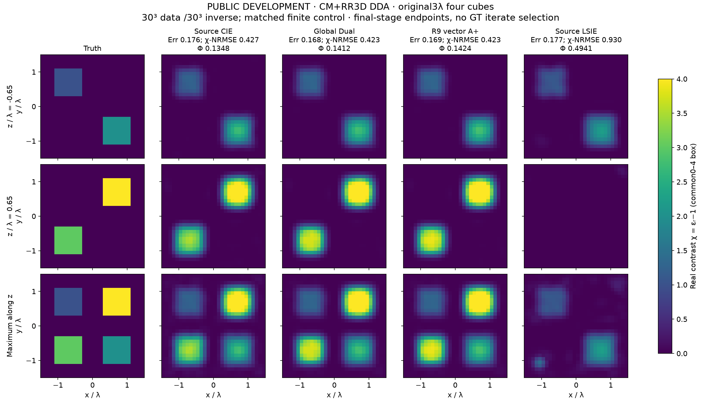

# Noise-locked contrast sources and auxiliary material paths in high-contrast Maxwell inversion

**Research manuscript draft.** This document reports mechanism evidence and limitations, not a claim of a publication-ready universally superior solver. The Chinese report and separate classical/vector benchmark reports are the authoritative experimental ledger.

## Abstract

Spatial transport of constitutive residuals can change contrast-source inversion trajectories, but a cheaper conditional material minimizer does not remove physical nonconvexity. We compare A-material, its Möbius-based A+ readout, ordinary CIE/FFT-TSOM and physical optimization. A public-noise discrepancy rule increases recovery from two to four objects on a six-object confirmation set for both ordinary CIE and A+; A+ adds no successful object. A weak-penalty current initialization recovers a previously failed development shell at lower cost than a longer continuation, without a confirmation advantage. Extensions include sixteen Austria runs, twenty-nine small-vector inversions and nine original-electrical-size vector runs. CIE retains clear advantages over direct optimization on Austria and over LSIE on the vector target; A+ has no stable additional recovery. Three short physical-refinement controls reduce Global-Dual and A+ vector material errors from approximately .423 to .249 alike. Conversely, longer physical correction worsens the Austria material image. The established identity relating auxiliary defects to propagated port errors helps distinguish premature auxiliary stopping from overfitting or model error. Final selection uses no test truth and matched physical objectives within each declared comparison group; unregularized NIE/LSIE references and different data models remain separate. The evidence supports a mechanism and failure study, not a universally superior solver.

## 1. Introduction

High contrast is not a single experimental axis. Electrical size, internal wavelength, topology, illumination, noise, and numerical discretization all influence the inverse problem. Consequently, a successful difficult curve and an unsuccessful ring cannot establish a general ordering of algorithms. We ask which part of CIE is changed by a transported material residual, whether more accurate material readout addresses the limiting failure, and whether changing the auxiliary optimization path provides a different capability.

Our contributions are an auditable failure decomposition, a noise-consistent repair shared with strong CIE controls, and a negative transfer result for complementary auxiliary paths. We do not claim a new discrepancy principle, variable-projection theorem, or global convexification algorithm.

## 2. Related work

The [2016 NIE formulation](https://doi.org/10.1109/TAP.2016.2535492) and [2019 vector CIE study](https://pmc.ncbi.nlm.nih.gov/articles/PMC8320915/) combine contraction-form residuals with FFT-TSOM subspaces and staged updates. Dual choices of the current and material contraction parameters are already present in that literature. Their published comparisons to LSIE are not interchangeable with comparisons to a modern fully converged physical optimizer under another acquisition contract.

Relaxing the wave equation and eliminating the state are established strategies; see the [penalty-method analysis](https://doi.org/10.1088/0266-5611/32/1/015007). A [recent constraint-relaxation analysis](https://doi.org/10.1088/1361-6420/adab89) also gives special convex finite-dimensional constructions. The matching source/receiver-span assumptions of that construction do not hold for our full internal Maxwell state space. A source-resolved claim ledger is provided in `delegated/nonconvex_prior_art/`.

## 3. Methods

For real contrast m and fixed permeability, let L(m)=I−diag(m)G, J(m)=L(m)⁻¹diag(m)E and F(m)=SJ(m). In the first phase, final candidates minimize Φ=||F(m)−Y||²/(2||Y||²)+R(m), with the same box and prior. Each extension declares its own normalization and matched-prior group; classical NIE/LSIE references use R=0 and are not pooled into the matched-prior ablation. A-material transports the fixed-current constitutive residual through fixed disjoint spatial blocks of local Green couplings. Its metric depends on material, so its exact derivative includes both the transported tangent and the derivative of that metric. A+ uses the conditional Möbius coordinate to reduce the cost of this readout. Global A/A+ is compared to ordinary Global-Dual current updates, while sourcewise A+ requires a sourcewise Dual control.

For S=UΣV*, a hard rank-r current readout has expected squared noise error Ns σ² Σ(i≤r)σᵢ⁻² under independent circular complex noise with E|n|²=σ². We select the smallest contiguous prefix for which the discarded measured energy lies within one declared 99% full-data noise ball. All prefixes use the same event; the complete data remain in the subsequent objective. This changes the hard current constraints, not the number of material unknowns or the physical observations.

The auxiliary-path comparison minimizes ||SJ−Y||²/(2yd)+λ||L(m)J−diag(m)E||²/(2ed)+R(m). The current is eliminated by an exact positive-definite solve. A three-stage schedule is compared with a fixed penalty, equally repeated fixed-penalty restarts, data-target continuation, and direct physical optimization. A later development-only simplification hands the first weak-penalty material directly to the physical corrector.

## 4. Theory and scope

A strictly increasing scalar transformation preserves local minima. A local diffeomorphic change of material coordinates preserves Hessian inertia at stationary points. Thus a Möbius coordinate or a monotone transformation of the physical loss cannot alone remove its erroneous local minima. Auxiliary residual transport can nevertheless change intermediate objectives and finite-step trajectories.

Eliminating the relaxed current yields a residual metric proportional to (yd I+(ed/λ)AA*)⁻¹, A=SL(m)⁻¹. This metric depends on material; state-wise convexity is not material-wise convexity. The small-λ limit can also suppress information. Detailed assumptions, derivatives and boundary caveats are in `THEORY_DERIVATIONS.md`.

## 5. Finite-model experiments

The first phase comprises 47 development inversions and 66 confirmation inversions with 576 free real material parameters. Six independent confirmation objects cover ellipse, multiple disks, annulus, comb, star and perforated geometry, with different declared contrasts, noise and apertures. Predictions and public-objective portfolio choices were sealed before confirmation truth was read. Six objects, not 66 runs, are the statistical units. This is a small same-discretization confirmation, not experimental-data or continuum evidence.

The fixed-rank single CIE, Dual, Global-Dual and A+ each recover 2/6. Their noise-adapted versions each recover 4/6. Mean NRMSE is .18666, .18882, .18766 and .18552 respectively; corresponding mean inclusive CPU times are 38.84, 40.81, 42.98 and 46.37 seconds. A+ adds no recovered object. Its mean improvement over noise-adapted Global-Dual is dominated by a still-unsuccessful annulus, while its two ordinary successful controls are slightly worse in continuous error.

The relaxed-current continuation recovers the public 40ac shell with NRMSE .05807. A weak-stage handoff gives .05835 at 19.63 CPU seconds including initialization, versus 28.10 seconds for the full schedule. Neither yields an additional confirmation recovery: both recover 2/6. Paid two-branch portfolios remain at 4/6. Restart-only and negative-curvature probes do not reproduce the development recovery.

## 6. Classical and vector benchmark extension

The companion extension distinguishes original Austria acquisition/grid contracts, scaled full-vector tests, and the original 3λ vector configuration. It explicitly corrects two inherited implementation confounds: A must not also change the current metric when testing material-only transport, and overlapping Fourier coefficients must be transported when the basis grows. The published CIE stopping quantity and error both contain square roots; an audit transcription error was corrected before any new vector inversion. Completed results and execution limits are recorded separately in `CLASSIC_BENCHMARKS.md` and the vector reports; no unexecuted example is claimed here.

### 6.1 Completed small-vector material inversions

Twenty-nine inversions use three-component dyadic fields, 512 real isotropic material unknowns and a common physical corrector. These are scaled development and discretization controls, not replicas of the original 3λ experiment. For four cubes, a thin hollow object with rods, and a strongly coupled εr=9 two-cube target, Global-Dual/A+ contrast-relative errors are .25022/.25039, .29281/.29355 and .47752/.47728. A later resolved-hollow control gives approximately .1806 for all compared methods. Direct physical optimization reaches similar endpoints at lower recorded cost. The original thin shell and rods are less than one inverse-grid voxel thick; the resolved control changes both geometry and scattering and therefore is not a pure refinement experiment.

These errors use ||χhat−χ||/||χ|| and must not be pooled with the amplitude-normalized two-dimensional errors. The completed results do not establish a stable A+ increment. They also do not certify continuous-Maxwell accuracy: independent Mie comparison for an εr=9 sphere gives complex scattering-plane errors of 61.6%, 55.5% and 43.1% at the tested 8, 10 and 16 grids. The field error is measured on one prescribed 181-angle plane; the separately reported scattering cross section uses spherical quadrature.

### 6.2 Diagnosing numerical-physics error

Replacing the point interaction by a standard source-cell-integrated Green tensor, while fixing the 16-grid sphere and Maxwell–Garnett boundary material, changes that field error from 43.06% to 43.39%. This rules out that particular kernel replacement as a sufficient repair. Two further known-interface forward controls keep the integrated operator and grid fixed: arithmetic scalar boundary material gives 27.84% field error and 4.74% cross-section error; normal/tangential tensor averaging gives 25.37% and 25.59%, respectively. Neither response is fitted or rescaled. The known interface is used only for this offline forward diagnosis, not supplied to an unknown-material inverse solver. A better integrated cross section can coexist with a worse angular complex field, and no single diagnostic supplies a continuous-physics certificate.

At the original 3λ electrical size, the CM+RR coarse/fine full-data difference is 53.5%. A fixed source-cell-integrated two-grid diagnostic reduces one source's mismatch from 50.84% to 35.98%, still far above the expected 10% measurement noise. The subsequent frozen comparison therefore separates cross-grid data from a matched finite-grid control, retaining both outcomes. The latter changes the observations and tests optimization under a consistent finite model; it cannot be reported as a same-data algorithm improvement. With 27000 real material unknowns and at most 21600 real measured components, this configuration also has a different information-to-unknown ratio from the small-vector tests. Dimension counting constrains regular interior points but does not prove nonuniqueness at the particular box-boundary truth.

### 6.3 Completed original-size vector comparison

All nine original-size runs terminate under the published coefficient-change criterion; none reaches the iteration cap or fails numerically. The cross-grid CIE/Global-Dual/A+/LSIE contrast-relative errors are .41460/.41072/.41182/.91006. In the matched finite-grid control they are .42727/.42275/.42347/.92953. Thus CIE substantially improves high-contrast material recovery over LSIE in this scene, while A+ supplies no further improvement over Global-Dual. The A+ implementation here is the disclosed vector material-readout variant with an ordinary-CIE seed proposal accepted under the A metric and two local coordinate sweeps.

This comparison also exposes a metric limitation. The paper's voxelwise relative-permittivity RMS error is .18966 for empty air. Cross-grid LSIE scores .17994 by that measure, versus CIE's .21627, even though LSIE largely loses the higher-contrast cubes and has much worse contrast-relative error. We therefore retain both denominators, the full common-range material figures, and physical data residuals. No threshold is changed to manufacture a successful reconstruction.

Shared-queue matched-grid wall times are 298.35 s for Global-Dual and 380.33 s for A+. The corresponding host CPU times reverse that apparent ordering because they exclude GPU arithmetic; host CPU alone is not an algorithm speed measure here. Setup and reused-prediction attribution are reported separately from actual execution cost, and neither is presented as an independently measured cold-start runtime.

### 6.4 A remaining constitutive-to-port defect

The matched CIE-family endpoints have physical objectives .135–.142, compared with .010203 at the known feasible truth. These vector objectives are mean sourcewise relative squared residuals, without the factor 1/2 used in the first phase. Yet their auxiliary data RMS values are only .017–.027. For auxiliary current J, e=LJ−D_mE and d=SJ−Y, the established finite-model identity is F(m)−Y=d−SL⁻¹e. Triangle inequalities applied to already paid norms place the gain on the realized residual direction in intervals [12.11,13.27] for sourcewise CIE, [6.97,8.06] for Global-Dual, and [7.00,8.09] for A+. The last pair uses the same current residual scaling and shows no meaningful reduction of this defect by A+.

These are numerical diagnostics with the implementation's declared source norms, not operator-norm upper bounds or certified discretization-error enclosures. They quantify why a small auxiliary loss and a coefficient stopping rule need not imply a small full-physics error. A separately frozen development control performs eight accepted L-BFGS-B steps from air, Global-Dual and A+, with identical physical objective and box. All three predictions are sealed before scoring. Global-Dual and A+ contrast-relative errors improve from .42275/.42347 to .24899/.24950; their physical objectives decrease from .14120/.14238 to .02775/.02780. Air reaches .97501 material error and .64852 objective. Both auxiliary endpoints admit useful physical descent, without an A+-specific increment. All three terminate at the eight-step budget, not stationarity. Their added wall times are 120.33/728.72/725.89 seconds; the auxiliary starts also retain their previously paid prefixes. This is therefore not an equal-total-cost warm-start superiority claim. The single resident GPU process charges 1740 forward and 1680 adjoint RHS, including the one necessary gradient wiring direction, and retains rejected trials. The original nine-arm endpoints are unchanged.

### 6.5 Austria under the original acquisition contract

The 400 MHz Austria extension uses the inherited 150²-generated observations, a 64² inverse grid, 20 sources and 40 receivers. All sixteen Windows executions are sealed before offline scoring. The six matched-prior arms are sourcewise CIE, Dual, Global-Dual, A, A+ and direct physical L-BFGS-B; independently implemented NIE/LSIE references have no material prior and are reported separately.

For εr=3.5, final amplitude-normalized errors for CIE/Dual/Global/A/A+ are .18513/.19040/.18962/.18922/.18450, versus .60683 for direct physical optimization. The independent NIE and LSIE references give .18644 and .61526. This supplies a concrete counterexample to the suggestion that direct physical optimization always outperforms CIE. It does not supply a distinctive A+ recovery: A+'s difference from single CIE is only .00063 in this metric, while its Otsu overlap is slightly lower. For εr=4, A+ gives .58300 versus Global-Dual's .57517 and sourcewise CIE's .47475. Global/sourcewise differences must not be attributed solely to the material readout.

A+ reduces total CPU relative to A by approximately 24.5% and 35.5% in the two conditions. These are complete-task reductions, including differing trajectories, rather than isolated material-kernel timings. It does not yield a stable material advantage over ordinary CIE. All physical correctors reach their common 300-iteration cap, and several native stages reach their declared cap; these are not globally converged solutions.

Longer physical correction is also harmful in this example. At εr=3.5, several CIE-family errors increase from approximately .136 at the presaved 80-step checkpoint to .185–.190 at 300 steps. For single CIE, the stored physical objective decreases only from approximately .0043534 to .0043184; this objective includes the common prior and is not a pure data-residual norm. The task has 10% measurement noise and a separately observed 9.96% coarse/fine response difference. The observation supports a limitation of physical-objective-only material selection; it does not uniquely separate noise fitting, discretization error and prior effects. We do not retroactively select step 80 as an online optimum. The stored CPU-prefix material comparisons have explicit gaps between snapshots and are not exact equal-time reruns.

## 7. Discussion

The first phase distinguishes three phenomena. The historical curve demonstrates a useful A-material trajectory under its development contract. The noisy confirmation cases demonstrate a repair to the common deterministic-current constraint that ordinary CIE also benefits from. The shell demonstrates a complementary path from state relaxation. None establishes dominance across all three phenomena.

The extensions reveal two opposite stopping problems. A small coefficient step can leave a substantial constitutive defect visible after full Maxwell propagation. Conversely, further descent of an already small physical residual can deteriorate the material image. Uniformly extending all iterations, tightening the material subproblem, or replacing the physical loss by a monotone transform does not resolve both problems. A noise- and model-consistent interpretation of observability is needed alongside the optimization analysis.

A smaller residual can coexist with a worse material image. Confirmation truth supplies offline witnesses that some failed endpoints have much larger physical objective than an existing feasible material; this rules out explaining those endpoints solely by absence of a better feasible point. It does not establish uniqueness, certify a local minimum on the full constraint cone, or prove that an optimizer will reach the witness.

## 8. Limitations and conclusion

The confirmation sample is small, the first phase uses the same discretization for generation and inversion, and the proposed repairs have established methodological antecedents. Material-only A+ cannot be directly generalized from a real scalar arc to an unknown complex reciprocal tensor. CPU, full-wave solves and auxiliary dense factorizations must all be charged; fewer physical LU calls alone do not establish lower total cost.

The evidence currently supports a reproducible mechanism and failure study. It does not yet support an algorithm paper claiming broad superiority over mature CIE. The next substantive question is how to preserve observable material directions while relaxing erroneous current constraints, rather than how to make one conditional material minimizer increasingly exact.
