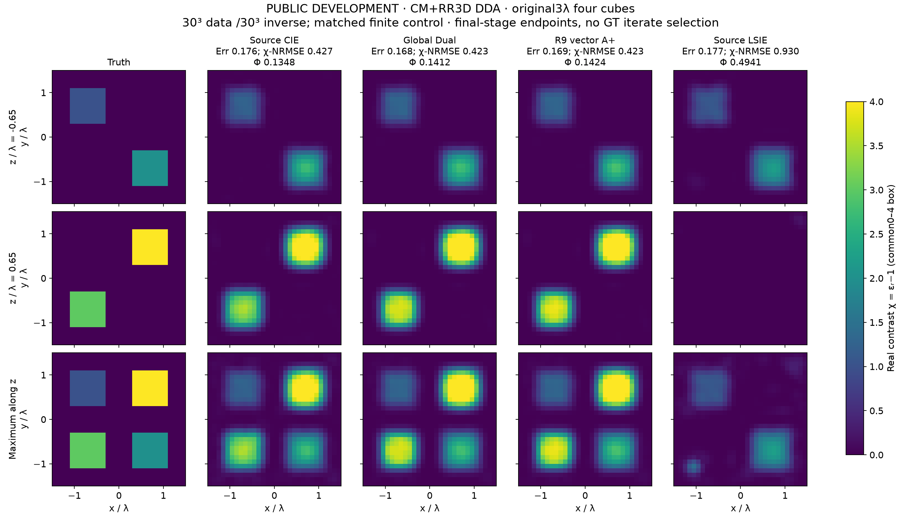
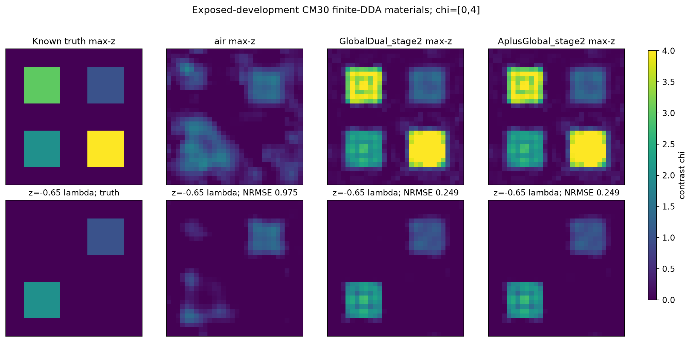

# MAX-STRUCT-R9：A/A+的增量、噪声硬锁与非凸搜索

## 最终判断

**A/A+有可信的局部高对比正例，但目前不能说已经做到“普通问题普遍打平、困难问题稳定击败成熟CIE”。** A改变的是材料读出的空间本构残差度量；A+主要降低这个读出的计算成本。Möbius条件更新没有消除全局材料反演的非凸性，“扩大GT吸引域”也尚非已证明结论。

第一阶段完成113次反演运行：47次公开开发/机制控制、66次新六材料比较；另有2次公开端点曲率诊断。结果给出了一个可复现的基线修复：按公开噪声选择DPCS秩，让新六例中的单β CIE、Dual、Global、A+都从2/6恢复到4/6。这一收益首先属于噪声与电流可行集的修复，**不是A+独有的恢复增量**。A+修正后平均NRMSE略低，但没有多恢复对象，平均CPU比修正后的单β CIE高约19%。

另一条已知WRI/CSI型完整current松弛路线恢复了此前共同失败的40ac开缝壳，证明不同辅助路径确能获得原方法未取得的材料解。进一步简化为“低罚权初始化＋原物理校正”仍成功且更便宜。但这两条路线在新六例中都仅2/6，两分支组合也未超过4/6。**不能把一个开发正例包装成新的普遍凸化算法或论文级成像突破。**

扩展已经实际完成：原NIE Austria的16项Windows比较、小型全矢量三维29项、原3λ四立方体九臂，以及三个原尺寸起点的短原物理校正。普通CIE在Austria ε3.5明显优于直接物理优化，在原尺寸三维明显优于LSIE，说明基线确有难以被普通局部物理优化替代的能力。**A+相对原A节省部分完整反演成本，但没有稳定超越匹配current的普通CIE；同样八步物理校正把三维Global和A+的材料误差都由约.423降至.249。**

本轮最有解释力的是两个相反现象：三维小系数步会提前停在仍有明显原物理改进空间的端点；Austria继续降低原物理目标却损害材料质量。前者涉及本构缺陷经过完整resolvent向端口传播，后者受噪声、离散与prior影响，不能用“统一多迭代”同时解决。全部科学队列结束；没有将R9包装成新的实测或NN训练证据。最终代码、紧凑证据与大数组分别见仓库和[完整Release](https://github.com/migodam/b1-probabilistic-maxwell-imaging/releases/tag/research-max-struct-r9-20261106)。

## 1. 继承与对照资格

R4–R8、Formula Atlas、FBG的实际代码和正负证据保留不动，本轮在隔离工作树、独立R9目录执行。复用R8 native FFT-TSOM、R7 A+、FBG-R3原Maxwell forward/adjoint及原物理corrector；没有另造弱CIE。审计读取630份R8完整回执，并保留R7的高对比正证据。

R8均匀初始化高contrast26例的材料成功数：单β CIE 6、Dual 3、Global 5、A 5、global A+ 4、sourcewise A+ 5。A+−Global的平均NRMSE约−.01505，但中位仅−.0000713，且没有A+独有成功；不能用均值遮蔽失效。R7高contrast18例A/A+各11/18、Dual/Global各9/18，属于不同采集/噪声/对象合同，正结果同样保留而不混分母。

比较A读出时，global A/A+对应普通Global-Dual；sourcewise A+对应sourcewise Dual。只用global A+击败Dual不能排除current更新方式的作用。A+相对A的内层费用下降已在R8观察到，但不是相对所有CIE方法的免费升级。完整审计：[AUDIT_ZH.md](delegated/baseline_audit/AUDIT_ZH.md)。

## 2. 物理、数据和评分合同

第一阶段为**24×24、576个独立实contrast未知量的二维scalar-TM有限VIE**，exp(−iωt)、出射Hankel1、固定μ。复用原G/E/S及非周期FFT作用；源和接收器均在ROI外。材料m=εr−1，box[.02,20]，均匀初值.1；全部方法同一smooth+TV先验，最终以完整原Maxwell观测的Phi选已付费候选。

新六对象为独立随机几何的ellipse、disks、annulus、comb、star、perforated，幅度2.5/12/18，复RMS噪声.1%/1%/3%，12源48接收、全/半发射孔径。一次生成、不重抽、不按结果过滤；六个对象才是分母，66次求解不是66独立样本。属于小型同离散确认，**不是跨网格、实测或3D证据**。已有R8的相关局限继续有效。

主要算法/参数在新数据生成前冻结；补充single-CIE同噪声规则、简化弱阶段臂在生成后、所有确认评分前加入，依据是旧DEV证据，未读取确认GT调节。该时间区别保留在配置，不把补充臂称作完全相同的预生成注册。所有66个预测和两组portfolio的原Phi选择先封存，再首次读取六个GT。

NRMSE=逐像素RMSE/声明contrast幅度；支持分割使用prediction-only Otsu。沿用旧材料成功定义NRMSE≤.15且IoU≥.7及box合法，不为本轮改门。CN99噪声拟合、Phi、求解器停止、材料指标分开。辅助3000步＋共同corrector最多3000步；direct最多6000步。松弛/延拓预算单列，不伪称相同迭代即相同计算。

## 3. 找到了什么问题，实际改了什么

### 3.1 含噪DPCS硬锁

旧阈值rtol=.001在四个R8采集算子中均保留17个receiver奇异方向，最弱保留方向使截断逆的条件数约394。对公开独立圆复噪声，硬读出电流的预期噪声量是

`E||ΔJD||² = Ns σ² Σ(i≤r) 1/si²`。

R8的3%噪声组，这一预期RMS量相对已观测JD范数的中位约91%；不是实际GT电流误差，但足以说明固定强模态阈值不能忽视噪声。R3已有无噪声/释放控制失败，因此它不是全部错误的唯一原因。

**实现修正：**公开σ按E|n|²=σ²解释，取完整数据99%噪声球，选最小连续奇异前缀r使丢弃数据能量落入该球。不同r共享同一个完整噪声事件，不从GT选秩。只改变硬锁/可优化current子空间；后续数据项仍使用完整Y，原物理验收也保留所有通道。额外SVD收费。减少r会释放一些原来锁死的current方向，不能称独立current自由度完全不变；材料仍576维，所有普通CIE也得到相同规则。

这属于已有截断逆/差异原则的具体修复，不是新的Maxwell理论。代码：[baseline_adapter.py](src/baseline_adapter.py)。

### 3.2 真正不同的辅助路径

测试完整current松弛

`min(m,J) ||SJ−Y||²/(2yd) + λ||J−m(E+GJ)||²/(2ed) + R(m)`。

current在固定m时用完整Cholesky精确消元，使用包含原prior的包络梯度；区别于R2已有固定CIE权重profile。λ按初值的公开接收resolvent尺度归一，依次.01/1/100，各100次，再接原物理corrector。对照包括固定λ共300次、相同λ三次重启、数据目标同伦、普通direct。

此处是已有WRI/CSI/variable-projection思想的机制控制。固定current子问题凸，不代表材料约化目标凸；Gram逆度量仍依赖m。参考[罚法先例](https://doi.org/10.1088/0266-5611/32/1/015007)及[约束松弛分析](https://doi.org/10.1088/1361-6420/adab89)。

低罚权首阶段在40ac已进入好的物理区域，因此另试“首阶段直接交原物理校正”，复用已付费状态；单独方法费用仍补上全部初始化，实验总账不重复收费。没有增加NN、先验或观测。代码：[landscape_solver.py](src/landscape_solver.py)。

## 4. 开发对象的决定性结果

|公开DEV|普通Dual / Global|A+|噪声修正|完整current路径|
|---|---|---|---|---|
|b20d弯条|NRMSE .390 / .488，失败|global .0406、sourcewise .0404，恢复|A+仍恢复，普通Dual/Global仍失败|三种最初延拓/固定松弛均失败|
|40ac开缝壳|.634 / .619，失败|.626，失败|秩仍17，不能修复|松弛延拓.0581、IoU .9618，恢复|
|0000正常控制|均恢复|恢复|各臂均恢复|各臂均恢复|
|0027高噪声困难例|固定秩约1.01，失败|固定秩约1.02，失败|四臂约.118–.120，全部恢复|direct及三种路径仍失败|

40ac固定罚权重启仍NRMSE .4579；仅重启不能复制成功。弱阶段交接NRMSE .05835、IoU .96923，含已付初始化前缀的standalone归属费用19.6337 CPU秒，其中本次新增执行16.3525秒、已付前缀3.2812秒；对比完整延拓28.10秒。它不是另一次冷启动的独立计时，实验总账也没有重复收费。后两个dense profile阶段不是此开发正例的必要条件。

原物理Hessian诊断也没有被当作魔法：40ac A+终点投影梯度9.43e−9，自由55坐标Hessian最小特征值+4.27e−9；b20d Global终点有一个−1.62e−8方向，但有限扰动＋同预算续跑与不扰动续跑都约NRMSE .492。活跃约束打开的临界锥未完全验证，不能宣布严格局部极小或全局证书。

完整逐例表：[DEVELOPMENT_COMPARISON.md](delegated/scoring/DEVELOPMENT_COMPARISON.md)。

## 5. 新六材料：修复有效，A+独有优势没有出现

|方法|材料成功|平均NRMSE|平均完整CPU秒|
|---|---:|---:|---:|
|原单β CIE|2/6|.55754|48.43|
|原Dual-CIE|2/6|.54021|46.06|
|原Global-Dual|2/6|.54211|47.96|
|原A+|2/6|.54352|52.67|
|噪声适配单β CIE|4/6|.18666|38.84|
|噪声适配Dual|4/6|.18882|40.81|
|噪声适配Global|4/6|.18766|42.98|
|噪声适配A+|4/6|.18552|46.37|
|直接物理优化|2/6|.40359|31.19|
|完整current松弛延拓|2/6|.34173|15.45|
|弱阶段＋原物理校正，含初始化|2/6|.34262|14.42|
|噪声A+＋松弛，两次完整付费|4/6|.18488|61.82|
|噪声Global＋松弛，两次完整付费|4/6|.18735|58.43|

噪声修正额外恢复的是comb0003和perforated0005，各普通CIE同样取得；annulus0002与star0004仍共同失败。新普通控制0000、0001都保住，但六例不足以证明总体非劣性或成功率显著提升。A+均值略好来自少数连续误差差别，没有新增成功；不能称其恢复增量已稳定复现。

[全部六例GT＋十一臂材料图](FIGURES/confirmation/all_six_materials.png)包含所有失败。简化弱阶段平均更便宜，但0000与0003反而稍贵，不是逐例加速。两portfolio在DEV分别4/4与3/4，在确认均4/6；额外花费没有多恢复对象。保留这个泛化负例，不再根据确认GT修改组合。

已付费轨迹的**事后**30/60 CPU秒切片中，噪声修正各CIE仍4/6，原各CIE2/6；例如30秒时噪声A+平均NRMSE .16482，继续到最终反而.18552。这提示Phi下降仍可伴随材料恶化，不能据此按GT选择30秒停止。切片只取实际已付费原Phi incumbent，不插值、不GT挑迭代；不是新的预注册性能点。见[PAID_CPU_SLICES.csv](RESULTS/summary/PAID_CPU_SLICES.csv)。稠密profile的current Gram/Cholesky全部计入CPU，不拿较少physical LU冒充等总算量。

## 6. 对“凸化”和剩余失败的回答

**PROVED_UNDER_ASSUMPTIONS：**严格递增变换保留局部极小；局部微分同胚材料换元在驻点处通过合同变换保持Hessian惯性。因此仅用Möbius改写或对原Φ取单调函数，不能删掉原错误极小。交叉熵采样搜索、KL数据loss、熵正则运输、熵prior是不同机制；对概率或运输计划凸，不等于对m↦F(m)凸。

完整current松弛确实改变中间目标，40ac正例证明这种路径有价值；其b20d和新确认负例不支持普适恢复保证；有限预算失败本身不作为目标非凸性的证明。已有特殊有限端口Galerkin凸化定理需要整个状态空间由匹配source/receiver Riesz基张成等条件，当前576内部自由度和48×12外端口不满足，不能强行套用。

没有把共同失败直接归为不可辨识。匹配有限模型下可用保存的GT全波响应作**离线可行点见证**；见[audit/CONFIRMATION_FAILURE_DIAGNOSTIC.json](audit/CONFIRMATION_FAILURE_DIAGNOSTIC.json)。更低的已知可行Phi只能说明当前求解未达到该值，不能证明唯一性、全局最优或整个连续PDE盆地结构。后续重点应是如何绕开共同错误材料区域，而不是继续给A+添加更精细的一维读出步骤。

## 7. 第一阶段定位与后续问题

1. **A解决的是局部材料读出的空间残差耦合；A+解决的是该读出的部分费用。**它们尚未解决硬DPCS噪声、所有Fourier表示限制、sourcewise PR问题和全局非凸搜索。
2. **本轮可采用的具体修正是noise-aware DPCS，且必须同样更新强CIE基线。**在新六例里普通修正CIE已解释主要收益；A+不应被宣传为普遍优于它。
3. **保留低罚权完整current初始化作为便宜的互补候选。**40ac实际被恢复，简化有成本收益；但确认没有额外成功，暂不能作为普遍更强的默认算法。
4. **目前最有价值的是机制和失效研究，而非新算法广泛优胜论文。**有明确噪声硬锁反例、合法路径互补、错误终点曲率、公开原始数组和成本；原创性仍需与既有CSI/WRI、差异原则及CIE近邻严格区分。该六例研究同离散、小样本；已完成的文献对象及真正三维按下述独立合同报告，也不替代未开展的新实测验证。

下一轮应围绕已有公式中的两点设计少量可反驳研究：一是用噪声相容的软约束替代二分硬锁，同时保持已修好的普通CIE基线；二是研究低罚权阶段为何在40ac产生有效可观测材料方向、却把新annulus/star带到共同错误终点。不能因为知道GT形状就给它们定制prior，也不能把更低Phi包装为恢复。NN、全局凸化及更广泛统计优势在第一阶段均未被证明；跨维度结果由新增全矢量实验单独评价。

完整推导见[THEORY_DERIVATIONS.md](THEORY_DERIVATIONS.md)，费用与缺口见[COST_LEDGER.md](COST_LEDGER.md)，运行与公开数组见[REPRODUCE.md](REPRODUCE.md)。

## 8. 已完成的三维扩展与物理修正诊断

新增29次小型全矢量三维反演已经完成：8³=512个实各向同性材料、1536个complex场分量，采用真正dyadic Green和60外部电偶极照明。与二维scalar-TM分表；不是将二维堆叠成三维，也不是原paper3λ电尺寸。

|三维公开对象|Global-Dual|A|A+|Direct|
|---|---:|---:|---:|---:|
|缩小四立方体|.25022|.25398|.25039|.25486|
|薄空心体＋杆|.29281|.29562|.29355|.30006|
|ε9双立方体|.47752|.47854|.47728|.47829|
|可分辨厚壳控制|.18066|.18063|.18063|.18063|

表为χ相对L2误差，**与第一阶段幅度归一NRMSE分母不同**。在共同300步原物理校正后，没有看到清晰的A/A+终点优势。前三例同Mac平台的Direct CPU约79–86秒、A+约163–165秒；厚壳同Windows平台Direct253.72秒、A+511.38秒。辅助240＋校正300与direct300不是等迭代/等算量；完整已付费曲线、所有方法及停止信息在[VECTOR3D_EXTENSION.md](VECTOR3D_EXTENSION.md)。

物理核查没有被低线性残差替代：ε9球的16³ Mie预定散射平面误差仍43.1%。一次标准源单元积分修正为43.4%，未解决主要误差。根据界面条件继续做了两个已知球离线正演，scalar arithmetic和局部法向tensor降到27.8%与25.4%；但其截面误差分别4.7%与25.6%，并非一项表示所有物理量都更好。该反例说明单一积分指标可以掩盖复场分布误差。

这些是已知几何的前向资格诊断，没有把GT界面法向交给未知材料反演，没有把静态平均、IGT或tensor公式记为新发明。原3λ四立方体的全60源CM+RR 30/60观测差约53.5%；固定source59单元积分后由50.8%降至36.0%，仍很大。因此目前不能称已独立复现作者连续高对比结果。详见[VECTOR_DISCRETIZATION_DIAGNOSTIC.md](VECTOR_DISCRETIZATION_DIAGNOSTIC.md)。

原Austria16项已在远端i9四个P核全部完成。原3λ的cross-grid五臂＋matched-grid四臂已在4060全部完成，见下两节；不能把换了数据生成离散后的改善记为同数据算法收益。

## 9. 原3λ论文对象：CIE优于LSIE，但A+没有进一步优势

新九臂为真正3D矢量，27000个实材料未知、60外部偶极源、180个接收分量，MF6→10，air初值、box[0,4]、R=0。全部18阶段达到原Eq16系数停止，无CAP或数值失败；主终点固定stage2，没有按GT选择迭代。它是CM+RR离散下的原几何/电尺寸算法适配，不能称作者代码或已取得连续物理精度的复现。

|方法|cross-grid χ相对L2|matched-grid χ相对L2|matched完整物理Φ|
|---|---:|---:|---:|
|source CIE|.41460|.42727|.13478|
|source Dual|.41088|未列入冻结四臂|未运行|
|Global-Dual|.41072|.42275|.14120|
|A+ global|.41182|.42347|.14238|
|LSIE|.91006|.92953|.49414|

这里Φ是逐源相对数据残差平方的平均，没有1/2，与第一阶段数值不能横比。A+与Global-Dual在两组数据上材料、物理拟合均接近且略差。matched的实际共享队列wall为Global298.35秒、A+380.33秒；补入setup与复用归属后仍是299.22/381.21秒。A+的host CPU较低并不代表运行更快，GPU算术必须看wall与设备计数。

CIE相较LSIE显著减少χ误差，能分辨四块；但并非精确恢复。论文逐像素相对ε误差会受到背景占比和高ε归一化影响：air为.18966，cross LSIE为.17994、CIE却为.21627；仅看这个指标会掩盖CIE在高contrast块上的实际改善。故保留完整色轴材料图、χ相对L2和原物理拟合，不挑有利指标。

matched数据下已知同一GT的可行Φ=.010203，CIE系终点仍为.135–.142；其辅助data RMS却只有.017–.027。因此粗细网格差异不能解释全部缺口，Eq16小系数步也不是原物理收敛证书。复用`r_phys=d−S L(m)^−1 e`及已付范数，当前残差方向的传播增益估计区间为CIE[12.11,13.27]、Global[6.97,8.06]、A+[7.00,8.09]。不同β的状态范数不同，不能按这些数字给算法排序；Global/A+同规范的结果显示局部材料读出没有控制这一端口缺陷。

该区间上端不是operator-norm上界，数值也没有严格线性误差包络；它是已完成端点的机制诊断，不是新定理或证书。推导、适用条件及完整九行数据见[THEORY §9](THEORY_DERIVATIONS.md)与[诊断原始表](RESULTS/original_residual_transport/DIAGNOSTIC.csv)。

为区分尚有原物理下降空间与更难的错误区域，另冻结matched的air、Global-Dual、A+三个初值，各做相同8 accepted step上限的原物理L-BFGS-B；三臂已全部完成、封存后统一评分。这是GT已经公开后的开发补充，旧九臂预测、终点和费用保持不变。完整原尺寸合同见[原九臂报告](delegated/original3d_feasibility/ORIGINAL_CM_NINE_REPORT_ZH.md)。

|起点|χ相对L2，开始→八步后|原物理Φ，开始→八步后|本次新增wall秒|
|---|---:|---:|---:|
|air|1→.97501|1→.64852|120.33|
|Global-Dual|.42275→.24899|.14120→.02775|728.72|
|A+ global|.42347→.24950|.14238→.02780|725.89|

两个辅助端点都还存在有效的原物理改进方向，A+没有独有收益。三臂均八步预算停止，不能称最终驻点。air的八步实际便宜得多，且Global/A+此前的辅助运行并非免费，故该表不构成等总成本的warm-start胜出证明。新增整进程1557.95 CPU秒／1583.52 wall秒，1740正向＋1680伴随RHS；完整独立增量账包含绘图、运输和工程失败，已知CPU下界1560.18秒。没有重复计入旧九臂费用。

详细梯度、请求/缓存区别、全部已付状态和成本见[短物理校正报告](delegated/3d_extension/physical_refinement/REPORT_ZH.md)。这只是匹配有限CM+RR模型，不能转述为跨网格或连续Maxwell的准确恢复。

## 10. 原NIE Austria：普通CIE的优势确实存在，A+没有稳定增量

两种公开材料条件的16项Windows运行已完成，并在全部预测封存后统一评分。64²=4096个实材料未知，150²生成数据，400MHz、20源40接收、10%原噪声；保留原MF/β日程、完整native预算及同一连续300步原物理校正。A/A+的current与Global-Dual完全相同；独立NIE/LSIE参考为R=0，与其余六个匹配prior的臂分开解释，不冒称作者代码。

|方法|εr=3.5幅度NRMSE|εr=4幅度NRMSE|两条件完整CPU秒|
|---|---:|---:|---:|
|source CIE|.18513|.47475|1552 / 2603|
|source Dual|.19040|.48472|1616 / 2531|
|Global-Dual|.18962|.57517|1577 / 2799|
|A global|.18922|.58654|2108 / 4617|
|A+ global|.18450|.58300|1592 / 2978|
|直接物理L-BFGS-B|.60683|.58057|382 / 477|
|独立NIE，R=0|.18644|.47560|1514 / 2418|
|独立LSIE，R=0|.61526|.59125|586 / 687|

因此“直接物理优化总比论文CIE强”不成立：ε=3.5时CIE系保留Austria结构，direct/LSIE大幅失败；但这也不是A+的独有收益。A+相对原A的完整任务CPU减少约24.5%/35.5%，支持该实现的整体工程收益；这些比例不是纯材料内循环计时，也包含不同轨迹的成本。相对ordinary Global，它没有稳定材料增量；ε=4时还比source CIE明显差。global与sourcewise的差异不能全部归因于A材料metric。

ε=3.5时A+比single CIE的NRMSE只小约.00063，Otsu IoU反而.87395<.87678，不能据此宣布优胜。ε=4多种CIE/A结果出现εr=21的假峰，材料幅度失败没有被约.62–.69的Otsu重合率遮蔽。完整幅度图和全部方法见[经典报告](CLASSIC_BENCHMARKS.md)。

另一个决定性反例是**更长物理优化会损害材料**：ε=3.5多个CIE/A方法在第80步的NRMSE约.136，继续到300步后升到.185–.190；以single CIE为例，保存的原物理目标Φ只从约.0043534降到.0043184。该Φ含共同prior，不能将sqrt(2Φ)直接称作纯数据残差。ε=4也多有退化及box假峰。这不证明GT就是优化目标的最优点，也不唯一归因于噪声；该任务还存在约9.96%的粗细模型差异。它说明错误材料不总是“还没优化够”，也不能用更低Φ作恢复证据。

所有16个corrector最终都是300步CAP，不能写成完全收敛；部分native stage也达到500步上限，表内全部保留。80点是预先保存的同一连续运行检查点，**没有事后把80改为线上最优停止**。300/600/900 CPU前缀仅使用已付保存材料、先按公开Φ选再评分；快照间隙可能很大，不能冒充精确等CPU截断实验或完整效能曲线。完整实际成本、35次GMRES停滞后LU回退和Mac迁移9项全部收费，主16项没有整项数值失败。

## 11. 完整交付、成本与论文资格

本轮科学队列全部结束。主证据池为113次二维机制反演、16项经典Windows比较、29次小型真矢量反演、原尺寸九臂及三个短物理校正；另保留Mac迁移前部分结果、所有中断与诊断。它们不是170个独立材料，不合并造成功率。所有方法原始预测、长轨迹、状态、失败与配置在同仓库Release无损保存，精简结果与图直接在Git浏览。

远端真实使用i9 P核四lane和RTX4060 resident complex128 CUDA。经典主队列wall7952.01秒，原尺寸九臂whole-process wall3138.32秒，新增三臂wall1583.52秒；这些运行有重叠及不同范围，不能相加称项目历时。科学和分析已知CPU下界约Mac4.64小时、Windows10.38小时，归档另计；最终[总账](COST_LEDGER_EXTENSION.md)按平台、维度和费用范围去重，金额、能源和未测编排保持未知。

独立审查核对了第一阶段封存与配对、原尺寸停止及current合同、经典误差分母与成本。最终修订明确：A+节省比例是整任务费用；80步比较引用含prior Φ；NIE/LSIE与匹配prior组分开；host CPU不是GPU速度。见[审查处理记录](audit/FINAL_ROOT_REVIEW.json)。

现在适合形成一篇严谨的机制和失效论文初稿：噪声硬锁、辅助路径互补、resolvent传播的本构缺陷，以及相反的停止失败。尚不足以主张广泛优于成熟CIE的新算法。普通CIE解释了主要确认收益，A+有局部开发正例及相对原A的工程价值，三维/经典对象没有稳定新增恢复。下一步应将噪声和可信模型误差纳入可观测残差软约束，再验证是否真的改变共同失败区域；单纯更精确的Möbius内循环不够。
