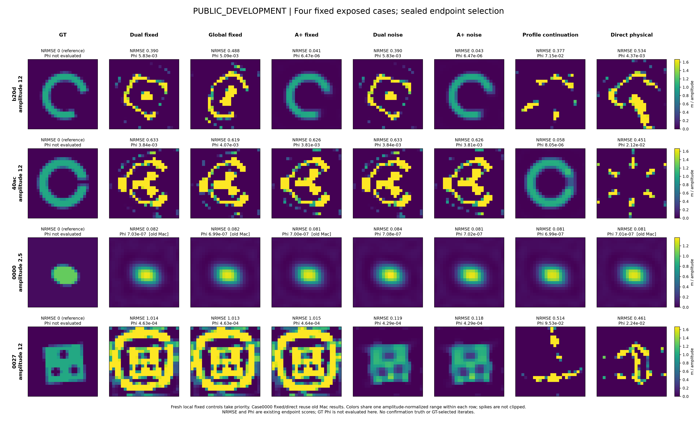
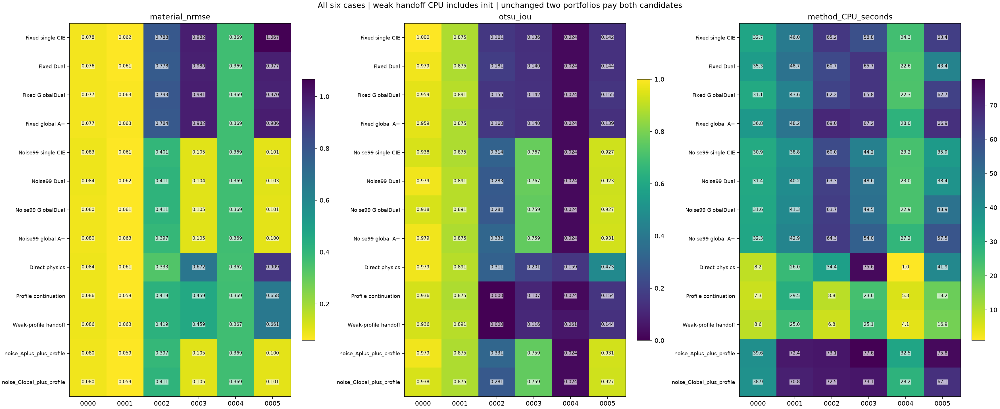

# MAX-STRUCT-R9：A/A+的增量、噪声硬锁与非凸搜索

## 第一阶段判断（二维机制研究；按新请求扩展三维与原论文案例中）

**A/A+有可信的局部高对比正例，但目前不能说已经做到“普通问题普遍打平、困难问题稳定击败成熟CIE”。** A改变的是材料读出的空间本构残差度量；A+主要降低这个读出的计算成本。Möbius条件更新没有消除全局材料反演的非凸性，“扩大GT吸引域”也尚非已证明结论。

第一阶段完成113次反演运行：47次公开开发/机制控制、66次新六材料比较；另有2次公开端点曲率诊断。结果给出了一个可复现的基线修复：按公开噪声选择DPCS秩，让新六例中的单β CIE、Dual、Global、A+都从2/6恢复到4/6。这一收益首先属于噪声与电流可行集的修复，**不是A+独有的恢复增量**。A+修正后平均NRMSE略低，但没有多恢复对象，平均CPU比修正后的单β CIE高约19%。

另一条已知WRI/CSI型完整current松弛路线恢复了此前共同失败的40ac开缝壳，证明不同辅助路径确能获得原方法未取得的材料解。进一步简化为“低罚权初始化＋原物理校正”仍成功且更便宜。但这两条路线在新六例中都仅2/6，两分支组合也未超过4/6。**不能把一个开发正例包装成新的普遍凸化算法或论文级成像突破。**

## 1. 继承与对照资格

R4–R8、Formula Atlas、FBG的实际代码和正负证据保留不动，本轮在隔离工作树、独立R9目录执行。复用R8 native FFT-TSOM、R7 A+、FBG-R3原Maxwell forward/adjoint及原物理corrector；没有另造弱CIE。审计读取630份R8完整回执，并保留R7的高对比正证据。

R8均匀初始化高contrast26例的材料成功数：单β CIE 6、Dual 3、Global 5、A 5、global A+ 4、sourcewise A+ 5。A+−Global的平均NRMSE约−.01505，但中位仅−.0000713，且没有A+独有成功；不能用均值遮蔽失效。R7高contrast18例A/A+各11/18、Dual/Global各9/18，属于不同采集/噪声/对象合同，正结果同样保留而不混分母。

比较A读出时，global A/A+对应普通Global-Dual；sourcewise A+对应sourcewise Dual。只用global A+击败Dual不能排除current更新方式的作用。A+相对A的内层费用下降已在R8观察到，但不是相对所有CIE方法的免费升级。完整审计：[AUDIT_ZH.md](delegated/baseline_audit/AUDIT_ZH.md)。

## 2. 物理、数据和评分合同

第一阶段为**24×24、576个独立实contrast未知量的二维scalar-TM有限VIE**，exp(−iωt)、出射Hankel1、固定μ。复用原G/E/S及非周期FFT作用；源和接收器均在ROI外。材料m=εr−1，box[.02,20]，均匀初值.1；全部方法同一smooth+TV先验，最终以完整原Maxwell观测的Phi选已付费候选。

新六对象为独立随机几何的ellipse、disks、annulus、comb、star、perforated，幅度2.5/12/18，复RMS噪声.1%/1%/3%，12源48接收、全/半发射孔径。一次生成、不重抽、不按结果过滤；六个对象才是分母，66次求解不是66独立样本。属于小型同离散确认，**不是跨网格、实测或3D证据**。已有R8的相关局限继续有效。

主要算法/参数在新数据生成前冻结；补充single-CIE同噪声规则、简化弱阶段臂在生成后、所有确认评分前加入，依据是旧DEV证据，未读取确认GT调节。该时间区别保留在配置，不把补充臂称作完全相同的预生成注册。所有66个预测和两组portfolio的原Phi选择先封存，再首次读取六个GT。

NRMSE=逐像素RMSE/声明contrast幅度；支持分割使用prediction-only Otsu。沿用旧材料成功定义NRMSE≤.15且IoU≥.7及box合法，不为本轮改门。CN99噪声拟合、Phi、求解器停止、材料指标分开。辅助3000步＋共同corrector最多3000步；direct最多6000步。松弛/延拓预算单列，不伪称相同迭代即相同计算。

## 3. 找到了什么问题，实际改了什么

### 3.1 含噪DPCS硬锁

旧阈值rtol=.001在四个R8采集算子中均保留17个receiver奇异方向，最弱保留方向使截断逆的条件数约394。对公开独立圆复噪声，硬读出电流的预期噪声量是

`E||ΔJD||² = Ns σ² Σ(i≤r) 1/si²`。

R8的3%噪声组，这一预期RMS量相对已观测JD范数的中位约91%；不是实际GT电流误差，但足以说明固定强模态阈值不能忽视噪声。R3已有无噪声/释放控制失败，因此它不是全部错误的唯一原因。

**实现修正：**公开σ按E|n|²=σ²解释，取完整数据99%噪声球，选最小连续奇异前缀r使丢弃数据能量落入该球。不同r共享同一个完整噪声事件，不从GT选秩。只改变硬锁/可优化current子空间；后续数据项仍使用完整Y，原物理验收也保留所有通道。额外SVD收费。减少r会释放一些原来锁死的current方向，不能称独立current自由度完全不变；材料仍576维，所有普通CIE也得到相同规则。

这属于已有截断逆/差异原则的具体修复，不是新的Maxwell理论。代码：[baseline_adapter.py](src/baseline_adapter.py)。

### 3.2 真正不同的辅助路径

测试完整current松弛

`min(m,J) ||SJ−Y||²/(2yd) + λ||J−m(E+GJ)||²/(2ed) + R(m)`。

current在固定m时用完整Cholesky精确消元，使用包含原prior的包络梯度；区别于R2已有固定CIE权重profile。λ按初值的公开接收resolvent尺度归一，依次.01/1/100，各100次，再接原物理corrector。对照包括固定λ共300次、相同λ三次重启、数据目标同伦、普通direct。

此处是已有WRI/CSI/variable-projection思想的机制控制。固定current子问题凸，不代表材料约化目标凸；Gram逆度量仍依赖m。参考[罚法先例](https://doi.org/10.1088/0266-5611/32/1/015007)及[约束松弛分析](https://doi.org/10.1088/1361-6420/adab89)。

低罚权首阶段在40ac已进入好的物理区域，因此另试“首阶段直接交原物理校正”，复用已付费状态；单独方法费用仍补上全部初始化，实验总账不重复收费。没有增加NN、先验或观测。代码：[landscape_solver.py](src/landscape_solver.py)。

## 4. 开发对象的决定性结果

|公开DEV|普通Dual / Global|A+|噪声修正|完整current路径|
|---|---|---|---|---|
|b20d弯条|NRMSE .390 / .488，失败|global .0406、sourcewise .0404，恢复|A+仍恢复，普通Dual/Global仍失败|三种最初延拓/固定松弛均失败|
|40ac开缝壳|.634 / .619，失败|.626，失败|秩仍17，不能修复|松弛延拓.0581、IoU .9618，恢复|
|0000正常控制|均恢复|恢复|各臂均恢复|各臂均恢复|
|0027高噪声困难例|固定秩约1.01，失败|固定秩约1.02，失败|四臂约.118–.120，全部恢复|direct及三种路径仍失败|

40ac固定罚权重启仍NRMSE .4579；仅重启不能复制成功。弱阶段交接NRMSE .05835、IoU .96923，独立成本19.63 CPU秒，对比完整延拓28.10秒；后两个dense profile阶段不是此开发正例的必要条件。

原物理Hessian诊断也没有被当作魔法：40ac A+终点投影梯度9.43e−9，自由55坐标Hessian最小特征值+4.27e−9；b20d Global终点有一个−1.62e−8方向，但有限扰动＋同预算续跑与不扰动续跑都约NRMSE .492。活跃约束打开的临界锥未完全验证，不能宣布严格局部极小或全局证书。

完整逐例表：[DEVELOPMENT_COMPARISON.md](delegated/scoring/DEVELOPMENT_COMPARISON.md)。

## 5. 新六材料：修复有效，A+独有优势没有出现

|方法|材料成功|平均NRMSE|平均完整CPU秒|
|---|---:|---:|---:|
|原单β CIE|2/6|.55754|48.43|
|原Dual-CIE|2/6|.54021|46.06|
|原Global-Dual|2/6|.54211|47.96|
|原A+|2/6|.54352|52.67|
|噪声适配单β CIE|4/6|.18666|38.84|
|噪声适配Dual|4/6|.18882|40.81|
|噪声适配Global|4/6|.18766|42.98|
|噪声适配A+|4/6|.18552|46.37|
|直接物理优化|2/6|.40359|31.19|
|完整current松弛延拓|2/6|.34173|15.45|
|弱阶段＋原物理校正，含初始化|2/6|.34262|14.42|
|噪声A+＋松弛，两次完整付费|4/6|.18488|61.82|
|噪声Global＋松弛，两次完整付费|4/6|.18735|58.43|

噪声修正额外恢复的是comb0003和perforated0005，各普通CIE同样取得；annulus0002与star0004仍共同失败。新普通控制0000、0001都保住，但六例不足以证明总体非劣性或成功率显著提升。A+均值略好来自少数连续误差差别，没有新增成功；不能称其恢复增量已稳定复现。

[全部六例GT＋十一臂材料图](FIGURES/confirmation/all_six_materials.png)包含所有失败。简化弱阶段平均更便宜，但0000与0003反而稍贵，不是逐例加速。两portfolio在DEV分别4/4与3/4，在确认均4/6；额外花费没有多恢复对象。保留这个泛化负例，不再根据确认GT修改组合。

已付费轨迹的**事后**30/60 CPU秒切片中，噪声修正各CIE仍4/6，原各CIE2/6；例如30秒时噪声A+平均NRMSE .16482，继续到最终反而.18552。这提示Phi下降仍可伴随材料恶化，不能据此按GT选择30秒停止。切片只取实际已付费原Phi incumbent，不插值、不GT挑迭代；不是新的预注册性能点。见[PAID_CPU_SLICES.csv](RESULTS/summary/PAID_CPU_SLICES.csv)。稠密profile的current Gram/Cholesky全部计入CPU，不拿较少physical LU冒充等总算量。

## 6. 对“凸化”和剩余失败的回答

**PROVED_UNDER_ASSUMPTIONS：**严格递增变换保留局部极小；局部微分同胚材料换元在驻点处通过合同变换保持Hessian惯性。因此仅用Möbius改写或对原Φ取单调函数，不能删掉原错误极小。交叉熵采样搜索、KL数据loss、熵正则运输、熵prior是不同机制；对概率或运输计划凸，不等于对m↦F(m)凸。

完整current松弛确实改变中间目标，40ac正例证明这种路径有价值；其b20d和新确认负例不支持普适恢复保证；有限预算失败本身不作为目标非凸性的证明。已有特殊有限端口Galerkin凸化定理需要整个状态空间由匹配source/receiver Riesz基张成等条件，当前576内部自由度和48×12外端口不满足，不能强行套用。

没有把共同失败直接归为不可辨识。匹配有限模型下可用保存的GT全波响应作**离线可行点见证**；见[audit/CONFIRMATION_FAILURE_DIAGNOSTIC.json](audit/CONFIRMATION_FAILURE_DIAGNOSTIC.json)。更低的已知可行Phi只能说明当前求解未达到该值，不能证明唯一性、全局最优或整个连续PDE盆地结构。后续重点应是如何绕开共同错误材料区域，而不是继续给A+添加更精细的一维读出步骤。

## 7. 第一阶段定位与后续问题

1. **A解决的是局部材料读出的空间残差耦合；A+解决的是该读出的部分费用。**它们尚未解决硬DPCS噪声、所有Fourier表示限制、sourcewise PR问题和全局非凸搜索。
2. **本轮可采用的具体修正是noise-aware DPCS，且必须同样更新强CIE基线。**在新六例里普通修正CIE已解释主要收益；A+不应被宣传为普遍优于它。
3. **保留低罚权完整current初始化作为便宜的互补候选。**40ac实际被恢复，简化有成本收益；但确认没有额外成功，暂不能作为普遍更强的默认算法。
4. **目前最有价值的是机制和失效研究，而非新算法广泛优胜论文。**有明确噪声硬锁反例、合法路径互补、错误终点曲率、公开原始数组和成本；原创性仍需与既有CSI/WRI、差异原则及CIE近邻严格区分。该六例研究同离散、小样本，不能替代三维、实测或论文级广泛验证；第二阶段正在补充文献对象及真正三维，按各自合同另报。

下一轮应围绕已有公式中的两点设计少量可反驳研究：一是用噪声相容的软约束替代二分硬锁，同时保持已修好的普通CIE基线；二是研究低罚权阶段为何在40ac产生有效可观测材料方向、却把新annulus/star带到共同错误终点。不能因为知道GT形状就给它们定制prior，也不能把更低Phi包装为恢复。NN、全局凸化及更广泛统计优势在第一阶段均未被证明；跨维度结果由新增全矢量实验单独评价。

完整推导见[THEORY_DERIVATIONS.md](THEORY_DERIVATIONS.md)，费用与缺口见[COST_LEDGER.md](COST_LEDGER.md)，运行与公开数组见[REPRODUCE.md](REPRODUCE.md)。
