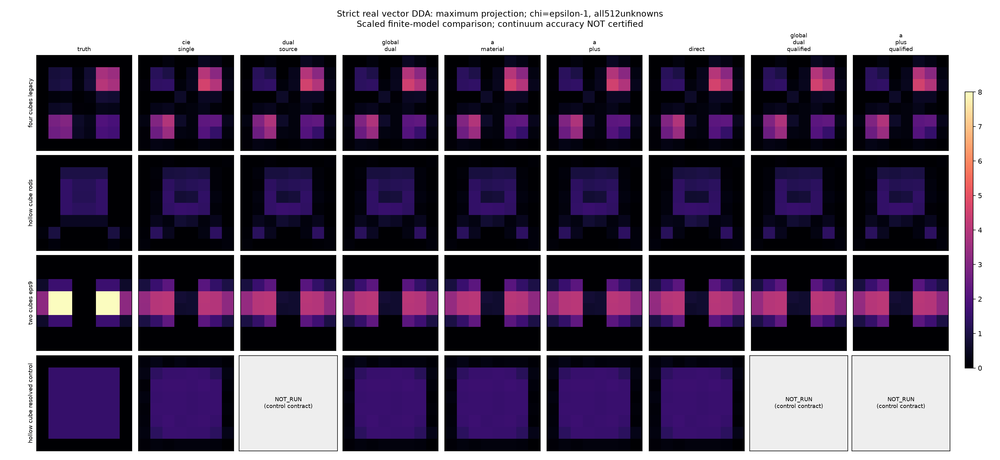
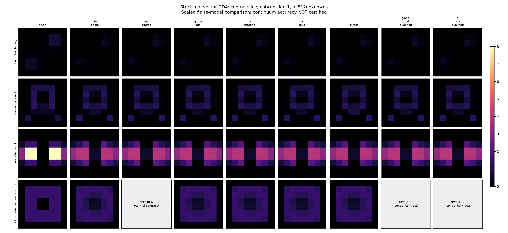
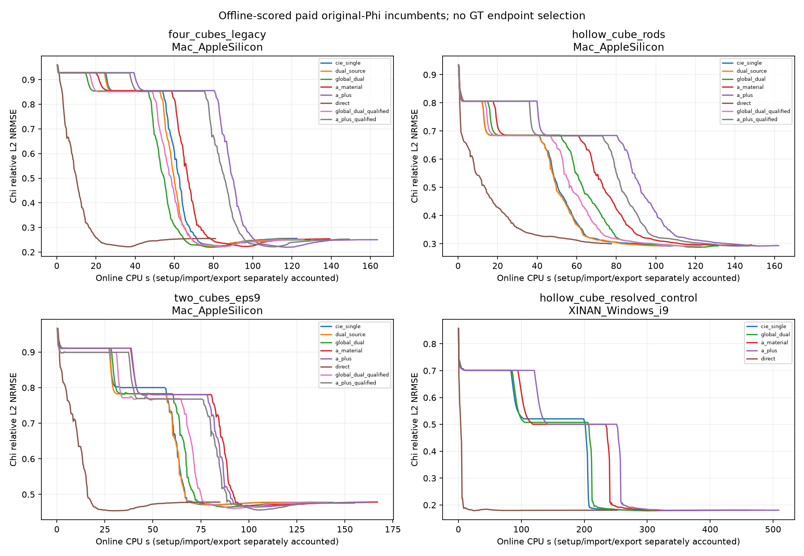
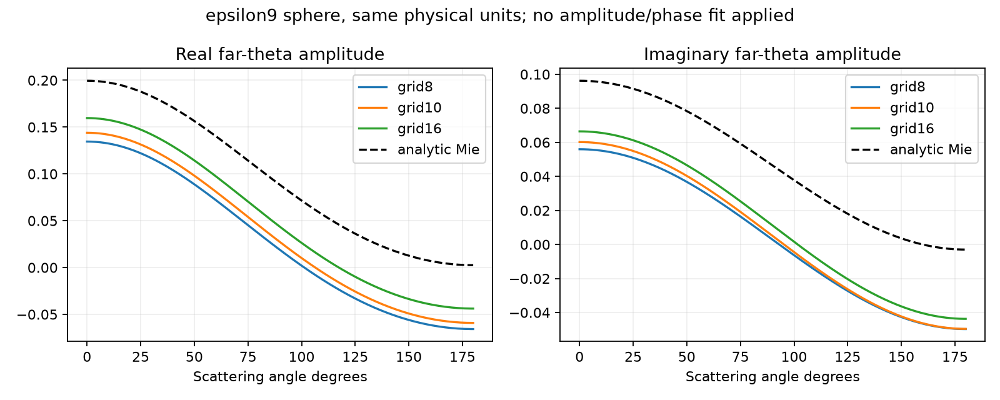

# R9 Phase2：严格实材料三维矢量扩展

**这是缩小电尺寸的有限DDA比较，不是原2019论文3λ、30³/60³的物理复现。ε9球的连续物理误差很大，不能仅用小线性残差掩盖。** R8与PhaseI保持不变；原24臂加追加5臂全部封存后才离线评分。

本组冻结预算下未观察到清晰的三维A/A+终点或成本优势。共同300步物理校正后，GlobalDual/A/A+/Direct在每个对象上的误差接近；Direct的完整CPU更低。A+最终χ-NRMSE为四块.25039、薄壳加杆.29355、ε9双块.47728、厚壳控制.18063，Direct分别为.25486/.30006/.47829/.18063。新增噪声规则下ε9 A+为.47547，仍有较大材料误差，不能据此宣称准确连续成像。这里只描述这些对象/模型/预算的结果，不构成方法的普遍否证。

厚壳控制的误差低于原薄壳加杆，但同时改变了对象几何、散射强度和噪声实现；这支持认真对待欠分辨问题，不能独立证明误差改善由壳厚或A机制造成。所有终点都按公开原Phi选择；曲线上更低的中间GT误差没有用于在线挑选或修改停止条件。

每例8³=512个独立实各向同性χ未知量，1536维完整矢量场，60有限电偶极/60三分量接收，10800复观测。所有方法χ盒[0,8]、初值.25、同离散smooth/l2 prior；无GT/support在线输入，无NN。继承R1/R8 dyadic CM+RR DDA，未增加物理后端。

单CIE sourcewise current β6→1；Dual sourcewise/GlobalDual β6→3，material β6→1。A/A+仅改变材料读出，current严格与GlobalDual相同。原生projected-IDFT γ在MF1→2按频率/component精确transport；240固定PR、材料内迭代max12/A+两轮八色arc，共同physical corrector300，direct300。两类checkpoint80只复制已付费状态。Eq16 sqrt(mean ratio)仅作诊断；不宣称paper stopping或Eq17 Err。A+只适用于本轮实各向同性材料，不扩称复介电常数。

|Case|Platform|Arm|Raw χ-NRMSE|Final χ-NRMSE|Accepted80|Residual|Whole-worker CPU s|LU|DPCS rank|
|---|---|---|---:|---:|---:|---:|---:|---:|---:|
|four_cubes_legacy|Mac_AppleSilicon|cie_single|0.85256|0.25547|0.24436|0.10107|124.16|528|42|
|four_cubes_legacy|Mac_AppleSilicon|dual_source|0.85396|0.25207|0.24071|0.10107|122.36|528|42|
|four_cubes_legacy|Mac_AppleSilicon|global_dual|0.85380|0.25022|0.24039|0.10108|130.91|484|42|
|four_cubes_legacy|Mac_AppleSilicon|a_material|0.85553|0.25398|0.25087|0.10107|141.24|483|42|
|four_cubes_legacy|Mac_AppleSilicon|a_plus|0.85552|0.25039|0.23626|0.10107|165.46|542|42|
|four_cubes_legacy|Mac_AppleSilicon|direct|0.95968|0.25486|0.23790|0.10107|82.54|301|—|
|four_cubes_legacy|Mac_AppleSilicon|global_dual_qualified|0.85138|0.25153|0.25582|0.10107|127.84|485|28|
|four_cubes_legacy|Mac_AppleSilicon|a_plus_qualified|0.85307|0.25278|0.24092|0.10107|150.87|544|28|
|hollow_cube_rods|Mac_AppleSilicon|cie_single|0.68408|0.29388|0.38264|0.02992|112.17|471|42|
|hollow_cube_rods|Mac_AppleSilicon|dual_source|0.68512|0.29523|0.37905|0.02991|109.83|473|42|
|hollow_cube_rods|Mac_AppleSilicon|global_dual|0.68553|0.29281|0.38867|0.02991|133.42|475|42|
|hollow_cube_rods|Mac_AppleSilicon|a_material|0.68425|0.29562|0.38427|0.02991|150.37|474|42|
|hollow_cube_rods|Mac_AppleSilicon|a_plus|0.68424|0.29355|0.39417|0.02991|164.08|542|42|
|hollow_cube_rods|Mac_AppleSilicon|direct|0.93455|0.30006|0.42555|0.02993|79.13|302|—|
|hollow_cube_rods|Mac_AppleSilicon|global_dual_qualified|0.68414|0.29318|0.38600|0.02992|124.49|473|45|
|hollow_cube_rods|Mac_AppleSilicon|a_plus_qualified|0.68288|0.29394|0.37295|0.02991|152.03|542|45|
|two_cubes_eps9|Mac_AppleSilicon|cie_single|0.80027|0.47752|0.47246|0.03105|124.94|541|37|
|two_cubes_eps9|Mac_AppleSilicon|dual_source|0.78314|0.47755|0.47370|0.03104|126.80|542|37|
|two_cubes_eps9|Mac_AppleSilicon|global_dual|0.78290|0.47752|0.47076|0.03105|145.34|544|37|
|two_cubes_eps9|Mac_AppleSilicon|a_material|0.78052|0.47854|0.46845|0.03105|168.92|545|37|
|two_cubes_eps9|Mac_AppleSilicon|a_plus|0.78048|0.47728|0.46529|0.03104|163.10|543|37|
|two_cubes_eps9|Mac_AppleSilicon|direct|0.96659|0.47829|0.45762|0.03105|86.38|305|—|
|two_cubes_eps9|Mac_AppleSilicon|global_dual_qualified|0.76913|0.47808|0.46841|0.03105|142.53|544|57|
|two_cubes_eps9|Mac_AppleSilicon|a_plus_qualified|0.76784|0.47547|0.46729|0.03104|156.51|544|57|
|hollow_cube_resolved_control|XINAN_Windows_i9|cie_single|0.52073|0.18064|0.18129|0.02985|461.14|538|42|
|hollow_cube_resolved_control|XINAN_Windows_i9|global_dual|0.50753|0.18066|0.18082|0.02985|468.44|537|42|
|hollow_cube_resolved_control|XINAN_Windows_i9|a_material|0.50060|0.18063|0.18192|0.02985|488.91|540|42|
|hollow_cube_resolved_control|XINAN_Windows_i9|a_plus|0.50059|0.18063|0.18143|0.02985|511.38|553|42|
|hollow_cube_resolved_control|XINAN_Windows_i9|direct|0.85735|0.18063|0.18044|0.02985|253.72|313|—|

NRMSE=||χhat−χreference||₂/||χreference||₂，与PhaseI幅度归一RMSE及paper Eq17不同；不跨池比较原始Phi。Raw是全部已付费joint物理评估中最小原Phi状态，不一定是最后joint状态；保存的stage文件保留真实联合m/J/Q/γ。

## 物理、电尺寸和分辨率限制

原四块在.6λ箱内，side=.16λ（2.13 inverse cells），ε2/3/4/5；原paper side=.8λ。ε5时本轮side=.358内部λ，原paper为1.789内部λ。新ε9双块在.4λ箱内，side=.12λ=.36内部λ、gap=.10λ=2 inverse cells。inverse h=.05λ，6.67 cells/内部λ；fine10为8.33。高contrast不自动比原paper较大对象更难。

薄壳+双杆沿用R8 literal box几何：外边.30λ、内边.18λ、壳厚.06λ=.8 inverse cell，杆横宽.07λ=.93 cell，确属欠分辨。追加resolved hollow仅立方壳，外边.45λ、中心腔边.15λ、壳厚.15λ=2 inverse cells，ε2.5；是公开声明的R9 resolution control，不是paper复现/新blind win。几何加厚也改变散射，因此不是纯grid-convergence或因果机制证明。

cube/hollow边界使用继承的几何体积分数乘线性χ；独立球使用固定24³ midpoint的MG静态极化率混合，两者不同。Mie控制不是这些cube/hollow场的误差界。
- four_cubes_legacy: 独立fine10→coarse8 clean-data relative discrepancy=10.607%。
- hollow_cube_rods: 独立fine10→coarse8 clean-data relative discrepancy=7.060%。
- two_cubes_eps9: 独立fine10→coarse8 clean-data relative discrepancy=6.818%。
- hollow_cube_resolved_control: 独立fine10→coarse8 clean-data relative discrepancy=3.612%。

新三例raw iid CN3%是期望Frobenius噪声，公开σ满足E|n|²=σ²，实际噪声不归一化。legacy四块保留原固定能量10% Y。Primary DPCS历史threshold=.1；qualified在新两例用完整raw噪声球σ²χ²(.99,2nrns)/2、最小支持连续SVD rank，legacy用(.1/.9)||Y||确定界。均不涵盖上述离散模型差异，不做per-r检验/GT调rank。追加resolved hollow只跑五个primary核心臂。

## ε9球的独立Mie失败与一次必要细化

- grid8: complex far-vector error=61.583%，linear residual=2.07e-15。
- grid10: complex far-vector error=55.526%，linear residual=3.29e-15。
- 唯一追加grid16: status=COMPLETED; relative complex error=43.057%; CPU=3.213s; peakRSS=1250.4MB；散射截面误差30.913%。

同一εr9/χ8、r=.145λ、箱.4λ；不拟合材料、半径、归一化或复相位。grid16仅消去严格χ=0背景，使用已有TensorDDA arbitrary-occupied-cell API；保留原8/10全部失败与费用。大Mie误差实质限制ε9对象的连续物理解读；有限DDA算法配对比较仍须与连续准确性分开。

角向复幅度表明这不是一个可用单一增益修复的偏差。解析五个预声明频率点的磁偶极响应与截面均上升，所查区间没有峰；不把它冒称已定位共振或误差的唯一原因。详见[Mie独立审阅](delegated/3d_extension/MIE_REVIEW.md)。

## 成本与执行边界

最多两个单BLAS线程数值子进程，有限队列不断流。原24项均Mac；root随后明确资源迁移，厚壳5项全部从相同初值在XINAN i9指定P-core logical[8,10]运行。两条已启动Mac厚壳partial单独保留为资源交接中止，不计算法失败，不混入远端cohort成本。Mie16已在Mac完成，不重复远端。所有CPU比较须在同平台、同对象内配对；跨平台总CPU只作消费账，不能跨池声称速度。远端保持connected SSH及Windows kill-on-close JobObject，只传publicY/config/必要代码，无GT、GPU或新框架。

Whole-worker CPU包含冷启动imports/setup/SVD/online/导出；表中与已付费online曲线的计时范围不同，后者不包含setup/import/export。Windows使用psutil user+system/GetProcessTimes和peak_wset，未知内存不伪记0。Direct300与joint240+300不是等预算，不能按终点迭代数声称速度优势；应结合真实LU/RHS、CPU轨迹及停止信息。

每项RECEIPT保留真实optimizer success/message/nit/nfev与允许上限；MAXITER不是收敛。所有material-only/GB/SB缓存动作、SVD、物理LU/全部源RHS/adjoint RHS分别记账；exact-m cache命中不伪称独立求解。终点复制不增加LU/RHS。新增validation/generation与失败费用在独立receipt中，旧四块fine10不重跑。

完整消费账见[PHASE2_COMPLETE.json](RESULTS/vector_extension/PHASE2_COMPLETE.json)：科学反演24项Mac为3185.44 CPU s，5项XINAN为2183.58 CPU s；另保留资格/生成/父进程/导出/评分出图/传输费用。两项Mac资源交接中止至少已付231.52 CPU s，日志可证物理LU至少389/390；没有伪记为零。少量已运行父进程/中止终段使用显式CPU下界与采样界，小型metadata/upload辅助CPU未单独计量，不能把消费账下界称为精确全成本或混合平台加速比。

原24任务的自动score因root追加控制而由显式SCORE_HOLD_ROOT_AMENDMENT_29预GT阻止；该hold是流程控制记录，不是有效预测seal。之后由all29 manifest统一封存并独立评分。详见delegated/3d_extension及RESULTS/vector_extension；未修改历史R8、PhaseI、原24配置或预测。

入口与数学范围：[README](delegated/3d_extension/README.md)。配置：[原24](configs/vector_extension_phase2.json)、[resolved hollow](configs/vector_extension_resolved_hollow.json)、[29项合并清单](configs/vector_extension_all29.json)。
