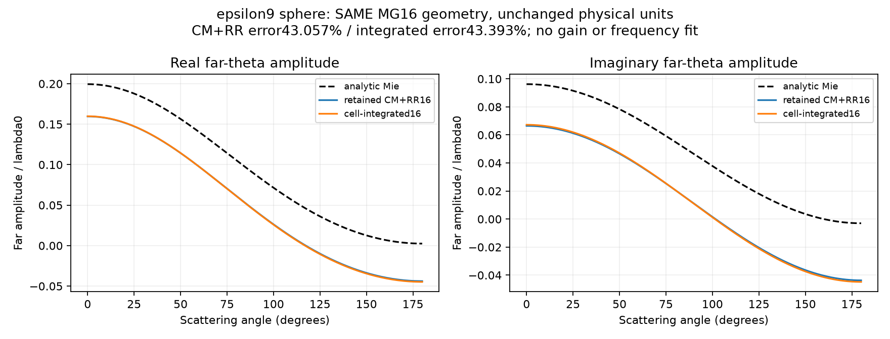

# 单次体积分Green控制：Mie16阴性结果

**固定cell-integrated pulse/collocation控制未修复这个MG边界球的Mie大误差。** 新误差43.3934%，保留的CM+RR16为43.0572%；截面误差分别30.1015%/30.9126%。没有重跑旧CM+RR、改变频率/材料/半径、增加网格或运行新反演。旧29结果及旧Mie负证据保持不变。

两者同为εr9/χ8、r=.145λ、h=.025λ，完整复矢量散射；复用完全相同的16³/1136 active-cell MG24 fractions、中心入射与解析参考。新算子使用root预先指定的标准脉冲基/中心配点体积分：近场Chebyshev lag≤2采用Gauss8，其他非自项Gauss3；自项Duffy Gauss16并包含全部动态实/虚部。新远场严格乘立方体均匀电流的sinc乘积，不用拟合归一化。

|量|保留CM+RR16|新体积分16|
|---|---:|---:|
|复远场相对L2误差|43.0572%|43.3934%|
|截面相对误差|30.9126%|30.1015%|
|散射截面λ²|.1329469|0.1345078|
|新线性残差|不重求|2.63e-15|

## 必要实现检查

- 自项s=-0.330225571128035 + i0.000205405449666335；Duffy16/20绝对差8.13e-20。
- 独立Cartesian regular-part Gauss24加已核准静态cube积分常数，与主自项差1.72e-11；不是把高阶值替换主协议。
- 单个固定近lag(1,0,0)：Gauss8/12相对差4.49e-06；固定远lag(3,2,1)：Gauss3/5差1.78e-06。
- 单lag反演/轴置换对称差9.21e-16/6.8e-16，block转置互易差0。
这些是固定必要spot checks，没有按结果调阶，也不能凭它们给出连续被动性或整个VIE的误差证书。

## 同MG控制的解释边界

此配对同时保留了原MG边界本构，**不能隔开界面本构近似与传播离散误差**。它说明本次积分核/动态self替换没有修复这个完整控制，不证明体积分理论错误，也不证明MG是唯一原因。

|Grid|切边cells/positive cells|Σχ/(8Σf)|MG静态极化率总和比|
|---|---:|---:|---:|
|8|152/184|0.782074|1.000000|
|10|224/312|0.839634|1.000000|
|16|584/1136|0.892267|1.000000|

MG满足χeff=3fχ/[3+(1−f)χ]，静态局部极化率求和按构造保持；Σχ低于线性χ体积分数只是这两种边界模型的描述性差异。不能将其直接等同“真实体平均ε误差”，更不能由此反推出材料或频率来追求Mie吻合。

## 可复用接口与成本

[cell_integrated_green.py](../../../src/cell_integrated_green.py)独立于冻结旧backend。`CellIntegratedGreen(h,k).assemble_dense(integer_coordinates)`返回已积分G，无额外h³；`self_density`用于一致地构造局部H=Glocal−sI。`external_electric_operator(points,receivers)`也做source-cell Gauss3积分，其精确离散伴随为同一S.conj().T；`far_field`包含h³和cube formfactor。可供root后续OriginalModel/FFT kernel与A+自项一致接入，本轮未接入或重跑旧反演。

本次XINAN P-core[8]、一BLAS线程、connected SSH+kill-on-close JobObject，无GPU；恰好1新LU/1源RHS。Whole-process CPU=2.21875s，script wall=2.39151s，peak working set=798.33MB。
LUT共12167唯一lags、388622dyadic quadrature节点；LUT CPU=0.12500s，含LUT的dense组装CPU=0.26562s（均嵌套在whole-process中，不重复相加）。
新费用在本诊断receipt/COST.json单列，不回写旧29的消费账；小型传输/打包helper CPU未独立计量，未知不写为0。root拥有后续方向/物理资格判断；本worker没有自行扩展grid、check或inverse。

## 评分口径补注（说明性追加，原指标与评分不变）

本文Mie far-vector relative error是预定φ=0散射平面、181个均匀θ采样上的三分量Frobenius相对范数：||F(φ=0,θ_l)−F_Mie(φ=0,θ_l)||F/||F_Mie(φ=0,θ_l)||F。它不是全角球面相对场范数；散射截面另外使用24点Gauss-cosθ×32个φ的球面积分。不能用较小截面误差替代角场误差，也不能把这一个平面的误差当作完整球面场误差。此补注不改变任何已存预测、原始指标或score。
