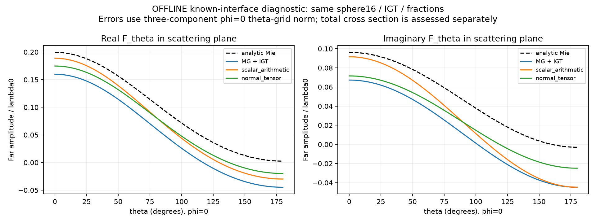

# 已知球界面的两次离线前向诊断

**OFFLINE_DIAGNOSTIC，非未知材料恢复。** 同16³球、同fraction、同IGT Green/self/cube sinc，仅替换边界材料表示。无新反演，无grid/radius/frequency/material拟合；旧29项、原尺寸9臂和既有负证据均未变。两个worker预测全部封存后才一次离线Mie评分；worker未加载Mie输出。

## 评分口径

下述“平面角场误差”为预先指定φ=0、181个均匀θ采样上的三分量Frobenius相对范数：||F(φ=0,θ_l)−F_Mie(φ=0,θ_l)||F / ||F_Mie(φ=0,θ_l)||F。它不是全角球面相对场范数。截面另用24点Gauss-cosθ×32个φ的球面积分计算，两者不可替代。图仅画该散射平面的F_theta实/虚部，三分量误差仍用完整保存场。

|材料表示|φ=0平面角场误差|全角截面误差|
|---|---:|---:|
|既有MG + IGT|43.3934%|30.1015%|
|scalar_arithmetic|27.8385%|4.7354%|
|normal_tensor|25.3656%|25.5854%|

Arithmetic大幅改变结果；normal tensor的平面角场略好，但截面明显比arithmetic差。scalar截面误差4.7%不能掩盖其27.8%平面角场误差。两者角场误差仍大，不给连续精度PASS，也不证明某一种界面机制是唯一原因。

## 冻结规则与合法性

Arithmetic：ε=1+8f。Tensor：ε_t=1+8f、ε_n=(1−f+f/9)^−1，εcell=ε_t(I−nnᵀ)+ε_n nnᵀ。仅cutcell使用公开已知球的局部法向n=point/|point|；fullcell精确ε=9。此处局部平面/准静态平均依据切向E连续和法向D连续，不是新理论，不是通过Mie结果选择法向或拟合材料。

|材料表示|最小/最大ε特征值|转置对称误差Linf|fullcell ε9误差|
|---|---|---:|---:|
|scalar_arithmetic|1.00173611111 / 9|0|0|
|normal_tensor|1.00019293845 / 9|2.22e-16|0|

两个表示均实SPD、互易，使用相同584个cutcell。改变tensor还改变方向响应及有限材料本构；不能将误差变化唯一归因于体平均、方向或几何。已知法向信息也不能自动迁移给未知界面反演，更未提供给冻结9臂。

## 先例与方法边界

切向算术/法向调和平均已有直接先例，见[Farjadpour等2006](https://math.mit.edu/~stevenj/papers/FarjadpourRo06-SPIE.pdf)。该文讨论FDTD/Yee相关的各向异性subpixel处理；本实验只是将静态平面界面effective ε适配到pulse/collocation，不能继承其FDTD二阶收敛结论。
[Piller/Martin的high-permittivity CDA工作](https://www.sciencedirect.com/science/article/abs/pii/S0030401898006452)结合WD与FCD；本实验没有完整复现其WD：IGT self保持冻结，也没有引入principal/secondary场的WD修正。本轮不主张公式原创、完整WD复现或未知界面恢复。

## 成本与封存

远端XINAN P-core[8]、一BLAS线程、无GPU；沿用R1 TensorDDA张量E-form I−Gχ与SciPy密集LU，χ为完整3×3块。每臂仅一次LU/一源RHS。两份PREDICTION及receipt先写入PREDICTIONS_SEAL.json，然后才离线读取Mie参考、计算角场/截面和eig合法范围。

- scalar_arithmetic: whole-process CPU=2.46875s，wall=2.52064s，peakRSS=651.33MB，线性残差=2.63e-15。
- normal_tensor: whole-process CPU=2.37500s，wall=2.50831s，peakRSS=651.44MB，线性残差=2.44e-15。

两worker成本、父进程dispatch/seal/offline assessment、Mac报告费用独立记录于COST.json，均不回写旧Mie/29 canonical。传输小helper CPU未单独计量，null不冒充0。本轮不自主扩展。
