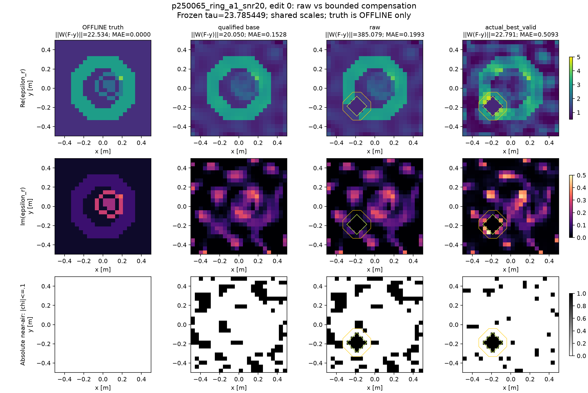

# Research T 独立研究报告：能补偿出新孔洞，但未改善成像

## 第一屏结论

1. **基础解：**固定8条件均有合法、数据相容的默认基础材料，原N3只有2/8。原32条件零物理审计为2/32。两套基础选择各8个变体已保存。
2. **成核：**三轮共40个有限编辑，raw全部不相容；32个经实际full-TM端点验证后相容，13cell严格空气核及闭合材料guard均保留。第一轮15/16成功，覆盖四个独立parent。
3. **区别：**同观测材料之间满足固定0.03归一化L2和至少6cell相差的archive共48个端点；这是有限栅格材料集合，不是48个拓扑分支证明。
4. **精度：**所有轮次Best-of-up-to-4含基础图时材料MAE改善为0；未建立更准确重建或更快搜索。没有运行multi-start、QD或CEM竞赛，不能对它们作优越性结论。
5. **A17：**独立增量NOT_RUN。普通全材料Jacobian已使用完整resolvent；移除它制造“无feedback”对照会改变物理。没有证据把A17列为当前生成器必要组件。
6. **交付：**G可直接复用8个minimum-change默认base、共同corrector/validator、48份真实材料与预测、完整约束及独立预算接口。
7. **裁决：**继续受限二维补偿机制与G的独立生成研究；停止最低残差即最佳材料、linear score即非线性排除、候选数即posterior质量三类主张。当前不足以支持强IEEE TAP原创算法论文。

## 为什么先审计

收到的ZIP实际包含执行说明、T↔G接口和一个manifest示例三份文件，均原样保存于pro_original；未假定还有未提供的大型Pro实证库。原A30源码、A17理论、Research A反证与其已有物理数组为主要证据。E0没有求解、分解或构造新Green矩阵。

32个历史条件保存的clean response、current、本构与场方程一致，最大相对误差1.97e-15，噪声metadata重放误差0。原N3缓存与pool只有质量打包带来的4.45e-16差；Research A一步更新后的base差0.03–0.07，不能混用残差。历史图的abs(chi-background)是增量支持，不能当空气；p250065_weak的历史三个阈值均7个增量组件、0洞。32真值均无严格χ=0的单元。Sparse64的35.69%是真值目标离线拟合容量，不是测量到材料的在线恢复。

四个真值噪声实现落在95%噪声球外，其中p250065_weak真值残差24.090925，阈值23.785449。这不是现有模型错配证据。所有实验保持原sigma和阈值；也不能把某一次truth不在置信球解释为其物理非法。

## 冻结的物理与资格

原24×24二维scalar TM/VIE，8照明、32接收、576个复材料，单一chi=epsilon_r−1共享全部源；Rechi∈[-.5,4]、Imchi∈[0,.5]，已知gain=1。原complex RMS噪声sigma，逐源Re32/Im32并乘sqrt(2)/sigma，共512实通道，tau=sqrt(chi²_512(.95))。没有Mie台架的实噪声约定移植、自由gain、噪声放宽或真值在线输入。

普通全材料1152实自由度与Haar64从相同N3开始，最大4更新／6新端点、trust0.6、LM damping0.001，两臂每条件均一次新端点就达到0.95tau。资格阶段16states/448RHS。数据相容恢复说明历史失败不能当不存在可补偿材料；它没有证明材料更接近真值。

|基础|合格条件|平均残差|complex MAE|Re MAE|Im MAE|
|---|---:|---:|---:|---:|---:|
|原N3|2/8|29.139042|0.041756|0.039688|0.009997|
|full GN|8/8|20.148396|0.167560|0.141362|0.062463|
|Haar64|8/8|21.162010|0.054811|0.048762|0.017934|
|最低残差选择|8/8|20.136726|0.147656|0.123295|0.057465|
|最小N3位移选择|8/8|21.927005|0.050757|0.045796|0.015730|

最后一行受离线汇总负结果启发后提出，但每case选择只比较合法相容端点对N3的材料L2；没有用truth选图。这是exposed development修订，不是独立确认。

## 三轮实际机制实验

|轮次|基础规则／主要变化|raw通过|补偿后通过|独立parent有成功|
|---|---|---:|---:|---:|
|1|最低残差base＋普通全材料补偿|0/16|15/16|4/4|
|2|同提案＋非core正材料相保护|0/16|10/16|4/4|
|3|最小N3改动的合格base；固定两个编辑|0/8|7/8|4/4|

固定位置(7,7)/(7,16)/(16,7)/(16,16)，空气核半径2cells，共13cells；guard宽1cell、Rechi≥.30。core为严格chi=0，guard与core均为corrector硬约束。guard被提高的材料也是提案的一部分，并非免费校正。所有core在原base的13cells都不是primary近空气，避免把原孔重命名为新孔。

v1采用全材料普通GN，最多3更新／3新端点；v2仅增加非core原Rechi≥.15处保持≥.15；v3只改用minimum-change base并在所有四parent固定前/第三位置执行，其他物理与corrector不变。raw与中间失败全保存；不得把v3换base说成与v1同一raw。

v2使core外新增near-air细胞均值从29.44降至11.06，但成功率从15/16降到10/16，材料MAE没有改善。v3仍7/8成功，说明第一轮并非仅能从最差full-base成核；同时其合法候选MAE均值仍0.488023。32个通过记录跨轮相关，不能当32个独立重复。

## 一个可核验实例

同一p250065_ring观测、gain=1：基础残差20.050，固定edit0 raw残差385.079270；三步有界补偿后22.790599≤23.785449。13cell core=0、闭合guard≥.30，归一化材料L2=0.507845。精确有限secant恒等式在全部40个端点最大相对缺陷4.10e-15。

它证明“有限结构编辑＋合法全材料补偿”能恢复冻结的观测相容；它不证明truth有该孔。该例MAE由基础0.1528变成0.5093。v1通过候选与base预测差距仍6.24–11.36白化单位，v3为10.07–14.27；即使双方在噪声球内，也不能称同一分布、统计不可区分或高posterior mass。概率字段保持null。

## 评分、A17与数值边界

约束linear compensation给局部trust box的可行上界U与合法dual下界L；没有uniform非线性误差界。v1有13个U>tau但后续三步full-nonlinear成功，因此用U>tau直接删除会误排有效端点。U排序只作付清所有raw/32-RHS评分成本的离线顺序重放；未建立独立online screen加速或ordinary multistart优势。

实际24网格单侧差分步长1e-4/1e-5的Jacobian相对误差1.07e-4/1.07e-5，呈一阶收敛；独立组装NumPy直接解与SciPy端点一致。两者仍共享离散算子/LAPACK家族，不是独立物理模型或连续误差证书。构成一致性和backward residual约1e-15并不提供输出误差上界。所有候选为FULL_VALIDATED_NUMERICAL，严格bound状态UNKNOWN_NUMERICAL_ERROR。

A17 paired law针对固定材料注入及指定Galerkin增广的局部二次问题。这里没有遗漏反馈的current ROM。新的core/guard改变active face；不能照搬无约束双侧步差定理。等成本paired/Krylov额外消融未运行，原A17局部GN结论不受改写。

## 资源、失败与后续

192states、5832complex RHS、213.213秒受控求解wall；详细split和零物理后处理在RESOURCE_SUMMARY。一次离线CSV失败保留，wall未记录为null，没有假装零费用。无大型NN、GPU、新3D或旧预算借用。新solver消费封口。

下一阶段先把minimum-change／discrepancy regularization与结构约束结合，保护材料质量；不要用更大的生成器弥补可行集合过宽。G可在同一后端独立授权下比较生成策略；T本轮不重复。非同心3D与强TAP理论声明均NOT_RUN/证据不足。有限可行端点不解决唯一性，不证明连通性或完整解族覆盖。
