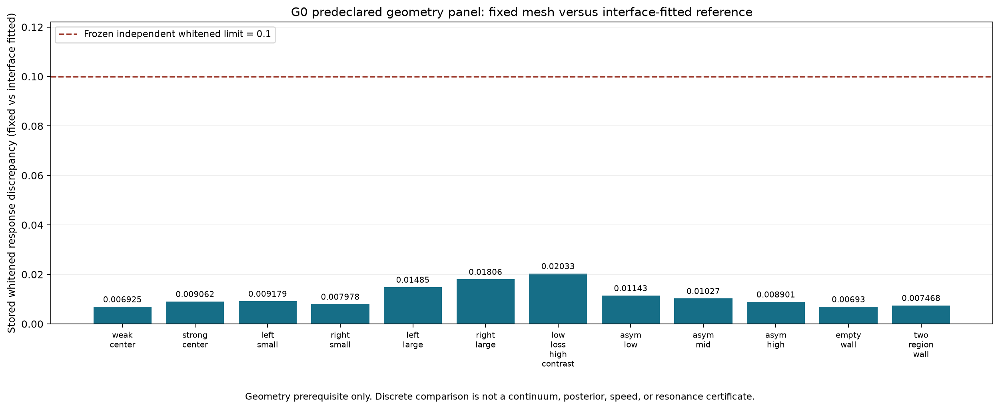
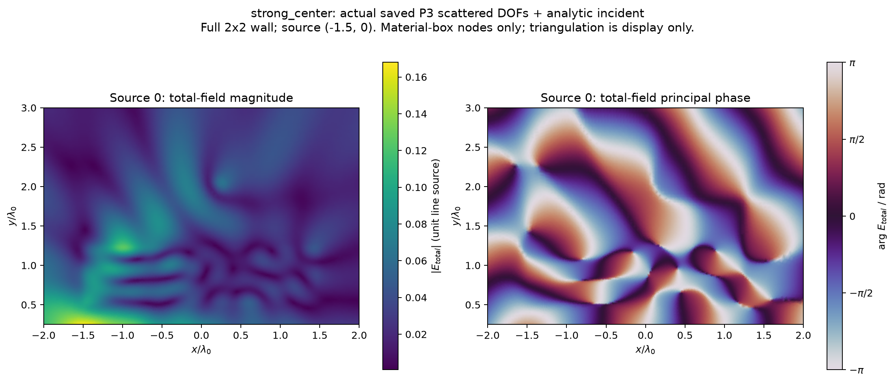
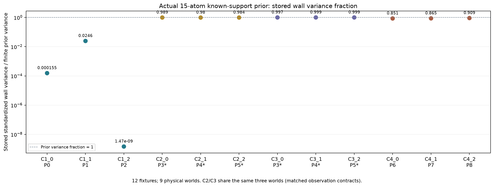
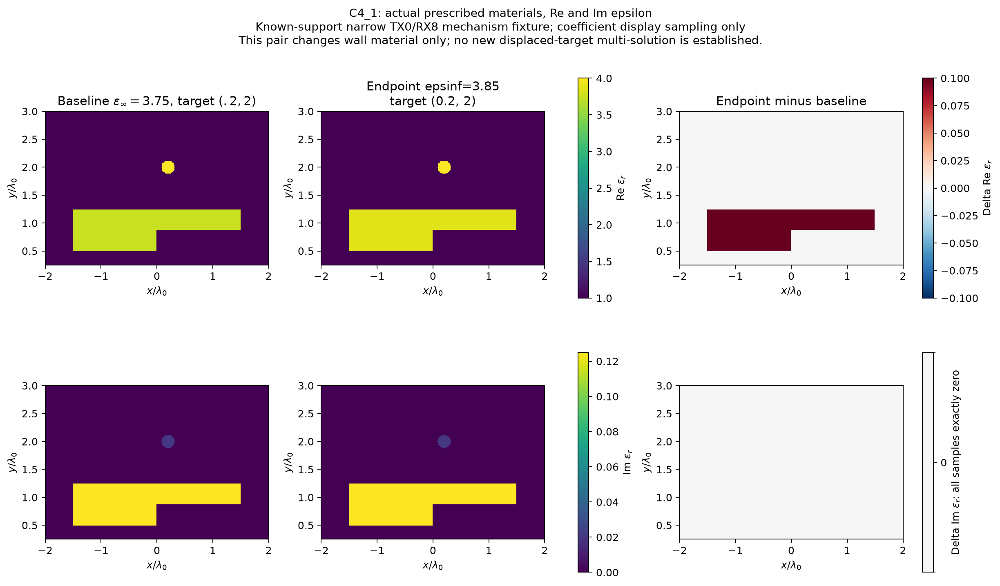
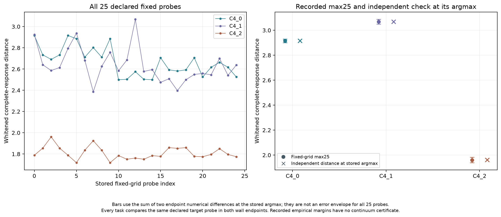
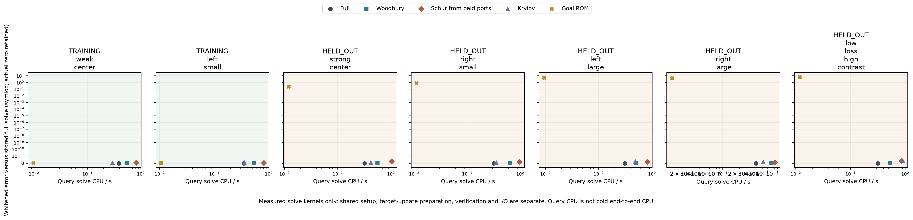
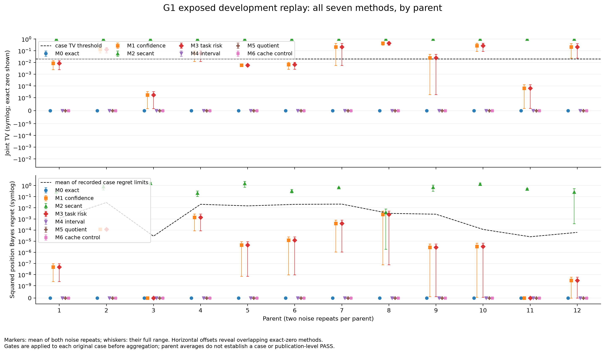
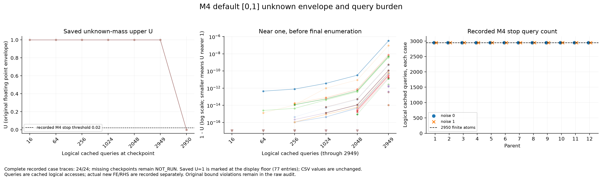

# Research W-BGGA：精确背景吸收、任务传播与完整联合概率

2026-10-28；二维scalar-TM；已暴露开发证据。**同离散精确吸收通过，当前完整端口与默认区间策略的计算加速路线NO-GO。** G2冷部署、unknown-support A0和30-parent确认未启动。

[入口](START_HERE.md) · [机器判决](GATE_DECISION.json) · [总表](FULL_TABLE.csv) · [成本](COST_SUMMARY.json) · [复现](REPRODUCE.md) · [Release数据](https://github.com/migodam/b1-probabilistic-maxwell-imaging/releases/tag/research-w-bgga-20261028)

## 1. 三种不同的“吸收”

精确更换Green背景、用代表传播近似一簇材料、把墙体posterior替换成单点，是三种不同操作。第一种保留随机残差材料与完整输入输出时只是重参数化；第二种须控制当前likelihood和指定未来任务；第三种直接丢失材料质量及墙–目标相关性。代数恒等式成立，不推出近似安全或计算便宜。

W与X在主观测中静止，位置/半径变化的行是不同查询世界或prior原子，不是运动时间。固定数据上的求解、背景替换、区间收紧都不增加信息。外侧TX2/3只在输出封存后作预测评分，不再乘进likelihood。没有新NN、3D、主动测量、locked数据或A17模块。

本轮实际运行G0新的全波求解：计费3,934 complex RHS、482次材料–频率FE分解。随后在旧2,950原子有限prior上完成12 parent×2 noise×7方法的独立重放，G1新增PDE为零，不能写成PDE加速。

## 2. 来源和统一合同

旧W固定提交为958a478739d9553269316ded8125fda9df225c0c，W-SLAM为52351aee6ddd41b09851fe5e52d1a8861891ef13。旧目录与结论不覆盖。Pro PDF理论与提案在source_review和THEORY_TO_TEST单列，不能当成已执行证据。

公共P3标量H1 FEM采用exp(−iωt)、μr=1、被动介质ε(f)=ε∞+iℓ/f、单位outgoing线源，不拟合复比例。当前f/f0=1、两发16收、仪器已校准。实虚每坐标σ=.01、复方差.0002；先按源/接收器展平，再拼全部实部和全部虚部，除以σ，不除通道数平方根。

墙ROI为[-1.5,1.5]×[.5,1.25]、宏格边长.125；目标积分ROI为[-1.2,1.2]×[1.4,2.8]。墙ε∞为1.5–6、损耗0–.25，目标contrast0–8、完整ε实部≤9。源、PML、位置/半径与积分细节见[CONTRACT](CONTRACT.json)、[G0_CASES](G0_CASES.json)、[stress计划](G0_STRESS_PLAN.json)。这是新有限合同，不能替代旧W宽材料类。

公共网格28,903 DOF、28,420自由DOF、6,369三角形，目标移动不改变空间。圆盘用384边形与三角形求交并积分。独立参考仍用高阶interface-fitted网格；经验一致性不是连续PDE证书。

## 3. G0：解决目标依赖网格与材料依赖右端

旧Evaluator会把目标边界刻入网格，不同目标矩阵不能直接相减。本次目标不再参与mesh key，公共目标域有2,257端口。一个r=.12圆盘约触及79 DOF、1,147个mass非零项；材料参数少不代表rank1。

backend采用散射场未知量，右端依赖材料，正确式为：

```
(L_W − V_X)u = b_W + b_X
L_W u_W = b_W
δu = G_W(b_X + V_X u_W + V_X δu)
```

省掉b_X不是精确吸收。本次保留解析入射场积分、接收项和墙–目标全反馈；Full、Woodbury、同付费端口Schur、背景LU预条件Krylov及普通goal-Galerkin共用相同空间。

12个弱/强目标、位置/半径、非对称/空墙与低损耗高对比案例，fixed-v-fitted白化差为**.00692498–.02032811**，均低于冻结.1。28条精确对照最大内部场相对差2.04e−13、响应差5.17e−14，最大backward residual为5.51e−17。三个原生JVP/实伴随配对约4e−15。

有限差分另行检查。边界参数改用合法单侧差分，不在box外取样；形状导数有有限步误差，最小步长一侧半径误差仍约百分之一以内，不能称所有导数机器精度。固定-v-fitted Jacobian最大尺度化差.08526，只是经验分辨率，不是统一误差上界。





低损耗高对比core的一范数条件数估计约3.49e4，不是inf-sup下界，也不证明物理共振。未使用jitter、伪逆或自动full fallback。

**QUALIFIED_DISCRETE_FULLWAVE_FOR_TESTED_CONTRACT**仅限已测配置，不是2,950原子的统一前向界或连续Maxwell认证。

## 4. 四类机制：材料可辨与任务稳定不等价

12个fixture每类3个；C2/C3复用同3个物理parent，故只有**9个独立物理世界**。这些known-support fixture用于机制测试，不是measurement-only墙体发现。分别profile pose、pose+intrinsic、再加共享仪器。proper Gaussian指标仅为tangent Gaussian；另用明确15原子有限prior计算实际非线性posterior及cross-covariance。

C2的完整nuisance相对保留谱约.60–.95，有限posterior仍保留**98.0%–98.9%**墙体prior方差。高比例可以只表示少量绝对信息被保留，不能因此固定材料。C3材料几乎未定，但窄任务响应差仅.040–.052，说明部分任务可容忍材料不确定。

部分局部rank在实测Jacobian网格差尺度上为UNRESOLVED，全部保留。完整nuisance谱与已知intrinsic的有限prior不是相同合同，不能拼接成安全证书。



### 一个范围很窄的传播例子

C4只用TX0/RX8一个复端口作当前观测。C4_1墙ε∞由3.75变3.85，损耗、支撑及目标(.2,2)不变。有限正确器只找到可行pair，并非全局或已收敛profile optimum。

当前单端口距离**.729007**；冻结25个相同target probes的完整响应max差**3.068166**，在自己的argmax独立贴体重算为**3.068786**；减两端经验网格差仍约**3.048647**。C4_0、C4_2的max分别2.91587、1.96088，未达3。





这是窄当前端口的task-conditional传播证据。同pair在主两发16收距离约2.7699，可被区分。没有新位移多解或一般unknown-wall ambiguity；经验margin不等于连续误差上界。旧W的.798716 joint见证保持独立oracle身份，本次未重算或赋posterior质量。

固定15原子posterior下，保持joint weights而用MAP-wall替换任务响应：C3均值响应变化小，但单墙化joint TV下界约.666；C4任务失真大。这个Jensen检查只约束固定posterior的响应均值，不约束重新近似likelihood后的posterior，更不是位置Bayes regret。

## 5. G0成本：精确方法当前不经济

|方法|7案例平均query kernel CPU秒|精度|
|---|---:|---|
|直接Full稀疏求解|.33988|同离散reference|
|完整端口Woodbury|.57170|精确|
|同已付端口Schur|.87109|精确|
|背景LU预条件Krylov|.47185|精确验收|
|普通goal-ROM|.01114|5个held-out均未通过白化.1|

这些是同进程query kernel，不能当完整独立冷部署。端口setup另需**2,257 RHS、7.64 CPU秒**；Green images约1.026GB、单core约81.5MB、实测job峰值RSS约2.325GB。

22列goal-ROM只用两个冻结训练状态与背景adjoint；五个held-out白化误差.237、.837、5.331、4.249、6.517。它快但精度不合格，不能算同质量胜出。完整端口查询本身比full慢，加setup后没有正break-even证据。

若为118个wall groups全建公共Green，仅setup约266,326 RHS、合计121GB images；流式可减驻留内存但不减RHS。这是工作量推算，未实际执行。ordinary Schur/cache享有相同复用权限，没有BGGA独占收益。



## 6. G1：2,950原子有限joint posterior七方法

FINITE_PRIOR_ENUM4_V1包含118墙组×25位置；是离散counting prior，不是连续求积。target intrinsic、gamma已知，2×2不表达孔洞。12个已暴露parent各两noise。**全部168份在线输出先封存，再算reference、打开truth评分。** 在线只读prior、y、原子查询oracle；无locked、旧posterior、GT或未来观测。

|方法|含义|parent等权平均joint TV|联合概率及风险门通过/24|每case逻辑查询|
|---|---|---:|---:|---:|
|M0|独立完整有限Bayes|0|24|2950|
|M1|自身MAP-wall单点化|.113268|13|2950|
|M2|有限secant最大保留率单墙消融|约1|0|2950|
|M3|自身posterior任务medoid单点化|.113268|13|2950|
|M4|保留完整joint的区间策略|0|24，原F64界另有失败|2950|
|M5|同时控制current/future的quotient|0|24|2950|
|M6|ordinary cache/Schur概率逻辑|0|24|2950|

M1–M3是表示消融，不是冷部署FWI强基线。M2为EMPIRICAL_BANK_SECANT_RETENTION而非local-J安全证书；它检验“仅角度足够”，不能用其失败声称成熟FWI失败。

M1/M3在此选择相同墙组。M1位置CDF门21/24、位置Bayes regret门24/24通过，但joint TV仅13/24。**目标边缘/行动好不代表完整joint正确。** 对任意墙组g，单墙分布Q的joint TV至少为1−P(W=g|y)；保留正确条件位置分布时取等号。因此最佳单墙已是MAP-wall，不是换个评分能普遍修复。这一下界不适用于保留随机残差材料的Green重参数化。



### 区间正确不等于节约计算

M4未计算原子用[0,1]，未按低prior删点。高维likelihood很小，剩一个未知原子的默认包络仍压过已算证据；24个case都查完2,950才满足遗漏质量.02。ESS不能替代遗漏质量界。



M5同时约束当前potential完整直径、future25最大响应差，避免链式合并；24/24都保留**118簇/118墙组**，没有merge。概率正确来自未压缩，不是压缩成功。新增目标材料或半径不在该future合同内。

原F64区间存在正越界：posterior上界最大2.55e−15、下界7.77e−16、log证据下界7.11e−15。按冻结规则原界FAIL，signed结果保留，未加容差抹除。一次限定修复采用60位定向归一化、80位独立复核，168个checkpoint未观察到修订界违规；仅对给定F64 log-potential有效，不涵盖FEM、potential形成或连续PDE误差。额外约10.65 CPU秒，若在线使用须归给方法；查询仍2950。

G0的.1前向门不能直接认证joint TV .02：高维残差会放大potential误差。因此本轮有限缓存数值posterior正确，物理posterior仍NOT_CERTIFIED。

## 7. 离线质量、相关性与失败

输出封存后，M0的GT位置平方误差均值约.35454 λ0²，M1/M3约.35496、M2约.72790。四个等面积墙格复χ MSE约.000713、.001139、7.64453；不是全空间unknown-wall成像。M1/M3使墙–目标cross-covariance变零，相对reference Frobenius差均值.00220，尽管位置行动regret小。

旧外侧TX2/3的proper predictive log score相对reference平均下降：M1/M3为.50352、M2为124.27836；M0/M4/M5/M6一致。密度包含64实维Gaussian正规化，正log density不是概率大于1。保留全部逐case/covariance数组，没有追加评分门。

真实缓存观测的TX0/TX1各注册一次，incremental与batch一致；旧factor版本替换不改变posterior，重复observation ID被拒。M4查询不新增数据。详见[FACTOR_HISTORY](FACTOR_HISTORY.json)。

失败保留：中心差分走出box后改合法单侧；矩阵序列化失败后复用已保存物理数组；C1_0原duality scalar与3次trial细节未写盘，明确MISSING，不补造。preflight环境失败、原区间失败也保留。65项零PDE测试通过，与Maxwell物理资格分列。

新计费快照约421.3 process CPU秒，RSS峰值2.325GB；发布收尾以[COST_SUMMARY](COST_SUMMARY.json)及最终receipts为准。早期PDF/静态阅读、少量脚本检查和网络准备未完整包裹计时，明确缺口，不当零或据此宣称端到端速度。旧bank的11,800 RHS、2,950 FE、9,288.02 CPU秒是历史已付，不是免费部署准备。

## 8. 分层决定与下一轮

|层级|裁决|
|---|---|
|精确离散吸收|通过，限共同空间及已测配置|
|跨目标公共缓存|数值资格通过；当前不经济，非统一prior/连续认证|
|angle-only|作为普遍安全规则拒绝；rank不确定行保留|
|task-conditional传播|窄单端口C4_1支持；主观测能够区分|
|有限joint|M0/M4/M5/M6条件数值模型正确；原区间失败，修复范围有限|
|单点墙吸收|一般不能保持完整joint；有时位置任务仍好|
|unknown-support A0|新实验NOT_RUN，旧A0_ONLINE_NOT_REACHED未修复|
|冷部署成本|NO_GO_CURRENT_IMPLEMENTATION，未测得完整冷部署优势|
|G2/30-parent确认|科学闸门停止，未消费确认数据|
|连续Maxwell、一般posterior、3D|NOT_ESTABLISHED|

实际被安全避免的FE/RHS为**0**。G1读旧缓存不算新PDE节约；没有安全merge或提前停止。任务风险读取全bank的费用不能推给reference。ordinary Schur/cache拥有相同接口，本轮没有证明其更差。

保留Task-Conditional Propagation Identifiability主线。它尚非强TAP新算法结论；标准Schur、resolvent、概率推送、角度谱不构成独立原创。下一轮须先找到真正便宜的likelihood/任务包络，或在保留随机残差材料时减少必要Green actions，并击败相同权限的ordinary Schur/goal-ROM。未出现该机制前，不扩大墙体类、大确认集、NN或A17附加模块。
