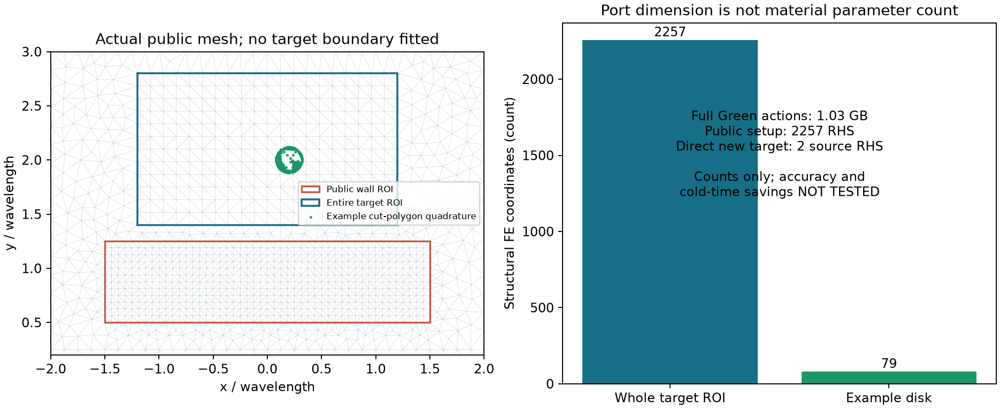

# Research W-BGGA：静态概率Green吸收的实现与资格前检查

本报告记录真实完成的代码、必要数值测试和公共网格计数；**新增全波实验为零**。当前停在明确资源授权门，不把准备工作写成G0成功，也不把未运行写成物理NO-GO。

## 1. 这次究竟要判断什么

这里的墙体W和目标X=(位置p，内禀材料m)在所有源、接收器和频率之间保持静止。不同观测编号不表示目标运动。固定全部数据y后，换Green背景、改basis或重开墙块，只改变计算表示；精确实现时原posterior不变。

科学上真正困难的不是写出`G=(L−V)^{-1}`，而是判断哪些传播差异可以舍弃、哪些相关墙–目标解释必须保留，并实际省掉某次昂贵求解。旧W-SLAM已经说明普通joint smoother能回访，旧四块也说明标准代数可以精确；它们没有证明新的BGGA更便宜。

本轮要求将三项分开：物理/数值资格、有限joint概率正确性、真实冷部署费用。新的角度谱、较少活跃变量或漂亮的wall confidence图都不能替代后两项。

## 2. 固定证据审计

已按指定版本读取旧W `958a478739d9553269316ded8125fda9df225c0c` 与W-SLAM `52351aee6ddd41b09851fe5e52d1a8861891ef13`；没有用main后续成果替代。审计登记48项来源和18项缓存路径。47项原始本地文件与固定版本逐字节相同；唯一差异是旧COST_SUMMARY发布尾项，科学源码和bank最终费用一致。没有计算hash。

旧W的条件oracle见证保持：joint距离0.7987161019689071、calibration距离3.5605119112114565、目标平移0.1λ0、24个相同固定target probe完整响应最大差4.81819338103861。任务最大值在probe6，其自己的粗细网格差约.00705/.01317；不能借probe8的精度，也不能把calibration距离3.56写成calibration omega(1)见证。

它只支持给定解析support和离散核验下的机制压力测试，不自然获得posterior权重，不进入新prior抽样来提高成功率。

W-SLAM的有限2950原子表、12 parent×2 noise观测和完整paid rows已找到；这是已暴露development数据。其2×2材料类没有孔洞，目标内禀和仪器已知，不能代表一般连续unknown-wall posterior。原A0主72拟合及补优化均触限，`A0_ONLINE_NOT_REACHED`保持。

## 3. 数学到实现的关键修正

附件第5节采用总场常源写法。现有FEM实际求散射场：

```
(L_W − V_X) u = b_W + b_X
L_W u_W = b_W
delta_u = G_W (b_X + V_X u_W + V_X delta_u)
```

其中b_X是目标区域上解析incident的真实有限元载荷积分。它随目标材料和几何变化，不能机械设为常数，不能只写`V_X @ incident_at_nodes`。输出同样保留direct和wall-only response。

已实现普通full、background-LU、resolvent/Woodbury、独立外域Schur、复用相同paid ports的普通Schur、预条件GMRES、同空间goal-Galerkin。BGGA没有专属更松误差或独占缓存权限。一个材料参数的变化仍可能有上千个结构活跃行。

合成复矩阵测试核对这些表达并包含“删掉b_X必然出错”的负控制。这只核验程序接线，不证明实际墙体精度、连续Maxwell或新算法优越性。

## 4. 固定公共网格：实际完成的几何benchmark

旧`Evaluator`的key包含pose/radius/f，且网格刻入目标圆边，因此旧不同目标的矩阵不能直接相减做Woodbury。本轮实现不含目标参数的公共mesh：公开wall宏格不变，公共target ROI覆盖所有声明位置与半径；用圆盘384边形与每个固定三角形相交，独立高阶积分质量和解析incident forcing。

|实际测量|值|
|---|---:|
|场DOF|28,903|
|free DOF|28,420|
|三角形数|6,369|
|完整公共目标ROI端口|2,257|
|示例目标结构活跃DOF|79|
|示例质量矩阵非零元|1,147|
|目标积分点数|10,050|
|多边形面积|0.04523691560091064|
|分割面积误差|约−6.94e−18|
|mesh生成kernel CPU|约.0117秒|
|basis/ROI索引kernel CPU|约.1385秒|
|示例目标装配kernel CPU|约.0333秒|

这些秒数是几何/装配kernel，不是完整solver或inference latency。权威端到端CPU以wrapper receipt为准。面积精确不等于场精确；新的独立interface-fitted比较还未运行。



图片来自保存的实际mesh和目标积分数组；没有手绘预期成像图。普通圆的384边形逼近误差、固定FE场误差与PML误差仍需独立核验。几何测试中的.06半径仅为积分边界测试；正式G0场条件使用旧合法范围交集.08–.16，有限prior仍为.12。

## 5. 已经看得到的计算障碍

全部公共Green images需要`16 × 28420 × 2257 = 1,026,303,040`字节，单个dense核心81,504,784字节。加入三个核心主数组后的分配估计约1.27GB，尚未含FEM、LU和临时内存；不是已测RSS证书。

每个背景端口准备2,257 RHS，直接新目标只需2源RHS。有限prior有118个wall groups；若全部提前建完整公共cache，仅端口就需266,326 RHS，是G1建议20,000上限约13.3倍，Green images总存储约121GB。串行/按需装卸可以降低同时驻留内存，但不能删除setup/RHS/磁盘成本。

因此可以在新物理前作一个有限工程判断：**eager全背景full-port实现不适合本轮建议预算。** 这不是关于所有BGGA、goal-ROM或按需区间查询的不可能性定理。也不能把未运行的ROM预写成成功。

旧direct表真实费用11,800 RHS/2,950 FE/9,288.02304 CPU秒，只提供本机历史量级；新公共网格、cut-cell装配和端口的完整solve时间必须重新实测后才可比较。

## 6. 有限prior区间与joint相关性

已实现log-domain likelihood上下界，未查询原子保持[0,1]；事件界使用事件和补集各自的上下界处理归一化分母。极小likelihood不会先exp下溢后被删除，默认不因低prior质量裁掉原子。

查询使用预声明的prior×区间宽度/cost排序，不读reference risk或GT。版本替换从prior和当前唯一factor重新构造，既不重复乘同一观测，也允许旧零支持恢复。完整joint推送保存簇内条件分布；若只有quotient mass与prior conditional lift，默认joint error为NOT_CERTIFIED。

任务范数单独声明：有限probe的`max_probe_l2`不等于把所有probe拼接成L2。簇diameter检查所有成员对，不能single-link链式扩大。经验forward界标EMPIRICAL_INTERVAL；没有directed rounding或统一稳定常数就不宣称严格有限精度PDE证书。

正式M0–M6的2950原子方法比较、误差表、mass certificate和cold cost均NOT_RUN。当前测试只检验有限概率核，不是本轮新的posterior实验。

## 7. 测试、失败和账本

首轮预检查发现：已有scikit-fem/triangle位于旧本地只读`.deps`，不在venv默认import路径；最初元数据读取失败。wrapper补充既有依赖路径后修复，没有安装新环境。初轮测试发现实矩阵LU接复RHS的类型问题，已统一complex128；并将测试依赖改为标准库unittest。首个mesh benchmark计算完成但JSON int32序列化失败，保留原费用后修复。

这些失败均在`FAILURE_LEDGER.jsonl`和逐job OUTPUT/RECEIPT内。没有真实FE/RHS发生。最终必要测试包括固定网格无目标边、clip积分与质量、源项负控制、背景/Schur/resolvent一致性、区间分式、log尾部、因子唯一性、条件lift、任务范数和资源拒绝；数量与结果以`CODE_CHECK.json`及最新测试receipt为准。

`PHYSICS_LEDGER.jsonl`只把真正reservation计入物理量，kernel观测计数不重复加入。wrapper总CPU包括自身与child最终CPU；当前报告生成中的CPU须查其完成后的receipt。早期PDF/source读取与worker静态检查未全部包wrapper，明确记为准备费用缺口，不能把已测值称完整campaign费用，更不能用来作加速主张。

## 8. 为什么本轮没有偷偷启动新全波

用户任务第0/9节明确将新预算写成建议，要求先检查已有资源授权；不足时先完成代码、合同、benchmark预测和可审查清单。旧W`CLOSED.json`明确封账且任何新物理需要独立授权；旧W-SLAM caps是原阶段额度，不可转成BGGA。

已经准备并提交G0单独申请：最多4,000 full RHS、500 FE、7,200 process CPU秒，任一先到即停。无GPU/云资源，不捆绑G1/G2。`AUTHORIZATION.json`保持false，实际物理入口会在预约前拒绝。该停止来自用户明确资源合同，不是新增科学门。

## 9. 已冻结但尚未运行的下一步

先比较12个固定几何/contrast资格条件：公共fixed-space完整响应对旧interface-fitted P3参考。第一条资格失败就停止cache主张；只能保留失败后作一次明确、限定修复。低损耗高contrast实例不预称共振。完整12-parent四类信息/传播stress另外列公开构造，仍未运行，驱动也尚未完整交付。

G0真正通过后才进行G1。只有不看teacher的概率界能收紧、确实存在省掉物理调用的机制时才进入G2；若必须先求全表才能决定安全，裁决CERTIFICATE_COST_NO_GO。unknown-support A0、30新parent确认、主动测量、NN、3D和新A17模块全部未启动。

## 10. 科研判断

目前支持继续检验的是“任务合同下哪些传播不确定性必须保留”这个物理问题。尚未支持的是新的BGGA调度/缓存具有独立算法优势。标准Green重表达、Schur、Bayes推送、用户已有sin²谱和普通smoother都不是本轮原创结果。

真正下一问仍很具体：**在哪一条实际FE/RHS调用前，算法能只凭合法在线信息判定不必支付，而且付出的判断费用低于普通Schur/goal-ROM？** 本轮尚不能给出已验证的例子。不能回答时应保留机制理论，停止昂贵实现主张，而不是添加NN或更多模块。

## 阅读与复现

[实施计划](IMPLEMENTATION_PLAN.md) · [资源申请](RESOURCE_REQUEST.md) · [G0](G0_OPERATOR_QUALIFICATION.md) · [G1](G1_JOINT_PROBABILITY_AND_COMPRESSION.md) · [G2/A0](G2_COST_REOPEN_AND_A0.md) · [分层裁决](SCIENTIFIC_DECISION.md) · [复现](REPRODUCE.md)

历史网页：[旧W固定证据](https://github.com/migodam/b1-probabilistic-maxwell-imaging/tree/958a478739d9553269316ded8125fda9df225c0c/research/research_w_p0r_to_p1) · [W-SLAM固定证据](https://github.com/migodam/b1-probabilistic-maxwell-imaging/tree/52351aee6ddd41b09851fe5e52d1a8861891ef13/research/research_w_slam)
