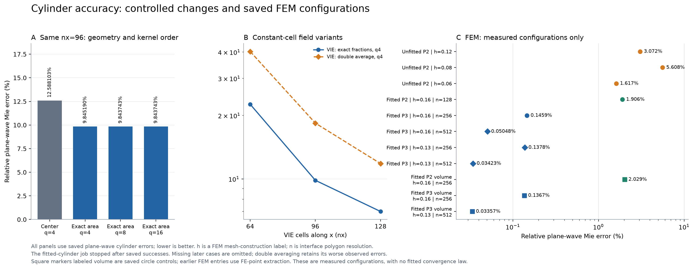
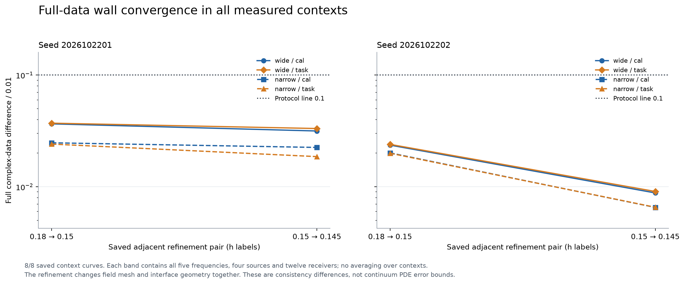
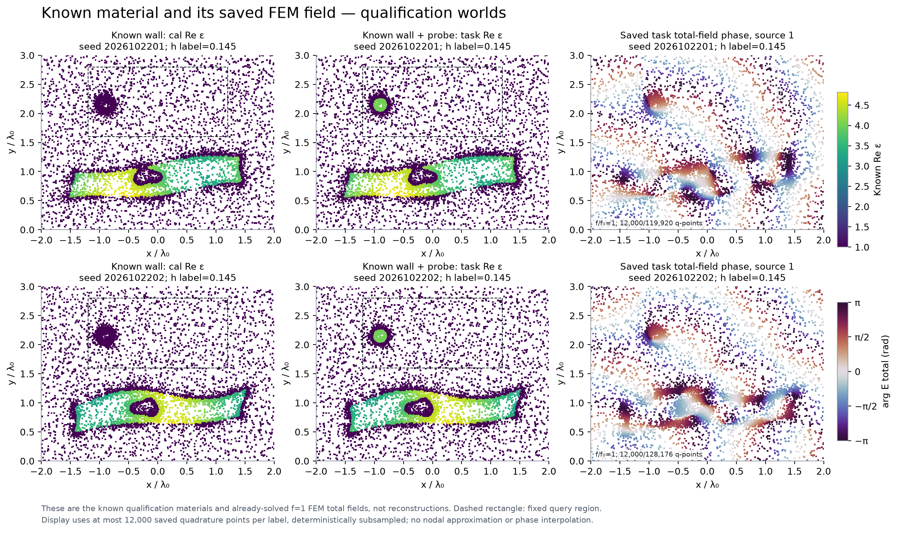
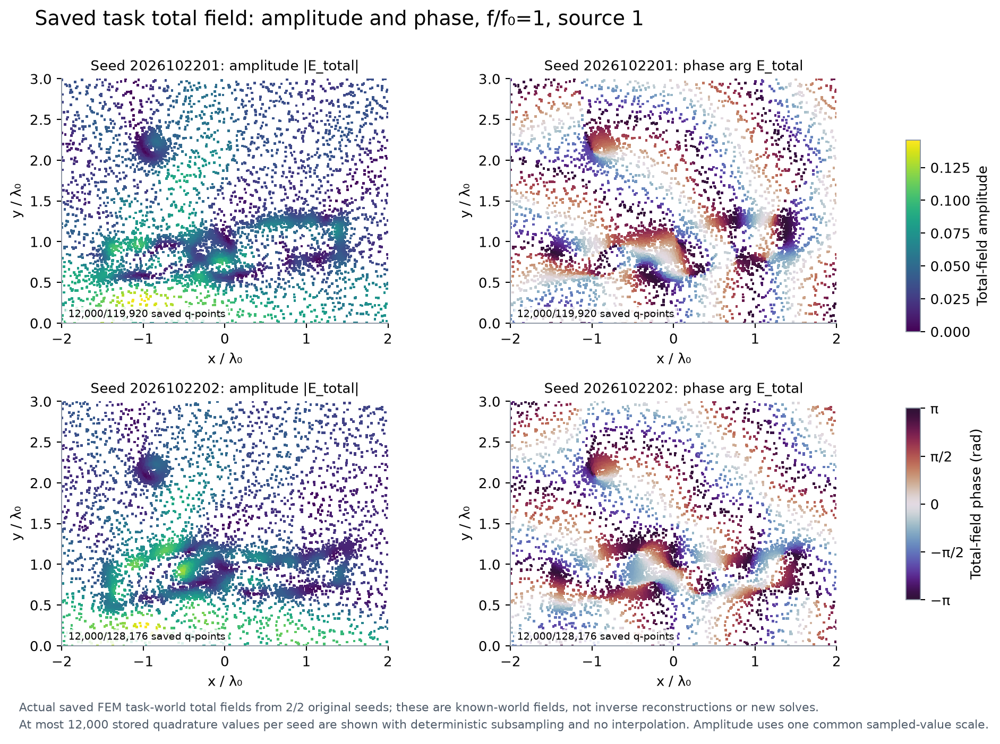
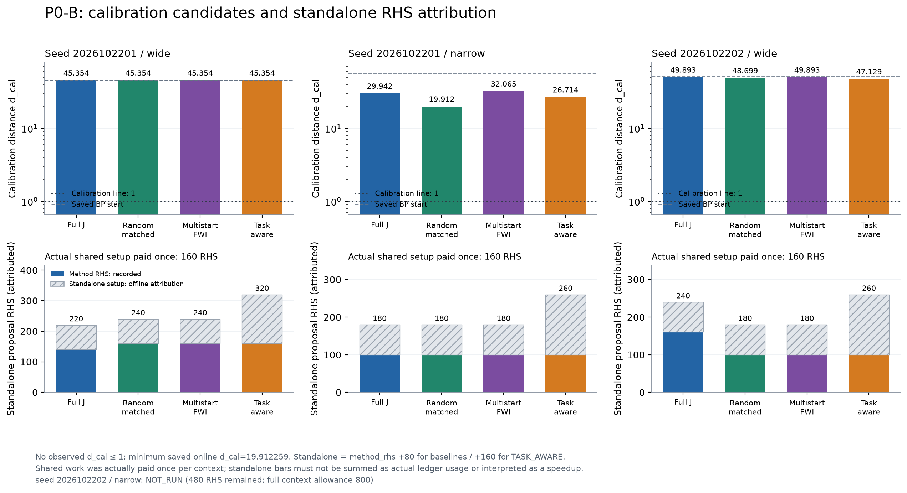
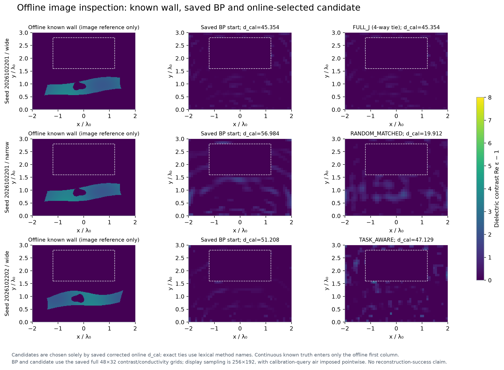
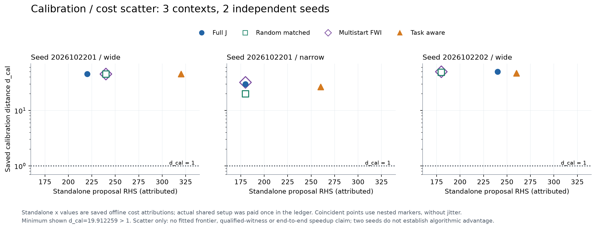
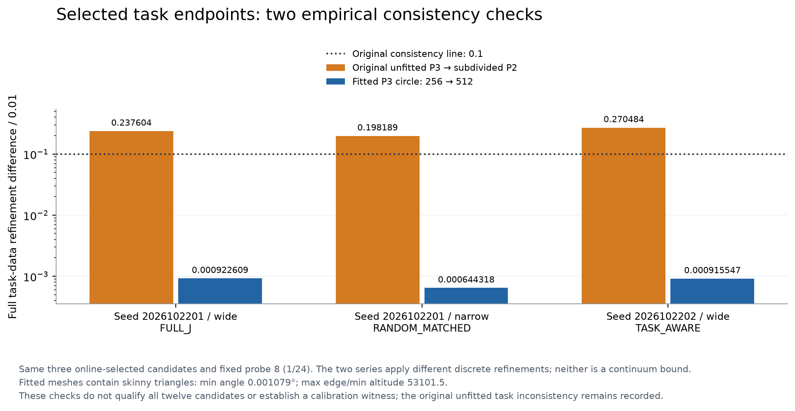
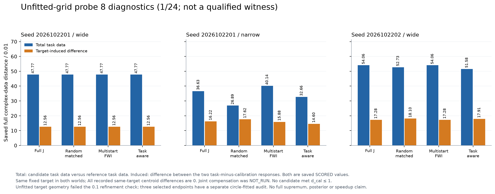

# Research W 续接：先修准物理，再检验传播歧义

**本轮结论：P0-Q PASS；P0-B未发现合格见证；P1继续HOLD。** 这是一个数值基础取得进展、物理多解问题仍未解决的结果。原P0的失败结论不改写，本轮不把更准确的前向平台说成更好的成像算法。

## 1. 研究从哪里出发

旧P0的一维反例成立：单频墙反射相同而双程传播不同；有限带宽会打破某个指定的联合补偿。0.5%下cal=0.887、joint=3.038，是原已完成证据，本轮没有重新充当新结果。旧二维矩阵残差和伴随虽好，真实圆柱误差仍约7%，两墙网格差约1个白化单位，因而当时没有搜索。

本轮保持原两堵不规则有损墙、4源12接收器、两套5频点、sigma=0.01、有限尺寸和多次散射。每频率共享epsilon_infinity与conductivity，没有读真墙mask帮助逆算法，没有增加观测或调大噪声。

## 2. 旧7%主要是什么问题

直接提升非自Green积分GL4到16，nx96圆柱误差只从9.84519%变成9.84374%，说明核积分不是这个误差的主要来源。圆中心二值采样换成精确面积fraction有改善，但仍很差；墙体4/8/16/32子采样也会改变数据。双单元平均VIE没有改善，负结果保留。

独立FEM不使用旧VIE矩阵。它求散射场、用解析入射避免离散奇异点源，外域采用显式坐标拉伸PML。固定同一贴合圆周网格和积分，P2到P3把平面波相对误差从2.029%降到0.1367%；进一步细配置为0.03357%，实际线源为0.02662%、白化差0.001716。界面相容和场阶数都有直接作用，但没有精确百分比分摊，不能宣称全部误差只来自某一项。

源/接收一致性也单独修复：体积分输出保留同一连续点接收物理，互易性约3.9e-15，真实材料差分最好1.49e-9、实伴随约3.15e-14。原FE点输出保留为对照，不拟合自由复增益。

## 3. 两堵原墙体真正过了哪些检查

两seed、wide/narrow、cal/同probe8共8个完整数据向量的最细网格差0.006533–0.033224，均<=0.1。PML强度、厚度/外域和输出提取复核也相容。两世界差分误差作为额外诊断，并没有替换单世界门槛。由此给出QUALIFIED_DISCRETE_FULLWAVE；没有严格连续PDE误差界，不能写CERTIFIED_CONTINUUM_MAXWELL。

图中是已知参考世界和真实数值场，不是逆成像成功图。资格只覆盖这些物理输入；新候选仍需检查。原墙source/receiver、无源真空、圆柱、平滑材料、被动性、损耗和跨频共享没有更换。

## 4. 搜索实际做了什么

全域48×32两实材料像素、同一box/面积/先验、同一online BP初值；Full-J、随机匹配、双初始化FWI、task-aware共享材料坐标与正确器权限。目标方向仅由当前材料的完整Maxwell切线构造，不使用reference材料或truth。所有在线输出先存盘，之后独立truth评分。

|参考seed / 带宽|Full-J|随机匹配|双初始化FWI|Task-aware|
|---|---:|---:|---:|---:|
|2026102201 / narrow|29.942024|19.912259|32.065442|26.713549|
|2026102201 / wide|45.354386|45.354386|45.354386|45.354386|
|2026102202 / wide|49.892531|48.699200|49.892531|47.129469|

三个context完成12个候选，第四个context缺失。最好的19.912仍离1很远。首seed窄带随机比task-aware好；第二seed宽带task-aware略好，另一context全部回退BP。没有稳定同成本优势，也没有得到一组数据近等价的物理世界。

首次搜索有正确器回退实现错误，已停止、修复，旧版本排除科学比较；760搜索RHS和133.673416 CPU秒没有退还。修正版仍是短预算局部搜索，不是已收敛全局FWI。这是优化/探索不足，不能把它写成Maxwell唯一性。余480搜索RHS不足完整800RHScontext，未借端点/验证预算补搜索。

最终审阅还确认：原材料minimum_feature=0.1没有被48×32像素、提案平滑和top-area投影严格执行。像素边长0.08333/0.09375，可能产生较小孤立特征。box、损耗、面积和跨频一致不代表全部几何先验合法。此轮明确记PROTOCOL_IMPLEMENTATION_GAP，全部端点不具备正向见证资格；不改变原条件，也不把失败当成原合法类不存在多解的证据。下一轮应先修正该表示约束，再问普通反演与分支搜索的问题。

## 5. 含目标和joint不能混淆

对所有最终候选实际计算固定probe8的完整强目标响应，只有1/24任务类，并另列目标诱导差。因为cal距离本来很大，即使同目标总响应差很大，也不构成传播歧义。相同目标的质心差为0，不是未知目标joint补偿。

进一步网格审核发现：最佳候选的cal差仅0.000586–0.004319，但未贴合目标圆盘的task差0.198–0.270，超过0.1。该项不合格结果明确保留，并在原验证额度补做贴合目标界面复核，详见[P0_B_PHYSICS_VALIDATION](P0_B_PHYSICS_VALIDATION.md)。没有任何cal端点达到1，故joint、全24任务、最终见证微扰均没有启动。

补充圆周256→512段、相同P3和像素材料的三个选定端点，完整目标响应细化差0.000644–0.000923，RHS相对残差最大2.80e-10。它支持把原task偏差归因于未贴合目标界面，但不把所有候选或任意新材料都自动升级为合格见证。

## 6. 成本、失败和证据边界

|新阶段|已预约复RHS|已预约因子|完成backend states|计费CPU秒|实际作业wall秒|
|---|---:|---:|---:|---:|---:|
|P0-Q|876|211|217|395.773|354.193|
|P0-B|3224|443|442|714.729|967.508|

这是报告生成快照，后续绘图/打包/网页读回仍追加。Q费用含60秒未仪表化准备的保守分配，不能把它叫测量CPU。预约包含在途/失败调用，不因SIGTERM退还；完成数单列。旧P0的959.069451计费秒完全分开。

所有LU、forward、receiver transpose、JVP/VJP和失败均先预约；Green核与材料积分/小矩阵CPU在setup/完整作业里，不冒充线性系统RHS。不同方法增量wall不含共享setup，不据此宣称完整加速。PML作业峰值2.160GB超过1.5GB工程目标，未发生系统OOM；搜索改为逐频释放，其修正版峰值约1.059GB。

保留输出序列化故障、内存预检拒绝、被拒绝trials及错误搜索中止；没有删除代价换新预算。[总账](PHYSICS_LEDGER.jsonl)、[失败](FAILURE_LEDGER.jsonl)、[费用快照](COST_SUMMARY.json)。本轮6项新合同测试通过及真实导数检查，只是实现证据，不替代Maxwell资格。没有NN、GPU campaign、posterior、三维或A17新ROM。

## 7. 十个问题逐项回答

1. **旧资格失败源于什么？** 主要是界面/系数与低阶场表示的空间误差组合，不是LU未解准；提高核积分几乎无效，匹配场阶数对照和界面细化给出直接证据。具体占比尚未量化。
2. **是否已有成本可接受的平台？** 对冻结两世界，是；高阶贴合FEM实际完成全部多频资格，CPU远低于本轮上限。不是任意高维搜索都已低延迟，也没有和成熟FEM/BEM竞速。
3. **能否支持d<=1判定？** 对已审核输入可做有数值裕度的离散判定；新的材料、目标/网格需要自己的审核，无统一连续误差证书。
4. **二维cal近等价且传播不同的合法世界是否找到？** 没有。最佳cal约19.91，有限搜索未进入相容区，不证明不存在。
5. **未知目标joint歧义是否持续？** 未检验。未把cal或同目标响应冒充joint。
6. **多次散射放大还是消歧？** 旧一维指定joint对会被带宽击破，旧离散四块显示Born遗漏强反馈；新的合格二维近等价对仍缺失，因此两种作用不能在此裁决。
7. **Task-aware同成本更好吗？** 未建立；观测到一优一劣一平，但均不合格，且task导数/共享setup有额外费用。
8. **目前支持哪类论文？** 目前只支持数值资格修复与受限搜索负结果，尚不足以支持概率传播或Progressive Imaging算法优越性论文。传播可辨识性是仍值得验证的物理问题。
9. **最可能的独立TAP理论贡献？** 在合法非规则材料与目标共同补偿下，连接局部观测弱方向、有限非线性任务歧义模数下界及宽带joint消歧条件。它是研究预测，尚未建立；四块/resolvent和同空间Schur恒等式不算新贡献。
10. **下一轮做什么、何时收缩？** 先证明普通受约束FWI能在原数据/先验下实际拟合到相容尺度，再比较同预算有限分支发现；不得让未收敛优化冒充物理限制。若cal分支被宽带joint击破，转测量充分性；有稳健joint分支才考虑低维P1-A，P1-B必须额外四格消融。没有收益就删除progressive/A17模块。

## 8. 后续只有方案，没有被自动执行

[P0-C相图](P0_C_IDENTIFIABILITY_PLAN.md)、[P1-A posterior参考](P1_A_POSTERIOR_PLAN.md)、[P1-B四格调度](P1_B_PROGRESSIVE_PLAN.md)、[P2-A费用比较](P2_A_A17_COMPUTATION_PLAN.md)、[P2-B拓扑扩展](P2_B_TOPOLOGY_SCALING_PLAN.md)、[P3矢量](P3_VECTOR_MAXWELL_PLAN.md)均为未来协议草案，不是结果。最终裁决见[SCIENTIFIC_DECISION](SCIENTIFIC_DECISION.md)。
