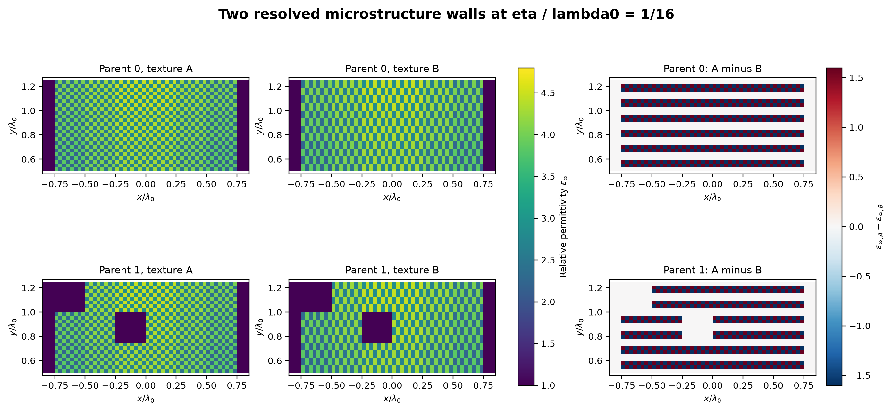
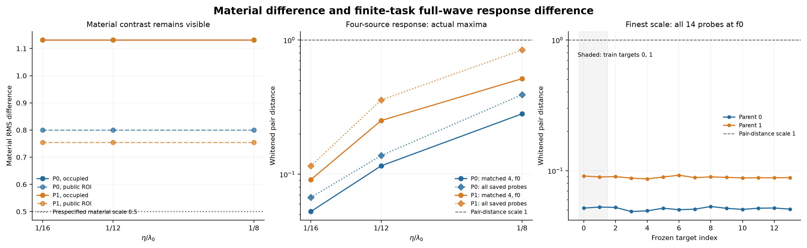
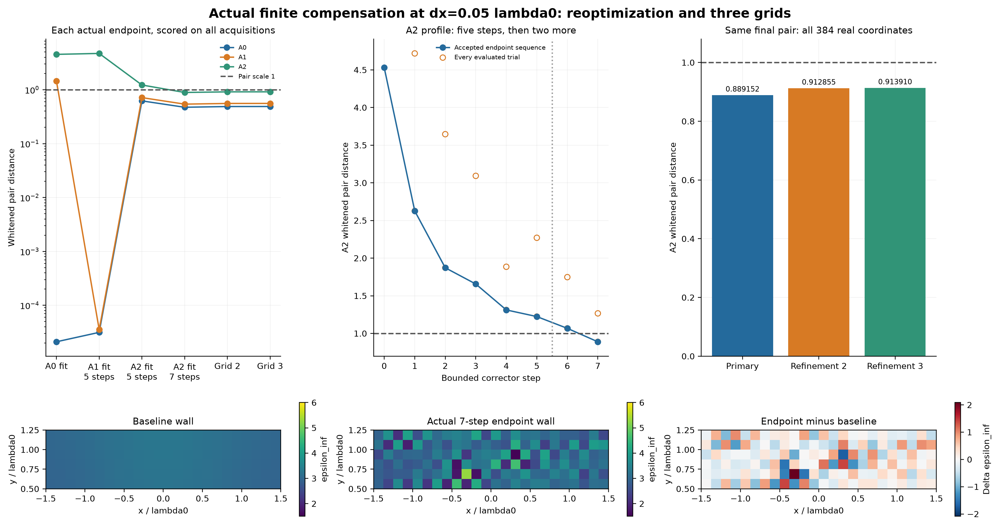
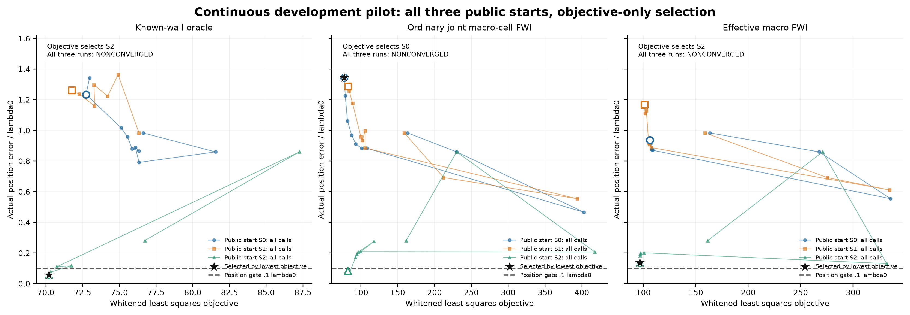
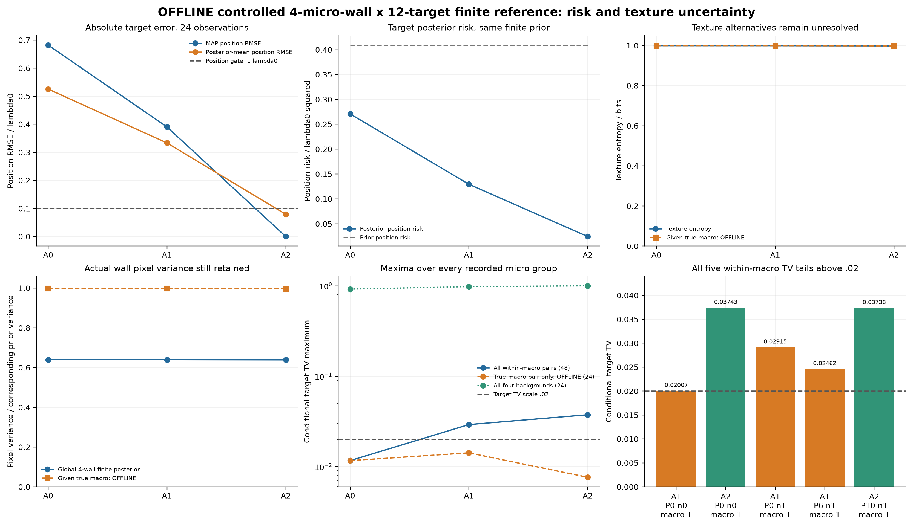
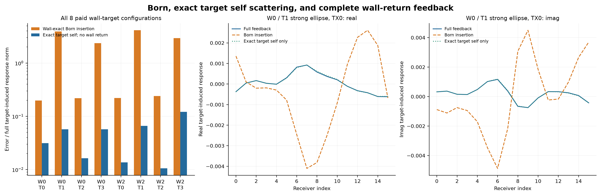

**发布说明（2026-10-29）：** 此为用户授权后的公开版本。[网页](https://migodam.github.io/b1-probabilistic-maxwell-imaging/research/research_w_gq_r2/) · [完整原始证据 Release](https://github.com/migodam/b1-probabilistic-maxwell-imaging/releases/tag/research-w-gq-r2-20261029) · [匿名 raw](https://raw.githubusercontent.com/migodam/b1-probabilistic-maxwell-imaging/main/research/research_w_gq_r2/REPORT_ZH.md)。执行结束时的本地未发布说明及打包回执保留为历史状态；当前发布记录单列在 `publication/`，科研数组、判决和费用不变。

# Research W-GQ-R2：不可分辨介电墙体后的目标分辨率

2026-10-29。本轮为实际执行的二维 scalar-TM、静态、非磁、被动介质开发 pilot。全文数字来自本目录保存的全波数组、有限后验或作业回执。没有训练网络，没有打开 locked 数据，没有进行三维、付费云计算或新 A17 campaign。

## 1. 本轮真正得到什么

**物理正例与物理反例都得到了；一般未知墙在线成像和新的 Bayesian 净加速尚未建立。** 这三项裁决不能压成一个总 PASS。

第一，新的普通二维微结构墙对在材料上差别很大，但整个有限目标任务面板的传播响应很接近。墙内介电率 RMS 差保持 **1.13137**；最细尺度下，两类宏观墙的两种纹理，在所有 12 个 held-out 目标及三频四发上的最大白化响应距离不超过 **0.159971**。这是新运行的完整多次散射结果，不是粗网格把材料先平均了。

第二，在一个明确的 **4 墙 × 12 目标 proper finite prior** 中，新增四发三频观测把目标位置后验均值 RMSE 从 **0.52555** 降至 **0.079224 λ₀**；位置 MAP 全部选对，而墙体纹理后验熵仍为 **0.998388 bit**。因此，目标任务的信息恢复可以与墙细节恢复分离。这是受控有限模型的物理和统计证据，不是一般未知墙支撑算法的证明。

第三，允许更丰富的合法墙材料补偿时，目标横移 **0.05 λ₀** 仍能被墙变化吸收。原两发单频可补偿到约 **2.1×10⁻⁵** 的离散白化距离；四发三频重新优化后得到 **0.889152 / 0.912855 / 0.913910** 三个离散层级的一致结果。它直接否定了“增加几条通道就必然消除所有目标歧义”的泛化。

第四，保留目标自身散射、只压缩墙返回算子，在此次 2 墙 × 4 目标面板上很有效。修正复对称配对后，rank 8 返回模型最坏白化响应误差 **2.04769×10⁻⁴**，rank 32 约 **4.46×10⁻¹¹**。但本轮没有证明新的概率策略能安全避免物理工作：模式构建、目标模板和核验仍要付费，旧 118 墙 bank 上条件目标共识也不成立。

最后，measurement-only 未知宏观墙模型没有通过定位门。新增有限宏观模型的 A2 位置 RMSE 为 **0.68343 λ₀**；连续 FWI 全部触及调用上限。不能用受控参考的成功替代在线识别的失败，也不能把未收敛的普通 FWI 当成算法性能上限。

## 2. 来源、优先级和证据身份

已完整读取附件 PDF、源 TeX、独立执行任务书、README 与 PROVENANCE。包内报告明确写着零新增 PDE，其定理、预测和预算不被记成本轮实验结果。附件的旧 GQ 信息没有包含上一轮实际执行结果：本地 `research_w_gq` 已有 2,252 FE、14,574 RHS 和约 1,634.69 秒 wrapper CPU 的真实 pilot。它尚未提交，因此本报告写为**未提交本地执行资产**，不伪造一个固定 commit。

固定仓库基线为 `73ba6eec3746548bf21259f627b635678709df00`。旧 BGGA 最终费用为 435.690883 秒，而非正文早期 421.3 秒快照；旧 G0 精确吸收、M4 全查、M5 无压缩、旧 M0 约 0.595 的 RMSE 均作为历史事实继承，不重新运行来制造新证据。旧 Research W 的 `d_joint=0.798716、Δx=0.1` 是 oracle 条件见证，本轮没有重标为在线发现。

可读固定来源：[BGGA 报告](https://raw.githubusercontent.com/migodam/b1-probabilistic-maxwell-imaging/73ba6eec3746548bf21259f627b635678709df00/research/research_w_bgga/RESEARCH_W_BGGA_REPORT_ZH.md)。逐项来源与代码位置见 [EVIDENCE_LEDGER.csv](EVIDENCE_LEDGER.csv) 和 [source/evidence 审计](research/delegated/evidence/SUMMARY_ZH.md)。旧目录未修改，本轮没有自动提交、push 或发布。

## 3. 物理、统计与资源合同

采用原 FEM 后端：二维 Ez scalar-TM，μᵣ=1，`exp(-iωt)`，P3 连续三角元，坐标伸缩 PML，单位 outgoing 线源。材料跨频共享 `ε(f)=ε∞+iℓ/f`。墙占据单元 `ε∞∈[1.5,6]、ℓ∈[0,.25]`，空气精确为 `(1,0)`。

公共墙 ROI 为 `[-1.5,1.5]×[.5,1.25]`；公共目标 ROI 为 `[-1.2,1.2]×[1.4,2.8]`。微结构解析网格仅由公共坐标轴、尺度与离散设置决定，不把实际材料值、目标位置或真实占据单元作为网格输入。目标用切多边形积分：圆和最大半轴为 radius、短长轴比 **2/3** 的椭圆，方向 0 或 π/2；不是等面积半径。384 边形与解析入射场弱式积分一致。

保留散射场方程：

\[
(L_W-V_X)u_{sc}=b_W+b_X.
\]

目标载荷 `b_X` 没有丢弃，也没有用节点入射值替代真实弱式积分。所有源共享同一个墙和同一个目标。参数是静态世界坐标，不是目标运动轨迹。

每个实、虚观测坐标噪声标准差均为 **0.01**。白化为先展平 source-major 数据，再拼所有实部和所有虚部，逐坐标除 σ；**没有除通道数平方根**。返回实验表中的 RMS 另有定义，主门只用 norm；两发 16 收对应 64 个实坐标，norm 是相应 RMS 的 8 倍。

|合同|实际观测|实坐标数|
|---|---|---:|
|A0|f₀，两发 ±1.5，16 收|64|
|A1|f₀，增加 ±2.25 两发，保留 A0|128|
|A2|0.85/1/1.15 f₀，各四发，保留 A1|384|

生成完整 A2 噪声后取切片得到 A0/A1，因此旧通道和噪声真正保留。新增测量的收益与内部计算近似的收益分开。

协议在新科学结果之前写入 [CONTRACT.json](CONTRACT.json) 与 [PRE_REGISTERED_PLAN.md](PRE_REGISTERED_PLAN.md)。定位 RMSE 0.1、有限目标 TV 0.02、选择性独立白化差 0.1、同离散恒等式 10⁻⁹、backward 10⁻¹⁰ 均未事后移动。它们是本轮工程门，不是 Maxwell 常数。

机器为 Apple Silicon 本地 CPU，使用已有科学 Python 环境及固定依赖；单 BLAS 线程。初始可用内存较紧，单 job RSS cap 冻结为 **4 GiB**。最大实测约 **3.35 GB**，没有内存杀进程。未安装新的 GPU 或调度基础设施。

## 4. E1-A：真实解析微结构，传播差随尺度下降

两类宏观墙均有限横向尺寸、材料非均匀。其中第二类具有阶梯不规则上边界和宏观空气空腔。宏观 ε、ℓ 在 0.25 单元上变化，两纹理共享相同的局部复均值；实部加入幅度 0.8 的棋盘与交错层纹。每个 η 周期内均值相同，损耗始终合法。

每个微结构界面以 **η/2 的 PSLG 边**进入网格，系数在各真实单元内为常数。FEM 没有先做 cell averaging。η=1/16 的主网格约 51,274 个总自由度，独立细化达到 128,182；材料世界本身保持完全相同。

|宏观墙|材料 RMS，墙内|η=1/8 的面板最大距离|η=1/12|η=1/16|
|---|---:|---:|---:|---:|
|0，非均匀矩形|1.13137|0.391440|0.137800|0.067202|
|1，不规则边界与空腔|1.13137|0.843384|0.357874|0.115275|

上述跨尺度面板包含共同固定目标/频率；最细层另外完成全部 12 个 held-out 目标。构造墙对没有使用 held-out 响应重新拟合。三频全通道的 held-out 最大 pair norm 为 **0.159971**。它是有限任务集合的最大值，不是对任意连续目标族的 sup 认证；三个尺度也不足以估计严格渐近阶，不宣称已数值证明 `O(η)` 常数。

选择每个 parent 自己最差的 f₀ held-out 探针，以及 1.15 f₀ 强目标，独立细网格端点误差为 **0.00531–0.00980**。细化后的 pair 距离为 0.05220/0.06548 和 0.09192/0.11435，仍远小于 1。这里没有借另一个目标的网格误差来审核最差目标。

结论：**NUMERICALLY_SUPPORTED**。新的普通二维材料近等效现象成立于本次有限尺度、有限任务、有限频率合同。它不是任意错误宏观墙的等效性，也不是连续 PDE 严格证书。

## 5. E1-B：镜像墙保护局部横向位移，但保护有边界

构造非均匀镜像墙和对称空腔，目标居中，收发成镜像对。墙材料导数限定为合法镜像方向，检验奇偶分量以及目标横向导数。

|状态|墙导数奇分量相对范数|横向目标导数偶分量|目标有效信息保留率|
|---|---:|---:|---:|
|镜像墙、已校准仪器|0.0001953|0.0021070|0.9999961|
|加入非对称墙变化|0.25944|0.28298|0.910158|
|允许左右相对幅相 nuisance|同镜像材料列|同镜像目标列|0.973468|

横向导数白化范数约 17.33，非退化；h=10⁻⁴ 的导数有限差分相对差约 1.35×10⁻⁶。奇偶泄漏并非机器零，公共三角网格本身没有强制完全镜像，因此不将它写成“10⁻⁹ 精确对称恒等式通过”。数学等变性是条件推导，实际网格结果是近似数值支持。

非对称墙和差分仪器列破坏严格保护；此次幅相 nuisance 并未让横向信息完全消失，所以不能夸大为“任意失配都彻底不可辨”。对称保护仅针对居中横向任务，不覆盖深度、尺寸或损耗。

原 asymmetry 脚本曾误把空气单元从 1 改到 1.4，合法性检查在求解前拒绝；修复仅改占据单元，保留原失败与费用。见 [FAILURE_LEDGER.jsonl](FAILURE_LEDGER.jsonl)。

## 6. E1-C / E2：完整非线性补偿、新测量与重新补偿

### 6.1 全波 Jacobian 和物理尺度

墙采用 6×24 个 ε/ℓ 单元，共 288 个实参数；目标参数顺序为 x/y/contrast/loss/radius。每个频率的完整 wall/target Jacobian 共用 16 个接收伴随 RHS，不按材料列逐次求解。标量 FWI 目标则只用每源一个加权伴随，没有强迫普通基线计算全接收 Jacobian。

产品核的实际方向核验：墙方向 FD 相对差约 1.8×10⁻⁹–9.1×10⁻⁹；目标 x 相对差约 6.0×10⁻⁸–1.6×10⁻⁷。它们只是已检查方向，不是全 Jacobian 的统一误差上界。

|合同|矩阵实尺寸|浮点代数 rank|最小保存奇异值（已尺度化）|
|---|---|---:|---:|
|A0|64×288|64|2.81×10⁻⁵|
|A1|128×288|128|5.59×10⁻⁶|
|A2|384×288|288|9.18×10⁻⁷|

不将这些浮点秩升级为连续 Maxwell 的满射证明，也没有删除极小但非零的奇异值后声称精确目标可辨。所有奇异值、双向 data-only Schur 和 proper tangent Gaussian 结果分别保存。原 JSON 未导出墙方向 Schur，收尾时用原始已付 Jacobian 补存到 [BIDIRECTIONAL_SCHUR_SUPPLEMENT.npz](https://github.com/migodam/b1-probabilistic-maxwell-imaging/releases/tag/research-w-gq-r2-20261029)，没有新增 PDE。

### 6.2 一条真实有限曲线

目标横移 0.005/0.02/0.05 λ₀，采用有界 GN 正确器和完整非线性目标函数接受。墙实部与损耗均被动合法，未改变每频材料。另取一个 ker(A) 方向生成第二条一阶补偿，保留两条曲线；这不等于对整个核空间完成最优搜索。

|横移|A0 优化后 A0 距离|同一端点 A1 距离|同一端点 A2 距离|
|---:|---:|---:|---:|
|0.005|2.77×10⁻⁶|0.15138|0.46625|
|0.02|9.47×10⁻⁶|0.60059|1.85117|
|0.05|2.10×10⁻⁵|1.45093|4.52971|

固定这对世界看，新增测量明显有用。但不能据此说补偿集合为空。对同样 0.05 位移重新拟合墙后：

|优化合同|对应数据距离|其他重要距离|
|---|---:|---|
|A1，5 步|3.55×10⁻⁵|A2 仍为 4.71337|
|A2，5 步|1.22399|局部优化尚在下降|
|A2，预声明追加 2 步|0.889152|同一合法总材料、固定目标位移|

追加两步在执行前写入独立 PLAN，硬限定为两步及一次半步重试，没有无限追求成功。最终实部范围 **[1.52021,5.29598]**、ℓ 范围 **[0.000795,0.248790]**，材料 RMS 变化 **0.63565**。

最终 pair 的三个离散层级为：

|层级|完整 A2 白化距离|
|---|---:|
|主网格|0.889152|
|独立细化 2|0.912855|
|进一步细化 3|0.913910|

第 2→3 层的 pair 变化 norm 为 **0.002278**，两个单独世界的每频差约 0.0023–0.0069，均明显小于门槛 margin。没有严格连续 PDE 上界，因此只称经过三层一致性检查的**离散全波有限歧义见证**。它给声明离散材料类中的 `ω_X(0.91391)≥0.05 λ₀` 下界，不给全局最小值、全局上界或精确连续等式。

两种一阶补偿的二阶有限 secant 都已运行。由于 A0 浮点墙矩阵满行，投影到其余空间后的二阶项接近舍入误差；这符合满射情况下二阶无法自动解除补偿的数学预期。它不认证完整盒上满射，也没有把一个最小范数解的曲率当成全部可行曲率。

结论：**NUMERICALLY_SUPPORTED**。新观测提高了原补偿的代价，但丰富的墙变化可重新恢复噪声尺度等价。没有找到全局 profile optimum，更没有证明所有更大目标位移可补偿。

## 7. E1-D：真正未知墙和未知目标，在线结果未通过

### 7.1 有限 measurement-only 宏观模型

在线可见 y、公共材料/目标族和六个候选宏观墙，不接收实际微结构墙身份或目标标签。目标候选为 12 个预声明静态配置；位置、尺寸、材料、损耗、形状在这个 counting prior 中有相关性，**不是全部参数独立连续变化**。两个微结构宏观 parent、12 个目标场景各两次噪声，不能写成 24 个独立墙世界。

比较 prior-only、joint finite MAP、目标 marginal、measurement-selected macro、普通 wall-first-fixed；Known-wall 使用真实墙，只作为明确 oracle 上限。全部在线输出封存后才评分；这是函数/独立 CLI 阶段的数据流隔离，不是 OS 级文件不可见沙箱。

|方法|A0 位置 MAP RMSE|A1|A2|
|---|---:|---:|---:|
|Prior-only|1.01078|1.01078|1.01078|
|六宏观墙目标 marginal|0.90921|0.53968|0.68343|
|Joint finite MAP|0.90921|0.53968|0.68343|
|Measurement-selected macro|0.90921|0.53968|0.68343|
|Wall-first-fixed|0.90921|0.53968|0.68343|
|Known-wall oracle|0.68221|0.39051|0|

A2 known-wall 的 posterior-mean RMSE 仍有 **0.078874**，因此“MAP 选对离散位置”不表示无不确定性。宏观模型的 A2 IoU 均值 **0.58333**、复材料相对误差约 **0.11021**，但定位失败；后两项不能代替位置门。其 95% credible set 覆盖约 **0.75**，也不能称合格的物理 posterior。

这组宏观类过于粗糙：3.0/3.8 的材料节点和简化纹理不能充分表示真实有效传播。新增频率会更明确地暴露模型偏差，误差从 A1 到 A2 变大不违反嵌套数据的理论信息单调性。它说明 misspecified likelihood 会使算法更自信地选择错误目标，而不是新增测量损害真实信息。

### 7.2 连续 off-grid FWI：可用分支不等于能从测量选中

另运行一个不在有限目标位置表上的连续目标；每臂先给两种公开 shape 起点和相同实际评价额度。发现初始起点遗漏合法椭圆方向 0 后，只增加一次同样的公共 ROI 中心起点，三臂各再付 10 次实际 full-objective，原失败保留。三个起点共 90 次评价，全部标 **NONCONVERGED_CALL_CAP**，不冒充成熟 FWI 的收敛上限。

最终必须按全部起点中最低完整 objective 选解，不能按真值挑选：

|方法|测量规则最终选择的位置误差|备注|
|---|---:|---|
|Known-wall oracle|0.055917|新增公开方向起点胜出；仍未收敛|
|Ordinary joint macro-cell FWI|1.343697|错误目标 objective 77.386 低于位置较准分支的 82.221|
|Effective macro FWI|0.136681|未达 0.1；仍未收敛|

普通 joint 的另一分支位置误差是 **0.082586**，但不能将其作为在线成绩。它说明本例并非完全没有较好候选；模型、先验及 likelihood 排序与优化路径需要一起解决。半径和介电率也未被完整恢复，不能因某个位置较准就称 full-material target imaging 成功。

结论：**ONLINE_IDENTIFICATION_NOT_ESTABLISHED / MODEL_MISMATCH / OPTIMIZATION_NOT_REACHED**。当前小型基线没有证实一般未知支撑成功；本轮也没有用它们来宣称某个新方法胜出。

## 8. E2 的正面证据：目标风险降低，墙细节仍宽

为把宏观模型偏差与真实信息分开，在线输出封存后，在已完整付费的 **4 微墙 × 12 目标** 数组上计算明确均匀 joint finite prior 的 reference。它不是连续 prior 的求积，未用于在线算法动作，也不是免费 teacher。

|指标|A0|A1|A2|
|---|---:|---:|---:|
|位置 MAP RMSE|0.682215|0.390512|0|
|位置 posterior-mean RMSE|0.525548|0.333520|0.079224|
|位置 posterior risk|0.270880|0.129509|0.024468|
|纹理后验熵，bit|0.999357|0.999329|0.998388|
|纹理真值概率均值|0.503580|0.502934|0.508168|
|宏观类内纹理方差保留比例|0.999109|0.999071|0.997767|

位置 prior risk 为 **0.409167 λ₀²**，A2 reference risk 约为其 5.98%。A2 的全墙像素方差仍保留原 finite prior 的 **0.63905**；不是只有热图看起来“不确定”。两种纹理材料 RMS 差超过 1，然而目标位置和有限 intrinsic 标签可恢复。

2000 次 bootstrap 先平均每个目标场景的两次噪声，再在两个固定宏观 strata 内 resample 目标场景。结果仅为描述性不确定性；只有两个宏观墙 parent，不能宣称大规模墙总体置信性或独立盲测。A2 的 24/24 HPD 包含真值也不是正式 coverage 校准。

这里的墙 prior 只含共享宏观类的两纹理。第 6 节更宽 288 维墙材料类中存在补偿，并不与此 reference 成功矛盾；它们允许的 nuisance 类不同。不能把有限 prior 的目标准确推广到所有被动墙。

## 9. E3：保留自散射，只压缩返回传播

使用标准两物体散射分解：

\[
C_W=C_0+H_W,\qquad
T_X^0=V_X(I-C_0V_X)^{-1},
\]
\[
F=d_W+B_W T_X^0(I-H_WT_X^0)^{-1}a_W.
\]

目标自散射由完整 free-target FE `L0−V_X` 处理，没有把目标内部高频边界电流限制到小 H 空间。d、a、B 对每个背景单独计算，目标载荷仍包含 b_X。公共 target ROI 仍有 **2257 个端口**，但没有预建完整 2257 列 Green；只付 32 个范围/核心 action，r=4/8/16/32 为嵌套表示。

### 9.1 失败和一次有依据的修正

第一种近似用同一个 Hermitian Q 左右投影。它是合法的低秩近似选择，但对于**复对称而非 Hermitian** 的 FEM Green 返回，输入空间没有被充分表示；rank 32 仍有 0.23094 的最坏白化误差。没有删除这 708 RHS/19 FE 的不足结果。

保持 rank 和所有目标不变，将右投影改为复对称配对：

\[
H_r=Q(Q^*H\bar Q)Q^T.
\]

新增 128 个共轭基 actions 和 128 个完整反馈核验 RHS，复用已付的目标模板、接收映射、参考解；并未重算完整 target bank。

|r|返回模型最大白化误差|目标诱导 ROI L2 相对误差|完整 current 闭合相对缺陷|
|---:|---:|---:|---:|
|4|0.0734857|0.0340701|0.0267400|
|8|2.04769×10⁻⁴|1.69250×10⁻⁴|1.41556×10⁻⁴|
|16|4.04446×10⁻⁸|2.58322×10⁻⁸|2.21071×10⁻⁸|
|32|4.46426×10⁻¹¹|2.56824×10⁻¹¹|2.18696×10⁻¹¹|

rank 32 的完整 FE RHS-relative defect 最坏约 4.35×10⁻¹²；小闭环 condition 最大约 1.335。这是有限离散、已测任务的数值精度，不是全输入空间 operator-norm、连续模式或 uniform posterior certificate。QR 与投影谱使用 Euclidean FE 坐标；场 L2 误差另用真实公共 ROI 质量矩阵计算，二者不能混称。

同一个仅为 H 拟合的基若被用于压缩整个 C_W，rank 32 白化误差仍约 5.93。它支持“保留奇异自作用”的设计理由，**不等于击败为 C_W 独立训练的最优 ROM**。本实现是普通 Schur/T-matrix/双侧 ROM 的实例，分解本身不作为原创算法。

### 9.2 完整反馈为何必要，哪部分最强

由已付 Bw/q/j0/full 数组重组，不新增 PDE：Born 诱导响应相对误差为 **0.198–4.124**，白化误差最大 **5.48546**。保留精确目标自身散射、暂去墙返回时，诱导相对误差为 **0.0105–0.1216**，白化误差最大 **0.226586**。

因此这批离墙目标中的强非线性主要来自**目标自散射**；墙返回较平滑、通常较弱，但不能对所有任务直接丢弃。它解释了 H 容易压缩，也限制了“增加复杂返回反馈必然带来大成像收益”的叙事。没有额外制造近共振案例；所测小闭环并不接近共振，新的低间隔/共振合同仍 **NOT_ESTABLISHED**。

### 9.3 经济性没有自动成立

表示研究的两次真实作业合计 **964 RHS、22 FE、21.145463 秒 wrapper CPU**，包括第一次不足、修正、参考与核验。8 个 direct full 参考本身只需 **16 RHS、8 FE**。研究总账不能直接冒充一个部署时延比；同时，原始 setup 与模板的已付工作已经表明小面板没有净 RHS 优势。

目标模板的 LU 可进一步按同一离散目标共享，这是标准工程复用，普通两物体基线同享。本轮没有实现其独立冷部署计时；不能将推算 break-even 当成实测速度。结论为 **NET_SPEEDUP_NOT_ESTABLISHED**，不是“低 rank 因而提速”。

## 10. Bayesian 条件共识：物理组有希望，全局省权重仍不安全

### 10.1 旧 118×25 bank 的新受控检验

在线只获得 prior 元数据、y 和逐原子查询 API；外侧源响应没有解码。24 例各 790 次共享逻辑查询，所有输出封存后才打开完整 teacher 和真值。这个访问身份是 **REPLAY_NOT_NEW_PDE_SPEED_EVIDENCE**。

新 prior-only 28 墙节点面板下：

|方法|平均 target TV|TV≤0.02 例数|真实位置 RMSE|
|---|---:|---:|---:|
|普通 response 插值|0.074915|18/24|0.613416|
|anchor-weighted contrast|0.357518|13/24|0.755230|
|sampled conditional consensus|0.783602|0/24|0.734923|
|完整 finite reference|0|24/24|0.595430|

不同背景的条件目标分布直径几乎为 1，不能删除其相对质量。未查询原子的 [0,1] likelihood 包络保留，但没有形成非平凡的全目标共识证书。**没有启动冷 Bayesian 200 原子 campaign**。这个 prior-only 设计与上一轮 adaptive 节点不同，不能把性能变化归因于“contrast 公式退化”；本轮的新增结论是没有便宜的全背景共识入口。

### 10.2 新微结构物理类内的共识更强，但仍有尾部

用全部已付 4×12 物理表作事后诊断，两个**同宏观类**纹理之间的最大条件目标 TV 为：A0 **0.011640**，A1 **0.029151**，A2 **0.037427**。超过 0.02 的尾部为 **0/48、3/48、2/48**，全部保留。四背景全体的条件 TV 直径仍最高达 **0.999996**。

只看真宏观类时更接近，但这个筛选使用真值，只能标 OFFLINE，不能用它藏起另外五个尾部。数据明确支持：**可以尝试粗化微纹理质量，但宏观传播分支的目标结论仍可能不同，不能把所有背景合并。** 这些统计用了全表；本轮没有因此声称安全省去了 FE/RHS。

目标增量相近也不足够。残差投影项在此次微结构面板中最大可达约 0.11015；完整 contrast 必须保留它。新 dense 公式核验覆盖 contrast 余切、C0+H 顺序、参数依赖右端 mixed derivative 和两背景差分恒等式，均只标代数 PASS。它们没有被升级成物理 posterior 证书。

## 11. 失败、预算和未运行部分

|阶段|FE 预约/完成工作量|complex RHS|FE cap|
|---|---:|---:|---:|
|E1|300|1608|300|
|E2|400|2640|400|
|E3|22|964|200|
|合计|**722**|**5212**|900 总 cap|

E1/E2 的 FE cap 用完后立即封闭新物理调用；E3 剩余额度没有挪给它们。最高内存约 3.35 GB。CPU 最终权威为 [PHYSICS_COST.json](PHYSICS_COST.json) 的 completed-wrapper 字段；正文和 ZIP 内打包前快照不替代封账回执。

费用包含所有 source/receiver actions、伴随、拒绝 trial、目标模板、范围/核心构建、检查、失败和重跑。父子聚合时间没有重复相加。初始文档读取、交互式代码编写和最后人工式文件回读没有完整 process CPU 计时，已明确保留这一缺口；不宣称这是全部人机科研工时。

保留的实现失败包括：freeze 脚本误用 Python 关键字；asymmetry 对空气材料的非法改动；绘图元数据 int32 序列化；第三层 refinement guard 当时仅允许 1/2。最后一项在任何新 PDE 前失败，随后只扩展既有通用网格参数到 3，未放宽精度门。第一次返回低秩方案虽然程序正常完成，但表示不足也单独保留。

未执行或未建立：大规模独立确认；一般未知支撑/孔洞 posterior；完整连续目标 posterior；强共振/贴墙推广；有限非线性仪器 nuisance 补偿；付费资源；新的 NN/3D/A17；满足可靠概率门后的 Bayesian 冷部署。标准 T-matrix 与本代码同源，没有独立新算法胜出证据。

## 12. 原创性判断与下一轮最值得做什么

均匀化、镜像奇偶保护、隐函数定理、Schur/T-matrix 和条件混合收缩均有标准基础。重点文献核对通过 ScholarQA 获取并验证了 Cakoni 等 2019 的身份；其他检索遇到 429，因此本轮不是完整文献排他审查。[Cakoni 等论文](https://doi.org/10.1137/19M1237089) 为 bounded oscillatory scattering 的重要近邻；[Haynes–Fenni 2022 的 CTMA](https://www.jpier.org/issues/volume.html?paper=22030901) 已利用 SVD/Woodbury 压缩多体 T-matrix，不能将本轮返回分解重新命名成原创。

当前最有独立价值的证据链是：

1. **同一普通二维全波平台上**，材料纹理不可分而有限目标 posterior 可准确；
2. 换到更宽、仍合法的墙材料类，同一目标任务可以出现真实有限补偿；
3. 新测量区分一对世界，不等于排除重新补偿的整个集合；
4. 目标分辨率必须由**允许的材料幅度、公共色散、观测和任务**共同定义，不能只看精确局部 Schur 或墙 MSE。

这支持继续研究 **Target Resolution through Unresolved Dielectric Walls**，而不是声称 Wall-Free Imaging 已成功。

下一轮一个最值得突破的理论点：在声明材料幅度盒和共同频率合同下，给出**目标有限位移所需的最小墙补偿代价/可行半径**；它应区分精确小奇异方向与物理幅度受限方向，并在非线性返回闭环中有实际可评估意义，不能再免费假设未知的目标 inverse-Lipschitz 常数。

下一轮一个决定性实验：在公开、连续且足够表达宏观墙的 proper prior 中，用真实解析微纹理生成离网目标；给予普通 joint FWI/边缘推断充分收敛预算和相同模板权限，验证能否在**不知道真实均值墙**时获得 ≤0.1 的连续定位和合格区间。保留本轮有限补偿 pair 作为扩大 nuisance 类时的破坏对照。如果只有已知微纹理族的离散 reference 成功，必须收缩到受控任务分辨率论文。

返回 H 方向值得保留为标准数值工具：精确目标自散射与平滑返回的分离有强数值支持。但在便宜的组内误差/条件共识判断出现前，不启动更大 Bayesian 压缩，不用增加 rank 或网络来救其经济性。

## 13. 分项最终裁决

|问题|裁决|
|---|---|
|A 普通二维 Wrong Wall、目标任务传播等效|**NUMERICALLY_SUPPORTED**；RMS 1.131、finite task A2 max 0.160|
|B 未知墙/目标在线高精度|**NOT_ESTABLISHED**；宏观模型失配，连续优化 cap，不能选真值较好分支|
|C 合法全波材料补偿|**NUMERICALLY_SUPPORTED**；0.05 位移，三层 A2 距离约 0.914|
|D 目标比墙细节更易恢复|**NUMERICALLY_SUPPORTED**；限 4×12 finite prior，不是一般 prior|
|E 只压缩墙返回|**NUMERICALLY_SUPPORTED**；rank 8 精度高，保留精确自散射|
|F 背景条件目标共识|**NOT_ESTABLISHED** 为统一在线证书；物理微组有经验支持且保留尾部|
|G 安全净计算收益|**NET_SPEEDUP_NOT_ESTABLISHED**；没有新的 certified early stop / 冷 Bayes GO|
|H 新颖性|物理任务分辨率证据组合值得继续；标准代数与降阶本身不算原创|
|I 推广限制|二维、静态、有限合同与 prior；没有连续 PDE/任意未知墙保证|
|J TAP 路线|继续有限目标分辨率与补偿边界；算法经济性保持 NO-GO/HOLD|

机器判决见 [GO_NO_GO.json](GO_NO_GO.json)，具体下一轮接口见 [NEXT_PRO_HANDOFF.md](NEXT_PRO_HANDOFF.md)。所有科学图来自保存数组，复现入口见 [REPRODUCE.md](REPRODUCE.md)。
