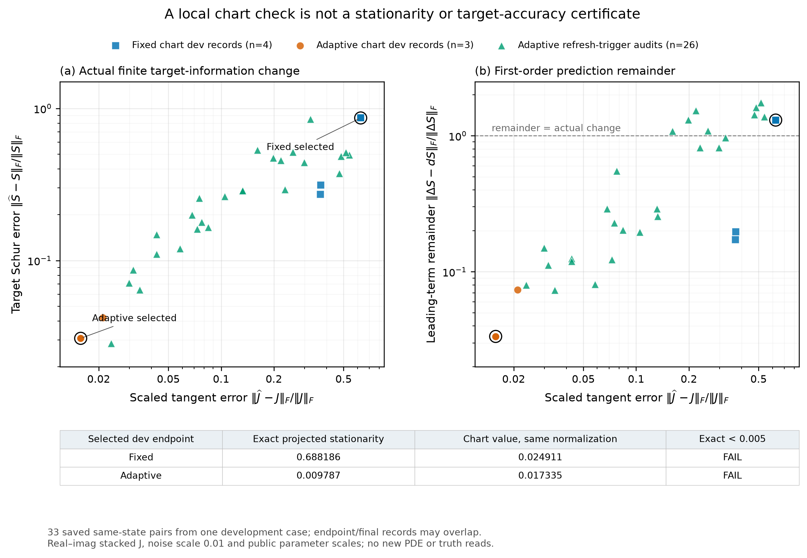

# 固定 chart、动态材料切向与本轮究竟检验了什么

## 两种表述必须区分

**固定真空 Green 的完整对比源表述。** 把墙与目标都保留在材料对比度中，$j_s=\chi(e_{b,s}+G_Dj_s)$，$y_s=G_Sj_s$。此时即使墙未知，$G_D,G_S$ 仍然固定；其 SVD 可复用。非线性发生在共同材料与多源电流的本构关系里。原 SOM/TSOM 的固定坐标思想在这个表述下有严格意义，TSOM 的内部传播状态约束不能删去。

**本轮实际实现。** 复用已有 FEM，在当前完整材料矩阵 $L(z)$ 下投影材料微分载荷。公共参考算子 $S_0=R L(z_0)^{-1}D^{1/2}/\sigma$ 的右奇异基形成 $P_r$，近似的是 $J(z)=S_zK_z$ 中的载荷：$\widehat J(z)=S_zP_rK_z$。当前完整 $S_z$ 负责传播保留载荷，非线性前向始终使用完整 FEM。这是 SOM-inspired material-forcing chart，**不是原生 SOM/TSOM 对比源优化**。

本轮 fixed chart 的失败不能用来否定第一种表述或整个 SOM/TSOM。它检验的是：只保留公共参考可接收载荷，再通过当前 Green 传播，能否充分支撑实际共同材料更新。

## 不锁死墙或目标的材料坐标

三个主方法都有同样的19个实材料/几何变量、同样的box和proper prior。没有把接收暗方向直接指定为合法材料弱坐标，也没有按真值选择分支。chart 改变求步用的 Jacobian，不缩小材料可行域。更新接受、分支排序和最终驻点审核使用真实 full-wave 量。

冻结的主 rank 为16，等于每频16个接收方向。初期 rank8 在公共非真值状态显示约0.77的切向误差，因此在盲测评分前改为保留全部参考可接收方向；rank8开发结果与费用单列保留。这不是根据盲测结果选择较好rank。

## 已推导的失配与后果

详见 [公式集 F20–F37](FORMULA_COMPENDIUM_ZH.md)：

1. $E=S_z(I-P_r)K_z$ 同时依赖参考谱尾、当前传播变化及材料激发。参考 receiver rank 已满也不能消除传播变化后的误差。
2. 消去墙补偿后的目标信息误差不由 current SVD 独自决定。一阶相关组合是 $E_B-E_A N$，$N=(A^TA+\Lambda_W)^{-1}A^TB$；作用方向是 $R=B-AN$。
3. 小的单步 $E\delta$ 不控制完整梯度中的 $E^Tr$。噪声残差非零时，真实目标函数下降与局部JVP检查都不足以保证精确驻点。
4. 目标 Schur 信息很弱时，小切向错误也可能放大为大目标步误差。局部先验/阻尼下的误差界不等于全局材料或目标后验保证。
5. 墙体与目标自身都改变完整传播。公共 $2\times2$ 状态实验用于区分两者，不将“无目标参考→强目标状态”的全部失配归咎于墙。

## 开发例的同状态后果分析

只复用已经付费保存的 Jacobian，新增0 FE/0 RHS；33个同状态记录包含重复来源，不是33个独立物理案例。fixed 所选端点的完整切向相对误差0.626，目标 Schur 相对误差0.865；adaptive 对应约0.0158和0.0308。F36 的一阶预测余项相对实际 Schur 改变，fixed约1.30，adaptive约0.0335：大失配时一阶解释并不可靠。

开发例 fixed/adaptive 的精确投影驻点量分别约0.688与0.00979，均高于冻结0.005门；不能把近似梯度或接近最优的数据残差替代精确收敛。完整数据见 [分析说明](research/delegated/sources/CONSEQUENCE_ANALYSIS.md)。

## 成本应如何归因

rank16 chart 当前传播需要16个载荷 RHS，而普通完整接收伴随同样为16个 RHS；adaptive还需逐源步方向审核、必要回退和重建。故本轮没有“rank较小所以自然便宜”的理由。能否节约只由完整初始化、所有尝试、迭代数、审核、回退与输出的实测总成本判断。只在未收敛处提前停止的速度不能当作同质量优势。

最终独立成像与费用判决见 [REPORT_ZH.md](REPORT_ZH.md)，而不是以开发例的局部图直接宣布算法创新。
