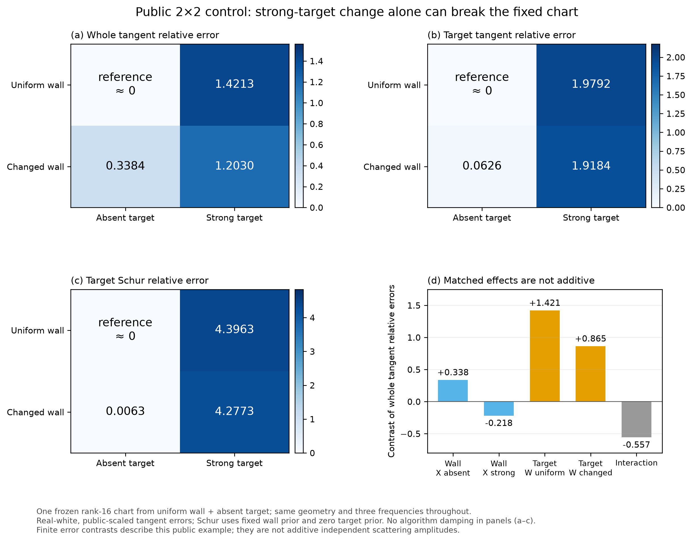
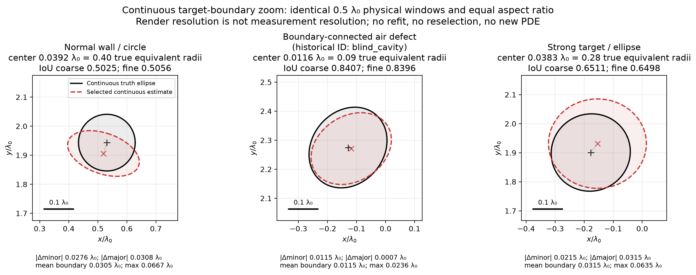
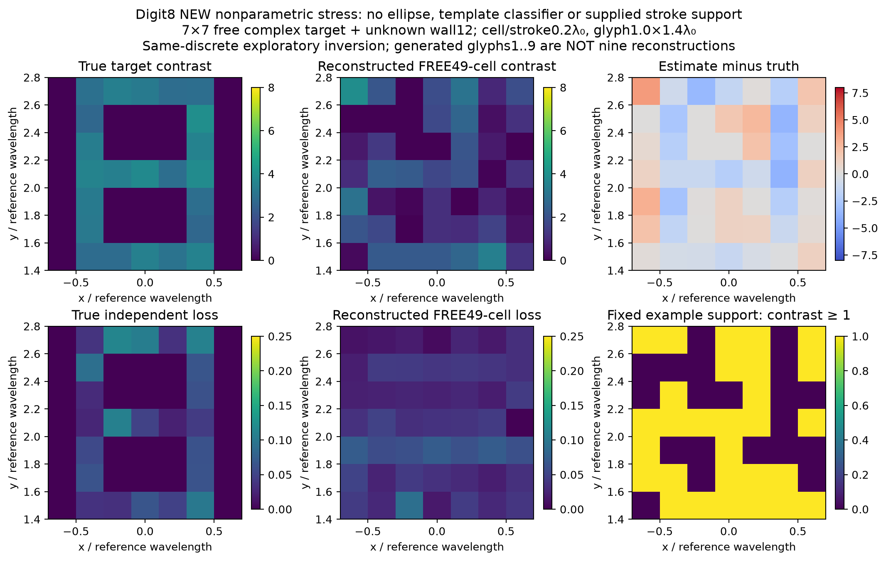

# Research W-GQ-R3-JI：未知墙体与连续目标的联合全波成像

生成时间：2026-10-29T18:25:41.165488+00:00。本报告只依据已保存、封存后评分的输出。原三小时窗口为2026-10-29 15:35:21–18:35:21 UTC；18:15:21后不启动新的非必要重计算。当前完成18个主比较槽位中的10个、9个控制槽位中的9个；未完成项逐行保留，不能从成功率分母中悄悄删除。

## 1. 实际完成了什么

已经实现从测量文件和公共配置出发的未知墙—未知目标联合成像入口。墙体的十二个材料变量和目标的七个连续变量都进入优化；没有输入真实墙、平均真墙、真实目标或旧有限标签库。输出包括二维目标/墙体材料图、完整三频复数预测、所有多起点分支、接受/拒绝轨迹及成本。目标形状是连续椭圆，圆是其子类；不是任意非参数目标图。

普通 Full-GN 在首份噪声的三个独立世界均达到位置误差0.1λ₀以内，但只有连边界空气缺块世界同时通过位置、IoU和实介电率三门。其位置误差0.01160λ₀、IoU0.84069、实介电率相对误差0.00656；损耗绝对误差0.12518，说明几何/实部成功并不意味着复材料全部恢复。另两例的形状或材料失败全部保留。

固定参考载荷 chart 降低了成像质量；自适应版本接近普通 Full-GN，却没有超过它的同质量成本优势。这个负结果属于本轮冻结实现和有限模型，不否定原生 SOM/TSOM，也不否定用户独立提出的目标充分传播研究方向。

## 2. 为什么这是真正的未知量联合反演，范围又在哪里

公共墙容器为[-1.5,1.5]×[0.5,1.25]，分为3×2宏单元；每格实介电率[1,6]、损耗[0,0.25]独立未知，允许精确空气。在线没有真实占据mask。这个网格不能表达任意精细墙边界或封闭内孔；历史ID `blind_cavity` 实际是一格连外边界的空气缺块，全文以此解释。

目标参数为(x,y,rx,ry,contrast,loss,angle)，位置、两个半轴、材料和方向独立连续变化。真值由冻结种子生成，不属于公开18个粗种子标签。三个parent的主重复构成唯一配对主表；同parent第二份噪声不是新物理世界，不能把3个parent写成6个独立样本。

测量为三个频率0.85/1/1.15、四个TX、十六个RX，共192个复坐标；实虚每坐标σ=0.01。白化不除通道数平方根。所有源和频率共享材料。采用exp(−iωt)、μr=1、ε(f)=ε∞+iℓ/f，ℓ是参考频率介电率虚部。FEM完整散射场右端包含bW+bX，材料导数包含db+dV·u_sc。

## 3. 算法与不可见信息

在线先以全数据拟合公开墙模型，再评价18个公开几何种子，按测量选择四个空间分散起点做连续联合优化。三个主方法使用相同先验、初值权限、每起点120评价/100接受步上限和完整Maxwell接受规则。最终按完整数据目标加冻结prior的最小值选支；真值仅由独立评分器在ONLINE_SEALED之后读取。所有分支都保存，未用Best-of-K材料误差选结果。

墙prior为独立截断Gaussian，目标为合法盒内uniform；算法damping不当作posterior精度。受约束GN直接求有界联合增量，标准Schur消元用于推导和解释，不宣称每步另有一个原创Schur求解器。报告中的converged同时要求合法停止原因和完整J列范数归一化投影梯度≤0.005；只是局部驻点，不是全局MAP。

主科学源码在首份盲测评分前冻结。Python访问guard拒绝private/scoring文件，评分与在线各自执行；这是接口级审计，不是操作系统安全沙箱。原始输入、输出、版本和访问日志均在交付目录。

## 4. 固定子空间究竟做了什么

本轮用公开参考状态的接收算子建立rank16材料forcing chart，近似当前材料Jacobian。完整前向始终为Full Maxwell。它不是把材料锁进所谓弱坐标，也不是给每个源独立材料。SOM的current可观测谱与共同材料更新相关性不是同一个量。

把墙也纳入总contrast时，真空Green仍可固定；材料Jacobian仍随局部场与反馈变化。当前FEM载荷表示的动态Green与原生固定真空contrast-source表示必须区分。TSOM内部传播的second-fold不能由本轮删去；本轮未实现完整原生TSOM，不能把结果标为TSOM失败。

adaptive以候选共同材料方向的native JVP检查失配，超过0.1则退回完整Jacobian并刷新接收basis。完整方向误差小不保证遗漏的转置残差项小，也不保证整个目标Schur系统正确。已付dev Jacobian的同状态离线分析支持这个区分；它不作为在线免费证书。

当前rank16的chart需要16个传播RHS，而普通完整Jacobian已有16个接收伴随RHS；没有天然RHS优势。拒绝trial后base LU可能因缓存只存最后状态而重算，fallback保留已收缩TR/damping。这些实际开销和路径效应均计费；不能把它们全说成投影理论必然缺陷。

### 关键2×2归因：目标自身变化已足以破坏参考chart

按预声明公共状态做了均匀/改变墙×无/强目标的四状态全波对照，12FE/432RHS、19.39CPU秒。参考chart只在均匀墙无目标构建。仅改变墙时，目标J与目标Schur相对误差为0.0626/0.00630；墙保持不变、仅插入强目标时，变成1.979/4.396。故这一例中的失配不能全部归给未知墙；目标插入导致的局部场、完整传播和共同材料载荷变化本身就是主要因素。

这个对照没有进一步拆开目标自身传播与载荷变化，也不代表所有墙/目标。墙—目标的误差交互非可加；原始绝对矩阵差和相对指标分开保存。详见`research/delegated/sources/CHART_MECHANISM_RUN/REPORT_ZH.md`，不能把局部误差图升级为一般可辨识性定理。

## 5. 冻结首噪声配对主结果

| 方法 | 父样本 | 位置RMSE | 平均IoU | 实ε相对误差 | 通过数 | FE | RHS | 墙钟秒 | 完整CPU秒 |
| --- | --- | --- | --- | --- | --- | --- | --- | --- | --- |
| FULL_GN | 3 | 0.032343 | 0.66477 | 0.10277 | 1 | 1701 | 28356 | 938.41 | NOT_RECORDED |
| FIXED_CURRENT_CHART | 3 | 0.068341 | 0.50487 | 0.12411 | 1 | 1851 | 25884 | 857.33 | NOT_RECORDED |
| ADAPTIVE_CURRENT_CHART | 3 | 0.03238 | 0.66498 | 0.10469 | 1 | 2517 | 41664 | 1411.1 | 1344.4 |

| Parent | 噪声 | 方法 | 位置误差 λ₀ | IoU | 实ε相对误差 | 损耗绝对误差 | 三门 | 驻点/停止通过 |
| --- | --- | --- | --- | --- | --- | --- | --- | --- |
| blind_cavity | 0 | ADAPTIVE_CURRENT_CHART | 0.010831 | 0.84165 | 0.012795 | 0.12518 | PASS | False |
| blind_cavity | 0 | FIXED_CURRENT_CHART | 0.017532 | 0.74724 | 0.034242 | 0.12482 | PASS | False |
| blind_cavity | 0 | FULL_GN | 0.011597 | 0.84069 | 0.0065618 | 0.12518 | PASS | True |
| blind_normal | 0 | ADAPTIVE_CURRENT_CHART | 0.03921 | 0.50412 | 0.001679 | 0.035416 | FAIL | False |
| blind_normal | 0 | FIXED_CURRENT_CHART | 0.043678 | 0.45519 | 0.11287 | 0.035416 | FAIL | False |
| blind_normal | 0 | FULL_GN | 0.039167 | 0.50247 | 0.0035682 | 0.035416 | FAIL | True |
| blind_strong | 0 | ADAPTIVE_CURRENT_CHART | 0.038608 | 0.64916 | 0.29959 | 0.042557 | FAIL | False |
| blind_strong | 0 | FIXED_CURRENT_CHART | 0.10861 | 0.31219 | 0.22521 | 0.20744 | FAIL | False |
| blind_strong | 0 | FULL_GN | 0.038337 | 0.65115 | 0.29819 | 0.042557 | FAIL | True |

所有位置、形状和材料指标来自真实数组。r0 Full-GN位置RMSE约0.03234λ₀，平均IoU0.66477；固定chart为0.06834/0.50487；adaptive为0.03238/0.66498。三者均仅1/3三门通过。固定chart部分少用RHS伴随质量和驻点损失，不能称同质量加速。adaptive约用1.47倍RHS、1.50倍墙钟，且所选三个端点均未过精确驻点门。普通GN三个所选端点均通过，但其他分支及全局最优没有保证。

### 不只看IoU：实际轮廓、尺度和分辨率

独立评分对三个已封存Full-GN端点画了相同0.5λ₀视窗、等比例连续真值/重建轮廓，并将评价网格从401×301细化到1601×1201。三个IoU分别从0.50247/0.84069/0.65115变成0.50564/0.83960/0.64980，变化不超过0.0032。细化画图没有重求FEM、没有增加观测，也没有改变估计或门槛。

normal的目标中心误差相当于真实等效半径的40.1%，较短/较长半轴绝对误差0.02759/0.03079λ₀；strong为28.5%，半轴误差0.02147/0.03152λ₀。空气缺块世界的中心误差仅为半径8.56%，平均边界距离0.01148λ₀。视觉上normal压扁且偏心，strong放大且偏移，空气缺块较贴合。因而“位置小于0.1λ₀”不代表所有目标尺度都足够准；也不能把真实形状偏差归咎于画图像素太粗。边界距离来自等弧长离散，非连续极值严格证书。

原始数值见`results/geometry_resolution/`。另行的FEM细网格检验与此分开，不能用画图细化代替物理数值资格。

## 6. 第二份噪声与独立控制

第二噪声完成范围如下；它检验同一个物理parent对噪声的敏感性，不扩充独立世界数量。缺失方法不能借r0结果填充。

| Parent | 噪声 | 方法 | 位置误差 λ₀ | IoU | 实ε相对误差 | 损耗绝对误差 | 三门 | 驻点/停止通过 |
| --- | --- | --- | --- | --- | --- | --- | --- | --- |
| blind_normal | 1 | FULL_GN | 0.025988 | 0.61828 | 0.016776 | 0.035416 | FAIL | True |

控制臂：prior-only取独立参数prior均值，不是平均材料图；wall-first固定先拟合的墙后优化七个目标变量；known-wall只额外获得墙参数，目标仍未知且连续多起点。后者是诊断参考，受局部优化和噪声影响，不保证每项指标都更好。

| Parent | 噪声 | 方法 | 位置误差 λ₀ | IoU | 实ε相对误差 | 损耗绝对误差 | 三门 | 驻点/停止通过 |
| --- | --- | --- | --- | --- | --- | --- | --- | --- |
| blind_cavity | 0 | KNOWN_WALL_ORACLE | 0.013876 | 0.83038 | 0.094805 | 0.12518 | PASS | True |
| blind_cavity | 0 | PRIOR_ONLY | 0.21723 | 0.027829 | 0.090171 | 0.00017656 | FAIL | NOT_RECORDED |
| blind_cavity | 0 | WALL_FIRST_FIXED | 0.0039876 | 0.77951 | 0.028994 | 0.12518 | PASS | True |
| blind_normal | 0 | KNOWN_WALL_ORACLE | 0.037625 | 0.51993 | 0.0036338 | 0.035416 | FAIL | True |
| blind_normal | 0 | PRIOR_ONLY | 0.55386 | 0 | 0.27277 | 0.089584 | FAIL | NOT_RECORDED |
| blind_normal | 0 | WALL_FIRST_FIXED | 0.030933 | 0.57309 | 0.12023 | 0.035416 | FAIL | True |
| blind_strong | 0 | KNOWN_WALL_ORACLE | 0.048742 | 0.59683 | 0.32977 | 0.042557 | FAIL | True |
| blind_strong | 0 | PRIOR_ONLY | 0.26665 | 0 | 0.33108 | 0.082443 | FAIL | NOT_RECORDED |
| blind_strong | 0 | WALL_FIRST_FIXED | 0.077218 | 0.47677 | 0.46031 | 0.10034 | FAIL | True |

这些控制按各自可见信息解释。wall-first可能在某个目标指标更好而完整目标函数更差；不能按GT事后换输出。normal的known-wall仍只有约0.520 IoU、位置约0.0376λ₀，说明在这一实现和噪声样本下，仅消除墙参数误差不足以解决形状恢复。目标噪声、形状—对比补偿、离散及局部优化仍需区分，不能由此宣布全局物理不可辨。当前Full-GN的墙实部RMSE本来也较小：normal约0.0617、空气缺块0.0112、strong0.0433；本轮正例主要证明受限未知墙可联合求解，不是又一个强制大墙误差的传播等价见证。

已付费完整Jacobian的零PDE离线谱诊断还显示：按冻结参数尺度，墙prior消元后最弱目标特征向量的loss分量绝对值约0.987/0.990/0.982；下一弱方向包含半轴、contrast与方向角耦合。三个端点loss均在box边界，normal的rx及strong的angle也在边界，因此这是环境七维空间的局部诊断，不能直接当作可行切向、posterior协方差或全局不可辨证明。原始谱/向量在`research/delegated/sources/TARGET_WEAK_DIRECTIONS/`；没有为这项解释重求Maxwell。

### 新增数字复杂形状探索：真实跑了8，没有把字形库冒充成像

用户在最后阶段要求数字1–9，因而将剩余第二噪声比较的时间转给一个明确独立的非参数压力测试。已生成1–9的公共字形，但**只有8生成真实全波观测并实际反演**；其他数字为NOT_RUN_PHYSICS。这不是椭圆拟合，也不是数字分类器。在线未知量为墙12个材料变量及7×7目标全部49格的实contrast/损耗，共110个实变量；初始化目标材料均匀，不读取笔画mask、数字ID或真实墙。

物体宽1.0λ₀、高1.4λ₀，笔画宽0.2λ₀，两孔约0.6×0.4λ₀；比原小椭圆明显更大。原A2频率、4TX/16RX、每实虚σ0.01不变。使用完整FEM及每源一个加权伴随，保留材料相关右端；目标只有独立box，没有字形/空间正则。生成与反演同离散，没有独立细网格验证，不能混入原blind成功统计。

实际两起点各40次迭代到限，均未收敛。按完整测量目标加墙prior选出的端点，白化残差范数19.205、逐坐标白化RMS0.9801，但目标复contrast相对L2误差0.7793，42.3%的重建contrast质量落在真实笔画之外；质心误差0.0480λ₀。固定阈值0.5/1/2下IoU为0.4737/0.4054/0.3571，均未保住两个分离闭孔。视觉检查同样没有恢复清楚的8，不能用“残差已拟合”包装成复杂目标成功。

离线读取已保存clean数据后发现：真值完整目标函数为213.6937，而被测量规则选中的错误图像为185.7089，已低27.9848。真值确实属于同一7×7合法表示，故不是目标不在表达类中；但它也说明仅继续追求更低训练目标不保证修复笔画。两世界的无噪声均值全通道白化距离仍为8.9356，明显不是d≤1的物理歧义见证。这里的0.9801是逐坐标残差RMS，绝不能冒充原始未归一化白化距离。

本探索用276FE/2172RHS；唯一公共混合墙/目标方向梯度检查用于排除新实现接线错误，不当作成像证据。数字失败仍需区分有限迭代、弱空间先验、有限孔径/噪声与局部极小；没有全局解/充分收敛，不能判定物理不可辨。完整合同、原始测量/图像、代码和状态见`exploration/digits/REPORT_ZH.md`与`RUN_DIGITS.md`。原主方法、先验与盲测门没有事后改动。

## 7. 数值物理、公式集及证据归属

`FORMULA_COMPENDIUM_ZH.md` 保存41组带推导/条件的公式：Born双Green积分及矩阵化、二维Hankel与三维1/r的远场差别、固定Green下完整反馈、投影式SOM/TSOM、共同材料反演、FEM右端导数、场resolvent迁移、有界联合更新、目标Schur扰动、残差后果，以及FFT/形状幅度有理族。远场不能只把1/r移出积分而忽略相位条件。

用户提出FFT/k-space后，Astra并行审阅了固定真空Green、近场角谱与相邻活跃R10推导。F39的椭圆Fourier积分明确显示低空间频率首先约束面积×contrast，形状二阶矩进入下一阶；它解释一个应检查的耦合机制，但当前强墙近场不保证低Q渐近适用，因此不宣称已经找到形状失败的唯一原因。F40说明FFT可加速Green卷积而非一次求解非均匀全波；F41给出保留材料依赖右端的固定形状幅度有理族。最小后续改法是积分幅度—面积坐标预条件，并维持同一完整目标函数和原耦合可行集。它未在本轮冻结盲测后偷偷替换方法，详见`research/delegated/theory_breakthrough/FFT_KSPACE_REVIEW.md`。

A17X已给材料激发—反馈—接收、paired GN后果、有限resolvent和成本警告，本轮准确继承。目标Schur的包络微分是标准数学专门化，不因改写变量就宣称新定理。详见A17X归属表与公式来源表。

两个预声明/条件触发端点做了独立更细网格求值：normal重建预测白化差0.03663、真值生成差0.21529；空气缺块分别0.06026/0.23653。实际噪声范数18.6507/20.7755，目标函数变化很小。这支持有限离散解释；真值网格差未通过历史W的0.1门，本轮没有事后宣称通过。没有连续PDE或参数误差严格证书，也没有所有端点的精细复核。详见`FULL_WAVE_VALIDATION.md`及原始复响应。

## 8. 真实费用和失败

当前成本汇总预约 **12440 FE / 187732 complex RHS**，含生成、开发、失败、拒绝、basis、验证及部署。记录到的CPU小计 **6461.501s**；总CPU状态为 **KNOWN_SUBTOTAL_ONLY**。normal_r0 Full-GN与Fixed封存后计费收尾失败，CPU/RSS缺测；不以墙钟代替，不重跑PDE补漂亮账本。所有进程4GiB限制、单重FE互斥；已知RSS和缺失状态见完整账。

wrapper子进程CPU优先，内层核/CLI/队列记录去重，不相加。未包裹的普通文档编辑CPU未重建；“实际费用”不能伪装成所有桌面活动的完整CPU。研究campaign成本与每个方法冷运行分别列出。所有旧状态消费不借用R2余额；本轮遵守三小时墙钟合同。

保留了生成器损耗范围修复、dev墙初始化目标损耗清零、rank8公开诊断、两个缺失receipt、评分图数组格式修复和控制输出收尾错误。修复前费用不删除；科学方法冻结后仅修运行/评分/计费接口，不用盲测真值调prior/rank/停止阈值。未收敛、未运行、未评分分别记录。

## 9. 论文贡献：可以系统推进，但不能用名字替代增量

用户独立提出的研究方向不因早期先例而失去价值。2016年的[TSOM穿墙实测](https://doi.org/10.1049/el.2016.2635)已报告目标恢复而墙体失真；它是不同采集合同的先例，不能与本轮直接比较数值，也不能据此否定更严谨的目标分辨率理论。

潜在新贡献应落在可检验的材料约束目标可辨识条件、有限非线性补偿边界、目标相关计算误差与实际算法增量。R3提供了真实受限联合成像管线、完整盲测正反例及载荷chart后果证据；尚未证明一个超过成熟Full-GN的独立算法，也未完成一般性的目标分辨率新定理。`PAPER_LEVEL_NOVELTY=NOT_ESTABLISHED`只裁决本轮证据，不是宣判整个Research W路线无价值。

Fresnel官方测量库和2016实验已作合同兼容性核对；外部原始数据未运行，不虚构cross-paper benchmark。见`research/delegated/literature/LITERATURE_AND_DATA_ZH.md`。Astra独立形成的叙事与最强反驳保存在`research/delegated/narrative/`。

## 10. 最终分项裁决与下一步

| 项目 | 裁决 | 范围 |
| --- | --- | --- |
| RUNNABLE_JOINT_IMAGING | PASS | Measurement-only 19-parameter restricted joint FEM reconstruction with continuous ellipse and full-wave outputs |
| BLIND_TARGET_ACCURACY | LIMITED_PASS | Position/IoU/real-permittivity conjunction; repeated methods/noise are not independent worlds; not general accuracy, loss recovery or population success rate |
| UNKNOWN_WALL_VALIDITY | PASS_RESTRICTED | All six public macrocell permittivities/losses unknown; exact air allowed; no GT mask. Not arbitrary wall geometry or enclosed cavity topology |
| FULL_WAVE_PHYSICS | SUPPORTED_DISCRETE | Inherited P3 full TM FEM and RHS derivative; two endpoints refined. No continuous PDE certificate; truth fine-grid changes exceed historical W 0.1 tolerance |
| FIXED_CHART_MECHANISM | LIMITED_MECHANISM_EVIDENCE | Reference material-forcing chart; dynamic material tangents can escape it. Does not falsify native fixed-vacuum SOM/TSOM |
| ADAPTIVE_CHART_INCREMENT | NO_GO_CURRENT_IMPLEMENTATION | Restores quality relative to fixed chart on r0, but no gain over ordinary Full-GN and higher total cost; cache/TR path limitations retained |
| BASELINE_FAIRNESS | PASS_WITH_SCOPE | Same public seeds/prior/data and optimization ceilings for three primary methods; full objective selects branches. Conditional controls have fewer active coordinates, oracle extra information disclosed |
| PAPER_LEVEL_NOVELTY | NOT_ESTABLISHED | R3 runnable evidence and failure attribution; standard Schur/resolvent/SVD and A17X inheritance not claimed new. Stronger target-identifiability theory remains a research opportunity |
| REPRODUCIBILITY | PORTABLE_EXECUTION_COMPLETED | Exact actual state; fresh dependency install NOT_RUN; original campaign cannot silently be restarted |

当前应保留普通联合全波成像基线，停止声称这一版adaptive chart带来加速。最值得继续的单一理论问题是：在材料幅度和目标精度明确受限时，如何用比完整Jacobian便宜的共同材料actions控制目标更新后果，而不是只控制receiver谱或单方向JVP。决定性实验应让新准则在同初值/同prior/同完整接受下超过优化充分的Full-GN或普通goal-ROM；若仍没有目标质量或真实总费用增量，就不维持chart作为核心创新。

本轮未执行原生TSOM独立baseline、resolvent迁移成像臂、posterior、真实设备数据或三维。非参数目标仅有上述单个digit8探索，未形成复杂形状成功证据。没有提交、push、发布。交付入口、公式、原始结果和独立部署命令见`START_HERE.md`与`RUN_RECONSTRUCTION.md`。
