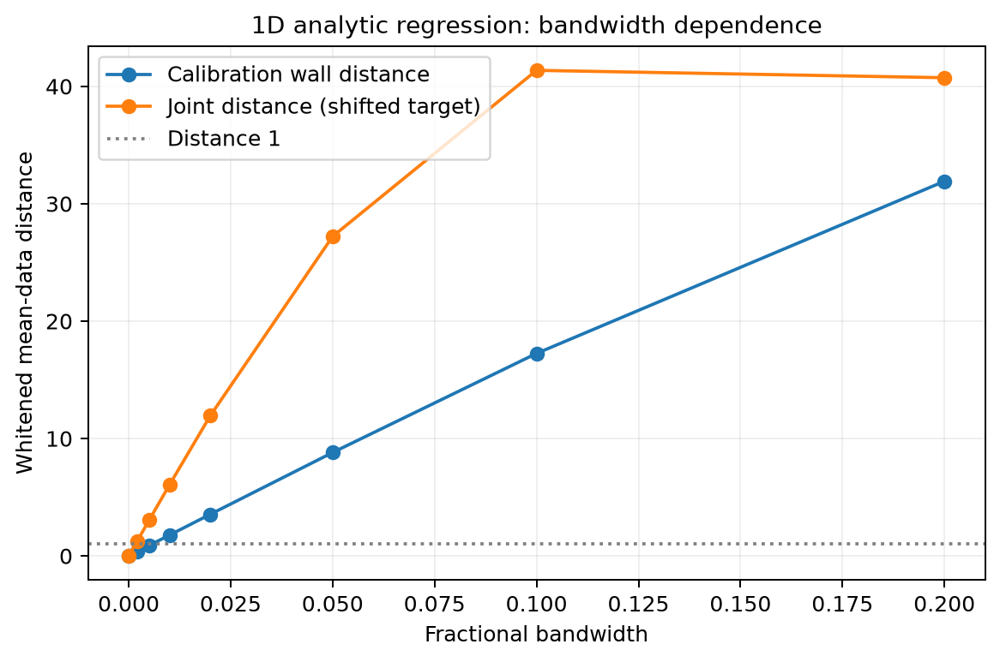
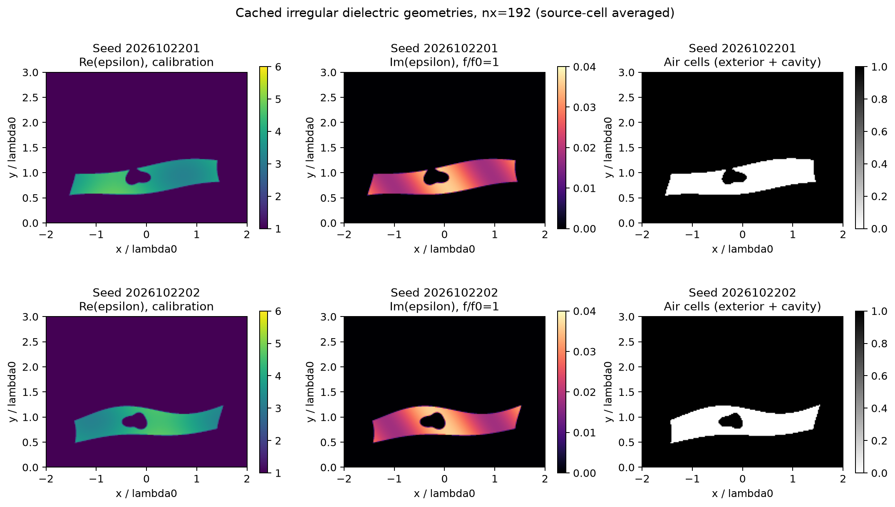
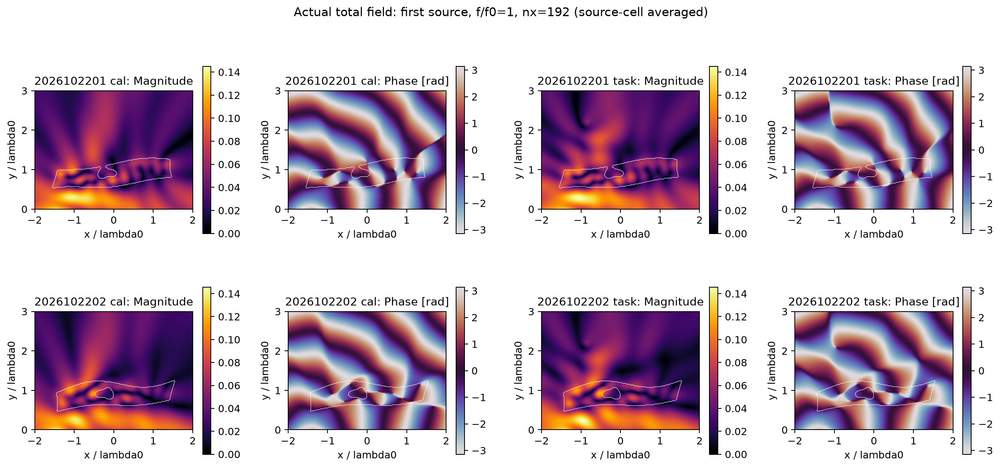
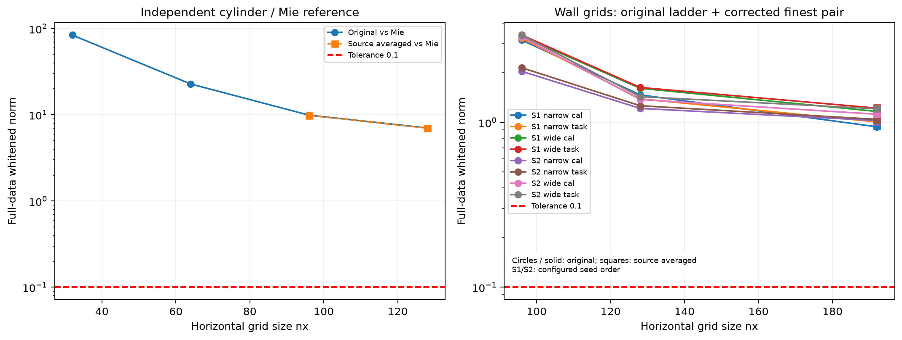
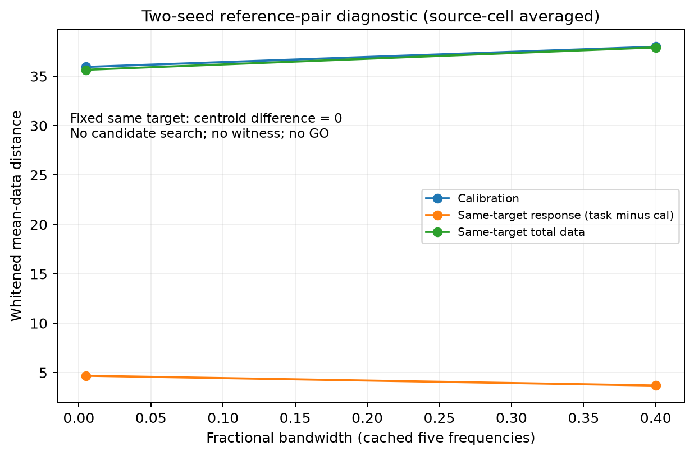
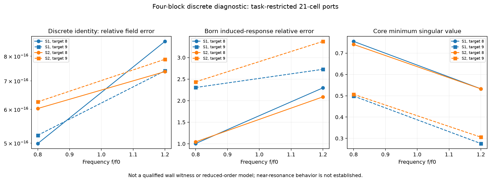
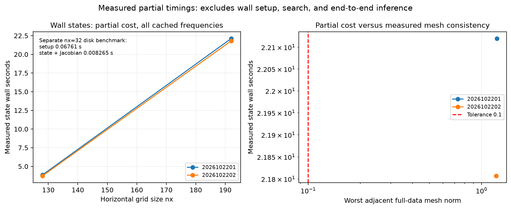

# Research W P0：未知不规则墙体的传播歧义验证

日期：2026-10-22。研究状态：**P0-A PASS；P0-B UNRESOLVED（二维前向精度未达标）**。

## 1. 先说本轮能够回答什么

Pro 的一维反例被独立正确复现，包括共同参考面、完整 PEC 多次反射级联和带宽负结果。二维确实执行了有限尺寸、非均匀、有损、不规则墙体的多频多源完整多次散射计算，保存了材料与复场数组；没有用 Born 或手绘场图替代全波。

但二维平台尚不足以支撑本题要求的强歧义判决。最细两层192×144与128×96网格之间，完整多频数据的白化差仍为 **0.951–1.229**，超过原协议的0.1。这个误差已与“两个世界距离≤1”的关键门槛同阶。不能因为线性系统残差小、伴随正确或者图片看起来正常，就去宣布数据近等价的物理反例。

因此本轮停止在资格审核：普通Full-J、随机、multistart FWI和task-aware见证搜索均未启动；calibration与joint的见证不存在“通过”记录。**这不是证明歧义不存在，不是二维宽带唯一性结论，也不是Research W物理假说NO-GO。** 未耗尽总预算；停止原因是冻结的前向资格阶梯未通过，不能用剩余搜索额度绕过Gate1。

## 2. 原资料与数学审计

ZIP实际包含26个文件：52页PDF、完整LaTeX章节、解析脚本、原始JSON/CSV及图。输入解压到只读 `source_package/`，清单只记录路径和大小；没有执行哈希校验或备份流程。父线程核对核心数学，Codex子代理承担来源、实现和图表整理；没有调用DeepSeek。

**纤维判据。** F相同必然H相同，当且仅当存在集合意义的H=h∘F。可微或局部Lipschitz因子化才给出ker DF⊂ker DH的必要性。原文已经写出可微h的限定；本轮补充F(x)=x³、H(x)=x说明，单射且连续可辨并不自动满足零点的导数核包含。邻域恒秩、每点核包含和局部连通纤维片，才允许积分成局部因子化；不能把一个小奇异值当成有限非线性纤维。

**任务歧义模数。** 找到一个合法非线性端点对可以给ωT(δ)下界；未找到不能给其全局上界。小观测导数、大任务导数只能提出初猜，不是物理见证或后验质量。

**四块公式。** 对L=L_W−UVU*，d=RGQ、A=RGU、B=U*GQ、C=U*GU，有F=d+AV(I−CV)⁻¹B。非交换顺序正确，V必须包含本构、频率与离散质量因子。它属于标准resolvent/T-matrix结构，不是新原创代数。相关逆不存在或接近不稳定时，不能套用统一误差界。

**后验界。** 原联合prior不变、likelihood相同且势能误差uniform受控时，保守TV≤tanh ε成立。替换墙代表时若丢掉目标/仪器条件依赖，结论不再自动成立。它是未来P1的条件工具，本轮没有建立后验、事件概率或压缩证书。

详细条件和状态标签见 [THEORY_AUDIT.md](THEORY_AUDIT.md)。没有发现一维相位、完整目标级联或四块次序的核心错误；机器精度下原归档与本次独立实现的数值分别保留。

## 3. 一维回归：反例成立，特定宽带补偿失败

采用(n,d)=(2,1/4)、(3,1/6)，同前表面，固定后参考面D=1；PEC位置L₁=1.5、L₂=1.5−1/12。行波界面矩阵、独立Fresnel求和、完整PEC边界三条计算路径相互核对。

|量|本次独立实现|
|---|---:|
|中心最大墙反射模|1.97455e-16|
|共同参考面双程相位差|1.047197551197 rad = π/3|
|同位置目标双程响应差模|1.000000000000|
|PEC位置补偿后中心联合差|5.07154e-16|
|最大无损幺正性缺陷|8.88178e-16|
|直接PEC边界与完整级联最大差|1.98603e-15|

每档带宽9点，噪声每实/虚正交分量标准差0.01。白化均值距离为||f₁−f₂||/0.01，**不除以通道数的平方根**。

|相对全带宽|墙校准距离|指定联合补偿对距离|
|---|---:|---:|
|0.2%|0.354877|1.216504|
|0.5%|0.887138|3.038246|
|1%|1.773893|6.055071|
|2%|3.544727|11.941859|
|5%|8.808753|27.215437|

0.5%下校准0.88714仍较难分，而同一联合补偿对已达到3.03825。目标存在的完整数据确实能击破这组特定补偿。这里的位移1/12λ₀也小于P0-B另行声明的0.1λ₀任务阈值，一维回归不替代二维joint门槛。不同带宽重新布9点，不是嵌套采集，不能要求这些距离严格单调。

图1只来自独立解析数组，不是有限横向墙体证据。

## 4. 二维模型、开放空间和冻结采集

复用A2的二维TM出射Green VIE数学，适配矩形域和单侧天线。时间为e⁻ⁱωt，g=iH₀⁽¹⁾/4，电流满足j=χ(Einc+Gj)。直接复数LU求解完整耦合，没有截断多次散射。χ=εr−1，本轮二维直接χ本构不是三维CM/RR极化率。

域为[-2,2]×[0,3]，天线y=−0.3，4发12收，孔径3λ₀；宽带0.8/0.9/1/1.1/1.2，窄带0.9975/0.99875/1/1.00125/1.0025。两带共9个不同频率。频率之间共用ε∞与σ₀，εr(f)=ε∞+iσ₀/f；源谱和几何固定，不能每频率拟合自由增益。

噪声协方差为0.0001I，单位线源强度固定1；没有依据墙体结果重新缩放噪声。每带240个复观测，480实维。噪声样本的总范数通常远大于1，并不意味着两个拟合世界就相距≤1。

查询T=[−1.2,1.2]×[1.6,2.8]只是计算分块；本轮calibration fixture明确将其实际置为空气。固定12位置、半径0.12、对比3/7的介质目标类。joint任务原定为T内总正介电对比的质心差≥0.1λ₀，并约束质量相对差≤20%。没有执行仪器nuisance压力测试或未知目标的joint补偿搜索。

**开放边界的实现说明：** VIE直接使用无限均匀外部的Sommerfeld出射Green，不存在PML厚度或人工外边界参数。因此没有假称完成PML增厚实验；使用独立圆柱散射解和网格细化审核这一表示。其辐射条件成立不代表内部空间离散足够准确。

图2为固定seed的实际材料。两者有倾斜外形、变厚度、非均匀介电率、合法损耗和不规则空气区。按Re ε>1.1、前景8/背景4连接作离线描述，第一个空气区与外界连通、封闭hole数0，第二个为封闭hole数1；不把两者都宣称为封闭空腔，也不在看到结果后更换seed。该拓扑统计不是在线输入或门槛。

图3是f/f₀=1、第一个源的保存离散总场幅度/相位，分别为无目标和同一固定目标状态。它不是重建图，不表示已经知道墙后目标。

## 5. 二维资格为何没有通过

先做公开benchmark，再保留原8000 RHS/2000分解/7200 CPU秒预算。使用32、64、96、128、192的预先登记方格分辨率阶梯；细网格不是把32×48逆表示误当足够准确的正演。

常规离散一致性结果良好：四步长材料差分的最佳相对误差约3.51e-10，实伴随dot缺陷约1.91e-15，线性后向残差约10⁻¹⁵。20项代数/合同测试通过。这些只能说明对当前离散矩阵求导和求解基本一致。

独立均匀介质圆柱Mie参考揭示了尚未解决的空间误差：原实现从nx32到128的相对散射误差约84.1%、22.8%、9.91%、7.03%；匹配源平均后nx128仍约7.00%。误差随细化下降，但没有达到足以支撑本题强均值距离门槛的精度。

对两个真实不规则墙体，修订源接口后192×144相对128×96的**完整数据向量**白化差如下：

|seed|宽带cal|宽带固定目标total|窄带cal|窄带固定目标total|
|---|---:|---:|---:|---:|
|2026102201|1.174762|1.229102|0.950860|1.019501|
|2026102202|1.127504|1.216380|1.015357|1.034440|

所有值都超过0.1，差约为目标容差的9.5–12.3倍。没有连续PDE严格误差上界；相邻网格差本来就只是数值一致性证据，如今连这一要求都没有通过。不能以某个粗网格d=0.999宣布GO，也不能把网格相近直接称连续Maxwell认证。

源接口和内存修复均保留原记录：接收单元积分与入射中心值不匹配导致交换源/接收的相对差3.49×10⁻⁷；匹配入射单元平均后降至7.20×10⁻¹⁶。但这不改善主要网格误差，故不能把互易性修复当成资格通过。原wall job峰值RSS2.05GB；分块、原位LU后降至0.572GB，同材料无损工程改动的数据对比完全一致。未使用jitter、伪逆或降低精度换取内存。

现有迹象指向空间系数/场近似精度，而非LU未收敛或伴随符号错误；尚未独立量化几何面积平均、常数单元场近似各占多少，不能给出未经测量的误差百分比分解。

## 6. 两个固定参考世界的数据：不是成功见证

以下全部由已保存的修订版最细网格数组重算，没有新增求解。两个seed并非优化得到的数据近等价端点。同一固定目标位置在两世界相同，任务质心差为0。

|带宽|两墙cal距离|同目标完整total距离|目标诱导响应差|目标质心差|
|---|---:|---:|---:|---:|
|wide|37.984019|37.913405|3.694601|0|
|narrow|35.944314|35.655212|4.685431|0|

目标诱导差是[(F₁(X)−Fcal₁)−(F₂(X)−Fcal₂)]的实验机制诊断；calibration场本来就是额外公开fixture，不能拿这一相减充当joint在线输入。原定义dT使用完整目标响应，该表同时给total与induced，避免混用。虽然诱导差达到若干噪声单位，cal距离约36–38，完全不满足近等价条件；更没有非零目标任务差。且网格仍未qualified，不能拿表中数值作为认证物理下界。

## 7. 四块传播：同一离散系统中的有限验证

在固定两个seed、f/f₀=0.8和1.2、同一目标位置两种固定对比上，额外完成8个实际离散全波对比。四块只覆盖该目标支撑的21个单元端口，**没有计算整个T的完整Green签名**。

用环境LU求任务端口后，四块重建与直接含目标全波数据的最大相对差为8.67e-16。Born目标诱导响应相对误差为100.6%–337.5%。这验证了非交换公式和内部多次反馈在该离散实例中不能省略；不是未知墙体歧义、ROM优势或连续PDE精度证明。

核心最小奇异值在0.276–0.755。没有找到接近奇异的冻结实例，不额外调材料或频率制造“近共振”图。每个环境四块setup需要21个复端口RHS，而直接一个新目标前向为4个源RHS；再加小核因子与4 RHS。不能把21维小核、缓存后的局部计时或恒等式精确当作总成本下降。

## 8. 费用、失败与没有运行的内容

截至本报告生成的计费快照：实际完整离散状态258次；物理因子分解266次，其中含8个实际目标小核分解；complex RHS为1184。源前向1032 RHS、接收转置36 RHS、四块端口84 RHS、小核32 RHS。全部在执行前预约；同材料、不同实现的重复和修复同样计费。

validation使用820/1600 RHS；repair使用364/800 RHS；search和endpoint搜索预算都为0。全局没有达到预算上限。实际包装作业wall合计约297.6秒、process CPU约288.0秒；对包装前的解压、源码/文献审读及环境尝试另保守计费600秒，**不是测量值**。账本收费合计约897.6秒。报告、图表与发布尾项仍追加到主账本，最终数值以提交中的账本为准；模型推理不当成本地物理CPU用量。

保留的失败包括系统Python缺NumPy、pytest未安装导致一次测试启动失败、初版源/接收离散不对称、较高内存峰值及两seed的资格失败。使用已有科学环境和标准库unittest后20项测试通过；没有修改冻结的旧项目环境或删除失败记录。

图7只显示保存的状态计算部分计时；没有完整推理、ROM加速或time-to-image结论。全部峰值、CPU/wall、LU/RHS及日志见 [物理账本](results/PHYSICS_LEDGER.jsonl) 和 [失败记录](results/FAILURE_LEDGER.jsonl)。公开物理调用口径不把人工矩阵代数单元测试伪造成材料状态；其CPU费用仍计入。

## 9. 七个科学问题逐项回答

1. **一维是否复现？** 是。相位、共同参考面、完整PEC边界/级联、幺正性、白化及0.5%带宽负结果均通过独立核验。
2. **有限不规则二维墙是否有合格calibration见证？** 尚未回答。只完成实际参考场和资格计算；Gate1失败，未搜索，不能报告“找不到所以不存在”。
3. **目标未知的joint歧义是否持续？** 未检验。没有把calibration或同一固定目标的比较冒充未知目标补偿。
4. **什么采集消除歧义？** 一维指定补偿对会被0.5%带宽击破。二维没有合格的歧义对，不能判断其宽带/孔径/目标自照明的消歧作用；没有运行孔径变化。
5. **task-aware搜索同成本更好吗？** 未建立。四种方法均为NOT_RUN，不存在成功率、同成本Pareto或算法优越性结论。
6. **四块/A17比单程或Born揭示什么？** 在同一离散系统里四块恢复完整内部反馈，Born在固定强目标上误差很大；但空间精度不足，量化只属离散诊断。没有执行A17新ROM，Schur同空间等价不构成新算法或加速证明。
7. **P1、测量设计还是停止？** P1-A/P1-B均HOLD，先解决二维前向资格。现在也不能宣布REDIRECT_TO_ACQUISITION_IDENTIFIABILITY，因为尚未有被宽带joint击破的合格二维见证。停止本轮搜索扩展，不停止尚未被检验的物理问题。

## 10. 下一轮可以做的最小工作

优先以这两个已冻结实例做更准确的前向离散核验，比较高阶/界面相容方法或独立FEM/BEM参考与当前VIE；保持同一源、噪声、世界及0.1门槛。按目前近似二阶下降趋势，简单加密可能需要数倍线性分辨率，直接活跃稠密LU的内存与费用会快速增加。这是工程预测，不是严格误差外推，也没有在本轮付费展开。

只有前向资格通过后，才按冻结数据和同成本普通强对照恢复P0-B搜索。若随后发现仅窄带calibration成功、宽带joint失败，再转向采集可辨识性；若joint见证成立，先做可独立积分的低维P1-A，并以同prior/likelihood direct joint方法作参照。P1-B必须另做单点/多解×joint/progressive的2×2消融。本轮两者、3D、大网络和概率权重均没有启动。

## 11. 阅读与复现

- 入口：[START_HERE.md](START_HERE.md)；冻结配置：[w_config.json](w_config.json)。
- 原始指标：[RESULTS.csv](RESULTS.csv)；机器判决：[results/GATE_DECISION.json](results/GATE_DECISION.json)。
- 实施细节：[PHYSICS_VALIDATION.md](PHYSICS_VALIDATION.md)、[PHYSICS_PROTOCOL.md](PHYSICS_PROTOCOL.md)。
- 代码：[src/research_w](src/research_w)；实际命令与CPU凭据：[results/jobs](results/jobs)。
- 全部图只读实际缓存；PNG/SVG及作图CSV位于 [figures](figures)。

最接近文献边界：单侧通过未知墙的应用可参考[Watson 2024](https://doi.org/10.1088/1361-6420/ad5b83)；反射/透射多模歧义已有[Waagaard–Skaar 2007](https://doi.org/10.1137/060672224)；部分边界数据的连续唯一性条件见[Brown–Marletta–Reyes 2016](https://doi.org/10.1016/j.jde.2016.01.002)。本轮仅用ScholarQA核对5条文献身份/可用摘要，未做穷尽新颖性检索；摘要缺口和与A17/B1/C1等既有代数的重叠保留在资料审计中。不宣称二维一般Maxwell唯一性、后验校准、首次反馈公式或IEEE TAP论文级算法优势。
