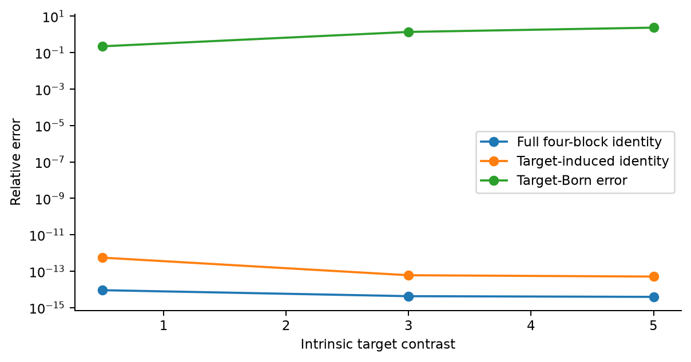
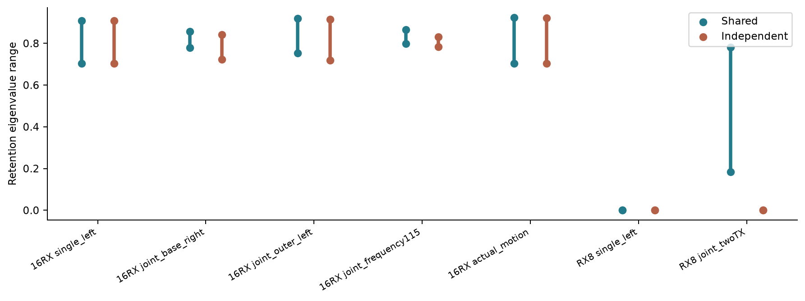
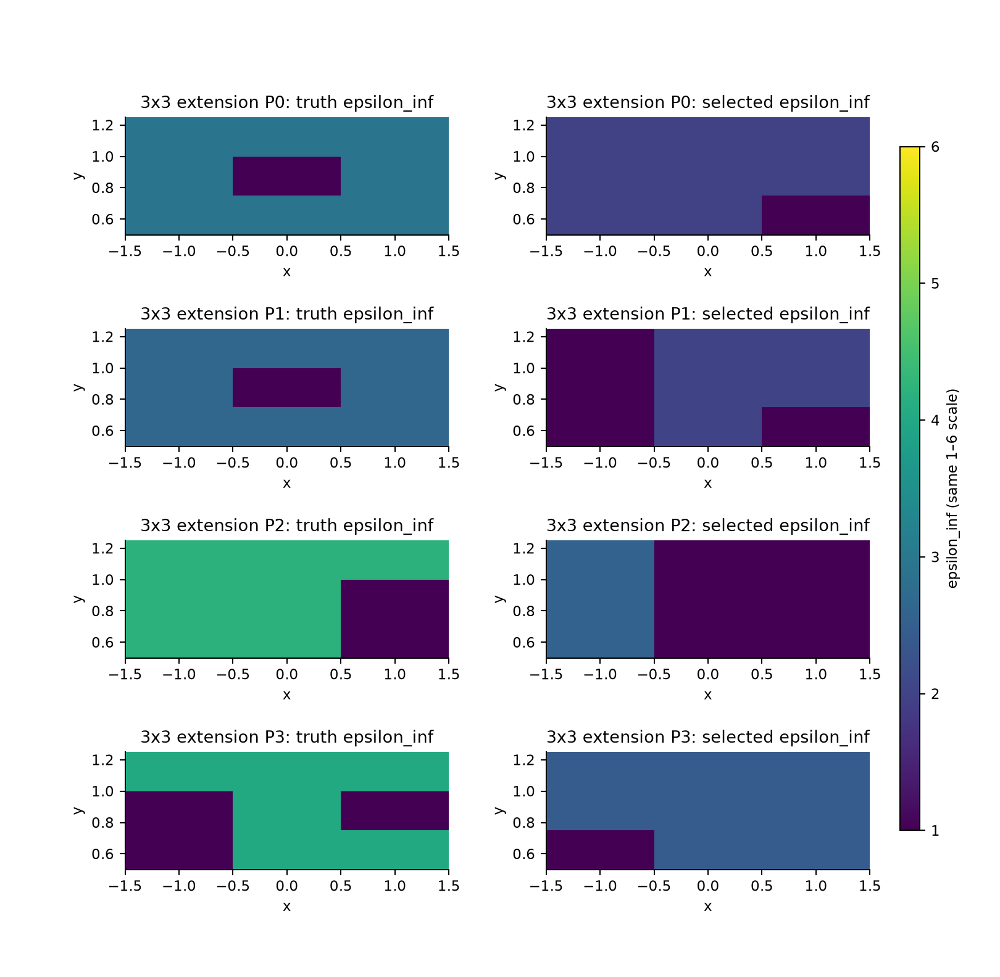
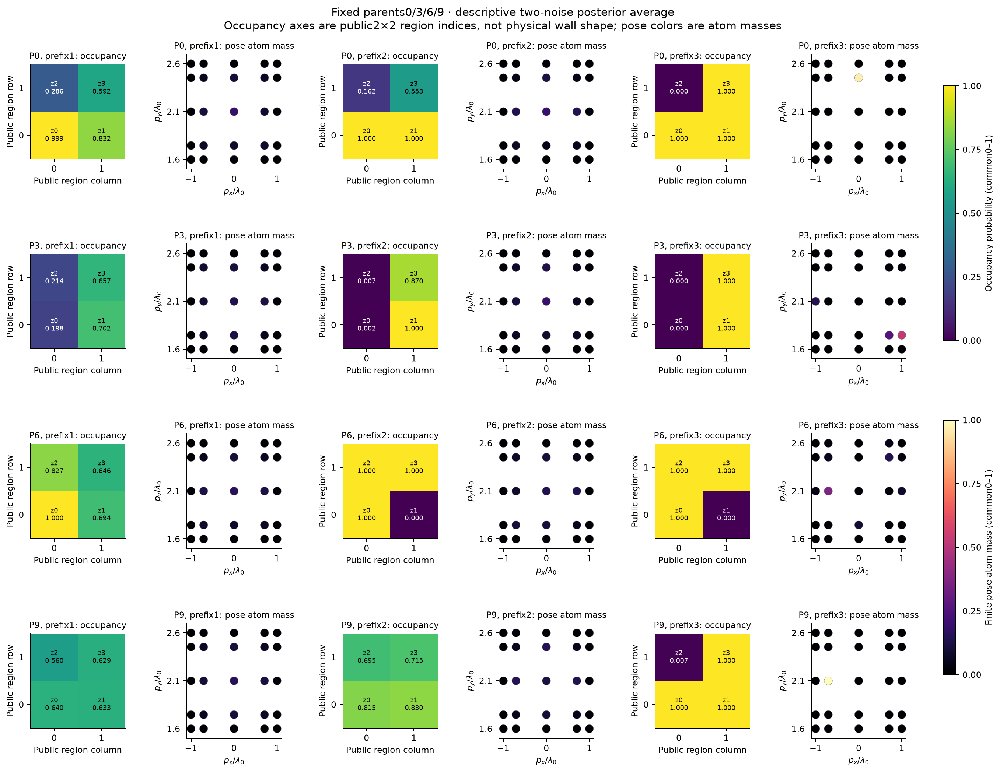
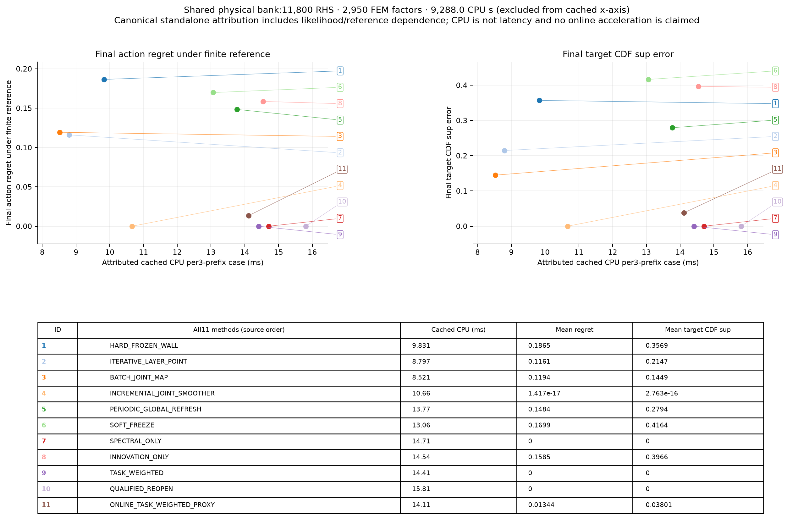
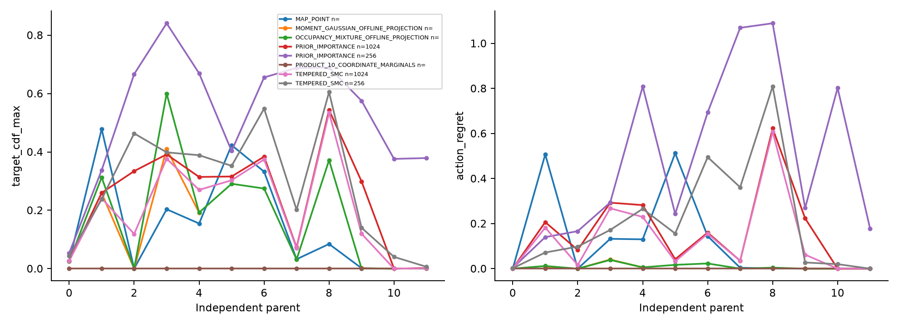
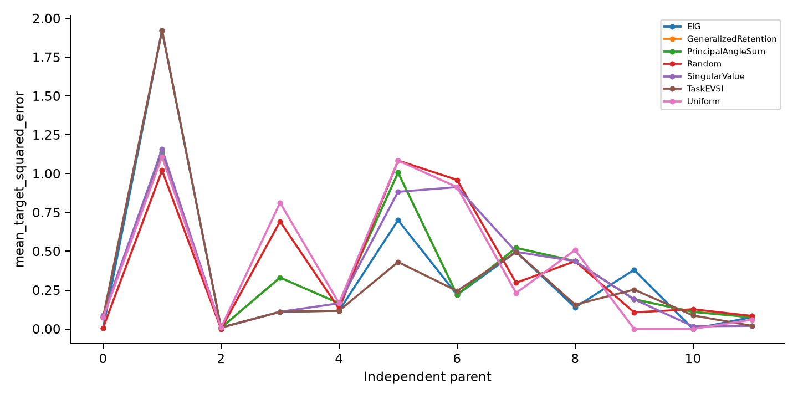

# Research W-SLAM：真实Maxwell联合补偿、概率地图与回访

2026-10-25 · 本轮实际计算完成 · 二维标量TM · 开发证据

## 结论先行

**墙体误差与目标位置、目标材料之间确有完整Maxwell补偿；保留联合belief能够修正早期错误。但普通可回访联合推断已经做到这一点，本轮新task/spectral重开规则没有更省计算。一般未知墙体在线恢复也尚未解决。**

本轮实际执行高阶FEM/PML、材料及位姿Jacobian、有限扰动、72条连续主拟合及扩展、2950世界全波参考表、24个含噪序列上的11规则回访、384项后验比较，以及7策略主动测量pilot。不是仅运行代数toy。未运行NN、locked test、三维或新A17 ROM。

详尽裁决见[SCIENTIFIC_DECISION.md](SCIENTIFIC_DECISION.md)，复现见[REPRODUCE.md](REPRODUCE.md)。科学结论与网页发布状态分开记录。

## 1. 问题与合同：墙、位置、材料不能混为一个pose

同一散射变化可能由墙介电常数、目标移动、尺寸或对比度变化产生。若各帧目标状态自由，多次观测未必帮助墙体；共享状态或运动关系可让补偿不再相容。但“目标材料已知”是强条件，不能只说共享pose而忽略材料自由度。

本轮采用`y_t=F(W,p_t,m_t,γ_t)+n_t`，独立计算墙导数A、位置导数B、内禀材料导数C_m及仪器/导航导数。动态公式中`C_comp=B†A`是补偿系数，不是C_m。

继承的旧W见证`d_joint=.798716、d_cal=3.560512、Δp=.1λ0`仍是其原合同下的条件见证，不是本轮发现，也未因此成为新prior合法分支。来源：[历史联合见证](https://github.com/migodam/b1-probabilistic-maxwell-imaging/tree/958a478739d9553269316ded8125fda9df225c0c/research/research_w_p0r_to_p1)、[旧continuation](https://github.com/migodam/b1-probabilistic-maxwell-imaging/tree/483d260c6b5b111db9fb814b096685fccb362448/research/research_w_continuation)。旧目录和结论未修改。

复用已审核scalar-Helmholtz FEM薄适配，Ez、μr=1、`exp(−iωt)`，包含完整二维多次散射。中心频率1GHz、λ0=.299792458m；单位线源`iH0^(1)/4`，不拟合复比例因子。两个基准源x=±1.5λ0、两个外孔径源x=±2.25λ0，16RX位于x∈[−2,2]λ0、y=0；E1另有0.85/1.15频率。这是新Pro采集合同，不能与旧W的4发12收混用。

公共墙ROI为[−1.5,1.5]×[.5,1.25]λ0，基础宏格.125λ0、24×6。初始2×2公共超区域允许14种合法占据，包括空墙；未提供GT mask。非空材料四连通，禁止对角棋盘，更宽表示允许空气孔洞。跨频共享`ε=ε_inf+i ell/f`，ε_inf∈[1.5,6]、ell∈[0,.25]。圆盘目标位置范围[−1,1]×[1.6,2.6]λ0，检查间隔、被动性及边界。

噪声实虚部各独立标准差.01，白化距离不除通道数平方根。连续A0的共享仪器幅相未知；有限概率pilot则仪器已校准、目标内禀材料与尺寸已知、目标静态。因此不能横比两阶段误差宣称算法进步。[物理协议](PHYSICS_PROTOCOL.md)、[prior/likelihood](PRIOR_AND_LIKELIHOOD.md)及冻结合同保存全部细节。

## 2. E0：合格的是离散全波，不是连续PDE证书

粗离散最强两项完整数据白化差约.185/.200，超过冻结.1门，保留为失败。修复采用h=.17、256边圆盘、field refinement2；独立参考为384边、refinement3。更细方案预估70861 DOF并触及资源守卫，未强行启动。

修复后23项主资格差约.00116–.00713，外孔径最强检查.00951；有限表12个预定索引最大.02076。24个最终posterior MAP端点另做独立网格审核，20个不同状态最大.009882。不是2950状态的统一误差界。

独立圆柱Mie、真空、PML、差分、实伴随和LU均有记录；8个收发互换的最大白化差.001927。材料差分误差约3e−6，位置/形状受重新划分网格影响约千分量级。22项测试与两份Pro toy回归通过；toy不替代这些真实物理审核。**E0 PASS：QUALIFIED_DISCRETE_FULLWAVE。**

完整FEM核对`F=F_wall+ΔF_target(W,p,m)`，诱导响应的墙导数非零。四块Green与相同离散Full solve约1e−15一致；目标对比度3/5的Born诱导响应误差为137.76%/236.68%。这说明反馈不能随意省略，不说明新逆算法更好。

四块setup用了2335个端口RHS，直接正演只有2个源RHS。本轮没有四块/A17加速主张。

## 3. E1：共享位置恢复信息，未知内禀材料又可撤销恢复

固定墙左右两个实材料参数和二维目标位置。一个复端口下，墙方向可被位置一阶变化补偿；两个源要求同一目标位置后，广义保留率为`[.184659,.781007]`，独立网格为`[.184680,.780971]`。允许各源独立位置仍约为零。

| 墙方向步长 | 单源补偿白化差 | 两源共享pose | 两源独立pose |
|---|---:|---:|---:|
| −.01 | .0000672 | .068241 | .0001426 |
| +.01 | .0000751 | .068876 | .0000693 |

独立网格差约.00054–.00081，有限恢复超过数值变化，但.068仍低于单位噪声距离，不能说两个世界已可靠统计分开。多数有限剖面达到8次上限，不是全局Oracle。完整16RX单源保留率本已约`.703/.909`，不能把最小端口的相对恢复包装成完整孔径巨大歧义。

放开位置、对比度、半径后，两端口目标Jacobian行秩4；最小奇异值.19037高于网格算子差.001919。墙步长−.01的实际非线性残差.0000965、细网格.000263；+.01仍为.023684/.023696，均未充分收敛。局部满秩不保证任意有限路径可延拓。

正确D2先消除`ker(B)`的免费运动。实际Jacobian上D2与增广消元差1.91e−26，错误的直接伪逆替换差55.43。即使内禀材料跨观测共享，4×7的B仍有两维不可见运动能力，运动prior不能凭空恢复墙信息。D1/D3也通过矩阵核对；给保存的无约束补偿轨迹计算运动惩罚，不等于重新求运动正则化有限最优解。

**完整E1为INCONCLUSIVE：条件机制受真实Maxwell支持；新二维精确非恢复世界对及充分有限运动优化仍缺失。** [E1详表](E1_MAXWELL_OBSERVABILITY.md)、[理论条件](DYNAMIC_COMPENSATION_THEORY.md)。

## 4. A0：measurement-only连续恢复未形成稳定锚点

未知支撑、公共初值、同prior，比较Full-J/TR、多起点联合MAP、multiscale/birth-death/support-exchange。12个连续prior世界×2噪声×3方法=72条主轨迹，每条同样6次付费评价。GT只在在线输出保存后评分。

| 方法 | 训练包络内 | 留出包络内 | 两者均满足 | 支撑IoU | 位置误差λ0 |
|---|---:|---:|---:|---:|---:|
| Full-J/TR | 3/24 | 0/24 | 0/24 | .4599 | .5625 |
| 多起点联合MAP | 9/24 | 5/24 | 5/24 | .6563 | .5912 |
| hybrid support search | 12/24 | 11/24 | 9/24 | .7106 | .5581 |

这是保守含噪discrepancy，不是无噪声均值`d≤1`或概率认证。72条已选拟合均触及上限，不能声称打败充分收敛的成熟FWI。另8例未知内禀stress仅2例同时通过；4例3×3扩展全未通过，含孔洞支撑均被选成无孔。更宽ROI未运行。

标准加权full-adjoint用每源一个转置RHS，与显式16接收器Jacobian梯度核对至4.22e−15。在剩余原A0预算内，固定4个已暴露parent×2噪声做20点补优化：8个目标函数都下降，但同时通过仍2/8，位置误差.5284→.5352，均触上限。它不换支撑，初值依赖前三法，不是同成本新胜利或盲测。

**A0_ONLINE_NOT_REACHED。** 个别相容候选不等于稳定一般系统；模型中真实材料合法且缓存目标更低，失败不能证明材料不存在或Maxwell唯一。原离线分析布局错误亦保留；修复后72条均可评分。[完整A0](A0_ONLINE_RECONSTRUCTION.md)。

## 5. E2/E3：真正的有限概率地图，以及没有胜过普通smoother的调度

按授权开展独立可核对小prior：14种支撑、共享ε/ell的3×3节点、二维位置5×5节点，共2950个物理原子，空墙无效材料参数已积分合并。节点/正权重定义离散prior，不是连续积分收敛证据。已知仪器和目标内禀，2×2不能表达孔洞。

所有原子均用四源Full FEM计算。12个预定义prior世界各两份噪声，实际12个不同原子，其中parent2/4为空墙，未重抽样。三次观测依次为单复端口、另一源同端口、两基准源剩余15RX。每份数据唯一factor ID；刷新旧版本不重复乘likelihood。

实际保存占据概率、占据条件下ε和SI电导率分布、墙–墙/墙–目标协方差、完整联合权重与分支质量。`σ=ε0ω0 ell`。普通incremental与batch reference权重仅差浮点舍入。

图为固定parent0/3/6/9的两噪声后验平均，属于重复实验描述，不是平均数据的单个posterior。占据坐标为公共区域索引，目标坐标为λ0。单独belief均保存。

联合熵`7.7146→6.0051→1.1195` bits，支撑熵`2.5821→1.5512→.0567`；位置方差迹平均`.41485→.41309→.19015`，但6/24例增加。两个边际95%区间同时覆盖23/24，不是联合95%可信域或正式SBC证明。

### 是否形成“新数据→改墙→改目标”的证据？

早期18/24墙组MAP错误，15例后期改为正确墙组；14例错误支撑全部纠正，11例同时墙组纠错及目标平方误差下降。非空墙parent5/repeat0从墙组116改为95，目标平方误差1.1152→.7153，hard freeze终点1.2446。绝对成像仍不理想。硬冻结实际位置更好的9/24例亦保留；所有24例都在同一结果表，不用GT决定在线动作。

总体普通联合位置误差.34614λ0，hard freeze为.53072λ0。**普通incremental smoother已经得到精确有限reference；新方法必须胜过它，而不能只击败永久冻结。**

| 规则 | 最终边际门/风险门通过 | CDF差 | 三次观测cached归因CPU |
|---|---:|---:|---:|
| 普通joint smoother | 24/24、24/24 | ≈0 | 10.663ms |
| hard freeze | 7/24、12/24 | .35688 | 9.831ms |
| innovation-only | 1/24、2/24 | .39658 | 14.542ms |
| spectral-only | 24/24、24/24 | 0 | 14.711ms |
| task，当前reference阈值 | 24/24、24/24 | 0 | 14.409ms |
| qualified，含reference审核 | 24/24、24/24 | 0 | 15.808ms |
| online task proxy | 22/24、22/24 | .03801 | 14.112ms |

这些不是完整冷启动latency，另有加载/日志及共同9288.023 CPU秒、11800RHS/2950FE准备。所有方法同享表缓存。task名义重开27次、proxy25次、普通48次，但前者先算完整reference，后者有2例失败；合格规则cached CPU更高，真实物理准备也没减少。

首次高斯surrogate因对称性审核拒绝而停止；保留失败后改为数值不合格即保守重开，没有jitter、precision修改或容差放宽。正式结果18次对称性拒绝、8次奇异/集中covariance拒绝均记录。D6–D8不认证真实多峰posterior。

已知空墙负控制无需回访，conditional与batch差3.33e−15；继承的一维板–PEC精确多解经6次独立重复仍1/2。两者不替代新二维未知墙精确非恢复反例。**E2在有限prior内PASS；回访机制受支持；完整E3 INCONCLUSIVE；当前新调度加速FAIL。** [belief详情](E2_BELIEF_MAP.md)、[11规则完整消融](E3_REVISITATION_ABLATION.md)。

## 6. E4：边际准确仍可严重丢失联合相关

384个比较中371可评价，13个moment Gaussian因奇异covariance未定义，保留分母。reference moment/marginal projection是OFFLINE诊断，不是可部署发现算法。

MAP仅10/24满足列出的概率和任务门；product marginals为22/24，但联合TV均值.16691、最大.57253。支撑mixture可几乎保留支撑模式质量，却仍丢失材料–目标相关性：联合TV均值.33240、最大.85363。因此单坐标CDF或支撑模式门不能认证联合后验。

SMC/importance在256/1024粒子、三个种子下各144行，全部门通过43/144、36/144。高ESS不证明模式覆盖，也未建立通用紧凑posterior替代。[E4详情](E4_POSTERIOR_VALIDATION.md)。

## 7. E5：预测utility优势没有变成可靠的实际优势

7策略×24案例，动作选择先保存，未来噪声独立生成；保留旧数据，新重复测量用新factor ID。候选为四个源的全16RX，无新频率campaign。

| 策略 | 32-draw预测目标风险 | 独立未来数据后风险 | 真值位置平方误差 |
|---|---:|---:|---:|
| Uniform | .26011 | .22874 | .41393 |
| Random | .26194 | .24540 | .41206 |
| EIG | .21266 | .25835 | .34792 |
| TaskEVSI | .19876 | .21706 | .32674 |
| singular value | .24975 | .27753 | .37372 |
| angle / retention | .25849 | .27691 | .35634 |

TaskEVSI相对EIG实际真值平方误差差值−.02118，parent bootstrap区间[−.08024,.02223]；相对Uniform为−.08719，[−.31286,.15429]，均跨零。选择本来就在同一32-draw utility上取最好者，预测优势不能替代独立未来验证。angle与retention等价，24次动作一致，不是两项独立创新。

局部谱策略另付24个原生Jacobian、480RHS/24FE，平均选点归因CPU约5.63秒；全表EIG/EVSI约.0367秒，但已有昂贵bank。没有端到端策略优越性确认。[E5详情](E5_ACTIVE_SENSING.md)。所有统计先在parent内平均噪声/算法种子，再做2000次parent配对bootstrap；12簇仅是开发证据。

## 8. 成本和失败：没有免费准备，也没有隐藏的重跑

科研物理合计**27674 complex RHS、4672 FE分解**，各阶段未超自己的上限。下表到科研汇总时点；归档/发布尾项继续入最终[COST_SUMMARY.json](COST_SUMMARY.json)。

| 阶段 | RHS / 上限 | FE / 上限 | 计费CPU秒 / 上限 |
|---|---:|---:|---:|
| E0+E1 | 3350 / 4000 | 385 / 1200 | 约737 / 7200 |
| A0 | 11916 / 12000 | 1281 / 3000 | 3565.57 / 14400 |
| E2+E3，含验证/图表 | 11928 / 12000 | 2982 / 3000 | 约9481 / 14400 |
| E4 | 0 / 12000 | 0 / 3000 | 211.41 / 14400 |
| E5 | 480 / 8000 | 24 / 2000 | 174.41 / 10800 |

包括mesh、LU、RHS、adjoint、准备、因子刷新、失败及审核。早期绘图未精确计时，保守计180秒；另有60秒准备上界，不称实测CPU。主要job均有wrapper receipt。峰值RSS约1.99GB，不相加进程峰值。实际平台Apple M4/24GB，GPU未用，不写成RTX或三维性能。

保留粗网格失败、被资源守卫拒绝的细化计划、bank首次语法错误（零PDE）、A0未收敛/旧布局错误、bank成本汇总误把validation目录当bank、首次高斯拒绝、13个Gaussian未定义及全部不达门案例。费用汇总修复按实际`finite_bank.py`命令识别，不改旧账本。未执行哈希或额外备份流程。

## 9. 原创性边界与十个问题

Schur补、用户已有sin²主角谱、Bayesian occupancy、SMC、posterior mean、Green identity和一般task EVSI本身都不是本轮新贡献。iSAM2已有增量重排/重线性化，[作者说明](https://www.cs.cmu.edu/~kaess/pub/Kaess12ijrr.html)。Watson等已有全波墙校正Green、Born目标及PODI，[预印本全文](https://arxiv.org/html/2403.10354v1)。信息门控选择性更新亦有先行研究，[实际访问版本](https://arxiv.org/html/2601.08110)。这里只核对访问到的版本，检索曾有DNS/429失败，不宣称完成全球新颖性认证。

| 问题 | 答案 |
|---|---|
| 墙、位置、材料是否形成物理补偿？ | 能，有独立Jacobian和有限全波端点；范围受内禀材料和观测合同限制。 |
| 多次测量何时打破补偿？ | 共享/运动关系可增信息；新内禀自由度及不可见运动可撤销恢复。 |
| sin²谱够不够？ | 不够，还需绝对信息、噪声、创新和任务风险；.068仍未达单位噪声距离。 |
| 无GT支撑能否得到墙概率地图？ | 4公共区域有限prior中能；任意孔洞/连续宽墙体A0未解决。 |
| 新观测能否改旧墙并纠正目标？ | 有受控实例和全cohort支持，普通smoother同样做到；单次真实误差不保证下降。 |
| 概率/可信度/相关性如何定义？ | 明确prior×唯一likelihood后的联合边缘化，保存SI材料分布及完整covariance，限于有限模型。 |
| task Reopen是否更有意义？ | 小高斯regret可算，多峰上只是代理；便宜proxy有2例失败。 |
| 比联合重优化便宜吗？ | 本实现没有，合格规则cached CPU更高，RHS没减少，reference依赖也计费。 |
| 超出成熟方法的新能力是什么？ | 一个真实全波联合belief/补偿验证平台；尚无普通joint inference没有的经济能力，A0也不是充分收敛FWI。 |
| 是否达到强TAP算法贡献？ | 条件物理值得继续；标准SLAM工具组合、矩阵通过及当前调度不足以支持强算法主张。 |

## 10. 下一步由负证据决定

保留普通可回访联合推断，暂停当前高斯criterion加速主张，不扩大NN、A17或三维。优先研究内禀材料与运动联合约束下的**有限**补偿及实际噪声尺度；让强普通连续优化在新预算中充分收敛，区分support搜索与优化困难。

未来若研究lazy Maxwell刷新，须先指出省掉哪次FE/RHS、如何正确刷新历史likelihood、如何保留模式，再与普通smoother同风险比较。本轮全表pilot不证明所有lazy算法不可能，也不因为概念尚存就自动扩展。

**最终：条件物理和联合回访机制受支持；一般未知墙体系统尚未实现；新调度独立优势未成立。IEEE TAP强算法主张HOLD，当前实现的调度加速路线NO-GO。**
