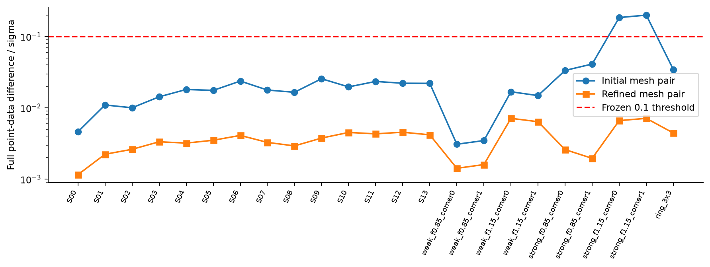
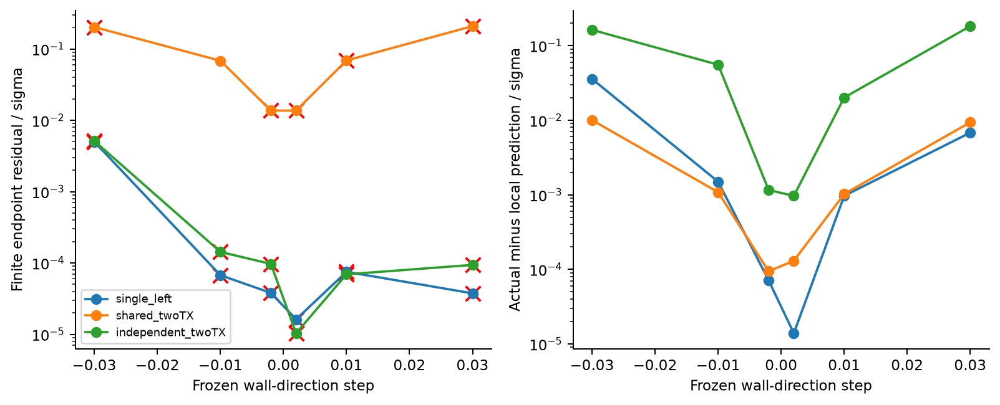

# Research W-SLAM：墙–目标联合补偿与可回访概率地图

## 当前状态

这是执行中的真实结果页面。E0物理资格、E1补偿实验、连续A0和两个扩展已完成；受控概率参考仍在计算。未完成的后验、回访和主动测量阶段没有写成成功。

最重要的判断是：**墙与目标的影响确实会在完整Maxwell中补偿，但共享状态能够恢复多少信息，取决于目标材料和仪器还剩多少自由度。当前连续未知支撑反演仍没有稳定解决。** 因此，不能从一组正确矩阵恒等式直接走到通用Maxwell-SLAM或强IEEE TAP算法贡献。

## 1. 从物理问题开始

穿墙观测中的目标回波不是自由空间目标响应加上一张可以剥掉的墙图。墙改变目标入射场、目标到接收器的传播，也参与多次反馈。我们实现完整墙响应与依赖墙的目标诱导响应分解，并与直接全波求解比较。

复用历史已验证P3有限元/开放边界后端。新实验使用公共0.125λ0宏网格，不给优化器真实墙体mask、孔洞数或目标位置。初始四区域占据类包括全部14种合法支撑；3×3扩展允许真正的内部空气孔洞。它仍是有限、轴对齐、单连通墙体类，不是任意复杂连续几何。

## 2. 数值算准了什么

初始精度在两个强材料案例上失败，完整白化差0.185/0.200，已保留。通过记录明确的统一精度修复，23项固定案例差降到0.00116–0.00713；额外外孔径检查最大0.00951。Mie独立线源圆柱、PML、材料/形状有限差分和实伴随另有审核。这里是合格离散全波，非连续PDE严格认证。

同一离散系统的四块传播重建到约1e-13。目标对比度3/5时，Born诱导响应相对误差约138%/237%，必须保留真实目标反馈。但2335端口RHS准备远比一次2源直接求解贵；没有授予加速。

## 3. 墙–位置–材料不能混为一个pose

真实Jacobian分别保留两墙参数、二维位置、目标对比度/损耗/半径，以及共享仪器与导航平移干扰。最小单复端口下，目标位置能补偿两种墙变化；共享同一位置的第二次激励使保留率变为0.1847/0.7810。允许每次目标独立移动时，局部墙信息仍为零。

但原完整16RX的单次观测已保留约70%–91%的墙信息，不能把单端口结果推广为完整孔径存在巨大歧义。未知内禀目标材料还可撤销两端口的恢复：四个目标参数的实际Jacobian具有稳健行满秩，有限补偿一个方向达到细网格距离0.000263，另一个仍为0.02370且优化未收敛。

固定墙步长±0.01时，共享位置留下约0.068白化距离，而独立位置可降到约1e-4；数值误差约1e-3以下。效果超过网格差，但0.068低于单位噪声距离，不能据此称已经实现可靠统计识别。

完整矩阵、有限端点、未知目标材料负控制和收敛状态见[E1报告](E1_MAXWELL_OBSERVABILITY.md)。D1/D2/D3及冻结任务风险公式的条件见[理论实施审核](DYNAMIC_COMPENSATION_THEORY.md)；它们不是新原创性主张。

## 4. 测量驱动A0没有被跳过

12连续父世界×两噪声，三种真实Full-Maxwell拟合共72条。所有方法共享物理模型、先验、初始候选权限和6次评价预算。在线输出先保存，之后才读取真实材料和独立外孔径留出。

| 方法 | 拟合通过 | 留出通过 | 同时通过 | parent平均位置误差/λ0 |
|---|---:|---:|---:|---:|
| Full-J/TR | 3/24 | 0/24 | 0/24 | 0.5625 |
| 多起点联合MAP | 9/24 | 5/24 | 5/24 | 0.5912 |
| 多尺度支撑交换 | 12/24 | 11/24 | 9/24 | 0.5581 |

检查使用固定噪声包络，不是把含噪残差d≤1当作停止门槛。全部主拟合触及评价上限；真实材料属于允许表示，因此不能把这些失败叫作全局表示不可能或Maxwell唯一性结论。它们至少包含尚未解决的搜索/优化问题。固定24个候选的细网格差最大0.00829，远小于失败拟合的尺度。

放开目标对比度/半径的8例压力测试，仅2例同时通过；四个独立3×3世界均未通过，两例真实孔洞均未恢复。具体原始表、真实图像及费用见[A0报告](A0_ONLINE_RECONSTRUCTION.md)。

## 5. 接下来实际运行的概率合同

不把A0失败改写成成功。按照授权的小prior分支，完整计算2950个合法材料–目标原子，每个都有真实FEM四源响应，计费11800复RHS和2950分解。14种公共支撑全部可选；不提供真值支撑或历史两墙的oracle初值。

这些点**直接定义有限先验**，不是已经收敛的连续Uniform后验求积。仪器校准与目标内禀材料已知，目标位置25节点；三节点材料和五节点位置的权重也属于公开先验。零位置具有离散质量，不能将其事件概率与连续位置prior混同。

将比较完整batch/reference、普通正确incremental更新、可回访block-MAP、硬冻结、软冻结、周期刷新及任务风险重开。每份观测有唯一factor ID；更新计算版本不重复乘likelihood。占据概率、条件材料分布、墙–墙和墙–目标协方差都会保存。

**本节目前没有实验结果。** 只有在实际参考完成及数值审核后，才评价概率误差、回访因果链和成本。普通incremental smoother是强基线；若任务判据没有等精度成本优势，独立新调度主张必须停止。

## 6. 当前科学边界

历史条件见证d_joint=0.798716、d_cal=3.560512、目标位移0.1λ0保持原限制，不升级为新prior内的合法全局见证或模式概率。当前局部物理例子、连续A0、有限概率prior是三个不同合同。

本轮没有网络训练、3D矢量结果或真实设备测量。未建立完整新文献检索；公开检索遇到网络/限流失败，因此不宣称全球原创。Schur、保留谱、占据概率和普通可回访平滑本身都不是新TAP贡献。

目前最值得继续验证的是：在目标内禀材料与动态约束明确后，补偿轨迹何时仍合法，何时新观测确实恢复任务信息。是否值得建立新的调度架构，要由后续同精度真实成本决定。
