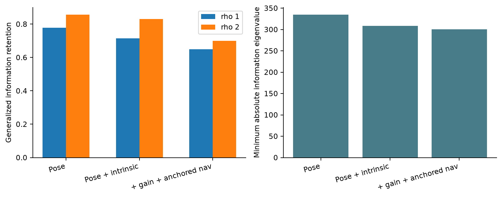
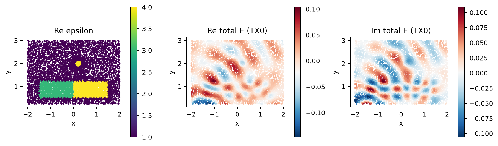

# 实际 E0/E1 图表 / Saved evidence figures

只读取已有数据；未执行 Maxwell、LU、RHS 或新的实验。 / Saved-array rendering only; no new physical actions.

## 01_precision_convergence

固定 E0 数据精度对照，保留最初失败。有限离散案例不等于统一连续 PDE 认证。

Fixed E0 data convergence; initial failures retained. These finite discrete cases are not a uniform continuum certificate.

Sources: `results/e0/qualification/RESULTS.json`, `results/e0/refinement01_executable/RESULTS.json`

## 02_four_blocks_born

同一离散 Maxwell 算子的四块恒等式与目标 Born 误差。精确代数使用已计费端口准备，不证明连续精度或加速。

Same-discretization Maxwell four-block identity versus target-Born error. Exact algebra uses paid port setup; it does not establish continuum accuracy or speedup.

Sources: `results/e0/four_blocks/RESULTS.json`

## 03_confusion_models

完整 16 接收器的局部线性信息：位姿、目标内禀参数、增益和已锚定导航。最后一项包含声明的统计先验，裸主角不等于先验辅助保留率。

Full16RX local linear information: pose, intrinsic target, then gain and anchored navigation. Last model includes declared statistical priors; bare principal angles alone do not equal prior-assisted retention.

Sources: `results/e1/dynamic/RESULTS.json`

## 04_aperture_retention

局部信息保留依赖孔径与干扰参数共享方式。RX8 为单复端口机制对照，不证明完整孔径的有限歧义；实际运动与假设相等约束沿用原标签。

Local retention depends on aperture and nuisance sharing. RX8 is a single-complex-port mechanism control; it does not demonstrate full-aperture finite ambiguity. Actual-motion and hypothetical equality panels retain their original labels.

Sources: `results/e1/dynamic/RESULTS.json`

## 05_finite_corrector

RX8 已计费有限补偿剖面与固定局部预测对照。红叉保留优化不收敛；局部与有限残差分开记录，不属于 A0 推断或完整孔径歧义。

Paid finite correctors at RX8, compared with the fixed local prediction. Red crosses retain optimizer nonconvergence. Local and finite residuals are separate evidence; these profiles are not A0 inference or full-aperture ambiguity.

Sources: `results/e1/dynamic/RESULTS.json`

## 06_sampled_fields

实际保存的 E0 代表材料与复总场，取自最初导数网格的积分点。仅确定性抽样显示，该图不是独立误差审核。

Actual saved E0 representative material and complex total field at quadrature points (initial derivative grid). Deterministic display subsampling only; this image is not an independent error check.

Sources: `results/e0/qualification/derivative_base.npz`

## 原始量保存范围 / Raw scope

- Confusion NPZ archives do not embed nuisance-column names; ordering comes from the saved driver source.
- Profile archives contain final residual/Jacobian, not every optimizer iterate or trial field.
- No standalone E1 full-field archive; representative fields belong to E0.

Optional future A0/probability JSON inventory is in SCHEMA_AND_MISSING.json; no missing data were invented.
