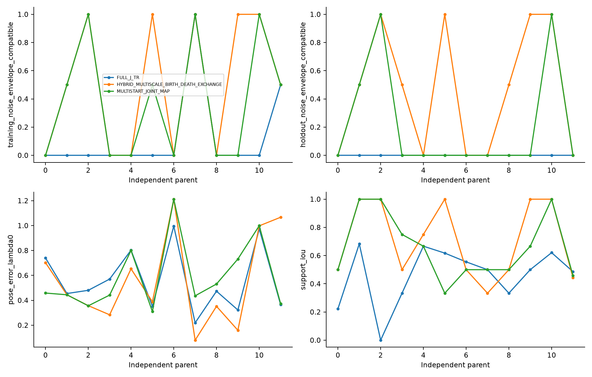
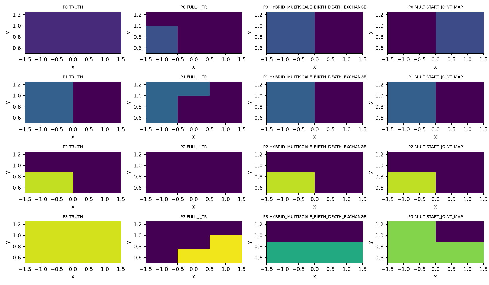
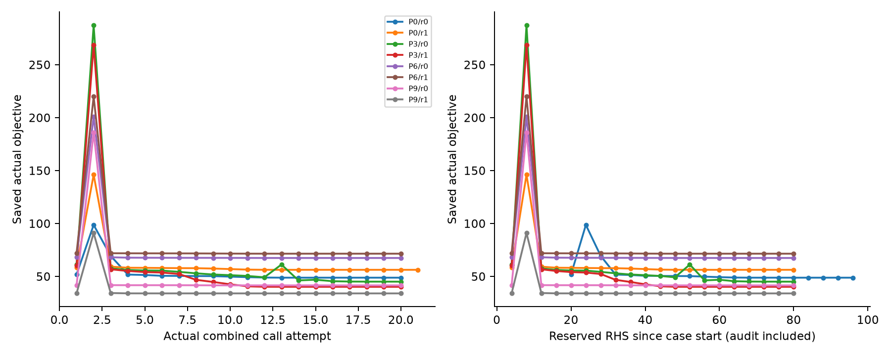
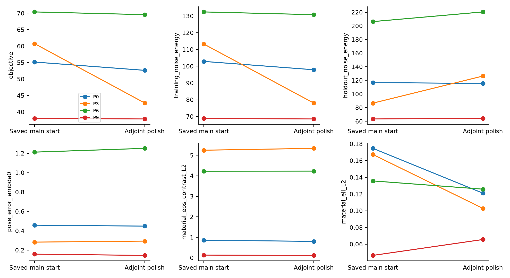
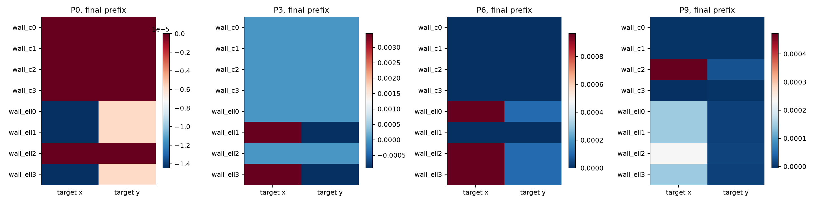
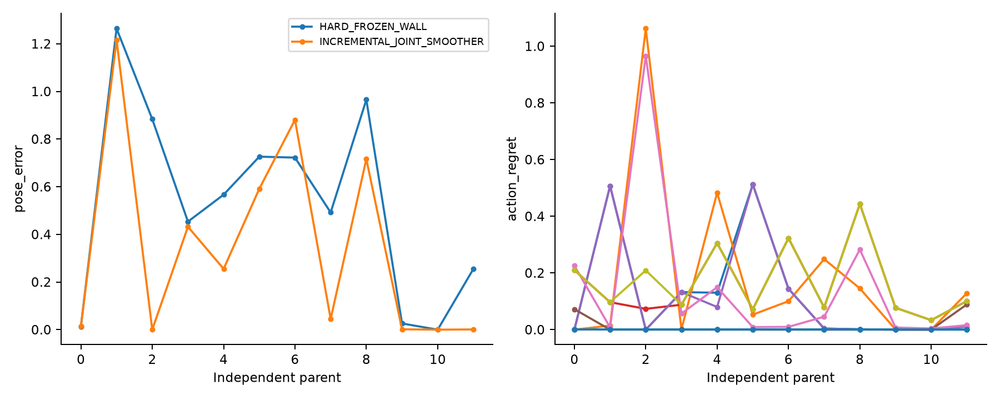
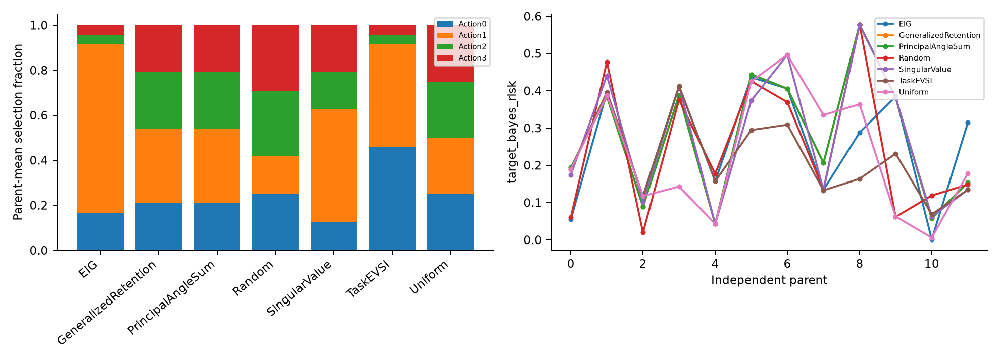

# Pilot figures / 条件试验图表

Continuous A0 and explicit finite-prior E2–E5 are different statistical experiments. All figures read saved evidence only.

量化图先在parent内平均副本；2000次配对bootstrap、seed2026102510，仅12个完整parent时显示描述性区间；不作新科学门判断。

## A0_parent_outcomes

连续A0：先在parent内平均噪声副本；训练/留出兼容、位姿误差和支撑IoU分开。缺失或失败得分不填零。

Continuous A0: repeats averaged within parent. Train/holdout envelope compatibility, pose error and support IoU remain distinct; missing/failed scores are not imputed.

Sources: results/a0/scoring/RESULTS.json, results/a0/scoring/FULL_TABLE.csv

## A0_fixed_materials

固定parent0–3、副本0：公共24×6网格上的实际真值与已选墙系数；非示意几何，不补造波场。未保存候选留空。

Fixed parents0–3, repeat0: actual selected and true wall coefficients on the public24×6 grid; no cartoon geometry or invented wave fields. Selection failures remain blank.

Sources: results/a0/scoring/RESULTS.json, inputs/offline/CONTINUOUS_TRUTHS.json

## A0_wide_matched_materials

已保存3x3扩展的离线真值与已计费候选墙系数，位于同一公共24×6网格。全部面板共用epsilon_inf1–6色标；不改写候选/不收敛状态，不生成新波场或PDE。

Saved3x3-extension offline truth and paid selected wall coefficients on the same public24×6 grid. Every panel uses the identical epsilon_inf1–6 color scale; selection/nonconvergence status is unchanged. No new wavefield or PDE.

Sources: results/a0/wide_extension/offline/TRUTHS.json, results/a0/wide_extension/parent_*_primary.npz

## A0_polish_actual_trial_objectives

可选的已知目标内禀参数普通优化诊断：绘制全部已有目标值的实际试探；缓存/失败/未付费尝试即使没有可绘点也保留在CSV。含首次原生J审核成本；初始化依赖三个主方法及共同已付费bank，不构成匹配速度比较。

Optional ordinary known-intrinsic optimization diagnostic: all saved valued trials; cached/failed/unpaid attempts remain in CSV even when no objective/RHS point exists. First native-J audit cost is included. Starts depend on all three primary arms plus the shared paid bank; no matched speed comparison.

Sources: results/a0/adjoint_polish/parent_*/ATTEMPTS.json, results/a0/adjoint_polish/RESULTS.json

## A0_polish_exploratory_pairs

固定4个parent×2副本的探索诊断，先按parent平均。分开显示目标函数、数据拟合、已暴露开发留出及离线真值误差。4簇不报告正式置信区间；不是盲测、匹配加速、新支撑搜索或重置A0预算，原三个主方法保持不变。

Fixed four-parent×two-repeat diagnostic, parent means first. Before/after objectives, data fit, exposed development holdout and offline GT errors are separate. No formal confidence interval from four clusters; no blind test, matched speed win, new support search or reset A0 budget. Original three arms remain unchanged.

Sources: results/a0/adjoint_polish/RESULTS.json, results/a0/adjoint_polish/OFFLINE_SCORES.json, results/a0/scoring/RESULTS.json

## E2_fixed_beliefs

显式有限先验参考，固定parent0/3/6/9：前缀1–3的两副本平均分布。位姿颜色为真实CC节点上的原子质量，非连续密度；不按结果选例。

Explicit finite-prior reference, fixed parents0/3/6/9: two-repeat mean distributions at prefixes1–3. Pose colors are atom masses at actual CC nodes, not continuous density; no representative selected by outcome.

Sources: results/e2e3/inference/POSTERIORS.npz, results/e2e3/finite_bank/online/FINITE_GRID.npz

## E2_wall_target_crosscov

先计算两份副本各自的有限联合后验墙–目标交叉协方差，再在parent内平均；对比度与损耗行单位不同。非局部高斯或连续后验证书。

Finite joint posterior wall–target cross covariance, averaged across the two within-parent covariances; units differ between contrast and loss rows. This is not a local-Gaussian or continuous-posterior certificate.

Sources: results/e2e3/inference/POSTERIORS.npz, results/e2e3/finite_bank/online/FINITE_GRID.npz

## E3_error_vs_CPU

有限先验最终误差对照METHOD_RESULTS规范standalone_cpu_seconds，包含各方法真实似然/参考依赖；旧派生回退会明确标注。共同11800RHS/2950LU准备另列；准备CPU只读完成的JOB_COST_FINAL wrapper收据，不使用运行中快照。不宣称在线加速或等风险优势。

Finite-prior final errors versus canonical METHOD_RESULTS standalone_cpu_seconds, including each method’s actual likelihood/reference dependence; any old derived fallback is explicitly labeled. Common11800RHS/2950LU setup is separate. SetupCPU comes only from complete JOB_COST_FINAL wrapper receipts, never in-flight snapshots. No online acceleration/equal-risk claim.

Sources: results/e2e3/inference/METHOD_RESULTS.json, results/e2e3/finite_bank/online/JOB_COST_FINAL.json

## E3_parent_hard_vs_smoother

有限先验最终离线位姿误差及相对参考动作风险，先按parent聚合。硬冻结与普通smoother作为显式对照；独立单位是12个parent，不是24份噪声。

Final finite-prior offline pose errors and reference-action regret, parent first. Hard freezing and ordinary smoother are explicit controls; all twelve independent parents, not24 independent noise cases.

Sources: results/e2e3/inference/OFFLINE_SCORES.json, results/e2e3/inference/METHOD_RESULTS.json

## E4_saved_comparison

已保存E4有限先验比较，副本及MC种子先在parent内平均。使用精确后验矩的离线投影不是可部署算法，不声称连续收敛。

Saved E4 finite-prior comparison; repeats and MC seeds averaged within parent. Offline projections using exact posterior moments are not deployable algorithms; no continuous convergence claim.

Sources: results/e4/comparison/FULL_TABLE.csv

## E5_policy_choices_risk

条件有限先验主动感知：按parent聚合的选点与目标后验风险。保留独立未来噪声，各策略共用已付费bank；仅为条件pilot，不宣称一般选点优势。

Conditional finite-prior active sensing: parent-grouped choices and posterior target risk. Independent future noise is preserved; all policies share the costly bank. These are conditional pilot outcomes, not general sensing superiority.

Sources: results/e5/finite_sensing/ONLINE_RESULTS.json

## E5_parent_GT_errors

有限先验离线目标平方误差，两副本先在parent内平均。描述性配对bootstrap以12个共同parent比较，不引入新接受门槛。

Offline finite-prior target squared error, two repeats averaged within parent. Descriptive paired bootstrap compares twelve shared parents; no new acceptance threshold.

Sources: results/e5/finite_sensing/offline/PARENT_GROUPED_GT_SCORES.json

