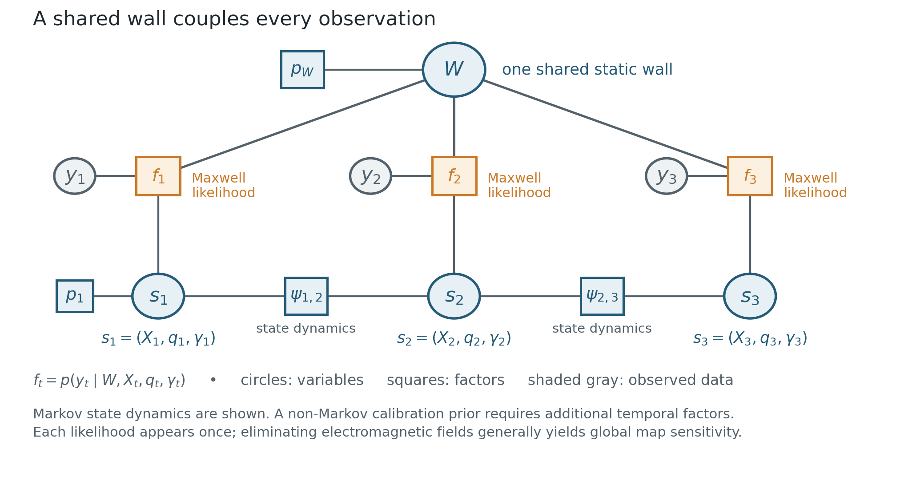
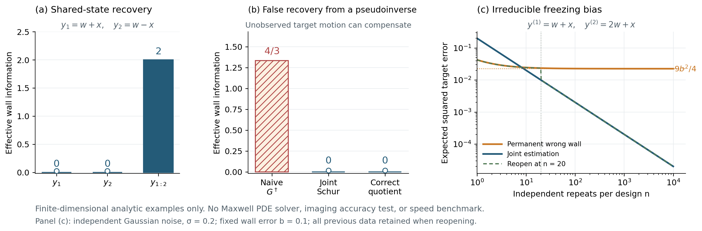

# 1 Executive Summary

**优先主线应当是范围受控的 Direction A，辅以一个最小的 Direction B 证书实验；暂缓 Direction C 端到端系统。** 最有价值的研究对象是：同一墙体扰动在不同时刻要求怎样的目标、位姿或仪器补偿；这些补偿是否与共享状态和时间动力学相容；当前计算近似若忽略这种耦合，会给目标决策造成多大误差。只有在这三层之间建立可计算、经过全波验证的联系，W-SLAM 才有机会超出普通增量平滑和已有广义可观测性理论。

本报告有六个主要结论。

1. **广义保留谱可以进入任务更新判据，但谱本身不能决定更新。** 必须同时知道当前数据创新、绝对灵敏度、墙–目标相关性和任务导数。相同 Jacobian、主角度和 Fisher 信息，可以对应任意不同的新观测残差，从而要求完全不同的地图修正。
2. **动态可辨识性来自“补偿的不相容”，而非观测次数本身。** 对每次观测分解 $A_t=B_tC_t+R_t$，在目标块可观测且动力学误差协方差为 $Q$ 时，墙体有效信息可精确写成
   $$K_{W}^{\mathrm{eff}}=R^*R+C^*D^*(Q+DG^{-1}D^*)^{-1}DC.$$
   第二项衡量维持墙体假设所需的目标补偿轨迹与运动规律的冲突。目标存在不可观测自由度时，必须先消除这些自由度；直接把 $G^{-1}$ 换成 $G^\dagger$ 会给出错误结论。
3. **可证明的是“任务计算后悔”，不是重算带来的新信息。** 同一数据对应的精确后验和精确 Bayes 风险不因重算改变。重开区域的目标是使近似决策接近这一后验的 Bayes 决策。局部 Gaussian 模型下，这种额外损失有精确公式，并可通过少量任务对偶问题给出上下界。
4. **错误永久冻结确实可以造成渐近不消失的目标偏差，但不是必然。** 只有当冻结误差通过联合响应耦合进入任务、后续设计本可辨识、先验包含真值且计算足够充分时，可回访才有条件消除该偏差。没有新信息、错误模型、遗漏先验支撑或错误局部极值，均不会因“允许重开”自动消失。
5. **完整反馈要求保留四类传播信息。** 目标域的有效算子、源驱动、接收映射和直接墙响应共同决定目标插入后的全波响应。仅保存单程 Green 函数或材料均值，通常不足以保留未来目标反馈。该物理消元是标准 Schur 结构；可研究的增量是限定任务合同下的概率压缩误差与实际计算收益。
6. **目前仍不能声称实现了未知一般墙体的测量驱动在线重建。** Research W 的 measurement-only 相容锚点没有取得；宽材料类的模式发现、后验覆盖、回访收益和计算加速均未完成。新增框架不能替代这些门槛。[W1–W7]

## 1.1 证据等级

全文使用下列标签，数学正确与文献原创性分开评价。

| 标签 | 意义 | 可以支持的主张 |
|---|---|---|
| **S 标准结果** | 文献或成熟线性代数、概率论结论 | 作为基础，不作为本项目独创 |
| **U 用户旧结果** | 已有 IS-SLAM、TriSpace、A 系列或 Research W 结果 | 必须引用旧研究，不重新计作创新 |
| **D 本报告条件证明** | 本文给出完整证明或可逐步核验的推导 | 在列明假设内成立；不自动意味着首次发表 |
| **C 待证猜想** | 尚无充分证明的研究命题 | 只能作为下一阶段目标 |
| **N 已有数值事实** | 固定仓库提交中的结果，或本次小型代数核验 | 仅限实际运行的模型与输入 |
| **H 算法假设** | 尚未运行的设计与性能预期 | 不宣称加速、校准或重建成功 |

本次实际执行的是文献与仓库核查、理论推导和两个小型 NumPy 代数验证脚本；**没有新增 Maxwell PDE 搜索、训练或三维实验**。脚本用于检验公式实现，不构成物理可行性证据。旧稿已核查的相关章节覆盖共享补偿、绝对信息单调性、保留率非单调性、运动图先验和无限维谱，因此本报告不把这些基础概念当作新发现。[U0]

# 2 Research W 已有成果与失败诊断

## 2.1 固定证据版本

本报告以两个指定 Git 提交为证据边界：`958a478739d9553269316ded8125fda9df225c0c` 中的 `research_w_p0r_to_p1`，以及 `483d260c6b5b111db9fb814b096685fccb362448` 中的 `research_w_continuation`。主要核查了中文总报告、概率合同、递进算法、任务风险、全波见证验证、带宽/孔径诊断与计算对照。[W1–W7]

| 阶段 | 已建立事实 N | 必须保留的限制 | 对 W-SLAM 的影响 |
|---|---|---|---|
| P0-Q | 高阶贴合 FEM 修复二维 scalar-TM 前向资格；已审核世界的细化差通过约定门槛 | 经验离散资格，不是连续 PDE 严格区间，更不是三维矢量认证 | 复用合格平台；新候选仍需自己的数值审计 |
| P0-R | 同一世界同一正演回放一致，材料导数和伴随核验良好；Oracle-near 拟合可达 $d_{\rm mean}<1$ | GT 支撑和近初值只说明离线容量；measurement-only 未达相容锚点 | 首要瓶颈是表示、支持探索和非凸初始化 |
| P0-B2 | 固定支撑联合见证 $d_{\rm joint}=0.798716$，目标位移 $0.1\lambda_0$ | 不是 calibration 近等价；不是宽先验无条件定理；不是在线发现 | 提供有限补偿机制种子，不能代替新测试集 |
| P1-A | 两墙 proper prior 上求积与共享 nuisance 处理成立 | 家族很小，prior 有墙–目标相关性，家族外质量未知 | 可作概率实现基准，不能作一般概率地图成功 |
| P1-B | 多假设平均在受控平方任务上优于若干硬分支点控制 | source-progressive 未超过 direct SMC；prior 均值在小 panel 上略好 | 概率表示价值与调度价值必须独立消融 |
| Green/A17 控制 | 相同 current space 中 A17 与 Galerkin 一致；普通 ROM 是强对照 | 没有完整概率推断的独立净收益 | 后端可替换，不强行加入主贡献 |

## 2.2 最重要的物理见证

两个固定墙–目标世界满足
$$d_{\rm joint}=0.798716,\quad d_{\rm cal}=3.560512,\quad\Delta x=0.1\lambda_0.$$
全波差量中，墙体变化与目标诱导增量变化的白化响应范数约为 $3.56051$ 和 $3.65662$，实化余弦为 $-0.975855$。它们的相消产生小联合差。这说明“墙体单独相近”不是“墙–目标联合相近”的必要条件。[W1,W3]

对同一固定对，宽带距离为 $7.086519$；允许第二墙重新局部优化后降至 $3.006876$。后者不是全局下界。**旧窄带和宽带的频点集合并不嵌套**，因此这些数字不能验证追加观测的单调性；中央孔径子集才是严格嵌套实验。下一轮必须显式保存旧通道并追加新通道。[W4]

真实墙背景中的 target-Born joint 距离约 $5.36859$，完整反馈距离约 $0.798716$。这里反馈是决定补偿的实际机制之一，不能用 Born 方案验证一个 Full-Maxwell 结论。[W4]

## 2.3 失败诊断应如何改变研究顺序

48×32 中心像素表示曾造成约 12–20 的白化响应误差；简单增加子像素采样仍可能不足。材料图像相似不代表相位响应相容。硬 Top-K 支撑投影也不等同于有数学定义的最小特征约束。另一方面，Oracle 拟合小于 1 又说明直接像素化误差不是表示类的全局最佳拟合下界。[W1]

需要分别回答：物理真值是否合法、逆表示是否能表达、优化器导数是否正确、measurement-only 是否能进入可行盆地、posterior 是否覆盖重要模式。后四个问题不能被第一个问题的 PASS 替代。下一轮先做合法几何与测量初始化，再做回访与后验；否则只会在错误锚点附近计算精致的置信度。

P1-B 的平方误差中 direct SMC 约 $0.00254511$、progressive SMC 约 $0.00254661$、无观测 prior 均值约 $0.00236616$。这批样本不足以证明利用数据优于强 prior，更没有证明递进调度优越。平方损失下 posterior mean 可以落在两段合法目标位置区间之间；它是决策，不是第三个物理世界。[W1,W5]

# 3 与 SLAM 的严格对应和边界

| 几何 SLAM 对象 | Maxwell 对应对象 | 可以继承的结构 | 必须重新解决的问题 |
|---|---|---|---|
| 地图、地标 | 墙体占据、材料、几何与传播状态 | 共同静态变量及后验相关性 | 体材料与波动传播，非局部多次散射 |
| 位姿轨迹 | 收发器位姿 $q_{1:T}$，以及目标状态 $X_{1:T}$ | 状态转移、锚定、gauge 处理 | 两种运动与仪器相位可能互相补偿 |
| 几何观测因子 | 复数全波测量 likelihood | 因子积与增量更新 | 每个因子可依赖几乎整张材料图 |
| 闭环 | 后期观测对早期联合解释的约束 | backward correction 与 smoothing | 触发事件是物理创新和模式冲突，不要求回到原位置 |
| 选择性重线性化 | 延迟材料块更新、重用传播与导数 | 缓存、活动集、重消元 | 需要全波误差、任务误差与成本控制 |
| 数据关联歧义 | 材料–目标联合补偿分支 | 混合/粒子与离散连续状态 | 模式发现与物理合法性，不是匹配几个几何地标 |

**S：精确 filtering 与 smoothing 的区别是所报告的随机变量，而非神奇的新信息。** 若精确 filter 保存了当前状态对未来的充分分布，其当前边缘与 batch posterior 的当前边缘相同。Smoothing 额外恢复历史状态，并避免实际近似 filter 因丢失相关性和线性化历史而无法纠错。不能笼统说 smoothing 总比任何 filtering 更准确。

iSAM2 已有流式重线性化、部分状态回代和缓存因子复用；NF-iSAM 已处理非 Gaussian 和多模态联合后验。2026 年 information-guided gating / selective partial optimization 又进一步接近本项目的计算选择问题。[S1–S3] 因而 “能回访”“保存相关性”“使用混合后验”都不应单独写成原创贡献。

## 3.1 四种稀疏性不能互换

有限元的 $L$ 通常有局部连接，这是 **PDE 离散稀疏性**。材料导数却包含
$$D_WF[h]=-ML^{-1}(D_WL[h])E,$$
即使 $D_WL[h]$ 局限于一个单元，$L^{-1}$ 也把变化传播到全场。消去场后的材料 Jacobian 一般是全局的，$J^*J$ 也不因 $L$ 稀疏就局部稀疏。

图优化稀疏性取决于每个观测因子实际连接哪些未知量；低秩消息或局部近似带来的节约则是第四件事，必须有误差和秩增长账本。保留场变量可使约束表达局部化，但消元可能产生稠密 Schur 补，且每次观测增加大量场未知量。iSAM2 的低复杂度条件不能原封不动继承到 Maxwell 地图。[S1]

# 4 文献与原创性审计

检索截止日期为 2026 年10月24日（UTC）。以下矩阵给出直接相关先例；“尚未解决”限于所核查模型与论证范围，不代表整个领域不存在对应成果。具体阅读范围和出处见参考文献及附带 `Literature_Audit.md`。

| 已有方法 | 已知结果 | 本问题仍需解决之处 | 可能超越之处 | 决定性验证 |
|---|---|---|---|---|
| iSAM2 [S1] | 增量因子分解、选择性重线性化、部分回代 | 不提供一般全波材料任务误差证书 | Maxwell 对偶残差和反馈余项下的任务预算 | 同后验精度、同输入对比变量阈值策略 |
| IGG/SPO 2026 [S2] | logdet 门控及动态活动集，保留测量 | 单纯曲率不能控制任意创新引起的任务偏移 | 同时利用创新方向与任务导数 | 固定信息矩阵、改变创新的压力测试 |
| NF-iSAM [S3] | 非 Gaussian、多模态联合增量推断 | Maxwell 全局因子和宽材料模式覆盖 | 物理模式发现、任务约束压缩 | direct joint posterior、模式质量及成本 |
| Li 等 2024 [S4] | 多地图特征 BP，位姿与反射/点散射特征联合估计 | 路径特征不等于体材料全波场 | 完整材料反馈与目标补偿 | 相同场景路径模型失配和全波对照 |
| Li 等 2026 [S5] | RF occupancy、反射系数、保留 cell dependencies 的 forward sensor model、prior map refinement | 表面候选路径模型并非任意体材料 Maxwell posterior | 材料参数、近场/多次反馈及任务相关性 | 同等先验下对比可恢复量 |
| Thrun forward occupancy [S6] | 已打破独立 cell 假设，联合估计相关占据图 | 未建立体介电材料和墙–目标补偿模式后验 | 材料物理与模式级任务相关性 | 与相关 occupancy 对比；独立边缘只作弱消融 |
| Abugattas 等 2025 [S7] | 已知分层背景中的标量纵向 P-wave 形状/材料反演，Laplace/MCMC UQ，数值误差讨论 | 不是 Maxwell 未知墙–运动目标–位姿全联合 | 时序耦合及未知支持 | 扩大合法材料类，独立 posterior reference |
| de Lima 等 2024 [S8] | Bayesian time-lapse FWI，以 baseline posterior 的 Gaussian 近似作为 monitor prior | 不是固定墙的计算回访证书 | 区分真实材料变化、估计修正与任务延迟 | 静态墙、变墙和模型失配三组控制 |
| Ghorbani–Soleimani [S9] | 墙/目标参数同步 DNN 回归 | 固定问题类别的回归不等于联合校准后验 | 宽支持物理模式与合法概率质量 | 家族外材料及后验覆盖 |
| TWR TAP/TIM [S10,S11] | Protiva TAP 估计墙厚与介电率；Yao TIM 同时估计墙参数和目标位置 | 复杂未知体材料、可回访概率状态；两篇本轮仅核原始摘要与元数据 | 完整非线性补偿和可信计算预算 | 取得全文后按其合同复现，另含成熟联合 FWI 基线 |
| Watson 等 2024 [S12] | 任意近似已知墙的全波传播、ROM、nuisance variable projection | 目标侧使用校正 Green 的 Born 模型 | 强目标反馈、未知材料图和多模态 | 有限强目标下 forward mismatch 与风险 |
| Huai 等 2019 [S13] | GPR model-based layer stripping，阶梯频率顺序会回访浅层 | 不是按 posterior 任务证书调度 | 非深度排序的可量化任务预算 | 普通可回访层析必须成为基线 |
| Goal-oriented Bayesian inversion/OED [S14–S16] | QoI 低秩近似、目标设计、2026 风险感知 OED | 一般思想已成熟 | Maxwell 补偿模式被新测量重新优化后的价值 | nested acquisition 与重新补偿控制 |
| Bayesian PDE approximation/online inference [S17,S18] | forward 误差到 posterior、SMC 更新等 | 成本高，稳定常数和高维模式覆盖困难 | 全波可用证书与端到端节省 | 同概率容差 direct inference 对照 |
| PDE flow matching 2026 [S19] | 近似后验、TV/KL 估计及 Metropolis 校正 | 不保证未知墙的模式发现与零摊销成本 | 只能在本任务证明独立收益 | teacher、训练、校正、fallback 全计费 |

## 4.1 必须修正的两种叙述

“现有 layer stripping 都永久冻结”不成立。Huai 等的 stepped sequence 已重新访问浅层；应区分一次剥离、逐层初始化、窗口化梯度和可回访层析。[S13]

“第一次把 SLAM 用在电磁或概率地图”也不成立。RF/multipath SLAM、RF occupancy、非 Gaussian smoothing 与未知墙参数成像均有明确先例。真正尚值得争取的，是具体 Maxwell 材料补偿、任务条件可辨识性和可验证计算误差的组合。

## 4.2 2026 年近邻工作带来的额外约束

Risk-Aware Goal-Oriented Bayesian OED 已将预测不确定性、空间风险和数据集风险组合；Flow Matching for Fast Posterior Sampling 已给出 PDE posterior 的精度估计和 Metropolization；IGG/SPO 已把信息门控与选择性优化结合。[S2,S16,S19] 不能把这些通用操作作为本研究独立新点。

本报告不接受“未检到相同标题，所以原创”的证明方式。论文创新应落到明确命题及其条件、一个标准方法无法保证的误差量，以及公平成本曲线。

# 5 完整 Maxwell 时序联合模型

## 5.1 物理状态与时间约定

采用 $e^{-i\omega t}$，各向同性、非磁示例中
$$\epsilon_r(r,\omega)=\epsilon_\infty(r)+i\frac{\sigma(r)}{\epsilon_0\omega},\qquad \sigma(r)\ge0.$$
频带较宽时可换成被动 Debye/Lorentz 参数，但同一材料在各频率共享物理参数，不能独立调整各频率的复介电率来制造补偿。

三维连续方程为
$$\nabla\times\mu^{-1}\nabla\times E-\omega^2\epsilon E=i\omega J_s,$$
并满足界面条件、相应散度约束及出射条件。二维验证使用其特定不变方向下的 scalar-TM 约化。所有结论必须写清适用的是连续方程、合格离散模型还是局部线性模型。

定义 $s_t=(X_t,q_t,\gamma_t)$，观测设计 $a_t$ 包含频率、源接收位置、极化和时刻。离散物理写成
$$L_{t,\omega}(W,X_t)E_{t,\omega}=b_{t,\omega}(q_t,\gamma_t),$$
$$F_t(W,s_t;a_t)=M_t(q_t,\gamma_t)E_t+d_t(\gamma_t),\qquad y_t=F_t+n_t.$$
若目标移动在单次采集期间不可忽略，应使用时变波动/Doppler 模型；以下逐时刻静态正演以 start-stop 近似有效为条件。墙体与目标的空间归属由先验或状态模型规定，不能将同一物理体积重复计为两个独立材料。

静态墙写作 $W$。$\widehat W_t$ 或 $p_t(W)$ 随证据变化不是物理 $W_t$ 随时间变化；真实变墙必须另设转移 $p(W_t\mid W_{t-1})$。

## 5.2 因子分解

在已声明的条件独立关系下，
$$\begin{aligned}
p(W,s_{1:T}\mid y_{1:T},a_{1:T})\propto{}&p(W)p(X_1,q_1,\gamma_1)\\
&\times\prod_{t=2}^T p(X_t,q_t,\gamma_t\mid X_{t-1},q_{t-1},\gamma_{t-1},W)\\
&\times\prod_{t=1}^T \ell_t(y_t\mid W,s_t,a_t).
\end{aligned}$$
只有在运动、仪器和墙体确实先验独立时，才进一步拆乘。未知静态目标用单一 $X$，不人为创造 $T$ 个独立目标；未知固定目标材料也在多时刻共享。静态仪器 gain 应是同一变量，漂移则用相关过程。

因子图可由以下关联表精确定义；每个 $\ell_t$ 对整个墙图的依赖必须保留。

| 因子 | 相邻变量 | 语义 |
|---|---|---|
| $f_W$ | $W$ | 材料、几何和拓扑 prior |
| $f_{s,1}$ | $X_1,q_1,\gamma_1$ | 初始状态与绝对参考 |
| $f_{{\rm dyn},t}$ | $s_{t-1},s_t$，必要时 $W$ | 目标/平台/仪器转移 |
| $f_{y,t}$ | $W,X_t,q_t,\gamma_t$ | 全波数据 likelihood |
| $f_{{\rm aux},t}$ | 相应位姿/时钟状态 | 独立获得的导航或校准信息 |



图结构不意味着消去电磁场后材料信息矩阵局部稀疏。一般非 Markov 仪器相关性必须由额外高阶因子或等价状态扩展表达。

## 5.3 实化、白化与相关噪声

令 $y^{\mathbb R}=(\Re y,\Im y)$，用真实协方差 $\Sigma$ 白化。Research W 的 $0.01$ 是每个实/虚分量的标准差；240 个复数对应480个实分量，白化均值距离不除以维数。[W2]

若噪声跨时间相关，正确顺序似然为
$$p(y_{1:T}\mid\theta)=\prod_t p(y_t\mid y_{1:t-1},\theta).$$
Gaussian 条件创新为
$$\bar r_t=r_t-\Sigma_{t,<t}\Sigma_{<t,<t}^{-1}r_{<t},$$
协方差为相应 Schur 补。不能先假设各时刻独立后再局部白化；那会改变统计模型。模型误差也应与仪器噪声区分，必要时作为有相关性的 discrepancy 状态。

## 5.4 场作为辅助变量

确定性场应以正规化条件测度
$$p(dE\mid\theta)=\delta_{L(\theta)^{-1}b(\theta)}(dE)$$
引入，再乘一次测量 likelihood。形式上写 $\delta(LE-b)\,dE$ 时必须补相应实化 Jacobian 行列式；否则会无意中改变材料先验权重。给 PDE 残差另加 Gaussian 罚项，则已经引入模型误差或扩展状态模型，必须声明其方差和物理意义。

独立 current proposal 只有满足材料 constitutive relation 和全波方程后才是合法世界。增加 latent variables 可能改善预条件和局部计算，也可能使内存与消元更昂贵；不能以维数增加本身推断加速。

# 6 先验 概率测度与物理可行性

## 6.1 表示选择

| 表示 | 优点 | 主要限制 | 本轮用途 |
|---|---|---|---|
| 独立 occupancy voxel | 简单、易做小型枚举 | 强行独立，难保留结构与相关性 | 负控制，不作为最终联合表示 |
| 相关 occupancy/region | 拓扑可变，prior 明确 | 组合空间大，normalizer/跳变需处理 | 小参考及中等维主候选 |
| Level set | 连续边界，形状导数自然 | 拓扑变换处不光滑，解码先验需明确 | 固定拓扑局部核验；拓扑 birth 独立提案 |
| 多分辨率树/自适应网格 | 区域聚合与细化 | 更换表示不能偷偷改变 prior | 用概率保持的 split/merge 或显式模型选择 |
| 连续/隐式 latent field | 表达力强 | 密度与覆盖难审计，decoder 与 Maxwell 双重非线性 | 后续可替换 proposal |
| 离散拓扑加连续材料 | 可解释模式和条件密度 | 模式数增长，需要 RJ/SMC 等合法转移 | 推荐低维概率参考 |

材料状态可以写为 $W=(z,\epsilon_\infty,\sigma,\mathcal G)$，但要避免重复参数化：若 $z=0$ 强制空气，则该处未使用的材料参数要积分掉或明确采用固定辅助 prior，不能因空气中任意参数的体积而偏置 evidence。

## 6.2 proper prior 与坐标变换

有限模型中，离散拓扑采用计数测度，连续参数采用 Lebesgue 测度；$p(z,\alpha)$ 必须可正规化。若 $\epsilon_\infty=\epsilon_{\min}+\operatorname{softplus}(u)$，概率密度必须按选择的参考坐标定义，变换时计入 Jacobian。优化正则项和算法 LM 阻尼不能自动当作统计 prior。

对于无限维材料，使用可定义的概率测度 $\mu_0$，后验相对 prior 的 Radon–Nikodym 导数为
$$\frac{d\mu^y}{d\mu_0}(W,s)=Z(y)^{-1}\exp[-\Phi(W,s;y)].$$
网格加密时必须检查 prior 的离散一致性，不能在每个新 voxel 上沿用相同独立方差而声称得到同一个连续 prior。[S17]

## 6.3 gauge 与外部锚定

在均匀背景、没有外部位置参考且所有物体与传感器共同变换时，整体平移/旋转可能不改变相对数据。未知相位和路径长度也可能产生局部混淆。应在 quotient 上做谱和协方差，或用真实外部信息锚定。

人为固定某个坐标是 gauge choice，不等于测量提供了该方向的信息。PML 网格边界也不能被当作现实中的位置参考。目标材料和 pose 同时未知时，必须把全部可补偿 nuisance 一起放进 Schur 块，不能只消除容易处理的几个参数。

## 6.4 数据相容的正确门槛

$\|F(\theta_1)-F(\theta_2)\|_{\Sigma^{-1}}\le1$ 是两个无噪声均值的近等价合同；$\|y-F(\theta)\|_{\Sigma^{-1}}\le1$ 不是高维含噪数据的通用拟合门槛。对已知真参数、正确 Gaussian 噪声，后者平方服从与实观测维数相关的 $\chi^2$；对从同数据估计的参数不能机械沿用相同自由度。

下一轮在线接受标准使用预注册 posterior predictive 检查、独立留出通道或校准过的 discrepancy rule；无噪声均值距离和 truth 误差仅由隔离评价程序计算。不得让算法读取 GT 决定何时停止。

# 7 Principal angles 与 generalized eigenvalue 理论

本节是 **S/U 基础的重新证明**。取实化白化后的局部模型
$$\delta y=A\delta W+B\delta u+n,$$
其中 $u$ 包含本次需要消去的目标、pose、仪器或历史状态。暂不加这些变量的 prior。

## 7.1 奇异材料信息上的正确定义

本小节先讨论有限维模型。令 $K_0=A^*A$，在 $\mathcal H_W/\ker A$ 或有效支撑 $\mathcal S=\operatorname{Ran}K_0$ 上工作；无限维非闭值域需要将最小值改为下确界，见7.5。定义
$$U_A=A(K_0|_{\mathcal S})^{-1/2},\qquad U_A^*U_A=I_{\mathcal S}.$$
它是从材料的响应范数坐标到 $\operatorname{Ran}A$ 的等距映射。最小化 nuisance 更新得到
$$\min_u\|Aw+Bu\|^2=\|(I-P_B)Aw\|^2,$$
故
$$K_{\rm eff}=A^*(I-P_B)A,\qquad
\mathcal R=K_0^{-1/2}K_{\rm eff}K_0^{-1/2}=I-U_A^*P_BU_A.$$
所有逆均限于 $\mathcal S$。在原空间对 $K_0=0$ 的方向，广义特征值是未定义，而不是任意赋值为0或1。

取正交基 $Q_A,Q_B$，$Q_B^*Q_A$ 的奇异值为 $\cos\theta_i$。因为 $U_A$ 与 $Q_A$ 只差单位变换，$U_A^*P_BU_A$ 与 $Q_A^*Q_BQ_B^*Q_A$ 同谱，所以
$$\boxed{\rho_i=\sin^2\theta_i.}$$
当 $r_A>r_B$ 时补入 $r_A-r_B$ 个零奇异值，即补入 $\rho=1$。因此
$$\boxed{\mathcal O(A,B)=r_A-\|Q_B^*Q_A\|_F^2
=\sum_{i=1}^{r_A}\rho_i.}$$
这个和按单位响应方向计量；缩小所有 $A$ 的幅值可以让原始信息趋近零，同时完全不改变角度。它不是材料概率，也不是绝对成像质量。

## 7.2 受影响方向与完全丢失方向

$$K_0-K_{\rm eff}=A^*P_BA,\qquad
\operatorname{rank}(K_0-K_{\rm eff})\le\operatorname{rank}B.$$
另一方面，
$$\operatorname{rank}K_0-\operatorname{rank}K_{\rm eff}
=\dim(\operatorname{Ran}A\cap\operatorname{Ran}B).$$
证明来自 $\ker K_{\rm eff}=\{w:Aw\in\operatorname{Ran}B\}$，再对 $\ker A$ 取 quotient。第一式计入部分信息损失，第二式只计完全不可分辨维度。一个非零但很小的 $\rho$ 不应被称为 exact nullspace。

## 7.3 nuisance 已消元及参数度量

若还有自由 nuisance $G\delta\gamma$，先取 $A'=P_{G^\perp}A$、$B'=P_{G^\perp}B$，并在 $G^\perp$ 的正交坐标中重新白化。随后对 $(A',B')$ 使用上述定理，与一次投影到 $\operatorname{Ran}[B,G]^\perp$ 一致。带 prior 的消元通常产生非幂等收缩，不能继续当作普通正交投影。

若材料和目标使用度量 $M_W,M_u$，先用等距坐标 $w'=M_W^{1/2}w$ 等转换，响应算子成为 $AM_W^{-1/2}$。非奇异参数变换不改变响应子空间及一致变换后的广义特征值，但会改变材料单位球与普通奇异值。有限元质量矩阵不能省略，否则网格加密本身会改变“单位材料扰动”的意义。

## 7.4 Gaussian prior

对于独立目标 prior 精度 $\Lambda_u\succeq0$，
$$K_{W\mid u}=A^*A-A^*B(B^*B+\Lambda_u)^\dagger B^*A.$$
这来自
$$w^*K_{W\mid u}w=\min_u\{\|Aw+Bu\|^2+u^*\Lambda_u u\}.$$
在有限维半正定情形，正规方程右端满足相应 range 条件；若推广到无限维，仍需检查闭值域和可达性。于是
$$A^*(I-P_B)A\preceq K_{W\mid u}\preceq K_0.$$

**一般此时 $\rho$ 只是相对信息保留率。** 当 $\Lambda_u=0$，或 prior 对所有相关补偿方向不起作用时，才恢复数据空间裸主角度结论。也可在增广空间中定义
$$\bar A=\begin{bmatrix}A\\0\end{bmatrix},\quad
\bar B=\begin{bmatrix}B\\\Lambda_u^{1/2}\end{bmatrix};$$
增广角度有数学意义，但必须说明其中包含先验约束，而不是原测量响应的夹角。

墙体 prior $\Lambda_W$ 应另加入 posterior Schur 精度。若 joint prior 含 $\Lambda_{Wu}$，应从完整 $H=J^*J+\Lambda$ 消元；不能沿用只带独立 $\Lambda_u$ 的裸公式。prior-only 墙方向仍有后验不确定性，不会因为做角度 quotient 就从推断问题消失。

## 7.5 无限维与离散极限

有界算子 $A:\mathcal H_W\to\mathcal Y$ 的 polar decomposition 为 $A=U_A|A|$。在 $\overline{\operatorname{Ran}A^*}$ 上，几何保留算子为
$$\mathcal R_{\rm geom}=U_A^*(I-P_{\overline{\operatorname{Ran}B}})U_A.$$
若 $\operatorname{Ran}B$ 不闭，投影描述的是 nuisance 可逼近到任意精度的闭包，未必有有限范数 nuisance 真正达到最小值。交集为零也不保证稳定横截；两个子空间可无限接近，保留算子下界仍为零。[U0]

无限维谱未必是一串离散 principal angles；$\operatorname{tr}\mathcal R$ 常常发散。可使用有限 retained 子空间，或 trace-class 的 prior/任务权重。离散角度收敛需要算子一致性、质量度量一致性、可辨识支撑的谱隙及 uniform stability。只看越来越细网格上的小奇异值不构成连续可辨识性证明。

# 8 多次观测的 Schur 信息与动态可观测性

## 8.1 五种状态共享方式

| 情形 | nuisance 结构 | 核或有效信息的含义 |
|---|---|---|
| 每次独立目标 | $B=\operatorname{diag}(B_1,\ldots,B_T)$ | $K_{\rm eff}=\sum_t A_t^*P_{B_t^\perp}A_t$；核为各次混淆墙方向的交 |
| 同一静止目标 | $B=[B_1^*,\ldots,B_T^*]^*$ | 必须由同一个 $u$ 同时补偿；不能逐次独立挑补偿 |
| 动态目标 | 块对角 $B$ 加运动精度 $D^*Q^{-1}D$ | 补偿轨迹必须支付动力学代价 |
| 目标和平台均未知 | $B_t$ 同含 $D_XF_t,D_qF_t$ | 对相对几何的混淆和共同 gauge 必须一起处理 |
| 跨时刻相关相位/gain | 共享变量或 drift prior | 不可每时刻单独 profile/边缘化后再假装共享 |

单次各自完全混淆，不代表共享联合模型仍完全混淆。例如 $y_1=w+x$、$y_2=w-x$，每次 Schur 信息为0，共享 $x$ 时联合墙信息为2；若把 $x_1,x_2$ 当独立未知，则仍为0。这个例子是线性反例，不是 Maxwell 物理见证。

独立目标情形虽然各次有效信息矩阵相加，但归一化分母 $K_{0,T}=\sum_tA_t^*A_t$ 也改变。不能把每次 $\sum_i\sin^2\theta_{i,t}$ 相加当成联合保留谱。

## 8.2 D1 动力学补偿分解

**假设。** 固定线性化点；白化测量独立；$B$ 按时刻块对角；$G=B^*B\succ0$；运动残差线性化为 $Dx$，协方差 $Q\succ0$。暂不加入墙 prior。定义
$$C=B^\dagger A,\qquad R=A-BC,\qquad B^*R=0.$$
则
$$\boxed{K_W^{\rm eff}=R^*R+C^*D^*(Q+DG^{-1}D^*)^{-1}DC.}\tag{D1}$$

**证明。** 有效二次型为
$$\min_x\{\|Aw+Bx\|^2+\|Q^{-1/2}Dx\|^2\}.$$
令 $e=x+Cw$，利用 $B^*R=0$，变成
$$\|Rw\|^2+\min_e\{e^*Ge+\|Q^{-1/2}(De-DCw)\|^2\}.$$
对 $e$ 解正规方程并用 Woodbury 恒等式，第二项等于
$(DCw)^*(Q+DG^{-1}D^*)^{-1}DCw$，得证。

因为两个矩阵项半正定且中间权重正定，
$$\ker K_W^{\rm eff}=\ker R\cap\ker(DC).$$
若 $D$ 表示 $x_{t+1}-F_tx_t$，则 $DCw$ 正是“各次抵消墙扰动所需目标轨迹”违反运动方程的量。此分解使实验可以分别测量单次不可补偿响应与跨时刻补偿冲突。

两次 scalar 情形，$A_t=B_tc_t$、$g_t=|B_t|^2$、$Dx=x_2-fx_1$、运动方差为 $q$，有
$$\boxed{K_W^{\rm eff}=\frac{(c_2-fc_1)^2}{q+f^2/g_1+1/g_2}.}\tag{D1s}$$
补偿系数完全顺应动力学时无恢复；运动不确定性越大，该贡献越小。有限 $q$ 下的提升包含运动 prior，不等于纯测量带来的全局唯一性。硬共享状态可直接参数化消去动力学约束；$Q\to0$ 时需在可行子空间上取极限。

**原创性判断。** 这是本报告给出完整证明的专门化恒等式。它继承用户旧 variational Schur 和 motion graph prior，不能只靠公式本身作为新 TAP 定理。[U0]

## 8.3 D2 目标不可观测自由度的正确消元

若 $B$ 非单射，取 $N$ 为 $\ker B$ 的正交基，$V$ 为其正交补基。设
$$G_r=V^*B^*BV\succ0,\qquad P=I-P_{Q^{-1/2}DN},$$
$$\widetilde D=PQ^{-1/2}DV,\qquad \widetilde C=PQ^{-1/2}DC.$$
则
$$\boxed{K_W^{\rm eff}=R^*R+\widetilde C^*(I+\widetilde D G_r^{-1}\widetilde D^*)^{-1}\widetilde C.}\tag{D2}$$
其核为
$$\boxed{\{w:Rw=0,\ DCw\in\operatorname{Ran}(DN)\}.}$$

**证明。** 在上一证明中写 $e=Vv+Nn$。数据只惩罚 $v$；先对 $n$ 最小化运动残差，相当于投影 $P$，再对 $v$ 完成二次配方即得。目标当前不可见的分量可以改变后续可见轨迹，因此不能跳过第一步。

**明确反例。** 取 $B_1=B_2=[1,0]$，$A_1=1,A_2=-1$，动力学矩阵
$$F=\begin{bmatrix}1&1\\0&1\end{bmatrix}.$$
指定 $D=[-F,I]$、$Q=I$。当 $w=1$ 时，可取 $x_1=(-1,2)$、$x_2=(1,2)$。两次数据补偿和 $x_2-Fx_1$ 都为零。错误地在 D1 中代入 $G^\dagger$ 会得到 $4/3$ 的虚假信息；正确 joint Schur 为零。本次脚本已核验该反例。

## 8.4 D3 新观测的条件信息创新

在固定线性化下，旧联合二次型 $H\succeq0$ 的块为 $H_{ww},H_{wu},H_{uu}$，其中 $H_{uu}\succ0$，旧墙 Schur 为 $S$。新白化因子为 $Aw+Bu$，且不创造未处理的新自由变量。若 $S$ 奇异，下面是二次型恒等式，不将其解释为 proper Gaussian 边缘协方差的逆。定义
$$C_n=A-BH_{uu}^{-1}H_{uw},\qquad
V_n=I+BH_{uu}^{-1}B^*.$$
则
$$\boxed{S_+=S+C_n^*V_n^{-1}C_n.}\tag{D3}$$

证明可由旧条件分布 $u\mid w$ 积分得到：新数据对 $w$ 的条件均值导数为 $C_n$，条件噪声为 $V_n$。也可直接对更新后的块矩阵做 Schur 消元。该式说明新增观测必须针对**旧后验中仍可补偿的条件方向**，不能仅看新墙 Jacobian $A$。

设 $N_S$ 张成旧墙核，则恢复的独立维数为 $\operatorname{rank}(C_nN_S)$。新增目标状态时，要先按真实状态转移形成 predictive conditional，再应用该式；不能假定新状态精确已知。此式是 S/U 增量信息理论的重新表达，不另行申新。

## 8.5 时间谱与 rank events

在同一固定线性模型、正确共享变量和新增独立数据下，Schur 绝对信息不减。归一化保留率不必不减：旧观测 $y_1=w$ 给 $K_0=K_{\rm eff}=1$；新增 $y_2=w+u$、$u$ 自由后，$K_0=2$ 而 $K_{\rm eff}=1$，故 $\rho:1\to1/2$。信息没有丢失，只是分母增加了可被 nuisance 完全解释的响应。

非线性重线性化后 Jacobian、局部基点和后验模式均变化，更不能要求所有估计谱单调。对有固定谱隙的谱簇，其 projector 可连续跟踪，选择水平规范
$$U^*\dot U=0,\qquad\dot U=\dot P\,U.$$
谱交叉时跟踪整个簇，不强行匹配单根特征向量；秩增减时重建 quotient 和基，保存新旧投影的对齐关系。材料单元坐标的物理含义不应随任意 basis sign/rotation 改变。

离散在线系统更适合事件驱动：检测谱隙闭合、可信支撑变化或近似 projector 误差超预算后重新构基。rank-adaptive TSOM 是计算截断工具，不能以丢掉弱方向的方式制造 posterior certainty。

# 9 概率地图与材料–目标相关性

## 9.1 三种不同的不确定性

材料不确定性用 $P(z_i=1\mid y)$、条件材料分布、几何事件和区域积分表示。耦合不确定性由墙–目标–pose–gain 的联合方向与 cross-covariance 描述。任务不确定性则由指定损失下的 posterior 决策风险刻画。

例如某远离目标传播端口的区域可以有很大的材料方差，但对当前目标位置几乎无影响；相反，薄层传播相位的小不确定性可能与目标距离强耦合。谱只能描述后一种耦合的局部结构，不能直接给出 voxel 的存在概率。

只存 occupancy marginals 的反例：$p_1$ 在 $(W_1,W_2)=(0,0),(1,1)$ 上各有一半质量，$p_2$ 在 $(0,1),(1,0)$ 上各有一半质量。两者每个 voxel 的占据概率都是 $1/2$，但异或任务在第一种分布恒为0、第二种恒为1。它是概率论反例，说明丢弃相关性可能完全改变任务；并非声称这些四张图已构成 Maxwell 等价世界。

## 9.2 D4 从联合精度到任务协方差

对 gauge 已处理的 Gaussian posterior $N(m,H^{-1})$，令 $u$ 包含墙以外和其他开放变量，线性任务为 $Z=C_ww+C_uu$。设
$$S=H_{ww}-H_{wu}H_{uu}^{-1}H_{uw},\qquad
T=C_w-C_uH_{uu}^{-1}H_{uw}.$$
由 Gaussian 条件分布和全协方差公式，
$$\boxed{\operatorname{Cov}(Z)=C_uH_{uu}^{-1}C_u^*+TS^{-1}T^*.}\tag{D4}$$
第一项是假设墙已知后的条件任务方差；第二项是墙体不确定性经联合相关性传递到任务的贡献。它是谱与任务概率之间的正确桥梁之一。

在 $K_0\succ0$ 的固定有限维子空间上，只有在独立墙 prior 恰为 $\Lambda_W=\alpha K_0$ 等特殊条件下，才有逐谱表达。这里 $v_i$ 明确定义为归一化算子 $\mathcal R=K_0^{-1/2}K_{\rm eff}K_0^{-1/2}$ 的欧氏正交特征向量，原材料广义特征向量为 $K_0^{-1/2}v_i$：
$$\operatorname{tr}(MTS^{-1}T^*)=\sum_i\frac{\|M^{1/2}TK_0^{-1/2}v_i\|^2}{\alpha+\rho_i}.$$
一般 prior 应保留完整矩阵，不能逐个 $\rho_i$ 随意赋概率权重。总体 $K_0$ 奇异时，kernel 与可观测方向之间的 prior 相关性应通过完整联合精度处理；不能一般性地机械追加独立的 prior-only 方差。

## 9.3 为什么 entropy 不能独立决定更新

取两个独立不确定量 $U,V$，任务只依赖 $V$。大幅减少 $U$ 的 entropy 可以让总信息增益很大，却不改变任务风险。即使两个设计对 $V$ 有同样方差下降，若任务是罕见占据事件而非平方位置误差，它们的决策价值也可能不同。[S14–S16]

还要区分 posterior covariance 和 frequentist 误差：错误模型或遗漏分支下，局部 covariance 很小不代表校准良好。应同时报告 posterior predictive 检查、分支质量、独立模拟覆盖与条件/边缘 covariance。

# 10 Hard freezing 的偏差与反例

## 10.1 D5 永久错误冻结的渐近偏差

考虑两类测量各持续获取同等数量的独立重复：
$$y^{(1)}=w+x+n_1,\qquad y^{(2)}=2w+x+n_2.$$
噪声均值为0且方差有限，设计矩阵满列秩。完整联合最小二乘在重复数增加时恢复 $(w_*,x_*)$。若永久令 $w=w_*+b$，受限最小二乘满足
$$\widehat x_{\rm frozen}\longrightarrow x_*-\frac32b,$$
因此目标平方偏差收敛到 $9b^2/4$，不会被更多同类独立噪声重复消除。

**证明。** 两类残差均值分别为 $-b-(x-x_*)$ 和 $-2b-(x-x_*)$；对两者平方和求导，得到 $x-x_*=-3b/2$。完整联合估计则因设计满秩与大数定律一致。一般线性式中，若 $B$ 满列秩，或固定 gauge 后满足等价条件，错误冻结墙增量 $b$ 造成开放目标偏差
$$\operatorname{bias}(\widehat u)=-(B^*B)^{-1}B^*Ab.$$

这个命题证明“错误约束可制造不可消除偏差”，没有证明任意 Maxwell 墙都满足该设计，也没有证明任意可回访优化器能找到正确盆地。

## 10.2 何时重开无效或冻结无害

如果始终只有 $y=w+x$，存在精确非唯一性；重开只是恢复这份不确定性，不会自动获得真值。如果冻结值正确、$B^*Ab=0$、任务与偏差无关，或任务另有充分独立测量，则错误地图也未必影响当前任务。若 prior 排除了真实墙、动力学不正确、仪器漂移未建模或优化仍停在坏盆地，重开也不保证恢复。

永久冻结、有限精度 prior 和延迟计算应严格区分。后两者可以吸收新证据；前者相当于加入无限精度约束。某时刻边缘 posterior 集中不是永久固定的充分理由，因为之后的条件创新可通过 cross-covariance 改变其均值和模式。

## 10.3 新观测不保证每次条件风险都下降

在正确概率模型和可忽略新数据的决策类中，观测前平均 Bayes 风险不增加。对某个具体意外观测，posterior 可能从一个窄模式变成两个分支，条件方差反而上升。应评价预期风险或完整随机测试集，而不是要求每次地图置信区间都机械缩小。

# 11 Soft freezing 与 Reopen 的数学判据

## 11.1 D6 精确局部二次冻结损失

定义同一数据下的计算后悔
$$\mathfrak e_t(a)=E_{p_t}L(a,Z)-\inf_bE_{p_t}L(b,Z).$$
以下 D6–D8 对真实 Gaussian posterior 精确，或对明确指定的局部 Gaussian 近似 $q_t$ 精确；后一种情况记为 $\mathfrak e_F^{\rm LG}$，不直接等同于真实非 Gaussian 后验的后悔。设其负对数密度为
$$Q(\delta)=\frac12\delta^*H\delta-g^*\delta+\mathrm{const},\qquad H\succ0.$$
$H$ 必须是所声明 Gaussian 分布的精度。若 LM 阻尼不是统计 prior，不能将阻尼矩阵的逆直接称为 posterior covariance。被动性或几何约束激活导致截断分布时，以下无约束 Gaussian 协方差也需修改。将冻结区记为 $F$，其余材料、目标、pose、仪器和历史状态统归 $U$。定义
$$S_F=H_{FF}-H_{FU}H_{UU}^{-1}H_{UF},\qquad
r_F=g_F-H_{FU}H_{UU}^{-1}g_U.$$
完整均值更新为 $\delta^*=H^{-1}g$；冻结解为 $\delta^0=(0,H_{UU}^{-1}g_U)$。配方给出
$$\delta_F^*=S_F^{-1}r_F,$$
$$\boxed{\Delta Q_F=\frac12r_F^*S_F^{-1}r_F
=\frac12(\delta_F^*)^*S_F\delta_F^*.}\tag{D6}$$
这验证了问题中给出的公式，但正定性、同一二次模型、冻结点的坐标平移和完整开放块求解是必要条件。真实不定 Hessian、活动约束变化或未处理 gauge 时，应先修改问题，不能直接套用。

## 11.2 D7 任务后悔和丢失的不确定性

令任务 $Z=C\delta$，平方损失矩阵 $M\succeq0$，定义
$$T_F=C_F-C_UH_{UU}^{-1}H_{UF}.$$
Gaussian posterior 的 Bayes action 为 $a^*=C\delta^*$，冻结报告为 $a^0=C\delta^0$。因此
$$\boxed{\mathfrak e_F^{\rm LG}=\|M^{1/2}T_FS_F^{-1}r_F\|^2.}\tag{D7a}$$
若进一步把冻结变量当成已知常量，会漏掉
$$\boxed{\Sigma_Z-\Sigma_{Z,\rm pin}=T_FS_F^{-1}T_F^*\succeq0.}\tag{D7b}$$

**证明。** $\delta_U\mid\delta_F$ 的均值为 $H_{UU}^{-1}(g_U-H_{UF}\delta_F)$、协方差为 $H_{UU}^{-1}$，而 $\delta_F$ 的协方差为 $S_F^{-1}$。代入任务并用全协方差公式得到 D7b。平方后验风险分解为方差项加到 posterior mean 的平方距离，得到 D7a。

即使 $r_F=0$，D7b 仍可能很大：均值暂不需要修正不等于材料精确已知。合理 soft-freezing 是延迟部分均值、导数或场更新，同时保存这些联合因子和不确定性。

## 11.3 谱 创新 任务三者的联合量

在某正定参考度量 $K_0$ 上写
$$S_F=K_0^{1/2}V\operatorname{diag}(\eta_i)V^*K_0^{1/2}.$$
定义 $z_i=v_i^*K_0^{-1/2}r_F$ 和 $t_i=M^{1/2}T_FK_0^{-1/2}v_i$，则
$$\boxed{\mathfrak e_F^{\rm LG}=\left\|\sum_i\frac{z_i}{\eta_i}t_i\right\|^2.}\tag{D7c}$$
当只含数据 Schur 时，$\eta_i$ 可以是保留率 $\rho_i$；包含墙 prior 后，一般是相对 posterior 精度，未必在 $[0,1]$。任务方向之间有交叉项，不能无条件改写成逐个 scalar 分数之和。

这正面回答“广义主角度能否指导回访”：能作为有效精度的一部分，但还必须有当前创新 $z_i$ 和任务传递 $t_i$。单独使用 angle sum 是信息不完整的启发式。

## 11.4 D8 不先求完整更新的对偶区间

令 $D_F=M^{1/2}T_F$，任务维数为 $m$。对每个任务分量求
$$S_Fz_j=D_F^*e_j.$$
任务误差第 $j$ 分量等于 $z_j^*r_F$。采用近似对偶 $\widetilde z_j$，定义可计算残差 $\xi_j=D_F^*e_j-S_F\widetilde z_j$。若有**可验证**的下界 $S_F\succeq cP\succ0$，则
$$|z_j^*r_F-\widetilde z_j^*r_F|
\le\frac{\|\xi_j\|_{P^{-1}}\|r_F\|_{P^{-1}}}{c}=\beta_j.$$
证明是对 $\xi_j^*S_F^{-1}r_F$ 使用 Cauchy–Schwarz 与 $S_F^{-1}\preceq c^{-1}P^{-1}$。令 $\widehat e_j=\widetilde z_j^*r_F$、$B=\sqrt{\sum_j\beta_j^2}$，得到
$$\boxed{\max(0,\|\widehat e\|-B)^2\le\mathfrak e_F^{\rm LG}\le(\|\widehat e\|+B)^2.}\tag{D8}$$

从这个局部区间升级到真实非线性、多模态 posterior 的任务保证，必须另外计入 forward、Gaussian 近似、模式覆盖与尾部风险预算；第15.5节给出一条有条件的概率误差桥梁。

| 证书状态 | 决策 | 含义 |
|---|---|---|
| 上界低于任务容差 | KEEP / SOFT-FREEZE | 当前合同和近似等级内可以延迟 |
| 下界高于任务容差 | REOPEN 或升级模型 | 当前延迟策略违反预算 |
| 区间跨容差 | 补对偶迭代、全波审计或保守重开 | 未判定，不能标为安全 |

$S_Fv$ 仍包含 $H_{UU}$ 求解和 Jacobian 动作。只有已缓存分解、少量任务端口、低秩耦合或可复用 Krylov 空间时才可能便宜。也可求全局任务对偶 $H\lambda_j=C^*M^{1/2}e_j$，跨候选区域复用其残差配对。经验 Ritz 最小值或少数随机探针不能直接充当全空间严格下界。

## 11.5 重开一块不保证任务单调改善

取 $H=I$、完整均值 $(1,-1)$、任务 $C=(1,1)$，当前状态 $(0,0)$。当前任务已经正确。只更新第一坐标到1，拟合目标下降 $1/2$，任务后悔却从0变为1。这否定“每块 $\Delta Q_F$/成本的贪心必然降低目标风险”。

若当前任务误差 $e=M^{1/2}(a^*-a^0)$，候选更新造成任务变化 $d$，则真实改善为
$$G=2e^*d-\|d\|^2.$$
有 $\|e-\widehat e\|\le B$ 时，可使用
$$\underline G=2\widehat e^*d-\|d\|^2-2B\|d\|$$
作为改善下界。没有正下界时，可以采用满足总任务容差的最小成本选择，但不能宣称每次都改善。

## 11.6 信息矩阵不足以认证重开

旧 prior 为 $\theta\sim N(0,1)$，新测量 $y=\sqrt\varepsilon\theta+n$，$n\sim N(0,1)$。信息 logdet 增量 $\log(1+\varepsilon)\to0$；若实际观测为 $y=M/\sqrt\varepsilon$，新 posterior mean 为 $M/(1+\varepsilon)$，可任意大。

此观测可能极罕见，但足以反驳**任意数据实现上的** information-only 安全证书。平均风险设计仍可用 Fisher/logdet；实际数据到达后的计算选择必须检查创新和模型一致性。该反例限定的是证书逻辑，不否认 information gating 在具体数据集上的工程收益。[S2]

## 11.7 延迟 Hessian 和累计后悔

在同一状态维数、同一 gauge quotient 上比较；有新状态时先按预测 prior 扩维。若缓存 $\widetilde H\succ0$ 满足
$$\|\widetilde H^{-1/2}(H-\widetilde H)\widetilde H^{-1/2}\|\le\epsilon_H<1,$$
则
$$\frac{\widetilde H^{-1}}{1+\epsilon_H}\preceq H^{-1}\preceq
\frac{\widetilde H^{-1}}{1-\epsilon_H}.$$
这是协方差的相对误差界，均值误差仍需当前残差。若通过完整误差预算，将每时刻真实后验下的计算后悔控制为 $\mathfrak e_t\le\tau_t$，则对同一已采数据序列，累计期望后悔不超过 $\sum_t\tau_t$。此结论不能单由局部 Gaussian 界推出；它不是对知道真值 oracle 的后悔，也不比较采用不同主动采集策略后形成的不同数据序列。

# 12 可回访联合平滑与历史修正

以下是 **H 可实现设计**，不宣称已经取得在线重建或计算收益。推荐先采用相关区域材料、少量离散模式和局部 Gaussian 条件表示；小型问题用直接求积/SMC 作参照。目标维数、模式数和时间长度上升后再决定是否需要 RB particles 或学习 proposal。

## 12.1 初始化必须先过测量门

初始化仅用观测、公开采集几何和冻结 prior。候选由多分辨率普通 FWI、adjoint/TR、多起点、合法 occupancy birth/death 和支撑交换产生。频率 continuation 只使用合同内已经获得的频率；若加入新频率，归入采集动作。

先在可枚举的未知支撑小模型检验全数据目标，再转向区域图。连续材料优化、支撑编辑、边界网格资格分开记录。对测量选择的支撑保留可逆性，不能让第一次 backprojection 的 Top-K 永久限定后验支持。

**无法在预算内形成合格 measurement-only 锚点时，算法输出“当前模型/优化未达数据相容”，暂停校准后验与回访优越性主张。** 它可以继续报告搜索失败和预测失配，但不能把 GT wall support 或旧两墙 prior 偷渡成一般在线初值。这是目前尚未解决的门槛，理论报告不能替实验保证成功。

## 12.2 Belief state 与计算状态分开

统计状态维护 $p(W,s_{1:t}\mid y_{1:t})$ 的近似；计算状态维护每个因子的最后线性化点、场缓存、精度界、活动区域和成本。SOFT-FREEZE 只修改计算状态，不修改统计模型。

建议每个分支保存：连续联合中心、局部精度/协方差因子、可采样的条件表示、合法质量估计、当前与历史目标状态、全波代表、模式边界或 responsibilities、prior/proposal 密度、尚未审计的尾质量状态。区域输出包括 occupancy、材料条件分布、与当前目标的相关方向，以及任务误差预算；不强制每个 voxel 生成独立置信标签。

## 12.3 因子账本保证不重复 likelihood

每份真实观测注册唯一 `factor_id`、采集设置、噪声模型和原始数据摘要。精确后验始终定义为
$$p_t(\theta)\propto p_0(\theta)\prod_{j\in\mathcal I_t}\ell_j(\theta),$$
其中 $\mathcal I_t$ 是已获得观测集合。重开、重线性化或提高数值精度时，**替换同一因子的计算版本**，不能向集合增加第二份相同数据。

若粒子权重已按旧近似 likelihood 形成，刷新一组旧因子 $\mathcal J$ 后需同步校正
$$w_i^{\rm new}\propto w_i^{\rm old}\prod_{j\in\mathcal J}
\frac{\widetilde\ell_j^{\rm new}(\theta_i)}{\widetilde\ell_j^{\rm old}(\theta_i)},$$
或运行以修正后全目标为不变分布的充分校正核。比值校正要求新目标相对于旧表示有适当绝对连续性；已被硬删为零的支撑不能仅靠比值恢复，仍需合法birth/rejuvenation。Gaussian smoother 对应移除旧因子的信息贡献再加入新贡献。只更换 evaluator 却保留旧权重会改变目标分布而未完成相应更新；上述比值修正是数值近似校正，不是新证据。

从 $t-1$ 到 $t$ 的合法递推是先通过状态转移形成 $p_t^-$，再乘新条件 likelihood。SMC tempering 使用增量幂 $\ell_t^{\beta_{k+1}-\beta_k}$；MCMC mutation 保持当前目标分布不变。重采样、重复梯度和新随机数都不算新测量。

静态墙粒子退化不能靠无声明的 random walk 漂移处理。应使用对当前后验不变的 rejuvenation，或者明确把墙改成有动态先验的新物理模型。[S18]

## 12.4 更新动作

| 动作 | 何时考虑 | 必须维护的内容 |
|---|---|---|
| KEEP | 当前误差区间低于任务容差 | 全部原始因子和不确定性 |
| SOFT-FREEZE | 暂缓昂贵材料/场重算 | cross-covariance、缓存误差与失效条件 |
| REOPEN | 任务误差下界超限或新证据冲突 | 联合更新，不仅改一个孤立 voxel |
| SPLIT / BIRTH | 当前近似无法解释新模式证据 | 合法 proposal、prior 支撑和质量校正 |
| MERGE | 查询合同内任务/预测距离被控制 | 总质量、联合相关性和可恢复来源 |
| GLOBAL-RELINEARIZE | rank event、稳定裕度失效或大量因子过期 | 重建有效支撑、导数和误差预算 |
| REOBSERVE | 采集合同允许且预计风险收益值得 | 真正新的数据 ID 与采集成本 |

## 12.5 Maxwell loop closure 的触发与核验

触发候选包括：posterior predictive 异常、旧墙–目标补偿不能满足新动力学、跨分支任务预测分离、新观测激活旧弱方向、pose/gain 修正要求历史墙体回退。触发并不等于必须把墙改动归因于真实材料变化；传感器异常和模型误差也要比较。

先更新新因子，检查其创新对历史变量的条件作用；再通过保存的联合因子向过去传播。固定窗口若已边缘化过去状态，必须保留精确边缘因子或可复原原始因子，否则不能重新正确线性化。永久保存一张旧 Hessian 不等于保存非线性历史信息。

严格成功链应在盲测中记录：预先冻结的后期采集进入系统；算法自主触发历史区域修正；独立评价显示旧地图误差及目标任务风险下降；同数据 batch reference 支持该变化。若普通增量 smoother 同样完成全部修正，额外贡献只能来自更少成本、较小延迟或更可靠模式保存。

# 13 多模态后验 分支管理与传播等价类

## 13.1 合法模式质量

对参数空间的可测分区 $\{\Omega_k\}$，
$$Z_{k,t}=\int_{\Omega_k}p_0(\theta)\prod_{j\le t}\ell_j(\theta)\,d\mu(\theta),\qquad
\omega_{k,t}=Z_{k,t}/\sum_lZ_{l,t}.$$
分支数值优化只产生 proposal 或候选，不能直接产生 $Z_k$。Laplace evidence 需要曲率体积、prior 密度、坐标测度和边界截断；residual softmax 忽略这些量，一般不是 posterior mass。

可采用 SMC 全局粒子加每个粒子的局部条件高斯，或测量驱动多起点形成 defensive proposal
$$q(\theta\mid y)=\varepsilon p_0(\theta)+(1-\varepsilon)q_{\rm guided}(\theta\mid y).$$
使用 $p_0\prod\ell/q$ 重要性权重或正确 MH 比。proposal 可以依赖数据，只要接受/权重修正正确；不能把由同数据学得的 proposal 当新 prior 再乘 likelihood。

## 13.2 分支生命周期

| 操作 | 合法实现 | 主要失效 |
|---|---|---|
| Birth | prior 支撑内 proposal；完整旧加新 likelihood 校正；必要时 RJ Jacobian | 只对新数据评分，忽略历史因子 |
| Survival | 按 posterior 权重、ESS 和任务尾风险分配资源 | 小粒子数造成重要模式随机灭绝 |
| Reweight | 每个新因子一次；共享 nuisance 在联合状态中保留 | 各源单独边缘化同一个 gain |
| Split | 精化同一密度表示或用可逆跳跃改变模型 | 同一世界重复计数，凭数量分质量 |
| Merge | 质量相加且保留条件任务分布/可恢复端口状态 | 平均材料非物理，丢弃墙–目标关联 |
| Reopen | 从 archive/proposal 重新进入并按当前全目标校正 | 给已删除状态随意恢复旧权重 |
| Retire | 仅在当前损失预算内暂停表示，保留可恢复支撑 | 当前小质量误当永久不重要 |

这些概率操作是标准采样原则；本研究需要证明的不是重新命名生命周期，而是物理模式能否被发现、质量能否核对以及成本能否下降。

## 13.3 D9 多模态任务下界及其限制

给两个已声明合法世界等 prior，各自测量为同协方差 Gaussian，白化均值距离为 $d$，任务位置相差 $\Delta$。标准二分类最小错误率为
$$P_e=\Phi(-d/2).$$
若报告动作被限制为两个端点之一，最小平方风险为 $\Delta^2P_e$。允许连续位置动作时，Bayes action 是 posterior mean，其风险为
$$R^*=\Delta^2 E[\pi(y)(1-\pi(y))].$$
因为 $\pi(1-\pi)\ge\frac12\min(\pi,1-\pi)$，有
$$\boxed{R^*\ge\frac{\Delta^2}{2}\Phi(-d/2).}\tag{D9}$$
这是标准二点 Bayes 下界的直接证明，不是新统计定理。在只提供该窄带 joint 观测、不另提供 wall-only calibration 的两点统计实验中，对已验证离散见证 $d\approx0.798716$、$\Delta=0.1\lambda_0$，$P_e\approx0.3448$，得到条件下界约 $0.001724\lambda_0^2$；硬端点动作风险约 $0.003448\lambda_0^2$。若实际另有独立 calibration 数据，应改用 $d_{\rm combined}^2=d_{\rm joint}^2+d_{\rm cal}^2$，不能保留原数值。该 prior 必须明确为两点统计实验，不能反推原宽材料 prior 中两邻域的质量。[W3,W5]

若这两个世界确实属于某个固定参数类，则其两点 Bayes 下界也是该类 minimax 风险的下界；几何合法性未解决时不能升级到旧宽先验。还要明确：**单个数值输出未必差，posterior mean 本身就是单输出。** 真正受限的是提前选一个物理分支并按该分支条件化，不能给“任何只输出一张墙图的任意算法”额外下界，除非严格定义其信息和动作限制。

## 13.4 删除和合并的任务预算

损失 $0\le L\le L_{\max}$ 时，删除总 posterior mass $w$ 并正规化，TV 改变不超过 $w$，决策后悔可保守界为 $2L_{\max}w$。无界平方损失不能仅用小质量保证安全。

对有界平方位置任务，若删除组和保留组均值分别为 $\mu_D,\mu_R$，posterior mean 的额外平方后悔为
$$w^2\|\mu_D-\mu_R\|_M^2.$$
丢失的组间方差则为 $w(1-w)\|\mu_D-\mu_R\|_M^2$，与均值后悔的阶不同；只看平均决策精度可能掩盖严重过度自信。

新观测后的丢弃组质量满足
$$w'=\frac{wL_D}{(1-w)L_R+wL_D}.$$
若未来 likelihood ratio 没有统一上界，再小的当前 $w>0$ 也能接近1。Gaussian 观测空间无界时，通常不能据当前权重永久删除。若可证明 $L_D/L_R\le B$，才有 $w'\le Bw/(1-w+Bw)$；这是限定未来合同的概率保证。

## 13.5 精确全波传播状态

将场分为墙/外部块 $e$ 和包含所有允许目标变化的区域 $r$：
$$\begin{bmatrix}L_{ee}(W)&L_{er}\\L_{re}&L_{rr}^0+\Delta L_X\end{bmatrix}
\begin{bmatrix}E_e\\E_r\end{bmatrix}=\begin{bmatrix}b_e\\b_r\end{bmatrix}.$$
设 $L_{ee}$ 可逆，并把受墙影响的交叉块依赖一并保留。定义
$$\begin{aligned}
K_W&=L_{rr}^0-L_{re}L_{ee}^{-1}L_{er},& f_W&=b_r-L_{re}L_{ee}^{-1}b_e,\\
R_W&=M_r-M_eL_{ee}^{-1}L_{er},& d_W&=M_eL_{ee}^{-1}b_e.
\end{aligned}$$
则
$$\boxed{F(W,X)=d_W+R_W(K_W+\Delta L_X)^{-1}f_W.}\tag{D10}$$
这是精确离散场消元，包含目标反馈。对当前频率、端口和目标域，定义
$$H_{\mathcal T}(W)=(K_W,f_W,R_W,d_W).$$
它与 $X$ 的联合推前分布足以计算 likelihood。**必须保留 $p(H_{\mathcal T},X)$，不能变成 $p(H_{\mathcal T})p(X)$。** 若任务直接询问材料或孔洞，还需保存相应材料标签的条件分布。

未来充分性还要求所有允许新频率、pose、激励和目标位置均被合同覆盖，且状态转移在压缩表示上闭合。完整 $K_W$ 可能是稠密大矩阵；精确充分性不等于低维、廉价或者可由当前有限测量识别。

## 13.6 D11 有限反馈下的合并误差

等价地，按一致的端口分解写
$$F(W,X)=D_W+R_WT_X(I-G_WT_X)^{-1}A_W.$$
其中 $A,R,D,G$ 分别是入射、回传、直接响应和环境返回；$T_X$ 与 $G_W$ 的内部/外部相互作用划分必须一致，不能重复计入目标 self-interaction。

若所有合同内目标满足 $\|T_X\|\le\tau$，两墙均满足 $\|(I-G_jT_X)^{-1}\|\le\kappa$，四块差界为 $\epsilon_D,\epsilon_R,\epsilon_A,\epsilon_G$，且入射/回传范数不超过 $A_{\max},R_{\max}$，则
$$\boxed{\begin{aligned}
\|F_1(X)-F_2(X)\|\le{}&\epsilon_D+
\tau\kappa(A_{\max}\epsilon_R+R_{\max}\epsilon_A)\\
&+R_{\max}A_{\max}\tau^2\kappa^2\epsilon_G.
\end{aligned}}\tag{D11}$$
证明用三项 telescoping 及
$$Q_1-Q_2=Q_1(G_1-G_2)T_XQ_2,\quad Q_j=(I-G_jT_X)^{-1}.$$
$\kappa^2$ 项说明接近强反馈放大区时，环境返回误差尤其危险。

以上响应范数需按同一堆叠测量合同白化，或再乘整体白化算子的范数转换。共同 Gaussian 噪声下，白化均值距离 $d$ 给预测分布 $TV=2\Phi(d/2)-1$。若保留共同 $X$ 耦合并对全部允许 $X$ 有界，可推到 $(X,Y)$ 联合分布及新测量前平均决策误差。这里指保持目标状态及其概率关联不变的传播表示替换；目标条件分布不同的两分支还需另计任务分布误差。**不能仅由 predictive TV 宣称每个具体 $y$ 后 posterior 都接近**；罕见数据会放大条件差，点态 posterior 需要第15节的 likelihood/归一化界。

# 14 Task-directed active Maxwell sensing

## 14.1 采集与计算的两种价值

令当前后验 $p_t$ 的最小任务风险为 $R(p_t)$，未来测量动作 $a$ 的 expected value of sample information 为
$$\operatorname{EVSI}(a)=R(p_t)-E_{Y\sim p_t(\cdot\mid a)}R(p_t(\cdot\mid Y,a)).$$
选择 $\operatorname{EVSI}(a)/C_{\rm acq}(a)$ 是合法的短视策略。若决策类允许忽略数据且模型正确，EVSI 非负，但每个具体观测后的风险不一定减少。多步策略是 belief-state 动态规划；信息价值一般不保证 submodular，不能无条件给贪心近似保证。[U0,S15,S16]

计算动作 $c$ 选择的是预计减少 $\mathfrak e_t$、posterior approximation error 或响应误差的收益除以 $C_{\rm comp}(c)$。所需 posterior 期望、事件概率及 Bayes action 已达到规定精度时，继续改善同一任务的计算收益才为零；仅能求值的 exact density 并不等于决策积分已完成。没有剩余计算误差时，应直接决策，不为“递进”额外增加模块。

## 14.2 Gaussian 低成本设计代理

固定局部 joint covariance $\Sigma$，新测量 Jacobian 为 $J_a$，噪声为 $\Sigma_n$。移动目标时，$\Sigma$ 应为包含未来状态及过程噪声的预测联合协方差。线性任务 $C\theta$ 的平方风险下降为
$$\Delta R_a=\operatorname{tr}\!\left[M C\Sigma J_a^*
(\Sigma_n+J_a\Sigma J_a^*)^{-1}J_a\Sigma C^*\right].$$
它是线性 Gaussian 下的精确预期协方差收益；一般非线性多模态下只能作提名代理。广义角度可帮助发现能够破坏补偿的测量，但 $\Delta\sum\rho_i$ 不等于 EVSI。

目标事件任务应直接积分事件损失。例如漏检代价为 $c_{10}$、误报代价为 $c_{01}$，二元事件 posterior 概率 $\pi$ 的 Bayes 风险为 $\min(c_{10}\pi,c_{01}(1-\pi))$。高 entropy 的事件未必是高成本事件，风险函数必须事前确定。

## 14.3 多分支测量设计与重新补偿

首先由当前联合后验计算每个动作的混合预测分布，积分共享 nuisance；然后对新观测模拟内层 posterior 更新。小参考模型中以枚举/求积计算 EVSI；较大模型中用共同随机数的嵌套 Monte Carlo，报告估计误差和用于选择动作的 Maxwell 成本。

固定候选对的距离增大仅说明这两个点更易区分。决定性压力测试还需对每个分支允许材料、目标和 nuisance 在原合法类内重新优化或重新采样。否则只是在攻击已存端点，不能说明整个补偿族已被打破。

## 14.4 嵌套采集与精确非唯一性

对于固定世界对及独立新增噪声，保留原通道后有
$$d_{1:T+1}^2=d_{1:T}^2+d_{T+1}^2.$$
相关噪声时应以条件创新形式分解。同一激励和几何的独立重复使非零距离按重复次数的平方根增长；若物理均值精确相同，重复再多也不能消除非唯一性。

新增频率必须采用相同被动材料规律；新增孔径或 pose 的实际配准不确定性必须进入 likelihood。若采集行动依赖已观察历史，且该选择机制只由这些已条件化的数据决定，可条件于设计本身推断；不能再把“算法选了这个频率”当一条独立物理证据。

# 15 Full-wave nonlinear feedback 与误差证书

## 15.1 D12 固定材料网格的 resolvent 界

设 $L_0E_0=b$、$L_1=L_0+\Delta L$，激励与测量算子固定。令
$$T=L_0^{-1}\Delta L,\qquad \eta=\|T\|<1.$$
由 $E_1=(I+T)^{-1}E_0$，得到精确恒等式
$$E_1-E_0=-TE_0+T^2(I+T)^{-1}E_0.$$
因此
$$\boxed{\|F_1-F_0+MTE_0\|_{\Sigma^{-1}}
\le\|\Sigma^{-1/2}M\|\frac{\eta^2}{1-\eta}\|E_0\|.}\tag{D12}$$
固定网格、仿射材料系数下 $-MTE_0$ 是 Jacobian 作用。若 $u=L_0^{-1}\Delta b$，相对于 $E_0+u-TE_0$ 的余项不超过
$$\frac{\eta^2\|E_0\|+\eta\|u\|}{1-\eta}.$$
几何、接收 pose、网格改变时还须加入 $\Delta M$、$\Delta L-L'[\delta]$ 和相应交叉项。

Passivity 不自动给出有用的 $\|L^{-1}\|$ 上界。共振、低损耗和非正规离散系统可能让证书非常保守。离散 resolvent 恒等式是数学证明；从离散响应到连续 Maxwell 的误差需要独立数值资格或严格 a posteriori PDE 界。

## 15.2 D13 从局部信息到有限材料稳定性

设某个 gauge-fixed、已约束共享状态的局部模型满足
$$\inf_u\|Aw+Bu\|\ge s\|w\|,\qquad s>0.$$
若考察的补偿满足 $\|u\|\le\kappa\|w\|$，增量整条线段 $\theta+s\delta$、$s\in[0,1]$ 位于同一可行且正演可解的稳定域，并且 $L_J$ 是该域上白化 forward 在声明参数范数下的统一 Jacobian Lipschitz 常数，则 Taylor 余项给出
$$\boxed{\|F(\theta+\delta)-F(\theta)\|
\ge s\|w\|-\frac{L_J}{2}(1+\kappa^2)\|w\|^2.}\tag{D13}$$
当 $\|w\|\le s/[L_J(1+\kappa^2)]$ 时，右端至少为 $s\|w\|/2$。补偿范数控制可以来自受控任务域，或经证明的局部 profile 最优解及正定 nuisance Hessian。没有这些条件，任意远处模式不受此界限制。

若 $s$ 来自“数据加运动 prior”增广残差，D13 约束的也是增广距离，不能称作纯数据的有限分离定理。要得到 Maxwell 独立贡献，需要证明合法材料/采集族中的可用 $s,\kappa,L_J$，并验证半径不是数值上近乎零。

## 15.3 局部小方向的失效反例

解析矩阵模型
$$L(s)=\begin{bmatrix}1&-s\\-s&\varepsilon\end{bmatrix},\quad
b=e_1,\quad M=e_1^*$$
给出 $F(s)=\varepsilon/(\varepsilon-s^2)$。虽然 $F'(0)=0$，取 $s=c\sqrt\varepsilon$ 却有 $F(s)=1/(1-c^2)$。随 $\varepsilon\to0$，参数步可任意小，而响应变化不消失。它说明缺乏稳定裕度时一阶判据不可能统一可靠；这只是 resolvent 反例，不是新构造的物理墙体。

Research W 已有实际全波对应警示：某仿射 decoder 提案的线性 calibration 预测为0.8，实际为3.09207，非线性余项约2.85770。[W1] 所以材料 decoder 线性并不能省去 Maxwell 有限步验证。

## 15.4 目标端口残差

对近似场 $\widetilde E$，$r_E=b-L\widetilde E$，测量误差为 $ML^{-1}r_E$。求 $L^*z=M^*c$，则端口误差为 $z^*r_E$。近似对偶的残差还要结合可验证稳定下界。这是标准 dual-weighted residual 技术在 Maxwell 中的应用。[S20]

少量端口只认证这些端口。若存在合法世界在全部审计端口上相同而在某未来端口不同，任何只读当前端口的策略都无法区分它们，因此不可能给任意未来任务永久冻结证书。可行方案是限定查询合同、证明 uniform 响应界，或保留回退及重新审计能力。

## 15.5 D14 forward 到 posterior 再到决策

若白化响应在某集合内满足 $\|F-\widetilde F\|\le\epsilon_F$，则
$$|\Phi-\widetilde\Phi|
\le\|y-\widetilde F\|\epsilon_F+\frac12\epsilon_F^2.$$
若对整个 prior 支撑有统一上界 $\epsilon_\Phi$，同 prior 的后验满足
$$e^{-2\epsilon_\Phi}\le\frac{dp}{d\widetilde p}\le e^{2\epsilon_\Phi},\qquad
TV(p,\widetilde p)\le\tanh\epsilon_\Phi.$$
证明先界归一化常数比，再对具有上述取值区间且均值为1的密度比求 TV 上界。此处采用保守常数，不声称最优。

若只在 $\mathcal C$ 中有界，还需分别控制 $p(\mathcal C^c)\le\beta$ 和 $\widetilde p(\mathcal C^c)\le\widetilde\beta$，得到
$$TV(p,\widetilde p)\le\beta+\widetilde\beta+\tanh\epsilon_\Phi.$$
近似后验自己给出的 credible set 不能证明真实漏模式质量小。

对于 $0\le L\le L_{\max}$，若近似后验下 action 的计算后悔不超过 $\epsilon_a$，则
$$\boxed{R_p(\widehat a)-R_p(a_p^*)\le\epsilon_a+2L_{\max}TV(p,\widetilde p).}\tag{D14}$$
证明加入和减去两项近似期望，并利用近似最优性。对无界平方损失，需有界目标域或矩条件。局部 Gaussian 的 D7 只能提供其中一个近似层的误差，不能跳过 Laplace 误差、漏模式误差及 PDE 误差。[S17]

## 15.6 计算证书与经验审计的标记

| 等级 | 所需证据 | 允许表述 |
|---|---|---|
| 数学证书 | 可验证稳定下界、全指定集合误差界、正规概率测度 | 在明确合同和假设下保证 |
| 概率证书 | 明确随机化假设和失败概率 | 以声明概率成立 |
| 经验审计 | 独立网格/求解器/全波端点和有限测试 | 在这些输入上未发现超限 |
| 启发式 | 未验证的谱阈值、少量局部探针 | 用于提案，必须允许 fallback |

对旧因子重算只替换其误差预算。若各独立因子的 log-likelihood 误差为 $\epsilon_j$，联合可保守用 $\sum_j\epsilon_j$；应优先刷新对总预算贡献大的因子。不能靠重复使用相同数据让 posterior 更集中。

# 16 定理候选 证明状态与可争取的原创贡献

| 用户候选 | 本报告已经得到的结果 | 尚缺的关键环节 | 原创性裁决 |
|---|---|---|---|
| 1 多观测信息恢复 | D1/D2 动态补偿分解，D3 创新，D13 有限半径界 | 非平凡合法 Maxwell 族的可用稳定常数；真实新测量恢复及重新补偿实验 | 普通 Schur/共享核已属旧结果；具体物理恢复律仍可争取 |
| 2 任务安全冻结 | D6–D8 精确 Gaussian 后悔、协方差缺失、可算对偶区间 | 非 Gaussian 误差、证书成本与全波历史因子刷新 | 最明确算法证书方向；还不是已完成加速方法 |
| 3 非线性重开 | D12/D14 反馈余项和概率误差链 | 廉价稳定下界、未探索模式尾质量、非平凡适用半径 | 局部端口不可能无条件全局认证；需限定任务合同 |
| 4 多模态下界 | D9 条件二点风险下界、错误冻结偏差反例 | 宽合法 prior 中真实模式质量和策略类的严定义 | Le Cam/Bayes 本身标准；物理见证及策略风险结构才可新增 |
| 5 任务信念压缩 | D10/D11 四块传播充分性和有限反馈误差 | 表示尺寸、未来合同闭合、实际计算节省 | Schur 消元标准；概率相关性与可撤销压缩的实用证书可研究 |

## 16.1 C1 可证路线明确的研究猜想

在合法被动材料、固定有限目标域和有限候选采集集合内，存在一类非退化全波场景，使单次墙–目标补偿强、共享状态或真实后续测量产生可认证的正稳定下界，并且对任务端口计算该下界及更新误差所需成本低于每时刻完整重算。

证明路线是：先在固定离散全波模型认证局部恢复与有限余项；再对材料/设计邻域建立稳定性；最后比较实际成本。这里把“存在可用场景”而非“所有复杂墙体都成功”作为目标。若必须把邻域缩到没有实际意义，理论价值应相应收缩。

## 16.2 C2 可证伪的计算优势猜想

在模式数有限、任务维数小、历史场和对偶可复用的区域图中，任务区间策略能在与 direct joint reference 相同的任务后悔/概率容差下，显著减少全波评价和总 CPU。

这不是当前定理。若全局散射使所有区域及历史因子每次都需刷新，或证书构建比重算更贵，则猜想失败。应以实际累计成本和等准确度 Pareto 前沿裁决。

## 16.3 本次代数数值核验 N

`observability_toy.py` 对原始 joint Schur 与 D1/D2/D3、任务协方差公式交叉核验，归一化误差约 $10^{-14}$；明确验证错误伪逆的虚假恢复、共享状态解除混淆和保留率下降反例。`freezing_toy.py` 使用100组随机 SPD 和100组 resolvent/端口模型，检查冻结后悔、协方差与误差区间，最大归一化误差约 $1.29\times10^{-14}$。

这些结果证明脚本与相应代数表达一致，**不证明公式在任意 Maxwell 材料类中的假设成立，不证明后验校准，也不证明节约计算**。完整随机种子、断言和 JSON 随报告提供。



# 17 复杂度与真正可能的收益来源

设场自由度为 $N$、材料自由度为 $p$、每时刻状态维数为 $d$、频率数为 $n_f$、源数为 $n_s$、观测数为 $T$、模式/粒子数为 $K$。一次材料世界评价约需各频率的矩阵准备与分解，加 $n_s$ 个 primal RHS；梯度/端口再支付 adjoint。具体稀疏 LU 的幂次与几何维数、排序和离散方式有关，不指定一个普适复杂度。

| 操作 | 主要费用 | 可能复用 | 不能忽略的部分 |
|---|---|---|---|
| 新世界 Full evaluation | $n_f$ 组装/分解与多源 RHS | 同材料频率下不同源 | 候选材料变动通常需更新算子 |
| 矩阵自由 $Jv,J^*u$ | 增量/伴随场求解 | primal 与部分 LU | 窄子空间也要支付构基 RHS |
| Schur / 谱审计 | Krylov 及 nuisance solve | 小状态块、缓存因子 | 不应先显式构造巨大 $J$ 再声称廉价 |
| $m$ 个任务对偶 | $m$ 个 inverse actions 及验证 | 同任务/稳定基点跨时间 | Hessian 漂移和低界资格 |
| 模式 posterior | $K$ 倍 likelihood 和 rejuvenation | 相同材料缓存、独立频率并行 | 历史数据、模式出生和 rejected proposals |
| 场 latent 图 | 更大约束系统 | 局部 PDE stencil、预条件 | 消元填充和每时刻场存储 |
| 端口压缩 | 建库、投影、误差审计 | 相同目标域、频率和材料邻域 | $K_W$ 稠密，频率/目标域扩展会破坏复用 |

**最容易被忽略的成本：**静态墙变化会改变多个历史时刻的全波 likelihood。exact MCMC/SMC proposal 若更新墙体，不能只检查最新因子；旧因子必须重算、利用已证明误差界延迟判断，或使用合法的近似目标并单独量化误差。保存所有历史数据不等于历史 likelihood 的计算免费。

局部材料编辑也不意味着线性系统更新 rank 等于材料参数个数。旧工程控制中一个 contrast 标量的 exact Woodbury 活跃行就有1228个；低参数维数与低离散矩阵秩是不同概念。[W6]

成本账本同时记录 full FE factorization、reduced dense factorization、primal/adjoint/incremental RHS、构基、proposal、失败、fallback、离线 teacher、序列化和 wall time。共享 setup 只收费一次，但独立部署时不能借用另一方法预先付费的中间结果。并行降低 wall time 不等于减少计算总量。

最有希望的收益条件是：目标任务维数远小于材料维数；传播状态可在一段合法材料邻域内复用；任务端口对历史影响低秩；大部分缓存误差确实低于预算。若这些条件不成立，直接 joint inference 就应当成为最终方案。

# 18 详细算法伪代码

## 18.1 Algorithm A 可回访 Maxwell belief mapping

```text
INPUT: frozen physical/prior/task/acquisition contracts; data stream
STATE: joint belief approximation; factor registry; field/dual caches;
       branch archive; numerical error budget; immutable cost ledger

INITIALIZE:
  use only measurements and public prior to create legal proposals
  solve ordinary joint FWI / enumerate the smallest unknown-support model
  validate full-wave prediction and numerical qualification
  if no data-compatible anchor within budget: return failure status
  construct and independently check a small posterior reference

FOR each genuinely new observation y_t:
  register one factor_id and acquisition/noise metadata
  predict new target/pose/instrument states using the declared transitions
  multiply the new conditional likelihood exactly once
  update branch weights by lawful SMC/importance/MH operations

  audit predictive innovation, gauge, rank events and cache validity
  estimate task mean/covariance and mode disagreement
  form task dual residual intervals where their assumptions are valid

  WHILE global task/numerical error budget is violated:
    propose KEEP / REOPEN(region set) / SPLIT / GLOBAL-RELINEARIZE
    estimate or bound computation regret reduction and total cost
    if certificate inconclusive: refine dual or perform Full audit
    execute a joint physical correction in the selected coordinates
    replace old factor approximations; never duplicate likelihood
    validate full-wave residual, material legality and mode mass accounting
    retain/revert numerical state according to declared acceptance rule

  emit Bayes action, joint uncertainty, branch status and confidence grade
  checkpoint state, factor versions, basis/field validity and action history

  if additional acquisition is allowed:
    compare nested expected task risk reduction per acquisition cost
    choose a real measurement or report that no tested action is worthwhile
```

## 18.2 Algorithm B 分支出生与重加权

```text
Generate candidate theta from a declared defensive proposal q(theta | y)
Check geometry, passivity and frequency-consistent material
Evaluate all affected old and new factors, with qualified Full correction
Compute log prior + sum log likelihood - log proposal (or exact MH ratio)
If a new physical mode is found:
  add an event/cluster representation without double-counting old samples
  estimate its mass using weights/reference integration, not search hits
If merge is proposed:
  check task and predictive error over the declared future-query contract
  retain summed mass and joint target conditional; archive original branches
If retire is proposed:
  bound current task loss and label future revival as unresolved
```

## 18.3 Algorithm C 严格嵌套主动测量

```text
For each allowed acquisition a:
  generate predictive y_new from the current joint belief, including nuisance
  solve the inner updated posterior without using truth
  compute Bayes task risk and uncertainty of the nested estimate
  allow compensating branches to move within the same legal material class
  charge design evaluation and acquisition costs separately
Select a using expected risk gain and the frozen cost utility
Acquire y_new, append new channels while preserving all original channels
Update once; evaluate against fixed-acquisition and random-design controls
```

上述伪代码中的全波校正可以使用普通优化、MCMC、SMC 或被正确校正的 ROM proposal；A17 和学习生成器都是可替换后端。算法应先以最简单能核对概率的实现运行。

# 19 决定性实验方案 E0–E7

本节是下一轮实验的预注册草案 **H**，不是已取得的结果。执行前把合同、随机种子、指标、预算和接受规则写入版本化文件；结果出来后不得通过缩小材料类、改目标损失或删除困难世界来追认成功。理论矩阵实验与物理实验分别出具状态。

## 19.1 E0 几何合同与前向资格

### E0a 解决旧 minimum_feature 的歧义

旧字符串 `minimum_feature=0.1` 没有唯一数学含义：它可能指像素宽度、颈部宽度、曲率半径、连通分量直径、间距或形态学开运算尺度。这些条件并不等价。不能把新定义自动施加在旧结果上并宣称旧真值已通过。[W1,W7]

建议首轮采用完全可判定的 **G_GRID_0125_V1 离散几何合同**：

1. 在事前固定的墙体候选 ROI 上使用边长 $h_g=0.125\lambda_0$ 的正方形宏单元；$z_i\in\{0,1\}$，材料支撑是闭宏单元的并。ROI 是允许出现墙的公共区域，不是 GT 材料支撑。
2. 禁止任何2×2邻域出现仅沿对角接触的两个材料格与两个空气格；采用一致的4连通材料/空气拓扑规则，禁止靠一个顶点定义连接。外边界的材料接触和空气开口规则单独写出。
3. 每个材料单元使用同一频率物理参数化，材料参数有事前固定的有界被动区间。可用相关区域 prior，不允许为每个频点另设任意复介电率。
4. 几何真值、proposal 和最终候选均通过同一个布尔判定器；它输出连通分量、孔洞数、面积和拒绝原因。孔洞数量由 $z$ 决定，算法不知道真值孔洞数。
5. 相邻的材料参数跳变、极薄目标、墙–目标接触是否允许另列条款；若设最小墙–目标间距，以几何集合距离精确判定。

该合同保证网格几何规则和有限最小格尺度，**不声称其等于连续几何的“所有方向厚度至少0.1”或滚动球条件**。90度角仍合法，前向网格应处理角点。首轮不必额外限定孔洞数为0或1；若计算需要限制总材料占据数量，必须预注册，并清楚标为新的受限 prior。

若论文希望声明连续最小特征，应另设 **G_ROLLING_R_V1**：材料域和空气域在每个界面点均允许半径 $r_0=0.05\lambda_0$ 的内切球，要求边界为 $C^{1,1}$ 并满足相应全局分离条件。它排除尖角、窄颈和小间隙，须对解析弧段/样条使用曲率及非局部分离的区间检验，不能靠少量采样点判 PASS。两种合同是不同实验族，不相互追认。

对旧真值只运行成员资格检测：通过则注明属于新合同；不通过或无法判定则保留旧条件见证的身份，同时在新合同下独立冻结新的真值集合。新集合在算法选择和测试前生成，不能先搜索容易重建的世界再制定规则。

### E0b 正演与噪声合同

沿用合格的二维 scalar-TM 贴体高阶 FEM 作第一物理平台，但每个新拓扑、材料范围、频率和 pose 仍须核查。固定边界/PML、源模型、接收端口、材料单位、频率范围和 $e^{-i\omega t}$ 约定。通过网格/阶次加密、域/PML加大、线性求解残差及第二实现抽检分别隔离误差来源。

初始见证数值门建议继续采用白化响应差 $d_{\rm num}\le0.1$，并要求它明显小于所宣称的恢复间隔。**posterior 精度门不能沿用同一个0.1阈值**：若观测噪声的白化范数约为 $\sqrt{480}$，第15.5节的 log-likelihood 误差上界可能达到约2，而不是0.1。因此概率 reference 应进一步直接检查 log-likelihood 差、Bayes action、事件概率和模式质量随数值细化的稳定性。

冻结 `noise_model.json`：每实/虚分量的标准差或完整相关协方差；独立重复的 seed；共享 gain/phase 的变量和 prior；真实测量误差与数值误差的处理方式。不得在计算不相容后事后调大噪声来使候选通过。

### E0c 可直接实例化的首轮候选合同

为避免执行时再凭结果选择参数，建议以下独立新实验默认值。它们不是旧见证参数，也不是已通过的场景；执行前可统一更改并重新冻结 manifest，此后不得按算法表现修改。

| 项目 | 首轮默认值 |
|---|---|
| 尺度与背景 | $f_0=1$ GHz，$\lambda_0=c_0/f_0$，空气背景，$\mu_r=1$ |
| 公共墙体候选 ROI | $[-1.5,1.5]\times[0.5,1.25]\lambda_0$；24×6个宏单元；全部支持未知 |
| 小 reference 支持 | 将该 ROI 划成2×2或3×3个矩形区域，各为宏单元并；枚举全部合法占据，无GT孔洞数 |
| 占据 prior | 条件于几何合法性的Bernoulli$(0.65)$区域 prior；小类明确枚举归一化常数；宽类另核prior采样 |
| 材料 | 占据区 $\epsilon_\infty\sim U[1.5,6]$，$\ell=\sigma/(\epsilon_0\omega_0)\sim U[0,0.25]$；先共享两参数，再逐步增加区域差异 |
| 静态目标起步合同 | 圆盘半径$0.12\lambda_0$，已知实介电对比度$\chi=\epsilon_r-1=3$；中心先验为$[-1,1]\times[1.6,2.6]\lambda_0$均匀分布 |
| 未知目标材料扩展 | 半径$U[0.08,0.18]\lambda_0$、实对比度$U[2,5]$；再单独引入目标损耗和拓扑，不能一次改变全部因素 |
| 基础收发 | Tx：$(-1.5,0),(1.5,0)\lambda_0$；16个Rx沿$x\in[-2,2]\lambda_0,y=0$均匀分布；无源–接收重合 |
| 频率与嵌套动作 | 基础$\{f_0\}$；可追加$0.85f_0$和$1.15f_0$，保留基础通道；扩孔径增加Tx $(\pm2.25,0)\lambda_0$，避免与Rx端点重合 |
| noise / gain | 每实/虚分量$s=0.01$；共享幅度$U[0.99,1.01]$、相位$U[-0.01,0.01]$；真实模拟从同prior生成 |
| pose / dynamics | 第一阶段pose已知；未知pose须另定导航prior和锚点；2D各向同性点源无方向灵敏度时不虚设可辨识姿态角 |
| 任务 | 目标中心二维平方损失；另预注册半平面占据事件；$\tau_{\rm floor}=(0.005\lambda_0)^2$ |

目标域与墙ROI分离是公开场景先验，不是已知墙体形状。小reference采用共享材料参数会限制多样性，必须明确其范围；宽类应有区域相关材料和未知支撑。有限元外域/PML和电流源归一化需在 E0 资格阶段写成固定数值；在它们尚未冻结前不能生成正式测试数据。增益、源归一化和噪声单位必须共同确定，避免任意缩放把数据难度改变。

## 19.2 E1 两次观测的信息恢复

### E1a 精确线性 Gaussian

附带脚本已经验证 D1–D8 的代数一致性。下一轮将其作为实现 gate，增加三种预注册结构：独立目标、共享静态目标、带有限运动协方差的目标；再分别加入共享/独立 gain 和 pose gauge。对每一种构造同时计算完整 joint Hessian、直接 Schur 和推导式，明确 data-only 与 prior-assisted 两种信息。

不得只观察最小特征值变大；应记录 $\ker R$、$\ker DC$ 或 D2 的 quotient 条件，以及恢复方向在统一材料度量中的响应。针对 rank event，检查投影算子而不是逐列特征向量的符号一致性。

### E1b 最小完整 Maxwell 场景

使用一堵共享合法墙、一个弱至中等对比度目标、两套事前指定的采集设计。第一组设计为不同发射位置/孔径，第二组为严格追加的频点。分别运行目标静止共享、两时刻自由目标、带已知运动误差的目标；pose 已知与 gauge 已固定的 pose 未知分开。

先用2–8个公开定义的墙区域材料自由度、2个目标坐标和少量 nuisance。已知区域划分只用于此项局部机制实验，不称为一般未知支撑重建。计算自动/伴随 Jacobian，并用合法方向的中心差分或边界单边差分验证；与网格细化误差区间共同确定数值 rank 阈值。

每种设计必须输出：单次和联合 $K_0,K_{\rm eff}$；完整 $\rho$ 谱；angle sum；绝对信息及其最小有效奇异值；噪声与参数度量；目标 prior 强度；恢复向量；全波有限正负扰动的残差曲线；经重新优化 nuisance 后的实际最小差。

**通过标准：**发现至少一组非退化合法场景，其单次弱方向在联合观测下按 D1/D2 预期增强，提升超过数值误差和预注册 rank 容差，并在有限扰动范围内仍有全波验证。必须同时展示不恢复的反例，例如独立目标可各自完全补偿、共享未知相位吸收了增益，或 B 的隐藏自由度消除了动力学冲突。

本项可在已知基点证明机制，不能证明 measurement-only 搜索找到了该基点。二者分别给出 PASS/FAIL。

## 19.3 必设前置门 A0 测量驱动未知支撑锚点

用户要求的第四个核心问题不能留给漂亮框架回答。A0 必须独立运行，且优先于任何一般在线建图结论。

首个可审计模型先枚举4个公开候选宏区的16种占据候选，再按E0筛出合法状态；对角棋盘等候选须排除，合法数量由判定器记录。连续未知量包括共享或区域介电参数、损耗、目标坐标和共享 gain。之后扩展到3×3区域的至多512种占据候选，应用 E0 几何合法性筛选；该类已允许未知孔洞拓扑，但仍是小型参数族。先以少量共享连续材料参数维持可独立积分性，再增加区域材料维数。不能把16或512个离散支持与两个人工指定墙等同。

较宽模型采用全 ROI 的多分辨率材料/level-set 或可逆占据编辑；初值来自均匀材料、公开 prior 样本、普通 FWI/TR 和测量驱动 proposals。优化器可做多起点、频率 continuation、joint target/gain 更新、支持 birth/death。GT 仅在评估进程可读；优化进程不得读取支撑、孔洞数或真值附近的初始化。

锚点需要两个不同门：一是噪声模型下的拟合/后验预测相容性；二是在独立留出源、频率或重复测量上的预测表现。训练残差很小可能是过拟合，不自动说明物理模型正确。对模拟白化残差可报告 $\chi^2$ 量级，但非线性拟合后的自由度不简单等于数据维数，应优先用冻结 prior-predictive 仿真校准接受统计量。

若宽模型 A0 在预算内失败，可以继续发表受控局部可辨识性研究，但必须撤销“未知一般墙体在线成像成功”的主张。严禁用旧 two-wall prior 或 GT 支撑替换这一失败后继续给系统报 PASS。

## 19.4 E2 Hard layer 与可回访地图

对至少三个序列机制分别建测试：早期墙–目标近补偿；新孔径激活弱墙方向；目标运动与错误墙相位累积冲突。使用固定的数据顺序，同时增加一个事前随机排列作为敏感性对照。移动目标只随机化因子到达/处理顺序，始终保留真实时间戳和原动力学边；不能把乱序处理改成一条新的物理轨迹。

比较七类方法：硬层冻结；普通迭代 layer stripping；batch joint FWI；普通 incremental joint smoothing；不含任务指标的 soft-freezing；谱/任务证书回访；低维 full batch Bayesian reference。概率算法和点优化器不要只比较单一 MSE，应分别对照各自相同表示能力下的调度收益。

主要终点是**匹配任务后悔和概率精度下的累计计算成本**，而非最终图像看起来更清楚。另报错误冻结造成的目标偏差、历史地图修正幅度、回访时间、失配发现延迟和旧因子实际刷新数。

要检验因果链，应保留三条并行轨迹：后续测量但禁止修正旧墙；允许修正旧墙但对当前目标使用同样优化预算；完整联合 reference。记录“新观测→旧墙 posterior/均值变化→目标风险变化”的中介量，但不把单例相关当成普适因果证明。必要时通过受控固定墙块消融区分目标自身新增测量收益与地图修正收益。

如果普通 smoother 与任务策略获得相同风险且成本不更高，本项结论就是“回访有效、所提调度无独立收益”，不改名为新成功。

## 19.5 E3 概率地图校准

先在 A0 的小支撑类中构造独立 reference：枚举离散 occupancy；连续部分用逐级加密求积、温度桥/SMC 和独立 MCMC 交叉核查。两个随机算法相互同意不构成严格全局证明，仍须报告尾部/未发现模式资格。reference 的数值误差应明显低于被评估算法的容差。

评价至少包含：occupancy Brier/log score；条件材料分布的 CDF/Wasserstein 误差；区域间 covariance 和墙–目标 cross-covariance；模式质量；目标 posterior CDF；事件概率；credible interval 覆盖/宽度；在线 Bayes action 与 reference 的平方后悔。材料均值只作附加图，不作 posterior 替代。

SBC/prior-predictive coverage 需要真值从所声明 prior 抽样。固定少数“漂亮墙”上的覆盖不是 SBC。报告按独立父世界聚类的误差条；同一墙的多个噪声重复不能当作独立几何样本。先做12个开发世界和24个锁定测试世界、每世界两个独立噪声；这是可行性 panel，不能用24个世界宣布高精度95%校准。需要更窄覆盖区间时，按事前二项区间宽度计算扩大样本数并另分配预算。

建议冻结初步数值容差：目标一维 CDF 最大差0.02、指定目标事件概率差0.02、重要模式质量绝对差0.02；位置决策误差用 $\lambda_0$ 归一化，并将任务后悔门写为 $\tau=0.05R_{\rm ref}+\tau_{\rm floor}$，其中 $\tau_{\rm floor}$ 由任务精度事前设定。它们是工程门槛，不是普适统计定理；不得因某算法失败而单独放宽。

## 19.6 E4 全波联合补偿与历史修正

旧固定支撑见证只作为机制起点。先忠实回放 $d_{\rm joint},d_{\rm cal}$、差量方向、数值细化和旧数据合同；单独标注新几何成员资格。然后在新合同下生成独立合法墙体，不把旧两墙复制成全部 posterior 支撑。

实验分为三类：固定旧分支响应；允许连续材料和目标重新补偿；允许合法支撑改变的更宽搜索。真正新测量必须嵌套保留旧通道。固定旧对的距离上升只能淘汰固定旧对，不能宣称更宽材料族唯一。

先用错误分支的高质量局部初值作为受控机制测试，再用 measurement-only 起点作主测试。记录后续观测是否让正确模式质量上升、错误模式是否能变形存活、目标位移是否被墙承担、真实目标是否仍在 credible set。禁止以 Best-of-K 或知道真值后挑选模式代替在线决策。

## 19.7 E5 多假设地图与压缩

比较 single MAP、独立 marginals、相关 Gaussian/Laplace、mixture、Rao–Blackwellized particles、direct joint reference 及四块传播推送分布。每种方法使用相同 prior 支撑和数据合同；不能让 mixture 预先得到真值附近模式而让单点基线从随机开始。

三个核心压力测试是：相同 voxel 边缘而不同任务联合预测；小质量高损失分支；在旧端口等价但新端口可区分的两个墙体世界。对于 merge，必须同时检查当前 Bayes action 和预注册未来查询集合的预测误差；未来查询超出集合时要求解压/重开。

模式质量由可核对的概率计算得到。局部优化“找到多少次”、residual softmax、任意温度归一化都不是 evidence。评估 mode discovery recall 只用于已知小 reference；较宽材料类应报告发现下界和未覆盖风险，不能伪称穷尽。

## 19.8 E6 主动 Maxwell 测量

严格分开四种动作：同数据多算；同几何新独立噪声重复；追加新频率；追加新收发位置/孔径。每个动作同时登记硬件采集费用、时延和设计计算费用。重复观测可平均噪声，但若 $F_a(\theta_1)=F_a(\theta_2)$ 精确成立，重复同一 $a$ 永远不能破坏这对物理等价。

在低维 reference 上对候选频率/孔径作直接嵌套 EVSI；比较随机设计、固定均匀宽带、最大总 EIG、最大 singular value、angle sum、generalized spectrum、Gaussian task proxy 和 exact task EVSI。将 nuisance 与 mode deformation 包含在内层 posterior。外层设计只能访问当前 belief，评估进程才访问真值。

决定性指标是每单位真实采集费用的 expected task risk 改善，以及同总采集预算下的风险；不把免费增加频点的方案与固定窄带方案直接称为算法加速。报告动作选择的 Monte Carlo 误差，若前两名差距低于设计估计误差，允许按预定简单规则平局处理。

## 19.9 E7 三维扩展

只有 E1 物理机制、A0 初始化和至少一个 E2/E3 成本–概率门通过后才进入3D。三维 vector Maxwell 需要重新验证 curl-conforming 离散、散度/边界条件、极化、源接收模型和材料可辨识性；二维 scalar-TM 结果不能移作3D认证。

首个3D试验应是一个小型、可独立网格验证的墙–目标域，检验理论公式与成本趋势，不同时追求复杂拓扑、长时间、多模式和主动硬件系统。

## 19.10 预注册计算预算与停止规则

以下是下一轮**建议预算**，不是本次已执行费用，也不把历史92,000 RHS余额视为自动延续。每阶段先在少量世界测量单位成本，再锁定本阶段 cap；以先达到 RHS、分解或 CPU 任一上限者停止。工作站差异下须同时报告三项。

| 阶段 | 首轮建议上限 | 通过后才进入 | 达到上限的处理 |
|---|---|---|---|
| E0 + E1 最小物理 | 4,000 全波 RHS；1,200 FE 分解；2 CPU小时 | 非退化全波恢复与数值资格 | 记录失败/不充分，不扩大几何后追认 |
| A0 小类与宽类锚点 | 12,000 RHS；3,000 分解；4 CPU小时 | 未用GT的相容与留出预测门 | 宽类失败则限制论文范围 |
| E2/E3 开发 pilot | 12,000 RHS；3,000 分解；4 CPU小时 | 证书有效且有成本节省迹象 | 证书过贵则停止方法主线 |
| 锁定测试、E4–E6 | pilot 估计后另冻结，任何方法相同 cap | 完整统计与公平比较 | 不自动启动大规模搜索 |

这些预算可在执行前依据硬件和已知正演成本统一修改；不能在看见某方法落后后只给它增配。大 posterior reference 的建设成本应独立报告；它可作为评价 oracle，但若主方法在线依赖该 reference，其费用必须计入部署成本。

# 20 强基线 公平比较与消融

## 20.1 六因素不能混成一次比较

| 因素 | 必须区分的水平 | 防止的错误归因 |
|---|---|---|
| A 概率表示 | point；local Gaussian；mixture/particles | 不把 posterior averaging 收益归给调度 |
| B 回访 | hard freeze；周期全局；普通选择性；任务证书 | 不只击败故意弱的硬冻结 |
| C 谱 | 无谱；singular values；angle sum；retention；task-weighted | 识别创新、幅值和任务项各自作用 |
| D 数据 | 同数据重算；独立噪声重复；新频率；新孔径/位置 | 不把新增物理信息当计算改进 |
| E 正演 | Born；reduced；Full；full-corrected proposal | 不让物理失配制造虚假优势 |
| F 强替代 | mature FWI；batch smoother；iSAM-like；direct posterior；普通 ROM | 证明所提组件不可由简单强方法代替 |

不必一次执行全部笛卡尔积。先在同一个局部 Gaussian 表示中固定 A/D/E，比较 B/C；再固定获胜调度比较概率表示；最后独立加入主动采集或后端压缩。这样可定位失败原因，避免把数十个模块同时优化后无法归因。

## 20.2 公平性的具体要求

所有方法使用同一测量、噪声、prior、目标损失、训练/测试划分和全波验证器。基线参数在开发集调优后锁定；主方法也遵守相同规则。普通 FWI 至少包含合格导数、线搜索/信赖域、多分辨率和共享 nuisance 优化；不能用已知失效的硬 Top-K 当唯一对照。

batch reference 可以获得更多离线费用以逼近真 posterior，但主成本比较必须给出在同准确度处的 direct 方法费用。warm start、场缓存和普通预条件器应允许所有适用方法使用。把先验模式或 teacher 免费提供给新方法而不提供给强基线，会使比较失效。

每个主终点同时画风险–累计RHS、风险–CPU、概率误差–CPU曲线。只报迭代次数不够，因为一次迭代可能涉及完全不同数量的历史 Maxwell 因子。拒绝的 proposal、模式出生搜索、证书失效 fallback 和频繁全局重线性化都计费。

## 20.3 统计与概率资格

测试按独立父世界配对；对同一父世界的噪声重复用 cluster bootstrap 或分层模型形成区间。先定义主要任务，次要指标避免选择性汇报。比较“成本降低”时，只纳入各方法达到相同精度门的样本，同时报告无法达门的失败比例；不能悄悄删除失败案例。

建议将主要方法收益门设为：在锁定测试上达到相同 CDF/事件/任务后悔容差，累计 CPU 与 full RHS 均至少有20%的中位降低，且配对不确定区间不支持主要收益完全来自少数异常世界。20%是研究资源决策阈值，不是统计定律；若仅减少RHS但 CPU 因证书变高，不称端到端加速。

概率校准、数据一致性和定位精度是三种指标：过宽后验可以覆盖而不实用；单点可准确但不校准；小残差可以来自错误墙–目标补偿。主论文必须并列报告。

# 21 IEEE TAP 论文主线选择

| 维度 | A 理论优先 | B 算法优先 | C 集成系统 |
|---|---|---|---|
| 最清楚的新增问题 | 全波补偿轨迹相容性、可实现恢复和有限半径 | 真实任务误差预算下的计算选择 | 一般未知墙的在线联合系统 |
| 已有数学基础 | 强，但大量已在用户旧稿及标准理论中 | Gaussian/dual 基础强，非线性覆盖困难 | 模块基础多，整体证明弱 |
| 目前缺口 | 物理非退化例子、可用稳定界、原创定理边界 | 廉价证书、初始化、模式覆盖、成本优势 | 前两者全部加真实系统鲁棒性 |
| 与历史证据匹配 | 条件补偿见证和Born失配直接支持机制动机 | P1-B/ROM负结果要求严格成本控制 | 无一般measurement-only成功，风险最大 |
| 实现成本 | 低至中：小维全波验证即可推进 | 中至高：reference和历史刷新昂贵 | 最高，最容易变成堆叠框架 |
| 论文风险 | 只有Schur恒等式会缺乏新意 | 比不过普通smoother则无方法贡献 | 被SLAM/RF已有系统覆盖且实验不足 |
| 当前建议 | **主线，附一个最小任务证书实验** | 独立候选后续或主线失败后的转向 | 暂缓 |

## 21.1 推荐论文的最小可发表结构

建议工作标题为 **Dynamic Compensation and Task-Conditional Identifiability in Full-Wave Wall–Target Inversion**。标题中的 full-wave 需要在正文立即限定二维 scalar-TM 验证范围；若最终包含三维矢量实验再扩展。

贡献应收敛为三件相互支撑的事：

1. **一个具体的动态补偿命题。** 不以共享核恒等式为新点，而以存在目标隐藏自由度时正确的信息恢复条件、其物理解释和非线性有效半径为完整命题；与旧稿逐条对照，确定真正新增的部分。
2. **一组合法的有限全波恢复/不恢复见证。** 对共享静态、有限动力学和仪器相关性分别展示；必须包含重新补偿搜索及数值资格，不能只画 Jacobian 谱。
3. **一个受控任务后悔应用。** 用 D7/D8 将谱、创新和任务联系，展示何时单纯 angle/logdet 会误判，及何时少量对偶计算有价值。只有测得等准确度成本优势时，才将其升级为算法贡献。

若最终只能证明标准线性代数并加数值例子，应主动降低原创性定位，不能通过加入“belief-space”“SLAM”来弥补。强 TAP 的机会取决于全波物理机制和独立数学结论，而不是章节数量。

## 21.2 应留给后续论文的内容

宽材料类的多模式发现、长时在线地图、严格 task-safe scheduling、四块传播概率压缩和主动测量可分别形成后续研究。把它们全部塞进首篇，会同时面对初始化、推断、模型误差和成本四个尚未解决的难题。

如果后续实验表明理论恢复是标准已知结论，而廉价任务证书在普通 smoother 之上有稳定优势，可以把 B 改为主线；这必须由证据决定。C 只有在 A0、posterior 校准、回访成本和主动新增测量均已单独通过后才值得投入。

# 22 失败模式与明确终止条件

| 失败模式 | 可观测诊断 | 研究处理 |
|---|---|---|
| 几何合同不完整 | 同一世界不同实现判断不同 | 停止新物理主张，先修合同 |
| 新正演资格不足 | 网格/端口误差与信息增益同量级 | 不解释谱和模式质量 |
| measurement-only 无锚点 | 残差/留出预测持续失败 | 停止一般在线重建主张，保留局部理论 |
| 真实模式不在 prior | reference在更宽类发现主要质量 | 扩类并重做；旧校准不外推 |
| prior 支配恢复 | data-only信息仍零，motion prior决定答案 | 改称prior-assisted，不称测量唯一性 |
| 证书只在极小半径有效 | full-wave audit频繁超限 | 缩小结论或退回全局重算 |
| 证书比求解更贵 | dual/稳定界/缓存刷新费用高 | 停止B主线，采用direct inference |
| 普通 smoother 同样好 | 匹配精度成本差不显著 | 不把回访本身写成原创 |
| 模式权重不可核对 | proposal无密度、尾质量未知 | 只报告候选集，禁止posterior口吻 |
| 重复使用数据 | factor ledger出现相同观测重复指数 | 撤销概率结果并重跑 |
| 未来查询超压缩合同 | 新频率/目标域无误差界 | 解压/重开，不延用安全标签 |
| 所谓收益来自新采集 | 数据合同不同 | 分离采集价值与算法成本 |

**优先主线的停止门：**在一个预注册小型全波 campaign 内，若找不到超过数值误差的动态补偿恢复与至少一个严格不恢复对照，或理论完全被旧 IS-SLAM 和已有 OED/Schur 结果覆盖，则暂停 A 的论文推进。若存在机制但没有有限非线性邻域，保留局部结果，不能升级到全局可辨识性。

**方法主线的停止门：**经过两次事前规定的合理工程修正后，任务证书仍不能在等概率/任务精度下减少总成本，或频繁回退使其与完整 batch 同价，则停止 B 的加速主张。普通 joint smoother/direct posterior 成为推荐方法，不继续用更复杂后端掩盖负结果。

**系统主线的停止门：**A0 宽支持初始化失败、重要模式漏检不可测或新观测只能在真值辅助下修复地图时，不启动 C。三维和生成模型训练均不能替代这些门槛。

# 23 可直接交给 Codex 的分阶段 Prompt

下面每阶段都要求保留原始结果、失败状态和成本账本。完整可复制版本另存为 `Codex_Experiment_Prompts.md`。各阶段不得自动越过 gate，本文没有要求立即执行大规模 PDE 训练。

## Prompt 0 只审计合同与实现

> 阅读固定提交的 Research W 报告和本报告。创建隔离研究分支，不覆盖历史证据。实现并测试 G_GRID_0125_V1 几何判定器、passivity/frequency consistency 检查器及唯一 likelihood factor registry。核查旧真值是否属于新合同，失败则保留旧标签并冻结新的合法truth manifest。检查前向噪声/白化定义、FEM/PML/端口资格和成本计数。只做小型资格试验，不启动模式搜索。输出 contracts、manifest、E0报告和精确PASS/FAIL/INCONCLUSIVE理由。

## Prompt 1 验证动态补偿理论

> 运行附带两个代数脚本，再实现 E1 小维 full-wave 场景。分别比较独立目标、共享静态目标、有限运动prior，含一个B非单射反例；pose/phase共享关系须显式。输出完整joint Schur、D1/D2结果、绝对信息、retention谱、投影变化和有限正负扰动的Full-Maxwell响应。对新测量使用严格嵌套通道，允许nuisance重新优化。E0与E1合计上限4,000 RHS/1,200 FE分解/2 CPU小时，本阶段只用扣除Prompt0费用后的余额。达到预算即停止，不把局部失败写成全局不可辨识定理。

## Prompt 2 未知支持的测量锚点

> 先对4宏区占据候选经几何筛选后的模式建小reference，再扩展至3×3合法occupancy和预注册宽ROI表示。优化进程不能读取GT支撑、孔洞数、真实材料或near-GT初值。使用成熟FWI、多分辨率、共享nuisance和合法support birth/death；固定数据下的频率continuation不得虚构新采集。评价拟合与留出预测，所有初始化和失败计费。上限12,000 RHS/3,000分解/4 CPU小时。宽类A0失败则停止一般在线建图实验，并出失败诊断。

## Prompt 3 任务安全重开与强基线

> 仅在A0和小reference通过后，固定Gaussian/mixture表示，比较hard freeze、迭代layer stripping、batch、普通incremental、周期回访和D8任务区间策略。区分LG证书与真实posterior误差预算；算法LM阻尼不得假称prior。每份观测只加一次；墙变化导致旧因子更新必须全部计费。用同概率/任务容差比较CPU与RHS，测试对偶证书是否真的便宜。先做开发pilot，不自行启动锁定大panel。

## Prompt 4 多模式与传播压缩

> 在更宽合法材料类中做真实模式发现，不预给旧两墙候选。使用有密度的proposal及合法SMC/MH/枚举概率计算，禁止residual softmax当evidence。核查branch mass、cross-covariance、事件概率、Bayes action和漏模式风险。实现四块传播表示时明确目标域、频率与未来查询合同，并保留可恢复的联合分支。对merge/retire报告当前损失上界和未来复活限制。与direct posterior和普通ROM比较全部成本。

## Prompt 5 主动新增观测

> 在明确允许新增测量的实验合同下，比较重复独立噪声、新频率和新孔径。保留所有旧通道，每个新数据有唯一factor_id。以小reference计算task EVSI，对照EIG、singular value、angle sum、generalized retention、随机/固定设计。对预测分支允许材料与目标重新补偿，积分共享nuisance。分别计采集与设计计算费用，报告内外层Monte Carlo误差。旧非嵌套窄/宽频点结果仅作背景，不用来证明追加信息单调性。

## Prompt 6 论文裁决而非强行成功

> 汇总所有预注册gate、失败样本、原始成本和独立验证。逐条对照旧IS-SLAM与27项文献审计，标明S/U/D/C/N/H。若只得到标准Schur恒等式、先验支配恢复或普通smoother等价收益，删除相应创新主张。选择A、B或停止；只有二维独立价值、measurement-only和概率门都通过，才另拟3D vector Maxwell协议。

# 24 对七个核心问题的直接回答与优先级

## 第一：谱能否指导概率地图局部更新与回访？

**能，但不能单独使用。** 在指定局部Gaussian模型中，广义谱进入有效精度，当前创新决定需要修正的幅度，任务导数及墙–目标相关性决定修正的决策价值。D7c给出精确桥梁，D8给出不先求完整更新的对偶区间。voxel置信度和occupancy仍必须由合法posterior计算，不能将 $\rho_i$ 当概率。非线性、多模式和尾质量误差未控制时，谱只是提案工具。

## 第二：永久冻结是否导致不可消除偏差？

**存在严格反例，但不是无条件必然。** D5说明错误冻结与任务响应耦合时，即使后续设计本可辨识，目标偏差仍不随噪声重复消失。允许回访只移除这条错误约束；消除偏差还要求真值在模型/prior内、数据有辨识力、相关状态被保留、优化/推断足够充分。真值冻结、任务无关方向、物理精确非唯一或错误模型，均使“回访必胜”不成立。

## 第三：如何逐次更新且不重复likelihood？

**以唯一观测因子和同一联合测度为基础。** 预测新状态，再乘一次新条件likelihood；旧数据重线性化只替换数值表示。墙体区域置信、条件材料分布和联合分支从更新后的joint belief边缘化得到。SMC权重、MH接受或精确求积要包含prior/proposal/共享nuisance；不能用候选残差softmax。真正相关噪声要按条件创新处理。

## 第四：能否不知真实墙形和孔洞数而完成测量建图？

**原则上可建立合法未知支持算法，但当前证据尚未证明成功。** A0是不可跳过的实验门；从可枚举未知occupancy到较宽材料类逐级扩展，GT只用于评价。旧measurement-only锚点失败不能通过概率包装解决。若A0失败，本项目仍可提供条件可辨识性结果，但不能宣称一般未知墙在线系统已完成。

## 第五：普通incremental smoothing已提供什么，Maxwell新增什么？

它已经提供联合地图–状态估计、旧状态修正、选择性重线性化、缓存和非Gaussian扩展。[S1–S3] Maxwell新增的独立数学困难在于：消场后的全局多次散射、材料–目标有限补偿、共振附近的线性化失效、未知支持/拓扑、频率共享的被动材料约束，以及任务端口预测的非局部相关性。要证明的是这些困难下的具体条件和误差量，而不是再命名一个Bayes tree。

## 第六：direct joint Bayes很强时为何需要递进计算？

**只有在降低近似计算费用且保持同样概率/任务精度时才需要。** direct posterior的所需积分及Bayes action已达到规定精度时，递进不带来额外信息或更低Bayes风险。可能的节省来自有限任务维数、可复用场/对偶、低秩历史耦合和误差预算。若全局材料变化迫使所有历史因子刷新，证书可能更贵；此时应选择direct方法。Research W现有结果尚未证明新调度净收益。

## 第七：论文应以什么为核心？

**先押注经过旧结果去重的Maxwell动态补偿与有限可辨识性；把任务证书作为小型应用验证。** 不把集成系统作为当前首要目标。若物理恢复律缺乏独立新意，而任务证书在强基线上取得明确成本优势，再转向B。若两者均不成立，应停止相应论文主张，保留负结果和合格验证平台。

未来两轮最合理的投入顺序是：**几何与正演合同 → 小型全波信息恢复/不恢复 → 测量未知支持锚点 → 小reference后验 → 等精度回访成本 → 多模式/主动采集 → 三维。** 核心原则不是让每块地图最终被标为“完成”，而是使每个暂时保留的材料信念都带有明确的观测、任务、模型和计算精度条件，并能在这些条件失效时被合法地重新计算。


# 参考文献与固定研究证据

## 用户旧理论 [U0]

**[U0]** 用户已有《Full-Wave IS-SLAM Spectral Observability Theory Report》，2026年9月3日，83项理论结果。已核查主角度/广义谱、Hilbert空间、共享补偿、motion prior、谱追踪、信息单调性与设计等相关章节，尤其4.24–4.32及6.4–6.5。本报告只将其作为用户已有研究证据，不视为已同行评审的外部论文。

[原始研究稿](https://chatgpt.com/library?file_id=libfile_0439999095c881919bd63d549c60dc2e&account_id=0dc0cf97-6ec4-4161-b931-df57a5b8e476)。用户提示中提及的A12/A17/A26/A30、L/F/T/G/P3等其他研究线，仅在有当前可核查证据处引用其机制或负结果；没有逐一全文重审所有项目，不将未核验的算法效果作为事实。

## Research W 固定仓库证据 [W1–W7]

以下均为研究记录和数值实验，不是新的连续Maxwell定理。根目录的README不能替代每项原始数值与合同。

**[W1]** `research_w_p0r_to_p1/RESEARCH_REPORT_ZH.md`，固定提交 `958a478739d9553269316ded8125fda9df225c0c`。包含P0-R、联合补偿、非线性失败和P1总诊断。

[固定版本报告](https://github.com/migodam/b1-probabilistic-maxwell-imaging/blob/958a478739d9553269316ded8125fda9df225c0c/research/research_w_p0r_to_p1/RESEARCH_REPORT_ZH.md)。

**[W2]** `P1_A_PRIOR_LIKELIHOOD.md`，同一固定提交。proper prior、噪声、共享gain/phase、任务和积分合同。

[概率合同](https://github.com/migodam/b1-probabilistic-maxwell-imaging/blob/958a478739d9553269316ded8125fda9df225c0c/research/research_w_p0r_to_p1/P1_A_PRIOR_LIKELIHOOD.md)。

**[W3]** `P0_B2_FULLWAVE_VALIDATION.md`，同一固定提交。固定支撑二维scalar-TM全阶联合见证、细化检验与限制。

[全波验证](https://github.com/migodam/b1-probabilistic-maxwell-imaging/blob/958a478739d9553269316ded8125fda9df225c0c/research/research_w_p0r_to_p1/P0_B2_FULLWAVE_VALIDATION.md)。

**[W4]** `P0_C_IDENTIFIABILITY_PHASE_DIAGRAM.md`，同一固定提交。孔径、频率、Born对照、gain与重新优化诊断。

[可辨识性诊断](https://github.com/migodam/b1-probabilistic-maxwell-imaging/blob/958a478739d9553269316ded8125fda9df225c0c/research/research_w_p0r_to_p1/P0_C_IDENTIFIABILITY_PHASE_DIAGRAM.md)。

**[W5]** `P1_B_TASK_RISK.md` 与 `P1_B_PROGRESSIVE_ALGORITHM.md`，同一固定提交。任务风险、direct/progressive SMC与source-factor递推范围。

[任务风险](https://github.com/migodam/b1-probabilistic-maxwell-imaging/blob/958a478739d9553269316ded8125fda9df225c0c/research/research_w_p0r_to_p1/P1_B_TASK_RISK.md)；[递进算法合同](https://github.com/migodam/b1-probabilistic-maxwell-imaging/blob/958a478739d9553269316ded8125fda9df225c0c/research/research_w_p0r_to_p1/P1_B_PROGRESSIVE_ALGORITHM.md)。

**[W6]** `P1_B_GREEN_COMPUTATION_CONTROL.md`，同一固定提交。A17/Galerkin、Woodbury活跃行、ROM与直接概率求积计算对照。

[计算对照](https://github.com/migodam/b1-probabilistic-maxwell-imaging/blob/958a478739d9553269316ded8125fda9df225c0c/research/research_w_p0r_to_p1/P1_B_GREEN_COMPUTATION_CONTROL.md)。

**[W7]** `research_w_continuation/RESEARCH_W_CONTINUATION_REPORT_ZH.md` 与 `P0_Q_PROTOCOL.md`，固定提交 `483d260c6b5b111db9fb814b096685fccb362448`。P0-Q资格、P0-R失败、几何合同和阶段裁决。

[Continuation报告](https://github.com/migodam/b1-probabilistic-maxwell-imaging/blob/483d260c6b5b111db9fb814b096685fccb362448/research/research_w_continuation/RESEARCH_W_CONTINUATION_REPORT_ZH.md)；[P0-Q协议](https://github.com/migodam/b1-probabilistic-maxwell-imaging/blob/483d260c6b5b111db9fb814b096685fccb362448/research/research_w_continuation/P0_Q_PROTOCOL.md)。

## 外部研究 [S1–S24]

以下 S 编号与主报告一致。书目核查截至 2026 年 10 月 24 日（UTC）；期刊卷年、在线发表日期和预印本日期分别标注，未核实的月日不补写。**F** 表示取得原始全文并检查相关模型或方法章节，并不表示逐句复核全部证明；**A** 表示核查原始摘要和出版元数据；**M** 表示作者或机构原始出版记录。与正文结论直接有关的访问限制列在相应条目下。项目内部证据另用 W/U 编号。

### [S1] iSAM2

Michael Kaess, Hordur Johannsson, Richard Roberts, Viorela Ila, John J. Leonard, Frank Dellaert. “iSAM2: Incremental Smoothing and Mapping Using the Bayes Tree.” *The International Journal of Robotics Research*, **31**(2):216–235, 2012.

DOI：[10.1177/0278364911430419](https://doi.org/10.1177/0278364911430419)。[作者原始 PDF](https://people.csail.mit.edu/kaess/pub/Kaess12ijrr.pdf)。

核查 **F**：重点检查选择性重线性化、部分状态更新和复杂度条件。其计算收益依赖图结构，不能直接推到消场后的全局 Maxwell 材料因子。

### [S2] Information-guided gating / selective partial optimization

Reza Arablouei. “Efficient Incremental SLAM via Information-Guided Gating and Selective Partial Optimization.” *Robotics*, **15**(5):87, **2026 年 4 月 27 日**。

DOI：[10.3390/robotics15050087](https://doi.org/10.3390/robotics15050087)。[期刊原始页](https://www.mdpi.com/2218-6581/15/5/87)。对应预印本标题为 “Efficient Incremental SLAM via Information-Guided and Selective Optimization”，[arXiv:2601.08110](https://arxiv.org/abs/2601.08110)，**2026 年 1 月 13 日**；[预印本全文](https://arxiv.org/html/2601.08110)。

核查 **F（预印本）/A（正式版）**。本报告对纯信息门控的反例是独立数学结果；预印本中信息量与 inexact-GN 残差之间的论证仍需额外核验，不能据此否定未经逐式审阅的期刊终版全部结论。

### [S3] NF-iSAM

Qiangqiang Huang, Can Pu, Kasra Khosoussi, David M. Rosen, Dehann Fourie, Jonathan P. How, John J. Leonard. “Incremental Non-Gaussian Inference for SLAM Using Normalizing Flows.” *IEEE Transactions on Robotics*, **39**(2):1458–1475, **2023 年 4 月**；在线发表年份为 2022。

DOI：[10.1109/TRO.2022.3216498](https://doi.org/10.1109/TRO.2022.3216498)。[IEEE 原始页](https://ieeexplore.ieee.org/document/9946412)。[arXiv:2110.00876v2 全文](https://arxiv.org/html/2110.00876v2)，修订于 **2022 年 7 月 2 日**。[IEEE 当期目录](https://www.ieee-ras.org/images/publications/t-ro/TRO.39.2.Table_of_Contents.pdf)。

核查 **F**：已研究非 Gaussian 联合后验、连续/离散不确定性及增量更新；其图结构带来的计算收益不自动适用于 dense Maxwell 因子。

### [S4] 多地图特征的 multipath BP-SLAM

Xuhong Li, Xuesong Cai, Erik Leitinger, Fredrik Tufvesson. “A Belief Propagation Algorithm for Multipath-based SLAM with Multiple Map Features: A mmWave MIMO Application.” **arXiv:2403.10095v1，2024 年 3 月 15 日**。

原始来源：[arXiv 全文](https://arxiv.org/html/2403.10095v1)；[作者机构出版记录](https://tugraz.elsevierpure.com/en/publications/a-belief-propagation-algorithm-for-multipath-based-slam-with-mult/)。

核查 **F**：采用路径参数和不同地图特征模型，并有 mmWave MIMO 实测；不是以体介电材料为未知量的复电场 Maxwell 反演。此处引用明确固定到已审核预印本版本。

### [S5] Radio-based SLAM 概率占据栅格

Xuhong Li, Erik Leitinger, Fredrik Tufvesson, Florian Meyer. “Probabilistic Occupancy Grid for Radio-Based SLAM.” **arXiv:2603.03559v1，2026 年 3 月 3 日**。

原始来源：[arXiv 全文](https://arxiv.org/html/2603.03559v1)。

核查 **F**：forward radio sensor model 显式考虑 cell dependencies，支持地图扩展和细化。物理模型是二维水平镜面路径、最高双反射、反射系数材料描述；不应误写为独立 voxel 模型，也不应等同于任意体材料 full-Maxwell posterior。

### [S6] Forward-model occupancy mapping

Sebastian Thrun. “Learning Occupancy Grid Maps With Forward Sensor Models.” *Autonomous Robots*, **15**:111–127, 2003.

DOI：[10.1023/A:1025584807625](https://doi.org/10.1023/A:1025584807625)。[作者原始稿](https://robots.stanford.edu/papers/thrun.occ-journal.pdf)。

核查 **F**：其核心包括处理格点间的统计依赖。不能把“只存独立 voxel 边缘”归为该文的已有结果或固有限制。

### [S7] 分层环境逆散射不确定性

Carolina Abugattas, Ana Carpio, Elena Cebrián, Gerardo Oleaga. “Quantifying uncertainty in inverse scattering problems set in layered environments.” *Applied Mathematics and Computation*, **500**:129453, **2025 年 9 月**。

DOI：[10.1016/j.amc.2025.129453](https://doi.org/10.1016/j.amc.2025.129453)。[出版社原始页](https://www.sciencedirect.com/science/article/pii/S0096300325001808)。[arXiv:2504.05776v1 全文](https://arxiv.org/html/2504.05776v1)。

核查 **F**：已知层状背景中的 inclusion 几何/材料推断，采用标量纵向 P-wave 模型，结合 Laplace 与 MCMC。它不是完整 Maxwell 未知墙–目标联合概率地图。

### [S8] Bayesian time-lapse FWI with HMC

P. D. S. de Lima, M. S. Ferreira, G. Corso, J. M. de Araújo. “Bayesian time-lapse full waveform inversion using Hamiltonian Monte Carlo.” *Geophysical Prospecting*, **72**(9):3381–3398, 2024；在线发表 **2024 年 9 月 8 日**。

DOI：[10.1111/1365-2478.13604](https://doi.org/10.1111/1365-2478.13604)。[出版社原始页](https://onlinelibrary.wiley.com/doi/full/10.1111/1365-2478.13604)。[arXiv:2311.02999v2 全文](https://arxiv.org/html/2311.02999v2)。

核查 **F**：实现将 baseline posterior 的 Gaussian 近似用于 monitor prior，比较序列与平行方案。物理材料变化与静态地图估计修正必须区别。

### [S9] 墙体和目标参数的 DNN 联合估计

Fardin Ghorbani, Hossein Soleimani. “Simultaneous Estimation of Wall and Object Parameters in TWR Using Deep Neural Network.” *International Journal of Antennas and Propagation*, **2022**:7810213, 10 pages，**2022 年 12 月 28 日**。

DOI：[10.1155/2022/7810213](https://doi.org/10.1155/2022/7810213)。[出版社原始页](https://onlinelibrary.wiley.com/doi/10.1155/2022/7810213)。对应 [arXiv:2111.04568](https://arxiv.org/abs/2111.04568) 的提交日期为 **2021 年 10 月 30 日**；[原始预印本 PDF](https://arxiv.org/pdf/2111.04568)。

核查 **F（2021 预印本）/A（正式版）**：本报告对模型维数和先验范围的描述以已检查的预印本为依据，未将其有限测试精度解释为 calibrated posterior 或未知拓扑普适成功；正式版未逐节复核。

### [S10] IEEE TAP：delay-only 墙参数估计

Pavel Protiva, Jan Mrkvica, Jan Macháč. “Estimation of Wall Parameters From Time-Delay-Only Through-Wall Radar Measurements.” *IEEE Transactions on Antennas and Propagation*, **59**(11):4268–4278, **2011 年 11 月**。

DOI：[10.1109/TAP.2011.2164206](https://doi.org/10.1109/TAP.2011.2164206)。[作者 PDF 地址](https://elmag.fel.cvut.cz/sites/default/files/users/machac/files/ap_2011-2.pdf)。[作者机构出版目录](https://fel.cvut.cz/en/faculty/people/874-jan-machac/publications)。

核查 **A/M**：已核原始摘要索引和出版记录，本次未能获取原始 PDF 全文。可确认其墙厚/介电率估计主题；不能据此假定它也完成目标 posterior 或复杂体材料联合推断。

### [S11] IEEE TIM：分布式 TWI 墙–目标联合估计

Yu Yao, Jiahui Chen, Shisheng Guo, Xiaojian Hao, Nian Li, Guolong Cui, Lingjiang Kong. “Target Localization and Wall Parameters Estimation via Distributed Through-Wall Imaging Radar.” *IEEE Transactions on Instrumentation and Measurement*, **74**:1–11, article **6500611**, 2025；在线 DOI 对应年份为 2024。

DOI：[10.1109/TIM.2024.3502875](https://doi.org/10.1109/TIM.2024.3502875)。[IEEE 原始页](https://ieeexplore.ieee.org/document/10758832)。

核查 **A**：原始摘要明确同时进行墙参数和目标定位，并利用分布式观测与目标一致性。全文获取受限，不对未检查的后验表示、迭代和回访细节作否定性断言。

### [S12] Full-wave 墙传播与 SAR 目标反射率估计

Francis M. Watson, Daniel Andre, W. R. B. Lionheart. “Resolving Full-Wave Through-Wall Transmission Effects in Multi-Static Synthetic Aperture Radar.” *Inverse Problems*, **40**(8):085009, **2024 年 8 月**；在线发表 **2024 年 7 月 9 日**。

DOI：[10.1088/1361-6420/ad5b83](https://doi.org/10.1088/1361-6420/ad5b83)。[原始预印本全文](https://arxiv.org/html/2403.10354v1)。[作者机构正式版记录](https://dspace.lib.cranfield.ac.uk/items/279aa6cc-1df0-458f-9d5d-a9fb1de82a09)。

核查 **F**：墙背景 full-wave BEM/Green、POD 与 variable projection；目标反射率侧采用 Born。墙体的全阶传播不等于目标–墙任意次数的完整双侧反馈。

### [S13] 可回访浅层的 stepped layer stripping

Nan Huai, Zhaofa Zeng, Jing Li, Yingwei Yan, Qi Lu. “Model-based layer stripping FWI with a stepped inversion sequence for GPR data.” *Geophysical Journal International*, **218**(2):1032–1043, **2019 年 8 月**；在线发表 **2019 年 5 月 8 日**。

DOI：[10.1093/gji/ggz210](https://doi.org/10.1093/gji/ggz210)。[出版社原始全文](https://academic.oup.com/gji/article/218/2/1032/5487078)。

核查 **F**：§2.5.3 的阶梯频率顺序明确重新访问此前层。该文是“layer stripping 不一定永久冻结”的具体电磁 FWI 先例。

### [S14] 任务导向后验低秩近似

Alessio Spantini, Tiangang Cui, Karen Willcox, Luis Tenorio, Youssef Marzouk. “Goal-Oriented Optimal Approximations of Bayesian Linear Inverse Problems.” *SIAM Journal on Scientific Computing*, **39**(5):S167–S196, 2017；在线发表 **2017 年 10 月 26 日**。

DOI：[10.1137/16M1082123](https://doi.org/10.1137/16M1082123)。[出版社原始页](https://epubs.siam.org/doi/10.1137/16M1082123)。[原始预印本 PDF](https://arxiv.org/pdf/1607.01881)。

核查 **F**：线性 Gaussian 框架下 QoI 后验协方差与均值的最优低秩近似、广义谱和加权 Bayes 风险。一般任务谱压缩不能作为本研究新发现。

### [S15] Goal-oriented optimal experimental design

Ahmed Attia, Alen Alexanderian, Arvind K. Saibaba. “Goal-Oriented Optimal Design of Experiments for Large-Scale Bayesian Linear Inverse Problems.” *Inverse Problems*, **34**(9):095009, **2018 年 9 月**。

DOI：[10.1088/1361-6420/aad210](https://doi.org/10.1088/1361-6420/aad210)。[arXiv:1802.06517v2](https://arxiv.org/abs/1802.06517v2)，修订于 **2018 年 6 月 11 日**；[原始全文 PDF](https://arxiv.org/pdf/1802.06517)。

核查 **F**：检查 §2–3 的线性前向、Gaussian prior/noise、线性 QoI，以及 A-GOODE/D-GOODE。结果不能无条件替换为非线性多模态 Maxwell 任意损失的 Bayes 风险设计。

### [S16] Risk-aware goal-oriented Bayesian OED

John D. Jakeman, Rebekah White, Bart van Bloemen Waanders, Drew P. Kouri, Alen Alexanderian. “Risk-Aware Goal-Oriented Bayesian Optimal Experimental Design.” **arXiv:2609.08023v1，2026 年 9 月 7 日**。

原始来源：[摘要与元数据](https://arxiv.org/abs/2609.08023)；[全文](https://arxiv.org/html/2609.08023v1)。

核查 **F（框架相关章节）**。该文是预印本；任务域、预测不确定性和未来数据的多层风险设计已有相邻工作，不能作为 Maxwell 系统的已验证性能。

### [S17] PDE 正演近似与 Bayesian posterior 误差

S. L. Cotter, M. Dashti, A. M. Stuart. “Approximation of Bayesian Inverse Problems for PDEs.” *SIAM Journal on Numerical Analysis*, **48**(1):322–345, 2010.

DOI：[10.1137/090770734](https://doi.org/10.1137/090770734)。[作者机构正式稿](https://eprints.maths.manchester.ac.uk/2211/1/090770734.pdf)。[arXiv:0909.2126 原始稿](https://arxiv.org/pdf/0909.2126)，首次提交 **2009 年 9 月 11 日**。[作者机构出版记录](https://research.manchester.ac.uk/en/publications/approximation-of-bayesian-inverse-problems-for-pdes/)。

核查 **F**：重点 Theorem 2.4、Corollary 2.5、Theorem 2.6；将具有适当可积性与稳定性控制的前向/势函数误差转化为 Hellinger 后验误差。所需统一条件不是任意 Maxwell 材料 prior 自动满足的性质。

### [S18] Sequential Monte Carlo for PDE inverse problems

Nikolas Kantas, Alexandros Beskos, Ajay Jasra. “Sequential Monte Carlo Methods for High-Dimensional Inverse Problems: A Case Study for the Navier–Stokes Equations.” *SIAM/ASA Journal on Uncertainty Quantification*, **2**(1):464–489, **2014 年 9 月**。

DOI：[10.1137/130930364](https://doi.org/10.1137/130930364)。[原始预印本 PDF](https://arxiv.org/pdf/1307.6127)。[作者机构出版记录](https://discovery.ucl.ac.uk/id/eprint/1425838/)。

核查 **F（问题与算法框架）**：序列 PDE 观测的高维 posterior 更新、SMC/MCMC/tempering 已有成熟先例；其相对成本结论不能直接转用为 W-SLAM 的加速证据。

### [S19] Flow matching posterior sampling with correction

Jan Blechschmidt, Oliver G. Ernst, Moritz Poguntke, Björn Sprungk. “Flow Matching for Fast Posterior Sampling in Bayesian Inverse Problems.” **arXiv:2610.02377v1，2026 年 10 月 1 日**。

原始来源：[摘要与元数据](https://arxiv.org/abs/2610.02377)；[全文 PDF](https://arxiv.org/pdf/2610.02377)。

核查 **F（引言与方法框架）**。近似 posterior 的 TV/KL 精度估计与 Metropolization 已有邻近工作；渐近校正不代表有限样本模式覆盖，也不意味着训练和校正成本为零。

### [S20] Dual-weighted residual 与任务误差控制

Roland Becker, Rolf Rannacher. “An optimal control approach to a posteriori error estimation in finite element methods.” *Acta Numerica*, **10**:1–102, **2001 年 5 月**；出版社在线日期 **2003 年 1 月 9 日**。

DOI：[10.1017/S0962492901000010](https://doi.org/10.1017/S0962492901000010)。[出版社原始页](https://www.cambridge.org/core/journals/acta-numerica/article/abs/an-optimal-control-approach-to-a-posteriori-error-estimation-in-finite-element-methods/5C67A03F528C6FA69F37A97DF5C3BE19)。

核查 **A**：原始摘要已明确局部残差、近似伴随权重、任务量误差和自适应计算。一般 dual-weighted residual 是继承技术；本研究需另外证明其在联合 posterior、有限 Maxwell 更新与可撤销冻结中的特定误差桥梁。

### [S21] 多 stand-off 观测破解未知墙歧义

Genyuan Wang, Moeness G. Amin. “Imaging Through Unknown Walls Using Different Standoff Distances.” *IEEE Transactions on Signal Processing*, **54**(10):4015–4025, **2006 年 10 月**。

DOI：[10.1109/TSP.2006.879325](https://doi.org/10.1109/TSP.2006.879325)。[作者原始 PDF](https://www1.villanova.edu/content/dam/villanova/engineering/research/BestPaper2010IEEETransactions.pdf)。

核查 **F**：多次改变 stand-off 并利用目标一致性降低墙–目标歧义已有直接物理先例。新的贡献必须落在更明确的 full-wave、共享状态和非线性条件上。

### [S22] 非线性 Bayesian 降维证书

Olivier Zahm, Tiangang Cui, Kody Law, Alessio Spantini, Youssef Marzouk. “Certified dimension reduction in nonlinear Bayesian inverse problems.” *Mathematics of Computation*, **91**:1789–1835, 2022.

DOI：[10.1090/mcom/3737](https://doi.org/10.1090/mcom/3737)。[原始预印本 PDF](https://arxiv.org/pdf/1807.03712)。

核查 **F**：KL 误差控制与梯度矩阵谱尾依赖相应分析假设；不自动覆盖离散拓扑模式、任意先验或共振附近的 Maxwell 参数族。

### [S23] Factor graphs for robot perception

Frank Dellaert, Michael Kaess. “Factor Graphs for Robot Perception.” *Foundations and Trends in Robotics*, **6**(1–2):1–139, **2017 年 8 月**。

DOI：[10.1561/2300000043](https://doi.org/10.1561/2300000043)。[作者原始出版页](https://www.cs.cmu.edu/~kaess/pub/Dellaert17fnt.html)。[作者原始书稿](https://dellaert.github.io/21S-8803MM/Readings/Dellaert17fnt.pdf)。

核查 **A/M**，定位原始书稿但未逐章审计。用于标准因子图和平滑框架的定位，不据此宣称 Maxwell 因子具有相同的稀疏复杂度。

### [S24] Information-theoretic active SLAM

Thomas Kollar, Nicholas Roy. “Efficient Optimization of Information-Theoretic Exploration in SLAM.” *Proceedings of the AAAI Conference on Artificial Intelligence*, 2008.

原始来源：[AAAI 出版页](https://www.aiinternational.org/Library/AAAI/2008/aaai08-217.php)；[作者团队出版目录](https://robustrobotics.github.io/publications.html)。

核查 **A/M**：已把信息目标、地图协方差与重访结合。此处不补写未核实的 DOI 或页码，也不将其几何 SLAM 信息准则直接等同于 Maxwell 任务 Bayes 风险。

