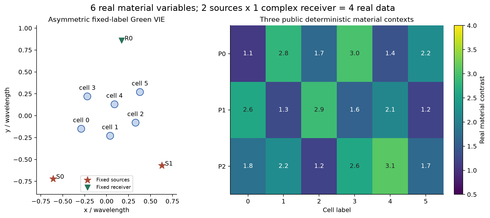
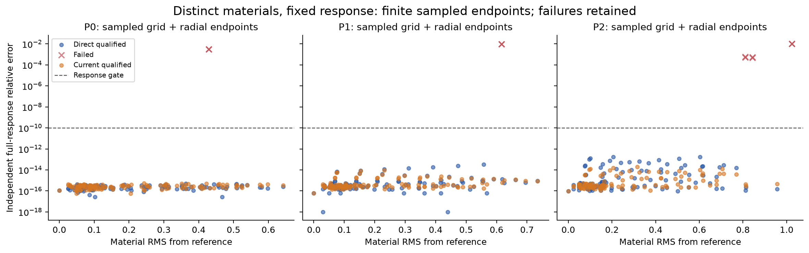
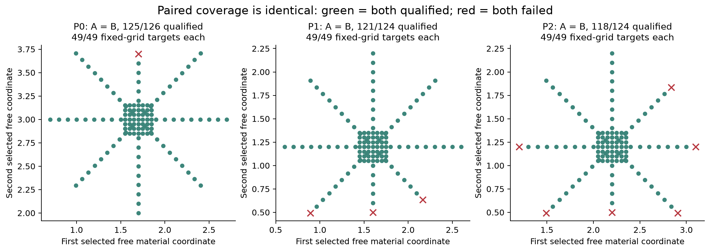
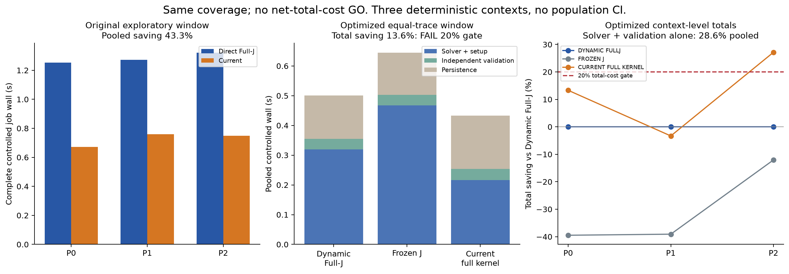
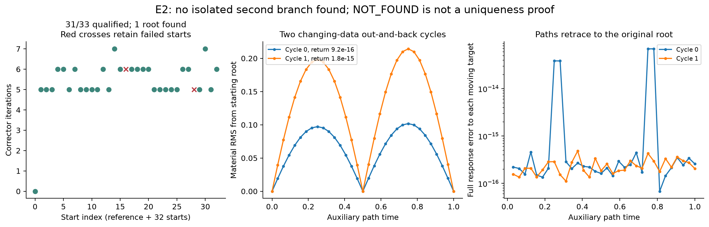
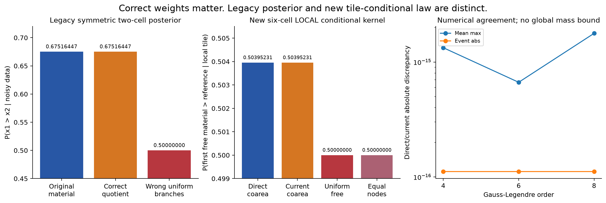
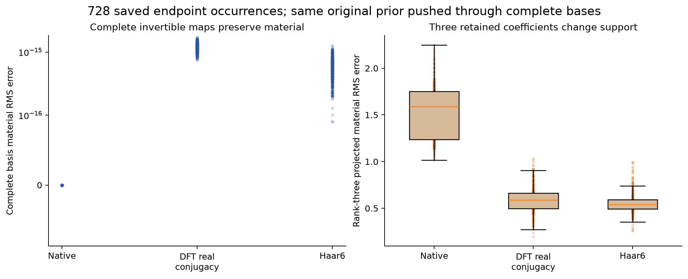
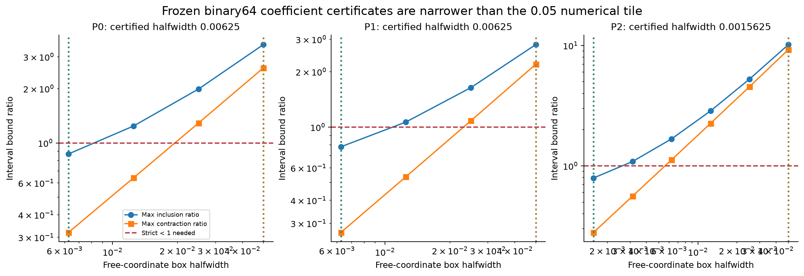

# Research Z-ALG-E1：非对称 Maxwell 材料图册、条件积分与成本反证

2026-10-29。完整实验已封账。实际支付 **15,115 complex RHS**，另有闭式物理响应 **6,164 source-RHS等价**；更保守合计 **21,279/30,000**。原R6/R7只读，没有预算转移。

## 1. 核心答案

在没有镜面交换对称的六单元真实Hankel–Green模型中，确实构造了材料会实际改变、完整两照明复响应保持到严格浮点门内的局部二维材料图册。这个结果不只是潜变量gauge，也不是仅看一阶弱方向。直接材料IFT/Newton和受共享实材料约束的完整接收零空间电流法，都能构造这些节点。

**但本轮没有建立代数current图册独立胜过普通材料方法的总成本或覆盖收益。** 两法通过同样的147/147局部网格目标，径向节点验收也一致；相同自由坐标上的材料差最大约1.03e-12。统一完整轨迹保存并加入便宜的冻结Jacobian控制后，current方法窗口总耗时仅降低13.601%，低于预注册20%门。求解＋验收子项的28.613%改善单独保留。

四单元满列秩子模型的33个启动中31个通过严格响应验收，合并为一个材料根；两次失败保留。两条各32节点的数据往返延拓回到原根，没有发现非对称远处第二支。有限搜索不是全域唯一性证明。

本轮裁决：**通用代数优势主张NO-GO；非对称局部材料图册与条件概率保留为限定正面基准；暂不进入原Full66。**

## 2. 附件输入、历史与协议差异

先完整读取38页Z-ALG报告及全部TeX章节、脚本、JSON、claim ledger和协议；PDF关键页另作视觉核对。输入ZIP共28条目，全部CRC检查并建立BLAKE2b清单。作者提供的SHA metadata原样保留，本轮不追加SHA-256检查。精简研究包没有R6/R7大原始数组；历史合同从固定B1源码/报告核对，不假装重新完成历史大实验。

原两单元材料(1,3)/(3,1)的交换正例、商(p,q)=(4,3)、dark-current反例、复三次monodromy和E4概率积分是**旧成果回归**，不是本轮新的非对称发现。E0重放实际20 RHS；之后仅报告序列化失败，从这些已支付矩阵/RHS/解逐字节缓存恢复，零新增物理。

默认旧E4同时重算32/64阶会有15,370次解析物理响应。本轮采用更保守预算：只新算32阶的两种积分，明确复用不可变64阶参考作为收敛回归，支付10实际RHS＋6,164解析等价。原报告的旧64阶时间不冒充本机新时间。新32阶原空间和商积分互相比较，同时各自对照交付64阶，原误差门没有放宽。

原P1仍是24×24、Full66、8×32复采集、原decoder与complex-noise约定。**以下新模型是新的P_Z材料支持、少量接收与real-component σ=0.001**，与P1统计合同不同。没有根据结果删通道、抬噪声或修改先验救正结果。

## 3. 冻结的非对称物理模型

新E1有6个半径0.04的圆盘常数pulse基，k=2π，exp(-iωt)，材料对比度为实数[0.5,4]，被动无损。内部Green包含真实圆盘积分自项和互项；前向为完整非线性VIE，而非Born。

两源为(-0.61,-0.72)、(0.63,-0.57)，单接收为(0.17,0.86)，标签固定，产生2个复数即4个实观测。三点不共线，不能由非恒等欧氏反射逐个固定；719个非恒等单元置换的完整G/Einc/S算子缺陷最小约0.559，未发现交换自同构。两个照明确实独立。

新原prior为独立实材料密度 p_Z(m)=∏[2m_i/(4²−0.5²)]，没有原子。材料RMS=||Δm||/√n。三份公开合法参考材料事前固定，用作**物理存在性构造**，不是从隐藏GT恢复的在线成像测试。它们也不是独立prior-predictive测试parents。噪声白化以每实分量0.001计，pair和Phi一直相对同一参考均值。

第一参考点完整材料Jacobian奇异值约(0.004576,0.003551,0.001906,0.001185)，数值满行秩4。全部6列在三档中心差分的最大相对误差9.26e-10；current方程Jacobian差分也通过。新非对称dark-current扰动的数据相对差约2.37e-16，但共享材料残差约0.03019，且恢复材料存在约0.0862虚部，不能是本问题的合法材料。

## 4. 两种真实图册怎样构造

A直接材料图册：以full material J作列主元QR，选4个受约束材料坐标、2个自由材料坐标，用带材料box的完整Newton和回溯求解固定完整响应。每个源forward RHS及接收伴随列都计费；全J仅额外1个复transpose-adjoint RHS，不人为弱化普通基线。

B完整current图册：每个源写j_s=j_s^0+Nc_s，S N=0；两个源共20个实current坐标，再加4个dependent实材料，联立24个实构成方程j_s−diag(m)(Einc_s+G j_s)=0。它和共享材料minors/实材料条件等价，但显式保留m避免场节点除零。G N预计算与所有代数Jacobian、实求解、回溯和保存均计入CPU/墙钟。不是给current系数另设平坦prior。

每个候选都用新的完整forward验收，不用拟合电流给自己作证。所有合格端点的数据、状态残差均不超过1e-10相对门，合法box和resolvent稳定性也检查。current构成残差最差约2.20e-14，最小两照明场平方和约0.01263，没有场节点。另以70位精度独立重算三个参考和三个事前指定径向点，最大相对差约2.01e-15；这不是连续PDE或Hankel区间认证。

## 5. 合法覆盖、有限位移与rank资格

|参考材料|直接材料A|电流B|A RHS|B RHS|最大材料RMS|
|---|---|---|---|---|---|
|0|125/126|125/126|1642|255|0.6423|
|1|121/124|121/124|1590|247|0.7346|
|2|118/124|118/124|1621|245|0.9572|

上表是**采样目标节点资格**，不是互异根数，也不是posterior质量。网格和径向目标有重复；逐材料去重数及实际RMS范围在RESULTS_SUMMARY/CSV保留。A/B共748次目标尝试，728合格、738有完整独立验证数组，其余越界/停滞点同样保留。没有只挑漂亮端点。

对738个已保存端点，后来额外支付738个伴随RHS检查实际J；数值秩都为4，最小奇异值约0.00104123，固定dependent block最大条件数约7.403。这是**事后离散节点诊断**，不冒充原在线rank-stop，也不保证节点之间全部正则。没有确证的chart奇异事件，未宣称实现了跨奇异域或整个连通分量覆盖。

对三个中心另做Neumann逆包围＋带权收缩/自映射检验。得到自由坐标半宽0.00625、0.00625、0.0015625的小矩形：在储存的binary64 Green系数被视为精确常数的有理离散模型中，每个自由点都存在声明dependent box中的唯一根。这给出局部连续二维材料图册依据。真实超越Hankel系数没有严格区间包围，有限pulse离散也没有连续PDE误差证书。较大数值网格/径向范围不借小证书升级为全覆盖。

## 6. 为什么RHS优势没有变成合格总成本优势

原记录窗口中，A总计4,853 RHS，B747 RHS；受控job墙钟约3.846与2.179秒，表面节省约43.3%。但A付费物理中间态逐次落盘，B中间current代数态后来通过0-RHS精确重放完整补存；该窗口不能单独支撑公平总成本主张。

因此事前追加明确成本核验合同：三参考材料、各9个相同自由目标、3次重复，旋转方法顺序；全部真实试探与current代数状态使用同一完整buffer/逐端点批量无损保存策略；双方均复用精确中心，均支付新的完整端点验收。另加入普通冻结材料J基线。所有243个方法案例都合格。

|方法|实际RHS|含轨迹保存的方法窗口/秒|求解＋验收＋方法setup/秒|合格|
|---|---|---|---|---|
|DYNAMIC_FULLJ|1026|0.500963|0.354742|81/81|
|FROZEN_J|1344|0.644394|0.502400|81/81|
|CURRENT_FULL_KERNEL|162|0.432827|0.253238|81/81|

上表是setup＋求解＋验收＋batch持久化的**逐方法窗口合计**；阶段整体RUN_END还包含共用参考和未归属循环/checkpoint开销，单列账本，不称上表为整个阶段wall。共同参考另实际支付27 RHS。给双方添加同样非负共同开销只会使13.6%总节时更小，不会救过20%门。RHS优势是真实的，但小型6×6 LU很便宜，current的24维实校正、代数状态构建和轨迹体量会抵消它；此处不能外推大型Maxwell加速倍数。

## 7. 远处分支：独立问题，结果为未发现

E2另取前4个非对称单元，保留原两源与接收，n=k=4。公开参考(1,3,2,1.4)。一个参考启动加32个冻结seed均匀启动，完整Full-J/边界回溯：31/33严格合格，合并为1个根；两次未达标原样保存。局部满秩和这次未发现不能证明全域唯一。

两条预定正弦数据路径各32节点，用普通continuation跟踪后返回；最大材料回返RMS为1.79e-15。它们是沿线段往返，不是非平凡monodromy。循环节点有新的完整forward/J和保存数组，但不是另付numpy独立重解；独立审计用保存矩阵乘法复核，不虚构新求解收据。有限覆盖/判别式前提未建立，复杂代数monodromy标NOT_RUN。

## 8. 概率：旧全域小模型与新局部核分开

旧两单元精确商值(p,q)=(4,3)的条件分支权重仍是1/4、3/4，事件概率0.75。有限噪声、完整四复通道下的新32阶回归事件为0.6751644720，与原64阶一致；错误均匀branch仍为0.5。两者不是同一条件对象。

新六单元只报告第一个参考的自由坐标半宽0.05图册片，在同一P_Z上的coarea条件核。直接材料权重为 p_Z/|det J_dep|；current隐式恢复材料切向T后，权重为 p_Z sqrt(det(TᵀT))/∏s_j(J)。不是current均匀先验，不是候选likelihood softmax。使用4、6、8阶，物理材料阈值事件在两半矩形分别积分。

末两阶质量相对差约1.1e-16，最大材料均值差约2.7e-15；两种图册质量差约1.1e-15。这些是数值收敛与独立恢复权重的一致性，没有严格积分余项界。0.05的数值积分片大于0.00625的小收缩认证域；不能用后者保证前者整个图册或其它分支。

**全材料域的未覆盖条件质量没有非平凡上界；没有计算完整带噪posterior。** 等权节点、均匀自由坐标及打乱条件耦合的控制单独保存。不能把本局部核接到原Full66后就声称posterior恢复。

## 9. 跨decoder与成熟先例

完整原生坐标、满足实共轭条件的完整DFT、正交不平衡Haar6，在相同已保存材料上往返通过，原prior按同一换基推前。截断3系数有非零材料误差，是支持变化，不是gauge或新材料等价。native只留前三坐标后其余cell置零，728/728投影违反box；DFT/Haar的截断投影虽仍在box，却已改变材料与prior支持，未作新的forward。完整DFT位于满足共轭约束的6实维子空间，不能给ambient C6强设普通Lebesgue密度。没有把原P1 decoder强行逆到这个新的6-cell材料类。

CSI/SOM/TSOM早已有共同材料/电流lifting和确定/模糊电流分解；IFT、coarea与monodromy是标准数学。Everett1996/2026已有小型电磁/Helmholtz多项式路径寻找等价根的直接先例。ScholarQA两查询四操作429保留，5篇身份核验通过；SOM/TSOM与coarea有全文，Everett仅按出版社摘要级证据使用，CSI原文captcha未取得。详见audit/prior_art，未认证全球新颖性。

## 10. 费用、失败和未执行项

总actual RHS 15,115，解析等价6,164，合计21,279；实际LU6,422；最大RSS约181.3 MiB。受控物理/代数job wall约17.824秒、CPU约13.464秒；写作/检索/绘图/交付另有记录，不伪造为物理钟。每run合并费用小于10,000，零训练、零GPU/云。

两次实现错误为E0 np.bool_ JSON序列化和E2响应/状态sigma_min重名。旧失败日志、原源码和795已付RHS保留。修复通过缓存恢复E0、复用E2已付33启动及第一个循环节点，只完成剩余循环；没有为了元数据错误重跑或删除旧成本。六个高精度合并snapshot原来引用END序号，另有只追加的paid-source链接收据。原试探current过程由同一矩阵代数重放补存，374目标、2615代数调用，所有原端点m/z一致，新增RHS0。

未执行：原Full66新探索、4–9 cell全域根数认证、复杂有限覆盖monodromy、跨新采集/频率泛化、连续PDE认证、完整新6维带噪后验。未用预算不作为追加授权。

## 11. 七个最终问题

1. **找到什么结构？** 新六单元少接收系统中二维局部材料图册；小binary64系数模型有局部收缩证书，较大范围是保存并验证的采样覆盖。
2. **current独立价值？** 它先精确消掉接收方程，内迭代不需Full solve，实际RHS下降；但未知量从4增到24，未增加覆盖。
3. **是否超过普通方法？** 同目标覆盖相同；本轮两种普通对照中动态Full-J更快，公平总成本只省13.6%，未过20%。不宣布净加速突破。
4. **哪些只是gauge/换基/对称？** 旧两cell交换是人工对称阳性控制；旧QD是decoder gauge；完整DFT/Haar是坐标。新的原生实材料图册m改变，属于不同材料。
5. **概率与漏质量？** 旧两cell全域低维数值参考复现；新模型只在声明图册片正确coarea数值积分，全域漏质量未知。
6. **交给R8什么？** 非对称算子/材料/完整电流/精确账本、可复核小图册证书、相同覆盖的成本反证、以及局部积分与全域质量之间的明确缺口。
7. **现在进入Full66？** 不进入。先在小模型解决一个限定域的分支排除/覆盖证书或真正低于强普通基线的表示，不能用模型复杂度替代这一步。

## 12. 可复现证据

入口为START_HERE、REPRODUCE、PHYSICAL_EVIDENCE/BRANCH_AND_COVERAGE/PROBABILITY_EVIDENCE三CSV、RESULTS_SUMMARY、中央COST_LEDGER和完整无损证据包。独立审阅脚本不导入物理求解器；它从现有数组重算资格与费用。所有主要图来自本轮真实数组。原R6/R7结论保持不变。
