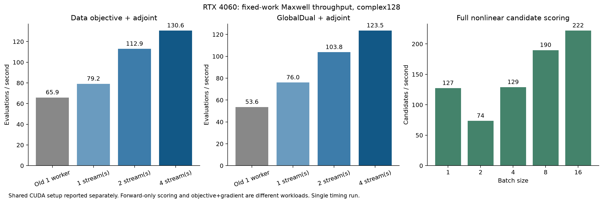
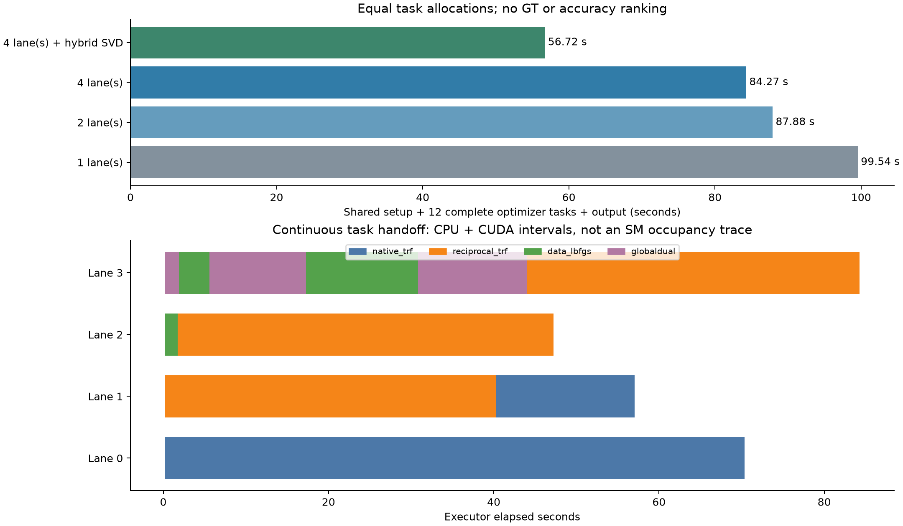
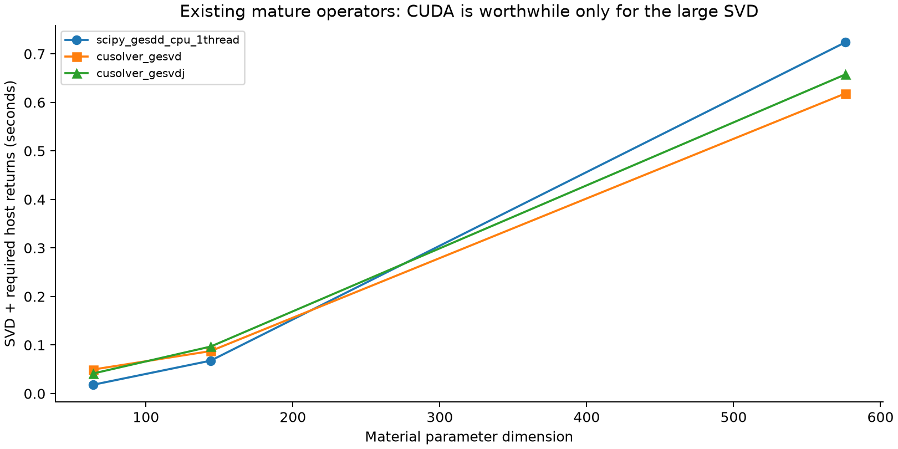

# Maxwell CUDA 执行流水线：复用成熟算子，减少全局等待

## 最重要的实测结果

在已有 i9-14900HX / RTX 4060 Laptop 上，三个公开匿名目标 × Native TRF、Reciprocal TRF、data L-BFGS-B、GlobalDual+data correction，共 **12 个完整多尺度反演任务**：

| 执行方式 | 总 wall | 目标评估 | 材料 LU | 完整 complex RHS，含共享 setup | 状态 |
|---|---:|---:|---:|---:|---|
| 新常驻算子，1 lane，CPU SVD | 99.535 s | 631 | 635 | 26,880 | 12/12 正常返回 |
| 同算子，2 lane，CPU SVD | 87.877 s | 631 | 635 | 26,880 | 12/12 正常返回 |
| 同算子，4 lane，CPU SVD | 84.269 s | 631 | 635 | 26,880 | 12/12 正常返回 |
| **4 lane + 非阻塞 CPU/GPU 混合 SVD** | **56.715 s** | **631** | **635** | **26,880** | **12/12 正常返回** |

最后一行相对单 lane **总耗时下降 43.0%，吞吐提高 1.755 倍**；相对普通 4 lane 下降约 32.7%。这不是减少优化调用数得到的优势，四种执行配置的 LU、源/伴随/接收 RHS、Full-J 和 Gram 次数相同。每个 run 的 634 次任务 LU 加 1 次共享参考 LU，总计 635。

这是**计算执行层的结果**。没有新盲测、没有重新揭晓 GT、没有改善材料 RMSE 的新主张。测试包含旧公开数据的失败拟合端点，`status=OK` 表示任务执行完成，不表示材料成像成功或优化器达到精确数据门。

## 为什么单纯多开 CUDA 进程不够

原 R4 CUDA 物理核已经用真实 complex128 LU/adjoint，物理上并没有换成 Born。但一次目标评估被切成许多 host/device 边界：

- 每个 `operation` 后 `torch.cuda.synchronize()`，会等待同设备其他工作；
- 正演先返回观测和诊断标量，随后伴随再返回梯度，Gram 期间还有多个 `.item()`；
- regularizer、材料粗网格乘法及 TRF 的 SVD 在 CPU；
- 两个 CUDA worker 分别持有 context 和算子，观察目标每个 task 反复加载。

CUDA 已经被使用，并不意味着连续计算留在 GPU。将更多小数组孤立地上传，或让多个进程争用同一张卡，不能自动提供更高总吞吐。

本轮保持原理成熟、改动明确：一个 CUDA 进程；G/E/S 一次常驻；不同反演任务各有私有 stream/LU；所有照明在同一 LU 下作为 RHS 求解；先在 GPU 连续完成 forward、adjoint、Gram、正则项与 coarse chain，最后把需要的值和梯度一次打包返回 pinned CPU buffer。

CPU 优化器消费结果前仍需要等自己的 event。这一依赖存在时，其他任务继续提交工作。热路径没有显式全设备同步。公开观测预载入一次，主线程写结果，worker 返回后立即领取下一项，无需等同批次中最慢的对象。

实际 4 lane 普通执行的任务周转中位间隔为 0.046 ms，最大 0.083 ms；混合执行为 0.053 ms、最大 0.243 ms。这是任务交接间隔，不是 GPU kernel 空闲率。底层库自身的同步行为没有被宣称全部消失。

## 决定性的下一步：复用成熟 SVD，而不是重写 TRF

完整任务只靠 4 stream 从 99.535 s 降到 84.269 s；物理内核提高吞吐后，TRF 的大 SVD 成为主要费用。于是只对会影响选型的一个实际公开状态矩阵做算子选择：

| 材料参数维数 | SciPy CPU gesdd，一线程 | cuSOLVER gesvd，含上传和完整输出 | cuSOLVER gesvdj，含上传和完整输出 |
|---:|---:|---:|---:|
| 64 | 0.0182 s | 0.0495 s | 0.0414 s |
| 144 | 0.0678 s | 0.0876 s | 0.0968 s |
| 576 | 0.7237 s | 0.6183 s | 0.6575 s |

这是单次有冷 API 开销的实际矩阵选择实验，不是稳定加速百分比的统计估计。小 SVD 保留在 CPU。大 SVD 使用已经存在的 `torch.linalg.svd(..., driver="gesvd")`，但最多占用一个 GPU SVD slot；当 slot 被占用，另一个线程立即调用原 SciPy SVD，而不是等 GPU 空位。

混合 run 的 318 次 SVD 中，272 次在 CPU，46 次在 GPU；91 次 576 维 SVD 被分为 CPU 45 次、GPU 46 次。实际并发期间，大 SVD 平均调用 wall 为 CPU 0.899 s、GPU 0.952 s，**GPU 单次调用并没有更快**；总批次仍缩短，说明收益来自两种资源共同承担 ready work 和减少串行通道，而不是“每个算子搬去 GPU 都会变快”。这些单调用时间相互重叠，不能相加代替总 wall。

`src/hybrid_svd.py` 只在本进程里适配 SciPy TRF 的 SVD 引用，保持原 TRF 的信赖域算法、FP64 economy SVD 和物理问题。它不改冻结源码，不改系统库，也没有安装新框架。依赖当前 SciPy 的 private TRF 接口，版本迁移应明确适配，不把本结果当作所有版本的通用保证。

## 物理内核与候选批处理

固定 64 次完整目标/伴随评估的实测吞吐：

| 工作 | 旧单 worker，含 task 算子 setup | 新 1 stream | 新 2 stream | 新 4 stream |
|---|---:|---:|---:|---:|
| Data objective + adjoint | 65.92 /s | 79.16 /s | 112.93 /s | 130.62 /s |
| GlobalDual + adjoint | 53.65 /s | 76.02 /s | 103.77 /s | 123.54 /s |

新 shared CUDA setup 另列为 1.758 s，其中包含本进程首次 CUDA 初始化。上表是 warmed API 的固定工作量窗口，不能直接解释成远程完整冷启动的加速比。新 4 stream 相对新 1 stream 的收益分别约 1.65×、1.63×；其余收益还包含融合 host 返回、GPU regularizer 和移出热循环诊断的效果，不能全部归因于 stream。

候选全非线性正演评分的 batch=1/2/4/8/16 吞吐分别为 **127.3 / 73.6 / 128.9 / 189.8 / 221.9 个材料/s**。batch=2 反而较慢，因此不按批大小单调假设。材料和目标已驻留 GPU，结果还在 GPU；这些数字不含候选生成、CPU 反演或 GT 评分，不能与 gradient 评估的吞吐混用。

旧 Full-J 与新接口的原始计时也保留在 JSON，但新接口额外构造/返回 regularizer residual/Jacobian，工作范围不同，本文不据此宣称 Full-J 核加速。

## 已有优化算子的复用审计

具体文件、接口、条件与网络文档在 [OPTIMIZED_OPERATOR_CATALOG.md](OPTIMIZED_OPERATOR_CATALOG.md)。主要发现：

1. **A9** 已有 CUDA DenseDDA LU/多 RHS；不需要重写向量物理。它当前多处返回 NumPy，适配时应该让连续操作驻留设备。
2. **A17** 已有压缩 endpoint 的批量 Cholesky/Woodbury、QR 和一次打包返回，也有单 CUDA 进程、完成即补任务的线程调度。其向量/复材料语义需要保留，不能直接替代当前 scalar-TM 公式。
3. **Route A/B** 已有 uniform vector-grid FFT 传播。当前 CUDA matvec 后仍回 CPU、接 SciPy GMRES；它提供了可移植传播结构，没有被夸大为完整 GPU-resident Krylov 求解。
4. **R2/R9/R10** 已有固定材料块/宿主/形状条件下的精确或有误差控制的算子复用。先满足结构条件再决定是否上 GPU；4/6 阶商代数或不合法的固定背景不应为了 GPU 利用率而引入。
5. **网上成熟库**：本轮直接使用 PyTorch 对现有 cuBLAS/cuSOLVER/MAGMA 的封装；FFT/Krylov 的后续候选为现成 cuFFT/CuPy，而不是手写一套新分解。CuPy 本轮未安装、未实测。

已把目录和推荐入口加入本机项目根 `AGENTS.md` 与 B1 Git 仓库根 `AGENTS.md`。指导其他 session 先查可复用资产、采用匹配的物理接口与实测配置，没有给其他 session 发消息或改变其正在运行的工作。

## SM、warp、stream 与进程的实际边界

进程管理 CUDA context；stream 表示设备工作序列；库内 kernel 在 SM 上由 warp 执行。普通 stream 不拥有固定 SM 数。本轮确认是 24-SM 的 4060，没有声称把它切成“四份六 SM”。

[NVIDIA MPS](https://docs.nvidia.com/deploy/mps/when-to-use-mps.html) 只支持 Linux/QNX，当前 Windows/WDDM 不适用。[CUDA 12.4 Green Contexts](https://docs.nvidia.com/cuda/archive/12.4.0/cuda-driver-api/group__CUDA__GREEN__CONTEXTS.html) 的确提供 SM 资源分区，但官方也不保证仅有分区就能获得并发进展；本轮未做分区或驱动修改。

当前没有 nsys，安装的 PyTorch profiler 只支持 CPU activity，因此 **SM occupancy、kernel 重叠比例是 NOT_MEASURED**。任务时间线包含 CPU 和 CUDA，不冒充 SM trace；有 ready work 时不设置不必要屏障，也不承诺数据依赖、CPU 求解、库内部实现或空队列可以没有等待。

## 保留失败与适用限制

- 首次脚本未包含原 vendor 路径，因缺 `threadpoolctl` 导入退出。修正路径后直接使用已有依赖，没有安装或反复重算物理。
- 默认库 Graph 捕获失败。强制 cuSOLVER 后捕获成功，但 graph batch=4 的 125.6 个材料/s 仍低于选出的 default batch=16 路径，故不启用。批大小不同，不将这个差异当成 Graph 自身劣化的因果证明。
- 同样 batch=16，default 219.3 /s、forced cuSOLVER 133.4 /s；没有一律强制 cuSOLVER。
- 代码保留 LU/Gram 状态并在 endpoint 计算物理 residual；没有把旧 kernel 每步的 eig/condition/residual/QR fallback 全搬进热路径。非奇异 resolvent 与有效 source Gram 是 fast path 的条件；病态情况下并非原冻结 solver 的逐位等价替换。
- 所有 timing 都是有限机器、有限固定工作量上的单次记录；没有置信区间或跨硬件保证。executor wall 含 GPU shared setup、任务、写盘，Python/Torch 导入和 SSH 传输不在计时窗内。物理 Green 的历史构造成本没有新测。
- 流水线不创造新材料候选机制、概率解集、后验样本或全局分支定理；没有用更快执行替代 GT recovery 的证据。

## 结论与推荐

对当前 576 单元混合反演 workload，优先使用 **`manifest_4_hybrid.json`**：共享常驻算子、4 私有 stream、全部源共享 LU、非阻塞混合大 SVD、独立写盘。对单纯候选评分使用 device-resident batch，当前 batch=16 是已测设置中的最快者。

可交付贡献是一个可直接复用的执行后端、已有算子的适用条件目录，以及物理调用数相同的 43% 总 wall 降幅。归因于成熟计算原语的组合、数据驻留与资源调度；不宣称新的 Maxwell 理论或已改善高对比成像。下一步只有在真实多初值/多目标科研任务需要时接入这些接口，复用本记录，不重复公式精度实验。

复现入口：[REPRODUCE.md](REPRODUCE.md)。实际数据：[RESULTS_SUMMARY.json](RESULTS_SUMMARY.json)、[COST_LEDGER.csv](COST_LEDGER.csv)。
