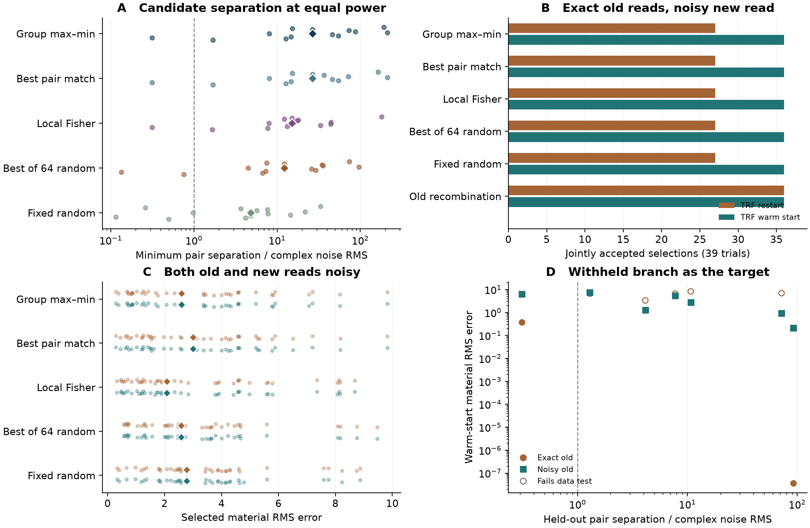

# 自然多根目标的闭环照明

独立验证组 24 个自然目标中，有 13 个被旧数据反演找到至少两根，合计 33 根。在这 13 个目标中，按已知候选设计的一次新照明增加了最差分支对的读数差。旧数据精确时，多分支热启使 36/39 次选中材料通过联合数据检验，普通重启为 27/39。旧数据也有噪声时，两种启动都通过 39/39 次，选中的材料误差中位数均为 2.595，对应的正演与 Jacobian 评估次数中位数由 107 降为 72。较低数据残差在这里仍可对应偏离真值数个对比度单位的材料。

## 实验

从独立验证组 `branch_holdout`、开发组 `branch` 和历史 R5 的统一搜索重跑 `branch_archive` 读取锚点和所有已验回旧数据的数值根，材料 RMS 距离在 \(10^{-3}\) 内合并并保留发现方法。闭环共做 13 个独立自然多根案例、11 个开发自然多根案例和 3 个历史案例 T2/T3/T4。T0 已有历史测量实验，从本次闭环中略过。独立组 13 个多根案例中有 7 个可留一，留最后一条按发现顺序出现的分支，其余分支用于设计。找到的根仅是已发现子集。

在每个目标的原波数和接收位置不变的情况下，用旧阵外部线源半径的中位数加 20 个外线源。发射 Gram 为 \(G_{\alpha\beta}=J_0(k|x_\alpha-x_\beta|)\)，保留其特征值 \(\ge 1/16\) 的模态并白化，所有实验使用单位辐射功率的一次相干发射并满足馈电范数 \(\le 4\)。旧源重组限制在原发射的张成空间。源选择比较候选组最差分支对的分隔，使用多个起点的非凸优化，并记录每一分支对的匹配照明与 64 个固定随机照明。局部 Fisher 控制用锚点处旧数据 Jacobian 最小右奇异向量，最大化新读数沿该方向的一阶灵敏度。留一设计阶段完全跳过被留根的响应计算。所有馈电在第一次读取生成真值前写盘。

新读数通过任务已有的同一全波标量 TM VIE，计算方式独立于选源与拟合使用的 LU 和伴随导数。这是离散模型的合成采购。每个目标和照明试三组固定圆对称复高斯噪声，每个复读数噪声 RMS 为 \(2\times10^{-4}\) 绝对幅度，同一目标不同照明共用抽样噪声以便对比。旧数据精确时，拟合的数值旧量权重尺度为 \(2\times10^{-8}\)，通过标准是旧数据误差 L2 \(\le10^{-7}\) 与新数据在 95% 噪声接受域内。联合带噪时，以全部复读数的已知噪声尺度做等权拟合，接受域取实自由度为复读数个数两倍的 95% \(\chi^2\) 椭球。每个条件下，两种方法使用完全相同的数据、相同材料盒和四个有界 TRF 起点，每起点至多 100 次函数评价。普通重启用盒中心加 Sobol 起点，热启用已发现分支替换相同数目的通用起点。选中材料按联合数据失配最低确定。

## 独立验证组的实际结果

下表每行 13 个目标、39 次噪声试验。分隔是同一照明下所有已经找到的分支对之中最小的绝对复读数差，表中取目标间中位数。通过数指按失配最小的选择，材料误差是选中材料与生成真值的 RMS。

| 一次新发射 | 最差对分隔中位数 | 旧精确通过数 重启 / 热启 | 旧也带噪材料误差 重启 / 热启 |
| --- | ---: | ---: | ---: |
| 候选组最大最小分隔 | \(5.33\times 10^{-3}\) | 27 / 36 | 2.595 / 2.595 |
| 最佳候选对匹配 | \(5.33\times 10^{-3}\) | 27 / 36 | 3.002 / 3.002 |
| 局部 Fisher | \(3.02\times 10^{-3}\) | 27 / 36 | 2.082 / 2.082 |
| 64 个随机源取设计分隔最大者 | \(2.43\times 10^{-3}\) | 27 / 36 | 2.590 / 2.590 |
| 固定随机源 | \(9.61\times 10^{-4}\) | 27 / 36 | 2.776 / 2.776 |
| 原发射重组 | \(3.74\times 10^{-17}\) | 36 / 36 | 4.113 / 5.121 |

- 最大最小照明相对最优匹配对照明在 13 个目标中的 3 个提高最差分隔，最大提高约 2.00 倍，其余只差数值舍入。独立组的 `fresh12-00` 三根最坏对分隔只有 \(6.30\times10^{-5}\)，低于一个读数噪声 RMS，旧数据带噪的两次抽样中三个原始候选都通过联合检验。
- 对最大最小照明，联合带噪且用分支热启的 39 次中有 7 次搜到相距超过 0.1 RMS 的不同可行端点，最大直径 12.25。旧源重组有 35 次。这个计数只针对同样起点预算下找到的数值端点。搜索不到其他端点不能证明材料唯一。原源组合还能提供一次独立噪声样本，所以即便严格的候选分隔为零，也可能改变排序。
- 将留根用作模拟采集目标时，7 个独立留一目标的留根到训练根之间最近差在 \(6.23\times10^{-5}\) 至 \(1.85\times10^{-2}\) 之间。最大最小照明有 5/7 个留一目标在本次带噪读数下拒绝了所有参与设计的原始训练根。按训练根热启后依然可能找不到留根所在分支。旧数据精确时，留根作为目标的热启选中结果仅 3/7 通过联合检验，且其中有材料误差 6.76 的结果。旧数据也带噪时，7/7 通过，但材料误差可到 7.38。通过新数据的局部拟合仍不能替代对未知分支或整块材料域的排除。

峰值强度、吞吐或真实天线阵列的效果不在这次模拟的测量范围内。等功率指标只对当前同频线源、背景与 Gram 有效。

[论文图 PDF](figures/feedback.pdf) · [馈电与设计](results/feedback_design.json) · [全部读数、端点及误差](results/feedback.json) · [计算脚本](src/branch_feedback.py)
