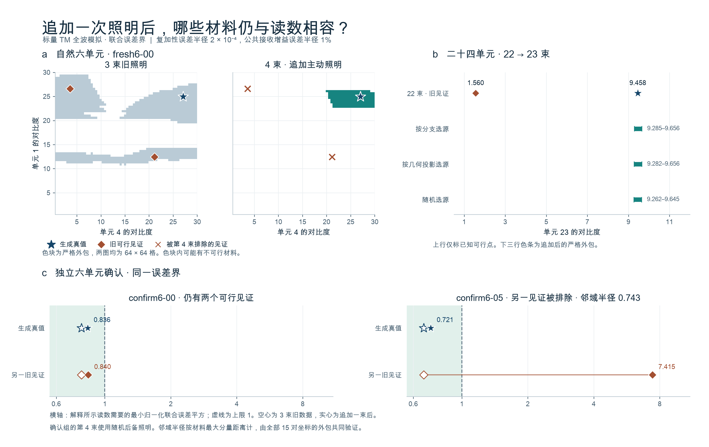
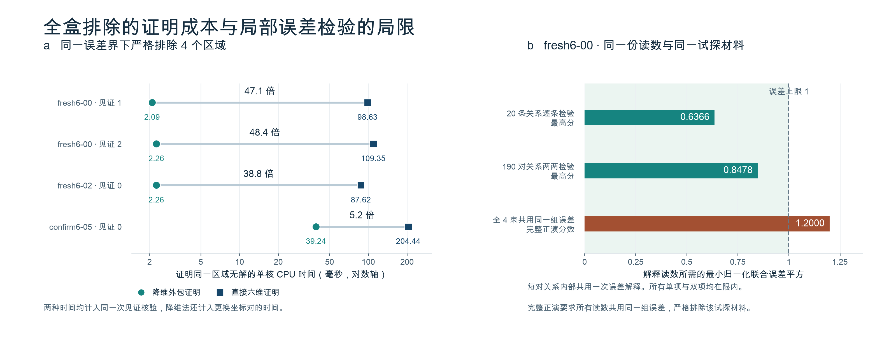

# Z-ALG R10 研究报告：一次新增照射能排除哪些材料解释？

**本轮最值得写论文的结果，是用同一份电磁读数证明“这一整片材料解释都不可能”。** 在一个有 24 个独立未知材料的二维仿真里，22 次照射后，某一处的材料值可以是 1.560，也可以是 9.458。两份完整材料都通过了带噪声、带接收增益误差的正演检验。我们根据旧数据选择再照一次，随后证明，整个材料盒里任何解释在这一处都只能落在 **[9.28, 9.66]**。第 24 次照射还没用。这个样本专门造出了难分的两解。随机照射和按源阵列几何选的照射，在该例也能排除低值段。[严格区间及物理见证](results/short_certificate.json)

**自然出现的多解也做了同样的检验。** 18 个六材料目标用三次旧读数选一次新照明。16 份错误的旧解释原先都与测量误差相容。加测后，我们在全部材料盒上严格排除了这 16 个解释各自周围的一片区域，随机新照明也排出了 16/16。另换一套有限孔径布局，8 个新目标中找到两份错误旧解释，一份能排除，另一份在第四次测量后仍与真实材料一样合法。这次实验给出了判断能否区分的办法，专门选源的普遍恢复优势依然缺少证据。[自然 18 例](results/natural_all_pairs.json) · [独立 8 例](results/confirm_all_pairs.json)

## 我们为什么改变了 R9 的做法

R9 的核心建议是直接寻找能产生同样旧读数的两份材料。它在历史双根上检验过一次精确割线，但没有测试从一个端点找出另一个的成功率。R3 曾在少数坐标中求得 538 个新提案，进入完整数据后没有带来恢复成功。R10 从所有旧观测的严格零空间出发，每一个活动材料都能变化，最终用单独的完整全波求解验收。

先尝试一个看起来颇有吸引力的简化。对旧解的任一复割线方向，另一个根的幅度可以用一个两列的实线性系统求出。这样少找两个实变量，还能避开出发点。实际运行却显示，一些合法远根的收敛范围缩小了。十二材料留出组中，直接割线和普通多起点各发现 4 个额外根，消去幅度后仅发现 2 个。查看已经找到的端点后，给 R5 T0 的真实方向加 $7^\circ$ 扰动，直接方法 12 次全部回到第二根，消去幅度的版本一次都没回来。我们按割线长度改权并用锚点的二次式预测方向，救回部分案例。独立六材料组上，普通多起点、直接割线与 POLSYS_PLP 同伦都找到了同样的 34 个材料解。商代数和圆反演都没有增加这组最终覆盖。[具体方法、时间与失败路径](results/branch_notes.md)

分支仍有实验用途。在旧读数精确、新读数有噪声的 39 次比较中，用已找到的材料作初值，普通 TRF 通过联合读数检验的次数从 27 提高到 36。等旧数据也有噪声，选中材料的中位 RMS 误差在两种初始化下同为 2.595。有一个十二材料目标，三种旧解释中最难区分的一对，在设计出的照明下只差 0.000063，单次噪声 RMS 是 0.0002。因而从若干候选中选一个拟合最好的材料，回答不了所有案例。[同源对照和留一结果](FEEDBACK_NOTES.md)

## 真正起作用的数学结构

接收器对所有内部入射场的响应可写成一行 $w$，固定传播矩阵为 $H$，接收行为 $R$。物理方程给出 $w_i=m_i(R+wH)_i$。旧照明只能读到 $wB$。如果阵列还看不到 $d$ 个独立的复方向，我们证明了以下关系。

**任选 $d+1$ 个单元，给它们各试一个材料值，就能构造一个可从实际读数算出的检验量。** 当这几个值都正确时，检验量服从一条精确等式。换掉其余全部材料，这个结论仍成立。构造只用未知方向的小行列式；每个试探材料在系数中至多出现一次。把噪声和一项共同的接收增益误差传进去，得到的必要不等式对每个材料分别至多二次。于是固定其中 $d$ 个位置以后，最后一个材料能否通过检验由一元二次式决定。

例如六个材料照四次，缺两个方向。可以画一张只有两个材料坐标的图。图上的每一点都允许其余四个材料在整个合法范围内取值。有一格被严格排除，就意味着任意选那四个材料都救不回它。第一次只画一对坐标，漏掉了一些主要在别的位置不同的错误材料。六个材料总共有 15 种配对，把 15 张图用同一份读数算出来，可以继续排除，无需额外照射。这个修正在原 18 例上把有严格排除半径的错误解释从 13 提到 16。独立 8 例中的保留失败已一并报告。[公式、证明和退化情况](MATHEMATICAL_THEORY.md)

左图的色块是物理可行解的外包，点是另用完整方程验证过的材料。中图的两点说明原来两种值都说得通，右侧短区间包含新增读数后的所有可能。独立几何中仍有两个材料都符合新增读数的样本。[论文图 PDF](figures/certified_regions.pdf)

## 证明同一块材料不可能，实际省了多少时间？

我们另写了一个直接六维算法，从原电磁方程消去共同增益，用同样精度对同一片材料区域求证。四个样本仅根据旧解划出八块区域，每块只限制两个位置，另外四个位置都可以随意变。四块确实有符合全部读数的材料，两种方法都能给出实例。其余四块，两种方法都证明整块无解。三个区域的降维计算各用约 2 毫秒，直接六维法用 88–109 毫秒，含相同的见证检查，分别快 **47、48、39 倍**。

第四块最能看出差别。先查旧候选分歧最大的两个坐标，算完仍留下 12.34% 的面积。如果在这里结束，就不能说这片材料已排除。保持原来那块材料和读数不变，再按顺序选了两对坐标，最后才排完整块。计入这些尝试用 **39 毫秒**，直接法用 **204 毫秒**。这个小样本支持低维求证节省计算，不能用来预测一般六材料问题的平均加速。[逐块用时与未决区域](results/direct_box_unselected.json)

从这个遗漏还能推得一个结果。若把每个单元分别检验，它们可以各自借用一份最有利的噪声，把实际不可能的材料留下来。但同一台接收器只有一份共同增益，同一批读数也只对应一份实际噪声。我们证明，在正演和所选坐标均正则、各旧照明独立时，把全部虚拟读数同时要求用同一份误差来解释，会**精确恢复原始全波可行性判据**。只联合两列时，仍可在其余材料未知的情况下给出比逐列检验更强的必要条件。我们还用一份实际模拟的四束读数，穷尽六个材料的 20 条三单元关系和任意两条间的 190 种组合。对同一份错误材料，它们给出的最高误差分数分别是 0.637 和 0.848，看起来都低于上限 1。但真正同时使用四束数据，所需的最小误差分数是 1.200。用区间运算进一步证明，这个材料附近有一个六个方向都可变化的小盒，盒中每份材料都会被这些成对检验放过，完整正演却能将它们全部排除。这是共用误差不可拆开的一个可复算反例。我们给出了有限个分组可能放大的最坏误差公式，为怎样选组合留下了定量问题。[数学推导第 8–10 节](MATHEMATICAL_THEORY.md) · [反例与数值](results/all_circuit_counterexample.json)

## 什么时候不能把结果说成材料恢复

1. **找到一个解、找到所有精确解、排除带噪材料域是三件事。** 成熟同伦在六材料上完成了每例 20 条路径；十二材料则有 144/5,544 条跟踪失败。带噪旧数据里，即使中央方程一个根也没找到，真实材料仍可能完全符合误差范围。独立有限孔径组 8 例中有 4 例正是这种情况。
2. **最能分开两个候选的照明，也可能是普通阵列设计会选的照明。** 当只缺一个方向，所有旧响应差都在同一条复直线上，最佳分支照明可从源几何直接求出。24 材料缺两个方向时，最佳候选照射产生的原型响应差为 0.30679，普通缺失方向投影产生 0.30676。比较一个较弱的补齐方法能得到 7.32 倍的差距，比较这个更强的几何基线就几乎持平。
3. **排除一份错误解释的邻域，不等于整幅图已经准确。** 自然 18 例里，每个案例的全材料 RMS 直径另有保守上界，中位仍为 7.65。盒内剩下的每个点也不一定可行。相反，独立 confirm6-00 的两份不同材料各自通过了完整的严格误差检验，任何只交出一个材料并声明唯一的算法，在这个例子上都会说过头。
4. **证明只针对声明的模型。** 所有数据均由非线性二维标量 TM 仿真产生。严格排除把保存的离散系数看作精确值，包含一个贯穿采集的未知复接收增益及有界读数噪声。真实天线、网格误差、多维宿主失配、未知支持和三维矢量场均需另行研究。

## 论文判断

**值得围绕“稀缺物理照明下，低维消元怎样排除 Maxwell 材料多解”写方法与理论论文。首选 Inverse Problems。** 最实在的理论增量是把缺失源维数、虚拟可达测试的次数和带误差的区域排除联系起来，能对完整材料盒作有限计算。直接六维算法在同一任务上给出相同结论，提供了可核算的计算对照。所有低维检验都放过的严格反例，则解释了这种简化的局限。结果适用于具有同样逐单元本构结构的离散波动系统，Maxwell 独有性与文献首创均未证明。

SIAM Journal on Imaging Sciences 也有合理切入点，尤其是相同排除质量下的算法成本、直接六维对照，以及哪些误差使外包变宽。目前 $d$ 增大时最坏复杂度仍呈指数，天然目标上未建立总体材料恢复优势。强 IEEE TAP 还需要真实阵列、可重复的高对比目标和校准误差实验。把本轮写成“代数找根全面胜过优化”“三次或四次即可成像”都得不到数据支持。[最接近的原始工作](RELATED_WORK.md) · [计算成本与复现](EXPERIMENTAL_RESULTS.md)

下一项有明确判别力的理论问题，是给外包的宽度与真实可行材料范围之间的差距一个可计算的上界。今天已经能证明某些地方绝无可行材料，却可能在剩余区域里保留太多点。独立案例留下的两份真可行材料和自然组的宽区间，是检验新理论应同时解释的两个端点。

## 输入和研究来源

本轮读了用户提供的 R9 Markdown、解开的检查脚本、数值 JSON 和原型来源，读取了所指 ChatGPT 对话及 R8、R9 Pro 会话可返回的研究正文；用本地 R6 PDF/TeX 和原仓库 R2–R7 源码、机器结果核对了本轮依赖。R8 的 30 页独立 PDF 未取得，本报告只把可读的 R8 会话和 R9 的引用作为该轮背景。R5 已有中央方程条件全根、R6 已有 fold、R7 已有共享区域的虚拟照明，都按历史成果归属。本轮研究判断、系数构造与误差证明由 Codex 主线程完成，计算实现、文献核读和绘图由按任务选定的原生 GPT-6.2 Sol 协作完成，全程未使用 DeepSeek。

[网页报告](https://migodam.github.io/b1-probabilistic-maxwell-imaging/research/research_z_alg_r10/) · [数学推导](MATHEMATICAL_THEORY.md) · [实验与命令](EXPERIMENTAL_RESULTS.md) · [下一轮 Pro 交接](NEXT_PRO_HANDOFF.md)

