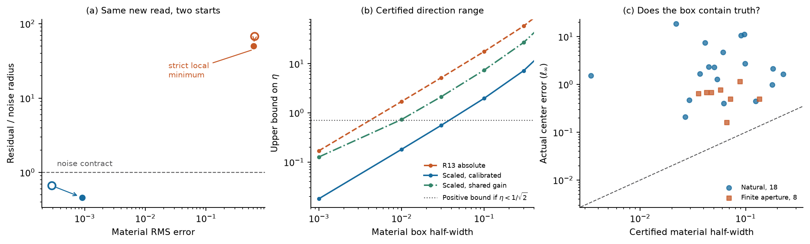
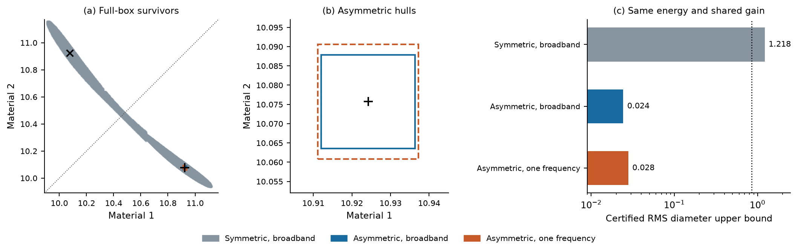

# R14 同一新增数据上的材料相容性与优化驻点

一份新读数可以排除某个旧材料，同时保留吸引求解器的错误极小。R12 六材料模型中，加一次 $+0.1545\%$ 频移的发射就能排除两个旧候选中的错误点。以该点启动同数据 TRF，仍落入一个经过严格数值证明的内点极小。该极小的材料 RMS 误差至少为 **0.60530**，完整物理残差至少为噪声合同上限的 **50.249 倍**。从另一个旧候选启动，材料 RMS 为 **0.000908**，残差为合同上限的 **0.4598 倍**。

## 一　候选筛选与全波优化

R12 实验重用公开的六材料、三次发射和一个接收器和档案中已经发生的三项复旧噪声。每个比较固定旧读数、一个单位能量的新频曝光及其三项复噪声。两个符号取相同偏移幅度，$\pm0.1545\%$ 是历史已曝光结构上的开发对照。复噪声每通道 RMS 为 $3\times10^{-7}$。已校准增益的六通道联合合同为加性范数 $\varepsilon=1.08617\times10^{-6}$。未知增益臂用同一个复增益解释全部旧读数及新读数，要求

$$
\left\|\frac{gF(m)-y}{\varepsilon}\right\|_2^2+
\left|\frac{g-1}{\gamma}\right|^2\le 1.
$$

这里 $\varepsilon=1.53608\times10^{-6}$、$\gamma=5.65685\times10^{-4}$ 是原加性 99% 球及硬增益圆盘的外椭球，适合保守相容性检验。TRF 对六材料做盒约束求解，对同一复增益精确剖面消元。相容性分数是上式左边的平方根。RMS 的材料单位是对比度，每个材料单元具有相同权重。

| $+0.1545\%$ 试验 | 材料 RMS | 相容性分数 | 后续求解复右端 |
|---|---:|---:|---:|
| 已校准，旧候选 A | 0.63314 | 67.599 | — |
| 已校准，从 A 直接 TRF | 0.60530 | 50.262 | 208 |
| 已校准，旧候选 B | 0.000288 | 0.6637 | — |
| 已校准，从 B 直接 TRF | 0.000908 | 0.4598 | 24 |
| 共享增益，两个旧候选 | 0.69557 / 0.06774 | 51.901 / 4.771 | — |
| 共享增益，从较低分候选做 TRF | 0.006036 | 0.4620 | 144 |

已校准臂的两次旧候选预测和打分共用 32 个复右端；直接选 B 后做 TRF 已返回这次最佳点。额外四个通用起点属于计算对照，由盒中心及固定 Sobol 点构成，和选中候选一起共用 1616 个复右端，不含候选打分。其输出按同目标取最低值，未改善本案。共享增益臂两中央候选均不相容，允许材料再拟合则存在相容点。因此有限名单的筛选有明确的覆盖前提。

已校准错误内点用 3 次 Newton 微调中心。对半径 $10^{-6}$ 的球，Arb 验证整个球上的 Hessian 特征下界为 $2.99126\times10^{-9}$，中心梯度范数上界为 $2.747\times10^{-19}$（均用未按观测范数归一化的目标）。球面上梯度严格向外，球内强凸，因而存在唯一严格局部极小。由该错误端点向生成材料移动弦长的 20% 时，R13 的白化方向内积除以 $\lVert h\rVert_2^2$ 的严格上界为 $-18020.110638194$，两材料的响应弦仍至少为 $105.865\varepsilon$。该向量对直接否定其所在大凸域上的正方向常数。这里的严格计算针对给定的二进制 Maxwell 离散算子。 [优化轨迹、合同与方向数值](results/geometry-fold.json)

在 R10 公开的含噪四照射数据中，同时使用档案中的共同复增益及原联合椭球 $(\varepsilon,\gamma)=(2\times10^{-4},.01)$。在自然 18 案上，12 案有中央旧根，但新增读数使所有这些固定旧根都不相容。自然数据的直接/多起点材料 RMS 中位数是 1.143/0.883，相容率是 17/18 和 18/18。有限孔径 8 案对应中位数为 0.346/0.346，相容率是 7/8 和 8/8。自然案 `fresh6-00` 的两个旧候选都被排除，按候选低分启动停在有 1 个活跃坐标的高残差盒面点（材料 RMS 14.338、分数 6.351、归一化投影梯度 $3.59\times10^{-12}$）。同一读数的普通中心起点达到 RMS 0.696、分数 0.535。有限孔径 `confirm6-05` 无中央旧根，统一盒中心的 RMS 为 10.864、多起点为 0.377。这些条件已经曝光，使用的是档案固定照射和误差实现。 [自然样本](results/geometry-natural.json) · [有限孔径样本](results/geometry-confirm.json)



## 二　怎样把方向界做得更宽

把共同增益作为两个实坐标 $u=(\Re(g-1),\Im(g-1))/\gamma$，定义扩展响应 $\mathcal F=(gF,\varepsilon(u_1+iu_2))$、扩展读数 $(y,0)$。已校准时直接用 $F$。盒中心来自数据上的拟合点。材料用给定半宽，增益方向的长方形覆盖整个合法增益圆盘。方向分析使用联合目标。若精确剖面目标的驻点增益落在这个域内，它也是联合目标的驻点。

记 $A_0=SQ_0$、$K=GQ_0$、$E_0=B+GQ_0D_{m_0}B$，其中 $Q_0=(I-D_{m_0}G)^{-1}$。若有已知宿主，只在未知材料坐标上取 $A_0$ 的列、$E_0$ 的行和 $K$ 子矩阵。对材料偏移 $x$，$A(x)=A_0(I-D_xK)^{-1}$，$E(x)=(I-KD_x)^{-1}E_0$。导数的第 $i$ 列是 $A(x)_{:,i}E(x)_{i,:}$。

选取中心实 Jacobian $J_0$ 的右缩放 $P=V\Sigma^{-1}$。用逐项复球 Cholesky 验证 $\sigma_*\le\sigma_{\min}(J_0P)$。对每个块，若 $B_*=r|K|$ 的最大行和小于 1，$U=B_*(I-B_*)^{-1}$ 和 $V_2=B_*U$ 分别提供逐项的一阶以上和二阶以上余项。绝对值矩阵给出 $|A-A_0|\le|A_0|U$、$|E-E_0|\le U|E_0|$，减去各自线性项后分别换成 $V_2$。这给出材料 Jacobian 余项 $|\Delta J-\sum_i x_i H_i|\le R$，其中 $H_i=\partial_i J_0$ 保留复数符号。增益混合项来自上式的 $gF$ 乘积。最大材料或增益偏移写作 $r_i$，可以取

$$
\eta =
\frac{\sum_i r_i\|H_iP\|_F+\|R|P|\|_F}{\sigma_*}.
$$

由此任意弦向量 $h$ 都有 $\lVert(J(m)-J_0)h\rVert\le\eta\lVert J_0h\rVert$，弦平均 Jacobian 也满足同样的界。两个向量都在以 $J_0h$ 为中心、半径 $\eta\lVert J_0h\rVert$ 的球中。它们的内积至少是 $(.5-\eta^2)\lVert J_0h\rVert^2$，在 $\eta\le .5$ 时可用 $(1-\eta)^2\lVert J_0h\rVert^2$。设 $P_M$ 是 $P$ 的材料行，材料 RMS 局部驻点误差上界为

$$
\frac{\varepsilon(1+\eta)\|P_M\|_2}{\sqrt{d}\,\sigma_*(1-\eta)^2}.
$$

这些充分界用 Arb 96 位向外舍入计算。数值 SVD 只提议缩放和谱界。正性由复球 Cholesky 和余项公式确认。箱的材料半径按 $\eta<1/\sqrt 2$ 或较强的 $\eta\le .5$ 定位。

| 使用的观测和误差模型 | R13 原式，正方向半宽 | 缩放后，正方向半宽 | 缩放后 $\eta\le.5$ 半宽 | 真材料在最后一列盒内 |
|---|---:|---:|---:|---:|
| R12，$-.1545\%$，已校准 | .003383 | .030912 | .022050 | 是 |
| R12，$+.1545\%$，已校准 | .004164 | .038008 | .027156 | 是 |
| R12，$\pm.1545\%$，共享增益 | — | .009636 | .006569 | 否，两案都在外 |
| R10，自然 18，共享增益，中位数 | — | .099241 | .057382 | 0/18 |
| R10，有限孔径 8，共享增益，中位数 | — | .092337 | .061883 | 0/8 |

已校准正频偏时，正方向半宽放大 **9.1 倍**。在 $.02716$ 半宽内，局部材料直径上界为 .01655（RMS），若真参数在盒内，所有驻点的材料 RMS 上界为 .02481。将求解限制在这个由拟合数据中心建立的盒子后，从投影入盒的普通起点进行 TRF，消耗 80 个复右端，回到 RMS .000908 的相容解。此成本不含确定中心的求解。增益未知时，证明正方向的盒子更窄，且结果中真值不在盒内。相同限制求解保持了小残差，未解决覆盖问题。R10 两组的盒子中确实存在正方向界，但在已计算点附近相对较小，全部错过了真值。自然组的驻点 RMS 界中位 22.03，远大于材料半宽中位 .05738。面向整体材料恢复，需要先用独立的全域相容外包排除盒外材料。

## 三　全频对称与破对称源

用 R12 的六状态二维 TM 模型。四个已知宿主材料两两镜像，接收者都在镜面对称轴上，两组可实现外部线源成镜像对。两待估材料独立遍历 $[.5,30]^2$。同时交换两个未知材料及其已知宿主镜像坐标，Green 矩阵按相同置换共轭，接收不变；两边馈电等权时入射也不变。这个关系对每个真实频率成立，因此等馈电宽带保持两材料交换歧义。

相同旧读数、相同的三份新噪声，每对发射在三份读数上各使用 $1/3$ 能量。比较 $(-8\%,1.2\%,8\%)$ 等馈电、同频谱各对只开固定左单源、和三次重复零频移的同一左单源。每对的总新能量为 1，单线源也依其辐射功率归一。先生成并分开保存观测。认证脚本只读取观测与模型，每格用已知宿主消元后的 $2\times2$ 复有理响应和区间残差排除。若共同增益未知，镜像整盒认证还用一个包含两种误差的椭球，以相同的一个复增益做松弛。写出全部保留格后再评分真实材料与交换材料。

| 源和频率 | 校准 RMS 直径上界 | 共享增益 RMS 直径上界 | 共享增益访问材料盒 | 共享增益中方向 |
|---|---:|---:|---:|---|
| 等馈电宽带 | 1.15147 | 1.21808 | 90,000 | 两种顺序都保留 |
| 固定左源，同一宽带 | .008553 | .024308 | 34,479 | 所有可行点 $m_1>m_2$ |
| 固定左源，重复旧频 | .007881 | .027967 | 34,349 | 所有可行点 $m_1>m_2$ |

三臂均覆盖生成材料。等馈电下，两份 RMS 距离至少 .848528 的材料均被严格见证为相容；用满盒预算后剩余格直接保留。共享增益椭球系数为 $\varepsilon=2.57516\times10^{-6}$、$\gamma=5.65685\times10^{-4}$，固定轮次 24 个复通道。两臂固定左单源都严格排除了交换点。固定几何已能提供本例主要收益，增加频带仅将共享增益证书上界由 .0280 降到 .0243。 [全盒共享增益结果](results/geometry-mirror-box-gain.json) · [封存格](results/geometry-mirror-box-gain-cells.npz) · [另行评分](results/geometry-mirror-box-gain-scores.json) · [已校准对照](results/geometry-mirror-box.json)



另一个同构对照使用很小的物理不对称，线源延迟使单次 $+.025\%$ 新频引入两候选均值差 $7.5932\times10^{-7}$，材料 RMS 间距为 .07071。旧读数固定，新加性噪声沿均值弦方向取 0、.5、.6 倍弦长。达到一半时两个材料都相容且两点比较在数值精度内打平，.6 倍时选择反转（真实/交换分数 .4194/.2796）。在该已知增益固定两点的圆对称复高斯模型下，条件最优等先验误判率是 3.675%。 [纯加性误差对照](results/geometry-mirror.json)

## 四　576 材料档案中的相容性对照

重用 R12 环、壳、桥的已有合成读数及最终材料。在同一组宽带读数（旧频、两份半能量的 $-50\%$ 与 $-25\%$ 新频），进行一次独立全波正演评分，未重跑优化。旧读数采用档案半径；新读数使用单份联合噪声 99% 球；共同增益硬半径取 .002，并用外椭球合并。此处相容分数以这一合同精确剖面消元，区别于阶段优化中的原正则目标。

| 576 材料对象 | 同时拟合 NRMSE / 相容分数 | 低到高累计 NRMSE / 相容分数 | 两法原历史复右端 |
|---|---:|---:|---:|
| 环 | .6574 / 9.016 | .2314 / .664 | 7056 / 7008 |
| 壳 | .4899 / 5.758 | .2278 / .737 | 7092 / 7032 |
| 桥 | .7070 / 18.145 | .1731 / .673 | 7200 / 7008 |

三案宽频累计的最终点都进入噪声合同，三案同时拟合均超合同。因此同一读数、近似相同复右端预算下，路径可影响相容性。NRMSE 单独评分；即使相容仍留下 .17–.23 的相对误差。历史旧数据上的壳、环盒面 Hessian 和近驻点记录支持旧盆地存在，但本轮没有认证 576 维新数据上的全域驻点几何。档案的原坏点和校正点在旧读数已具有响应差。新频候选筛选中，只有环的校正点相容；壳、桥两候选均不相容。 [重新剖面的分数及数据合同](results/geometry-high.json) · [原宽带路径](../research_z_alg_r12/FREQUENCY_RESULTS.md)

## 复现

脚本在本目录运行，低维实验依赖 NumPy、SciPy、python-flint，图需要 Matplotlib。高维评分另依赖 threadpoolctl 并复用 R12 的历史输入；可按 R12 说明配置 `ZALG_HISTORY`，所需档案可从 R12 的 `results/high_inputs.zip` 提取。每个 TRF 记录实际复右端、因子分解数、时间。低维方向盒的 Arb 计算中位时间约 .008–.022 秒；镜像整盒每个共享增益臂 2.7–6.8 秒。镜像整盒每种布局四个中心小矩阵求逆，再对各格做低维复球运算。

```text
python src/geometry_experiment.py fold
python src/geometry_experiment.py natural
python src/geometry_experiment.py confirm
python src/geometry_controls.py mirror
python src/geometry_controls.py high
python src/geometry_mirror_box.py acquire
python src/geometry_mirror_box.py certify
python src/geometry_mirror_box.py certify --shared-gain
python src/geometry_mirror_box.py score
python src/geometry_mirror_box.py score --shared-gain
python src/geometry_figures.py
```
