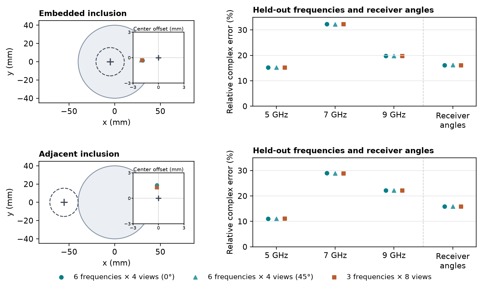

# Fresnel 实测圆柱定位与留出场预测

Institut Fresnel 的两个独立实物都允许用 576 条复场读数定位塑料圆柱。两种分配方式得到的中心仅相差 0.2–0.3 mm，并给出近乎相同的留出复场误差。这个实测对照支持两类测量都足以约束本例的已知圆柱模板。样本只有两个，无法凭此区分一般未知缺陷更需要频点还是角度。



## 同样的实测读数预算

使用 2005 年 Institut Fresnel 数据库的 `FoamDielIntTM.exp` 和 `FoamDielExtTM.exp`。两件实物都是圆柱组合，一件将塑料圆柱嵌入泡沫，另一件把塑料圆柱放在泡沫外侧。数据包含 2–10 GHz 的 9 个整数频点，8 个每隔 45° 的实际发射方向，以及每方向 241 个接收位置。收、发天线分别距装置中心 1.67 m。[Geffrin、Sabouroux 和 Eyraud，2005，图 5 与表 1](https://doi.org/10.1088/0266-5611/21/6/S09)

| 采样方式 | 训练频率 GHz | 发射角 | 每组频率和发射的接收数 | 训练复读数 |
|---|---|---|---:|---:|
| 6 频 × 4 发（0°） | 2、3、4、6、8、10 | 0°、90°、180°、270° | 24 | 576 |
| 6 频 × 4 发（45°） | 2、3、4、6、8、10 | 45°、135°、225°、315° | 24 | 576 |
| 3 频 × 8 发 | 2、6、10 | 全部 8 个方向 | 24 | 576 |

训练接收角相对发射为 60°、70°、…、290°。共同训练频率 2、6、10 GHz 上，所有 8 个发射方向的交错接收角 65°、75°、…、295° 留出评分，共 576 条。完全留出的 5、7、9 GHz 上，所有发射方向的 49 个逐 5° 实际接收角留出评分，共 1,176 条。原测量报告指出，逐视角交替扫描方向引入了交替的接收定位误差，因此两组四发相位分别报告。[Geffrin 等，§5.1](https://doi.org/10.1088/0266-5611/21/6/S09)

原始数据保留实录噪声、相位和频率间幅度差。两份空场扫描之差给出的粗略 SNR 为 27.94–44.21 dB，定义为同频散射场 RMS 与两份匹配空场之差 RMS 的比值。这个量含漂移，且原始档案没有逐条重复散射读数、发射功率或曝光时长。预算比较采用同样的复数读数与频率–发射组合数。

## 只从训练散射读数估计圆柱位置

以泡沫中心为原点，泡沫与塑料的半径先验为 40 和 15.5 mm，其名义相对介电常数固定为 1.45 和 3.0。候选同时允许塑料柱完全嵌入和完全外置，搜索所有角度。先比较 121 个相同候选，再依每一分支的最小训练复残差细化中心。二维 TM 边界模型在两个界面匹配轴向电场和法向导数，用柱谐展开同时求解两个圆柱间的多重散射。原文采用长圆柱近似。外置分支要求两柱间至少留 0.2 mm，便于在近接触条件下用独立圆柱展开，所有三组外置定位的中心半径都到了这个搜索下限。[Geffrin 等，§3.2、§5.1](https://doi.org/10.1088/0266-5611/21/6/S09)

复数散射读数为原总场减同文件入射场的共轭，与正演的 exp(−iωt) 和外向 第一类 Hankel 函数 约定一致。每发每频用空场朝向对侧的 ±30° 接收数据拟合二阶柱谐，从相位与幅度校准发射场。只用其中约三分之二的角度做拟合，空场留角相对误差中位数 11.0%，原文式对向单点标定的同样误差中位数 64.5%。留出目标散射只用于评分，使用对应频率的空场入射标定。所有目标和采样方式都使用该规则，未从散射读数拟合额外复增益。档案单位用空场延拓继承，绝对功率与完整喇叭响应未知。

## 位置和场的定量结果

位置误差以公开示意中心为参考，内嵌为 (-5,0) mm，外置为 (-55.5,0) mm。公式和搜索读取的几何只包含上述半径、材料和装置原点。物体摆放误差以及模型固定介电常数使坐标差包含模型偏差。[公开名义坐标，§IV](https://arpi.unipi.it/retrieve/f49f3103-450c-43e8-9d9f-08e1441a616f/AP1905-0871.R2.Final.Manuscript%5B1%5D.pdf)

| 实物 | 训练方式 | 预测中心 mm | 到名义中心 mm | 留出接收角复场误差 | 留出频率复场误差 |
|---|---|---:|---:|---:|---:|
| 内嵌 | 6 频 × 4 发（0°） | (-6.88,-0.34) | 1.91 | 16.16% | 20.13% |
| 内嵌 | 6 频 × 4 发（45°） | (-7.06,-0.32) | 2.08 | 16.17% | 20.14% |
| 内嵌 | 3 频 × 8 发 | (-6.91,-0.30) | 1.94 | 16.16% | 20.13% |
| 外置 | 6 频 × 4 发（0°） | (-55.68,1.55) | 1.56 | 15.86% | 18.39% |
| 外置 | 6 频 × 4 发（45°） | (-55.68,1.36) | 1.37 | 15.83% | 18.37% |
| 外置 | 3 频 × 8 发 | (-55.69,1.28) | 1.29 | 15.82% | 18.37% |

复场误差是预测减实测的复数 L2 范数相对实测 L2 范数。留频幅度相对误差为 11.81–14.08%，实测功率加权主值相位 RMS 为 7.66–7.84°。留出的 7 GHz 对两个实物都比 5 和 9 GHz 难预测。对应误差约 32.2% 和 28.9%，几乎不随采样方式变化。外置近接触的柱谐截断在 5 和 9 GHz 额外加七阶后，场变化不超过 0.20%。内嵌的同一变化小于 2 × 10⁻¹²。

## 复现

从 [IOP 补充数据页](https://iopscience.iop.org/article/10.1088/0266-5611/21/6/S09/data) 获取 `supp.zip`，取两份 `.exp` 到同一目录。此次使用工作区既有镜像，2026 年 9 月经 [IOP 自有补充数据镜像](https://beta.iopscience.iop.org/article/10.1088/0266-5611/21/6/S09/data) 下载。工作区数据位于 `research/delegated/a2_literature/data/2005_iop_21_6_S09/`。结果包包含预测，原始文件由出版社提供。

```sh
OPENBLAS_NUM_THREADS=1 OMP_NUM_THREADS=1 python src/fresnel_measured.py --data-dir /path/to/Fresnel2005
```

记录见 [JSON](results/fresnel_measured.json) 和 [预测阵列](results/fresnel_predictions.npz)，阵列索引为实物、采样方式、频率、接收、发射。两个实物的读数处理、标定、定位、预测和截断比较合计 31.21 秒墙钟，30.79 秒 CPU。
