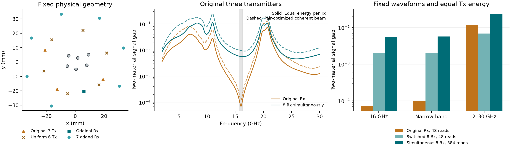
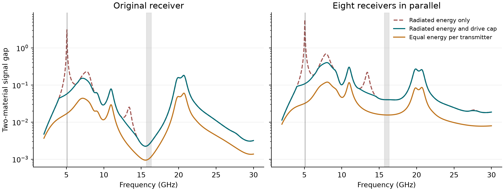

# R15 宽频与空间孔径对 R14 的旧材料对各自有多大作用

旧三发保持不动、总辐射能量与发射时隙相同，**单独扩频与单独扩接收孔径都能打破这对材料的窄带混淆**。保留原单收时，固定 2–30 GHz 八频点的信号距离是固定窄带的 **115.79 倍**。保留窄带时，在八个位置轮换、仍只读取 48 个复数，距离是原单收的 **20.26 倍**。在宽频下，轮换八收的 48 个读数只得到原单收距离的 **60.0%**。八收并行时，宽频的距离提高到原单收的 2.09 倍，同时读数增加到 384 个。在等读数预算下，宽频加入这组轮换接收器对这对材料反而有损。



## 冻结的材料、几何与功率

使用 R14 `fresh6-16` 已知增益 g = 1 的两条材料向量，六个反差的 RMS 差为 7.9733。

| 候选 | 六格反差 m = εᵣ − 1 |
|---|---|
| A | 18.219166，25.548789，17.396523，20.524145，30.000000，16.819040 |
| B | 18.084338，26.015197，17.400754，18.469964，10.705480，18.988713 |

将旧参考波数 k₀ = 7.3 对应到自由空间 16 GHz。一个旧坐标单位对应 21.7693 mm，每个材料圆盘半径 1.0232 mm。保留旧三发和原接收点的物理位置。新接收孔径由旧点加上半径 34.8308 mm 的外圈七点组成，八个角位相隔 45°。另外把六发均匀布在约 22.64 mm 半径的圆环上，原接收方向处于两发射口之间。旧三发和均布六发的最近收发间距各为 12.30 mm 和 11.43 mm。每个频点按固定米制几何与波数 k = 2πf/c 重新构造 G、B、S。

一个发射时隙的复端口系数记为 w，D_m 为六个材料反差组成的对角矩阵。散射均值和线源的归一辐射功率为

```text
Y_m(f) w = S(f) [Id − D_m G(f)]⁻¹ D_m B(f) w
P_norm(f, w) = wᴴ Q(f) w
Q[s, t] = J₀(k × 两个发射口 s、t 之间的距离)
```

B 中包含幅度因子 √(f / 16 GHz)，用于抵消单条同系数线源的 1/k 远场功率因子。Q 的交叉项来自远场的角向积分。所有比较中，各时隙的归一辐射功率之和固定为 3。时隙等长时，总能量等于这个无量纲额度乘共同的时隙长度和背景功率常数。相干发射按 Q 计算能量，端口系数的平方和通常给出不同的数值。 [NIST DLMF 10.9.1](https://dlmf.nist.gov/10.9.E1) [NIST Hankel 远场展开](https://dlmf.nist.gov/10.17)

固定波形每发只开一口，振幅为 0.25，每发归一化能量为 3/48。每频点六发，旧三发各发两次，均布六发各发一次。三种接收方案分别是原单收、轮换单收和八收同时采样。轮换接收器的编号为频点序号与该频点时隙序号之和对 8 取余。每轮都发 48 次。前两种各用 48 个复数与 48 份接收通道时间，后一种用 384 个复数与 384 份接收通道时间。时隙成本和采样噪声按相同停留时间比较，频率切换与射频实现开销未计入。中心对照把八个频率时段全部设为 16 GHz。窄带在 15.68–16.32 GHz 等间隔取八点，宽带固定取 2、6、10、14、18、22、26、30 GHz。

## 固定波形结果

把一轮的散射均值按读数顺序堆成向量 `μ_A` 和 `μ_B`，以两者欧氏距离 `Δ = ‖μ_A − μ_B‖₂` 衡量区分程度。完整复数读数与每个发射时隙的系数都保存在结果文件中。

| 发射 | 频率方案 | 原单收 · 48 读数 | 轮换八收 · 48 读数 | 并行八收 · 384 读数 |
|---|---|---:|---:|---:|
| 旧 3 发 | 16 GHz | 0.000070523 | 0.0020020 | 0.0056626 |
| 旧 3 发 | 15.68–16.32 GHz | 0.000099232 | 0.0020104 | 0.0056862 |
| 旧 3 发 | 2–30 GHz | 0.0114897 | 0.0068940 | 0.0240389 |
| 均布 6 发 | 16 GHz | 0.0010125 | 0.0055121 | 0.0155905 |
| 均布 6 发 | 15.68–16.32 GHz | 0.0010330 | 0.0055139 | 0.0156107 |
| 均布 6 发 | 2–30 GHz | 0.0113091 | 0.0088915 | 0.0264143 |

旧三发的窄带轮换八收，改变轮转起始角位后，信号距离 Δ 在 0.0019977–0.0020243。宽带同样轮换得到 0.0068940–0.0096853，八种都小于原单收的 0.0114897。窄带只换均布六发、保持原单收，有约 10.41 倍距离增益。宽带进行同样替换，距离为旧三发的 98.4%。旧三发宽带原单收的每读数最大幅值分别为 0.0135965 和 0.0135800。宽带并行八收时是 0.0151915 和 0.0151347。两个候选的幅值峰接近，判别使用逐读数复数差与相位。

## 判别概率与单频的严格分离

沿用 R14 自然组的噪声标度。独立圆复高斯噪声满足 E|nᵢ|² = σ²，取 σ = 6.89821417471 × 10⁻⁵，使三读数的 99% 二范数半径为 2 × 10⁻⁴。已知两个均值和等先验时，把读数减去均值中点，再与差向量 `μ_A − μ_B` 取实内积。该统计量的噪声标准差为 σΔ/√2，精确 Bayes 错判率为 Pₑ = Φ(−Δ/(√2 σ))，其中 Φ 是标准正态累积分布函数。旧三发且原单收的中心与窄带错误率各为 0.235 和 0.155。空间与宽频的更大分离对应理想高斯模型的极小尾概率，噪声对照表以对数展示。

也可按高概率噪声球做有界判别。对 N 个复读数，令 c 为 2N 个自由度的卡方分布的 99% 分位数，噪声球半径 r₉₉ = σ√(c/2)。当 Δ > 2r₉₉ 时两球不交，当 Δ < 2r₉₉ 时有界内读数可由任一材料解释。下表使用 55 位十进制精度 Arb 球运算包住 Hankel 核、线性解和复间距。用整数形状的 Gamma 分布有限和夹住 σ 与半径。每个频点重复旧三口固定轮发，依然 48 发，总能量 E = 3。

| 实际频点 | 接收方案 | 信号距离 Δ 已证界 | 两个半径之和 2r₉₉ 已证界 | 判别 |
|---|---|---:|---:|---|
| 16 GHz | 原单收 | < 7.052276145382 × 10⁻⁵ | > 0.001117175174119 | 有交叠 |
| 16 GHz | 轮换八收 | > 0.002002041674027 | < 0.001117175174165 | 分离 |
| 16 GHz | 并行八收 | > 0.005662628975690 | < 0.002864385644328 | 分离 |
| 22 GHz | 原单收 | > 0.011588570717083 | < 0.001117175174165 | 分离 |
| 22 GHz | 并行八收 | > 0.017766940159256 | < 0.002864385644328 | 分离 |

R14 原连续证书用已冻结的单接收几何及 ±2% 频带，单个新增相干复读数的分离比上界是 0.764821。上面的 16 GHz 轮换八收与 22 GHz 原单收，用不同采样几何或证书频带以外的点打破这一具体材料对的混淆。拆开预算可见，16 GHz 的空间效果不依赖新增并行读数。

## 两候选预先给定时的配波

对已知候选的响应矩阵，记 `D = Y_A − Y_B`。固定频点时，信号距离的平方等于 ‖Dw‖₂²。若只约束总辐射能量 E，它的最大值为 E 乘以 DᴴD 关于 Q 的最大广义特征值。用 ‖w‖₂² ≤ 2wᴴQw 限制总端口激励后，先把 wᴴQw 归一到 1，再取 DᴴD − ηId 关于 Q 的首特征向量。若激励上限生效，取 η ≥ 0 使 ‖w‖₂² = 2。该矩阵的最大广义特征值加 2η 是目标的上界，所取方向达到该上界。发射频率在 25 MHz 网格上搜索，同时保留窄带边界和固定频点。所得频率是网格最优。

| 发射和接收 | 八个固定宽频点，有限端口激励配波 Δ | 网格最优单频 | 该频点配波 Δ |
|---|---:|---:|---:|
| 旧 3 发，原单收 | 0.026349 | 20.700 GHz | 0.130335 |
| 旧 3 发，轮换八收 | 0.016596 | — | — |
| 旧 3 发，并行八收 | 0.052400 | 10.975 GHz | 0.246771 |
| 均布 6 发，原单收 | 0.035947 | 20.675 GHz | 0.182720 |
| 均布 6 发，轮换八收 | 0.025539 | — | — |
| 均布 6 发，并行八收 | 0.074083 | 8.000 GHz | 0.403431 |

单频结果可用同一波形重复 48 发来保持总发数与每发辐射能量。旧三发原单收的 20.700 GHz 每发系数为 `(−0.114167 − 0.063276i, 0.219255, 0.046129 + 0.038309i)`，复读数峰值为 0.012443 和 0.009593。并行八收的 10.975 GHz 每发系数为 `(−0.129611 − 0.026317i, 0.190532 − 0.015271i, 0.249551)`，峰值为 0.014616 和 0.021330。

均布六发若只约束理想远场辐射，在 5.075 GHz 处 Q 的最小特征值为 1.58 × 10⁻⁴，几乎同相的六个线源能显著抵消远场。数学优化给出单收与八收距离 3.10189 和 5.77764，同时总系数平方约是辐射额度的 **6312 倍**。固定原波形、偏离 5.075 GHz 约 50 MHz 时，归一化辐射额度从 3 变为 15.3 或 25.0。把端口激励上限加回来后，这个尖峰消失。端口系数平方上限是数值中的硬件代价代理，实际功放功率、元件自损与互耦需要物理端口模型。



## 噪声和接收器校准偏差

令实际测量为 `(1 + e_r) μᵢ + nᵢ`，其中 e_r 是接收位置 r 的复增益偏差。将给定幅相误差包入复平面中半径为 η 的圆盘，即 `|e_r| ≤ η`，对名义判别器按最不利的幅相偏差计算错误率上界。静态误差按同一接收位置的读数先求复投影再取模，独立变化误差逐读数取模后加总。下表列出旧三发固定波形的 log₁₀(Pₑ) 或保守上界。角度 1°、幅值 1% 与噪声标准差翻十倍同时施加。

| 条件 | 窄带原单收 | 窄带轮换八收 | 窄带并行八收 | 宽带原单收 | 宽带轮换八收 | 宽带并行八收 |
|---|---:|---:|---:|---:|---:|---:|
| 名义噪声 | −0.81 | −93.93 | −739.88 | −3014.54 | −1086.66 | −13187.82 |
| σ × 10 | −0.34 | −1.71 | −8.55 | −31.59 | −12.10 | −133.64 |
| 再加静态幅相偏差 | −0.24 | −0.98 | −3.73 | −27.55 | −9.22 | −116.31 |
| 再加任一读数可独立偏差 | −0.01 | −0.62 | −1.60 | −25.28 | −7.98 | −96.66 |

例如最后一行窄带轮换方案的上界为 24.2%，宽带原单收约为 5.3 × 10⁻²⁶。这组误差模型只覆盖已校准散射读数的乘性残差和独立加性噪声。极小尾概率主要用于比较统计信息，实际测量的串扰、共模噪声、残留直达波、色散与散射模型误差需要单独测量。

结论适用于这两个已知候选、给定位置、二维线源及无色散六盘脉冲模型。30 GHz 的自由空间波长约 10 mm，圆盘直径约 2.05 mm。对最高反差圆盘，盘内波数与半径的乘积 ka√(1 + m) 约为 3.58，盘内场均匀是显著离散近似。严格球运算界描述此模型中的判别，有限激励的宽频配波同样属于模型计算。

可在本目录运行 `python src/pair_mimo.py`，需要 NumPy、SciPy、Matplotlib 和 python-flint。 [逐时隙数值和复波形](results/pair_mimo.json) [判别图 PDF](figures/pair_mimo.pdf) [端口激励比较 PDF](figures/pair_source_effort.pdf)
