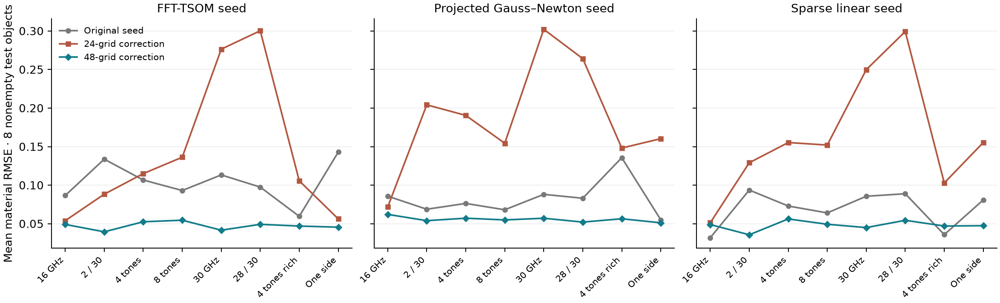
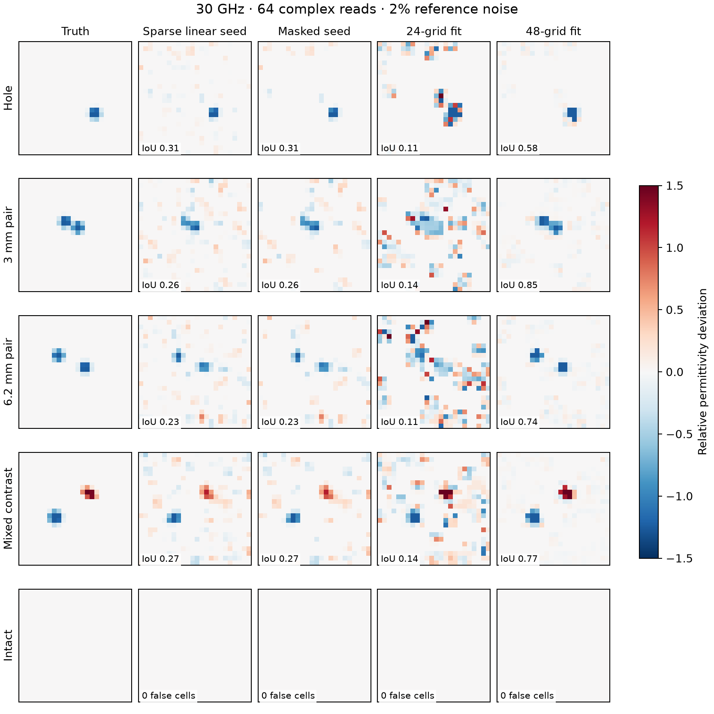

# 从初图选区域，再用细网格全波修正

在 2% 参考噪声、同一初图、同一选区和同一六步优化下，48×48 前向网格显著改善高频材料恢复。30 GHz、64 复读数、稀疏线性初图的平均介电反差 RMSE 为 **0.0856**，在原 24×24 全波网格上修正后为 **0.2498**，换成 48×48 前向网格后为 **0.0450**。三个双孔对象分别有 **2/3、0/3、3/3** 能分开。36×36 非嵌套网格的误差落在两者之间。收益对频率和初图质量有明显依赖。原 16 GHz 单频和丰富多静态数据下，好的稀疏初图平均优于后续细网格修正。改用 72×72 独立采集网格后，宽频和定位两臂的 48 网格修正仍优于 24 网格修正，但平均也输给稀疏初图，28/30 GHz 定位臂还失去一例近双孔。



## 区域和方程

初图 q̂ 由同一曝光的观测产生。先取幅值达到阈值的像素，阈值为 0.12 与初图最大幅值的 15% 中较大者，再用 3×3 邻域膨胀一格。只保留区域 I 上的初图系数，其他像素设为零。区域固定到优化结束。空区域直接返回零图，无非线性场求解。记录同时保存初图、只清零区域外的初图、24 网格修正、48 网格修正。所有求解结束后才读材料真值，随机外验的预测文件也在读取真值前落盘。区外真实支持比例仅用于回顾评分。

材料变量始终定义在 24×24 图上。48 前向网格中，每个选中材料变量 qᵢ 控制相邻 2×2 个真实细单元，记这些细单元的索引为 F(i)。F 是所有选中细单元的索引集合，`T_I q_I` 把选中材料复制到对应的细单元上。E_h、G_h、S_h 是消去完整已知板后的算子。有限区域的散射与材料导数可写为

```text
D = diag(T_I q_I)
A = Id − D G_h[F, F]
p = A⁻¹ D E_h[F, :]
y = S_h[:, F] p

U = S_h[:, F] A⁻¹
V = E_h[F, :] + G_h[F, F] p
∂y/∂qᵢ = 对 j ∈ F(i) 的 U[:, j] V[j, :] 求和
```

区外扰动电流为零，所以子块 `G_h[F, F]` 保留了区域内全部扰动多次散射。已知板的传播已经包含在全板消元中，板边界与区域外已知介质均参与传播。每个材料变量仍有四个场自由度。24 网格对照使用同一个选区和初图，每个材料变量对应一个前向单元。36 网格对照按细单元与粗像素的面积交叠定义固定线性映射，半覆盖和跨界细单元照常参与求解。

两条校正使用原 projected GN 的数据归一化、盒约束 [−1.25, 1.5]、平滑 TV 权重 0.0055、平滑 L1 权重 0.0035、盒内步、Armijo 回溯与小步停机。TV 包含穿过掩膜边缘的差分。3 个开发对象 × 8 设计 × 2 全波初图上，48 网格最多 6、12、24 步的平均 RMSE 是 0.04417、0.04489、0.04498，符号 IoU 是 0.741、0.735、0.734。因此统一锁在最多六步，再应用于测试及随机外验。30 GHz 的代表性算子对照中，区域限制与完整 2304 单元正演的相对差为 5.76 × 10⁻¹⁶，绑定材料导数的中心差分相对差最小为 2.57 × 10⁻¹¹。区域正则的值、梯度和曲率与完整表达式的相应限制一致。 [开发组全结果](results/roi_metrics_dev.json) [算子对照](results/roi_operators.json)

## 原测试对象

表内是八个非空对象的平均材料 RMSE，括号里依次为**原初图 / 24 网格修正 / 48 网格修正**。四个基础频空设计均含 64 个复数，30 GHz、28/30 GHz 定位设计和单侧设计也是 64 复数。富阵设计含 512 个复数。

| 设计 | FFT-TSOM 初图 | Projected GN 初图 | 稀疏线性初图 |
|---|---:|---:|---:|
| 16 GHz · 8 发 × 8 收 | 0.0866 / 0.0540 / 0.0491 | 0.0858 / 0.0718 / 0.0621 | **0.0319** / 0.0513 / 0.0489 |
| 2 / 30 GHz · 4 发 × 8 收 | 0.1337 / 0.0883 / 0.0395 | 0.0688 / 0.2042 / 0.0540 | 0.0937 / 0.1291 / 0.0357 |
| 4 频 × 2 发 × 8 收 | 0.1067 / 0.1150 / 0.0526 | 0.0763 / 0.1906 / 0.0572 | 0.0730 / 0.1553 / 0.0562 |
| 8 频 × 1 发 × 8 收 | 0.0931 / 0.1363 / 0.0546 | 0.0681 / 0.1544 / 0.0550 | 0.0641 / 0.1521 / 0.0493 |
| 30 GHz · 8 发 × 8 收 | 0.1133 / 0.2764 / 0.0417 | 0.0881 / 0.3022 / 0.0571 | 0.0856 / 0.2498 / **0.0450** |
| 28 / 30 GHz · 定位设计 | 0.0975 / 0.3003 / 0.0492 | 0.0831 / 0.2642 / 0.0521 | 0.0889 / 0.2993 / 0.0545 |
| 4 频 × 8 发 × 16 收 | 0.0596 / 0.1057 / 0.0470 | 0.1356 / 0.1482 / 0.0565 | **0.0359** / 0.1029 / 0.0471 |
| 2 / 30 GHz · 单侧 | 0.1429 / 0.0563 / 0.0455 | 0.0551 / 0.1603 / 0.0512 | 0.0809 / 0.1554 / 0.0475 |

48 网格修正相对同选区 24 网格修正，按 FFT-TSOM、Projected GN、稀疏初图分别改善 **64/64、64/64、62/64** 个非空对象与设计组合。相对原初图改善 **63/64、54/64、46/64**。三种初图的平均符号 IoU 各从 0.451、0.576、0.537 提高到 0.771、0.662、0.712。三种初图的双峰判定个数各为 18/24→23/24、21/24→24/24、22/24→24/24。按原 0.20 幅值阈值，FFT-TSOM 和稀疏初图的八臂空板均无误报，两个网格修正依然为零。Projected GN 原始误报格合计 3，24/48 修正分别为 5/4，显示修正会继承或放大初图中的空板误选。

低数据残差仍可能伴随较差的材料图。例如 4 频富阵中的稀疏混合正负缺陷，细网格拟合把已选区初图的数据残差从 2.26σ 降到 0.97σ，材料 RMSE 从 0.0357 升到 0.0734。该初图的 ROI 已覆盖全部阈值真实支持。16 GHz 的稀疏单孔和薄槽也出现类似退化。较好的初图和弱可辨识的像素方向使局部非线性修正有过拟合空间。 [全波初图逐对象结果](results/roi_metrics.json) [稀疏初图逐对象结果](results/roi_metrics_sparse.json)



## 网格敏感性和成本

在 30 GHz、28/30 GHz 两臂，取单孔、近双孔、远双孔、正负混合四个非空对象，沿用三种初图，共 24 个同区域对照。前向分辨率 24→36→48 时，平均 RMSE 依次为 **0.2773→0.0960→0.0529**，符号 IoU 为 **0.123→0.363→0.666**，单对象在线修正时间中位数为 **0.023→0.090→0.209 秒**。36 网格与 48 网格的观测生成离散不同，已恢复大部分 24 网格到 48 网格的 RMSE 降幅。48 校正网格与采集网格同离散，采集目标在 48 网格上使用独立亚格占空率，校正则让相邻 2×2 细单元共享一个粗材料值。 [三网格逐对象数据](results/roi_metrics_grid.json)

M4 上，主批次每个独特 48 宿主冷建 0.614–0.683 秒，持久数组约 86 MB/频点。9 个使用频点按需建一次、多臂多对象复用。主批次包括全波两种初始化的 192 次成对校正，耗时 143 秒，峰值 RSS 约 2.04 GB。冷建每频需要一份全板 LU 及 2304 + 8 + 16 个复右端。非空测试对象中，三类初图的 48 网格在线修正中位数分别是 0.370、0.060、0.076 秒，24 网格修正中位数是 0.022、0.012、0.015 秒。典型一例共有 24 次选区复 LU、192 个复右端。细网格每次 LU 的维数是选中粗像素数的四倍，大区域成本增长快。

稀疏初图在全部八臂的含初图重建、筛选、提取与细修正的热启动中位数为 0.077 秒，冷启动组合估计为 3.21 秒。30 GHz 单频相应为 0.227、1.57 秒。细宿主与稀疏字典可跨对象摊销。这里将归档稀疏字典冷建、每配置准备和实测精化宿主冷建都计入，稀疏拟合用实际批时间除以对象数，因而时间列是分阶段测量的组合。低频与富阵稀疏初图的退化显示，速度与精度应一并根据采样策略选择。 [每频宿主、每对象运行及成本](results/roi_metrics_sparse.json)

## 新随机对象外验

复用已锁定的选区与六步优化。在新对象的 48×48 无色散观测上比较相同 64 复读数、8 发以及同一总发射能量的三臂。九个对象含一个空板、2.885 mm 与 5.858 mm 两个随机双孔，以及一个弯曲槽。只读新观测和稀疏初图运行全波校正，保存 27 组预测后读取材料和双孔位置。以下材料均值只用八个非空对象。

| 设计 | 材料 RMSE，稀疏 / 24 修正 / 48 修正 | 符号 IoU，稀疏 / 24 / 48 | 双峰成功，稀疏 / 24 / 48 | 48 修正含初图，热启动中位 |
|---|---:|---:|---:|---:|
| 16 GHz · 8 发 × 8 收 | **0.03304** / 0.05178 / 0.05044 | **0.8804** / 0.6323 / 0.6555 | 1/2 / 1/2 / 1/2 | 0.006 s |
| 4 频 × 2 发 × 8 收 | 0.05942 / 0.13270 / 0.05044 | 0.5919 / 0.2530 / 0.6350 | 2/2 / 1/2 / 2/2 | 0.065 s |
| 28 / 30 GHz · 4 发 × 8 收 | 0.06962 / 0.27545 / 0.05143 | 0.4365 / 0.1178 / 0.6484 | 2/2 / 0/2 / 2/2 | 0.085 s |

两条频带较宽或较高的臂，48 网格相对同 ROI 的 24 网格在 8/8 对象中降低 RMSE，相对稀疏原图分别赢 5/8 和 6/8。16 GHz 细修正相对其稀疏初图无一改善。三臂所有变体均无空板误报。近双孔在 16 GHz 始终未分开。28/30 GHz 的细全波修正把近、远两双孔的平均峰位误差从 0.508、0.454 mm 改善为 **0.271、0.323 mm**，4 频设计的细修正对应 0.508、0.454 mm。若以整图 RMSE 排序，28/30 GHz 对这个外验集合没有胜过 4 频设计。 [随机对象逐例评分](results/roi_metrics_holdout.json) [先行保存的外验预测](results/roi_materials_holdout.npz)

### 用 72 网格生成同一组观测

以 72×72 重新生成这九个对象的无色散数据，保留几何、亚格积分、逐元素噪声、读数与辐射能量。仍用原 24 或 48 网格的反演算子、各自用新观测重建同法的稀疏初图，完全不改选区和求解设置。一个对象仍只计一次，两种采集网格的结果可逐对象配对。

| 设计 | 材料 RMSE，稀疏 / 24 修正 / 48 修正 | 符号 IoU，稀疏 / 24 / 48 | 双峰成功，稀疏 / 24 / 48 |
|---|---:|---:|---:|
| 16 GHz · 8 发 × 8 收 | **0.03274** / 0.05204 / 0.05060 | 0.8706 / 0.6323 / 0.6551 | 1/2 / 1/2 / 1/2 |
| 4 频 × 2 发 × 8 收 | **0.05683** / 0.15064 / 0.05825 | 0.6402 / 0.2223 / 0.5353 | 2/2 / 1/2 / 2/2 |
| 28 / 30 GHz · 4 发 × 8 收 | **0.06564** / 0.29283 / 0.07270 | 0.4621 / 0.1137 / 0.4146 | 2/2 / 0/2 / 1/2 |

广频和定位臂的 48 修正仍在各 8/8 对象优于粗网格修正。相对自身稀疏初图，两条臂分别只赢 4/8 和 3/8，均值和符号 IoU 均退化。28/30 GHz 的 48 修正在 72 采集网格上失去近双孔，峰位匹配平均误差变为 4.32 mm。广频仍分开两个双孔，三臂所有变体的空板仍无误报。细化确实减少粗前向网格带来的误差，但剩余离散差异足以影响高频的材料量化和近双孔。 [72 网格外验评分](results/roi_metrics_holdout72.json) [72 网格外验预测](results/roi_materials_holdout72.npz)

运行 `python -m src.roi_refine` 得到全波初图对照。加 `--only-sparse --suffix _sparse` 运行廉价初图。加 `--plot` 重绘两张图。 [核心实现](src/roi_refine.py) [主要预测与掩膜](results/roi_materials.npz) [稀疏预测与掩膜](results/roi_materials_sparse.npz) [论文图 PDF](figures/roi_error.pdf) [重建图 PDF](figures/roi_reconstruction.pdf)
