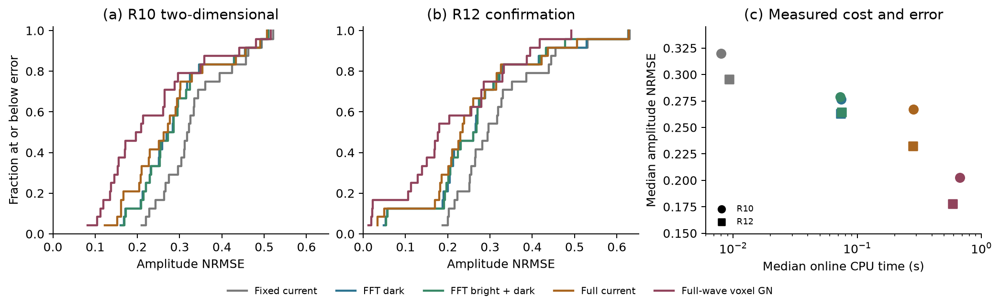
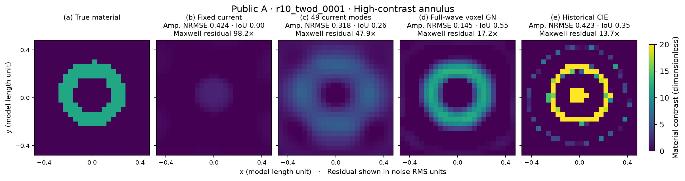
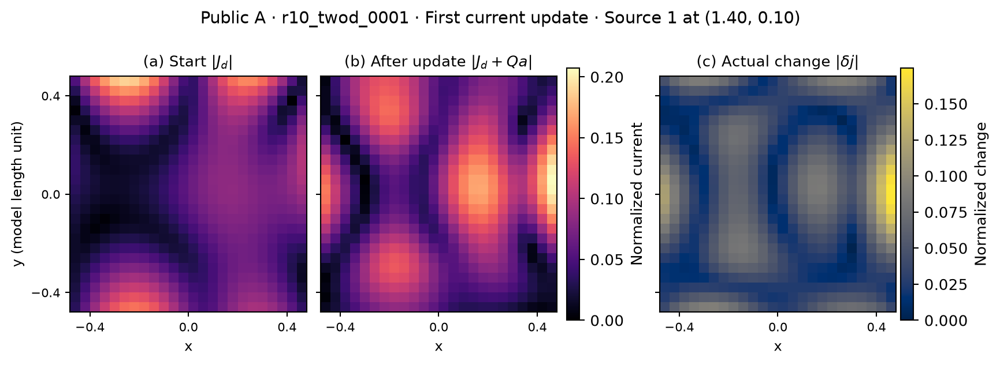

# R16 电流子空间与全像素材料交替更新

在两组共 48 份已有的带噪 Maxwell 仿真观测上，49 阶电流校正、576 像素材料拟合的在线 CPU 中位均为 **0.074 秒**。约束电流能改善固定电流的结果。全电流交替和全波体素 Gauss–Newton 的材料误差整体更低。各电流交替臂都没有达到完整物理的噪声合同，虽然它们都降低了所优化的双块目标。

## 两步怎么做

在已归档的单频标量 TM 模型上，\(G\) 是完整的 \(576\times576\) 多重散射算子，\(S\) 有 48 个接收通道，\(E_0\) 包含 12 个源。给定材料 \(m\) 和电流 \(J\)，联合代价为

$$
\mathcal L(m,J)=
\frac{\|SJ-Y\|_F^2+\lambda^2\|(I-D_mG)J-D_m E_0\|_F^2}{2\|Y\|_F^2}
+\mathcal R(m).
$$

电流交替主臂使用 \(\lambda=.32\|S\|_2\)，边邻差的平方项和平滑 TV 系数各 \(10^{-4}\)，平滑量 .01。材料始终有 576 个独立实数像素，直接使用档案盒 \([.02,20]\)，起点统一为 \(m=1\)。

1. **电流步。** 从接收 SVD 在旧读数上选亮子空间 \(V_L\)，用接收投影的伪逆取得 \(J_d\)。把 \(7\times7\) 的二维低频 Fourier 电流字典投影到 \(V_L^\perp\)，正交化为 \(Q\)。固定材料，令 \(J=J_d+Qa\)。每个源的 \(a\) 通过同一个小正规矩阵计算。全电流控制将此二次代价在整个 \(\mathbb C^{576\times12}\) 上最小化。它用完整 VIE 因子分解和 48 阶接收 Woodbury 解。本轮还比较了只保持 \(J_d\)、以及允许亮电流与 Fourier 暗电流一起修正。
2. **材料步。** 固定电流，求 \(E=E_0+GJ\)。无正则控制直接用 \(m_i=\operatorname{clip}_{[.02,20]}(\Re\sum_s\overline{E}_{is}J_{is}/\sum_s|E_{is}|^2)\)，分母为零则保留原像素。主臂加入邻差正则后，在全 576 变量上用盒约束 L-BFGS-B，检查该步降低同一代价。普通体素 GN 直接拟合完整 Maxwell 正演，使用同一材料正则及起点。

旧数据选择亮模式的规则为接收奇异值至少占最大值 .05 且投影读数 RMS 至少为 \(2.75\sigma\) 的最远索引前缀。FFT 暗校正使用 49 个复系数/源，FFT 亮暗校正使用 59–60 个。主试验迭代上限 28，GN 的物理右端上限为 2028，与全电流 28 轮的 2016 右端接近。全部方法另报告实际时间。电流交替的最终材料独立完整正演一次，只用于物理验证。材料真值在各臂结束并保存预测后读取，只用于误差、IoU 和轨迹评分。两组使用历史仿真读数。 [实现](src/alternating_tsom.py)

## 同一观测上的结果

**材料相对 L2** 是 \(\|m-m_*\|_2/\|m_*\|_2\)。MAX-STRUCT 的**幅度 NRMSE** 是 \(\mathrm{RMSE}/(\max_i m_{*,i}-0.1)\)，其中 \(\mathrm{RMSE}=\|m-m_*\|_2/\sqrt{576}\)。**固定支撑 IoU** 是估计图和真值图上对比度 \(>1.0\) 的交集大小除以并集大小。结果文件分别使用 relativeL2、amplitude_NRMSE 和 fixed_support_IoU。早期半峰阈值 IoU 保存在 half_peak_support_IoU。

下表每格依次列出 **材料相对 L2 中位数 / 完整正演残差相对噪声 RMS 的中位数 / 在线 CPU 秒中位数**。R10 与 R12 均为完整的 24 案历史队列，各保留其原始观测和噪声尺度。噪声合同阈值约为 1.049，以每份观测的 576 个复通道联合统计量计算。

| 更新 | R10 二维组 | R12 确认组 |
|---|---:|---:|
| 固定 \(J_d\)，只拟合像素 | .981 / 87.35 / .008 | .986 / 92.54 / .009 |
| 49 阶 FFT 暗电流 + 全像素 | .778 / 48.35 / .074 | .894 / 60.82 / .074 |
| 59–60 阶 FFT 亮暗电流 + 全像素 | .784 / 49.86 / .073 | .886 / 60.53 / .075 |
| 576 阶全电流 + 全像素 | .745 / 23.49 / .283 | .878 / 43.56 / .281 |
| 全波体素 GN | .532 / 6.05 / .670 | .620 / 14.29 / .586 |

按 MAX-STRUCT 的评分口径，各格列出 **幅度 NRMSE 中位数 / 固定支撑 IoU 中位数**。下方论文图的误差轴使用幅度 NRMSE。

| 更新 | R10 二维组 | R12 确认组 |
|---|---:|---:|
| 固定 \(J_d\)，只拟合像素 | .320 / .016 | .296 / .005 |
| 49 阶 FFT 暗电流 + 全像素 | .277 / .428 | .263 / .224 |
| 59–60 阶 FFT 亮暗电流 + 全像素 | .279 / .405 | .265 / .235 |
| 576 阶全电流 + 全像素 | .267 / .442 | .232 / .233 |
| 全波体素 GN | .203 / .530 | .178 / .394 |

FFT 暗电流比固定 \(J_d\) 改善 22/24 和 23/24 例，比全波体素 GN 的材料误差低的只有 4/24 和 2/24 例。两队列电流交替全部超完整物理噪声合同。体素 GN 各有 4/24 例达标。FFT 暗臂在线每案 28 轮最多因子分解 28 个 49 阶矩阵，336 个小系统复右端。它在线使用零个 576 阶 Maxwell 复右端，最后的独立验证消耗 12 个。完整电流臂在线每轮 72 个 576 阶右端，另有 12 个 48 阶 Woodbury 右端。首轮电流正规方程最大相对残差 \(3.44\times10^{-15}\)。两个队列所有双块目标均单调下降。最终失败出现在完整物理相容性和材料精度，电流线性子问题本身已求解。 [R10 逐案](results/alternating_r10_twod.json) · [R12 逐案](results/alternating_r12_confirm24.json) · [汇总](results/alternating_summary.json)

## 公开 A 的实际空间图

高对比环 \(r10\_twod\_0001\) 是 R12 公开 A 中沿用的 R10 旧案例。核对了公开 A 与本轮原始观测的 \(Y,G,S,E_0\) 和网格坐标逐项相同。右端的成熟 CIE-single 材料图直接取自 R10 的归档终点，逐项等于公开 A 保存的起始材料。五幅图共用色标，数值是无量纲材料对比度，横纵轴使用档案长度单位。图中统一标注 MAX-STRUCT 的幅度 NRMSE 和固定支撑 IoU。档案 CIE 使用 62,544 个完整复右端，本轮全波 GN 使用 2,016 个。

这例的 FFT 校正把固定电流只形成的中心团块变成浅反差的环。全波 GN 找到了更接近真图的环。档案 CIE 的残差达到 13.7 倍噪声 RMS，图上可见过强的环与多出的中心团块。

| 同一环案 | 材料相对 L2 | 幅度 NRMSE | 固定支撑 IoU |
|---|---:|---:|---:|
| 固定电流 | .998 | .424 | .000 |
| 49 阶 FFT 电流交替 | .749 | .318 | .257 |
| 全波体素 GN | .342 | .145 | .548 |
| 档案 CIE | .996 | .423 | .353 |

下图只画源编号 1 的第一轮实际复电流更新，当时全图材料均为 1。三幅分别给出 \(|J_d|\)、\(|J_d+Qa|\)、\(|Qa|\)。电流使用模型归一化的脉冲 VIE 场单位。单源电流更新范数是原 \(J_d\) 范数的 **80.56%**，对应 \(SQa\) 的接收变化仅 **0.465 倍**该源的噪声 RMS。电流系数限制作用于接收器弱见方向，这张图显示了电流内部变化与接收变化的不同尺度。 [空间图数值](results/alternating_public_a_spatial.json) · [复电流数组](results/alternating_public_a_current.npz)

## 机制对照

- **固定电流的限制。** 环、壳、桥三个历史难例的完整物理残差，固定 \(J_d\) 为 98.16、78.66、101.18 倍噪声 RMS；打开 49 阶暗电流为 47.92、67.07、68.46；全电流校正为 13.30、62.06、37.07。桥案让亮电流也更新后，残差由 68.46 降到 52.90，材料相对 L2 均约 .797。关闭像素先验的逐格闭式对照在这三例几乎复制了 FFT 暗臂。
- **多迭代与扩电流带宽。** 在原 49 阶空间把上限从 28 增加到 140 轮，三例的物理残差及材料误差变化很小。把 Fourier 暗空间增大到 121 阶、迭代保持 28，环和桥的完整物理残差从 47.92/68.46 降为 22.07/43.08，壳仅从 67.07 降为 64.32。桥的材料相对 L2 同时由 .797 升到 .833，幅度 NRMSE 由 .315 升到 .329。更宽的电流空间降低了部分读数差，仍可能留下材料歧义或错误优化盆地。 [先导细表](results/alternating_pilot_scores.json) · [更多轮次](results/alternating_time140.json) · [更宽电流字典](results/alternating_rank121.json)

复现主对照先运行以下命令，再用 R12 队列名替换 R10 队列名和标签。归档路径由 [cohorts.py](src/cohorts.py) 解析。全波基线和边邻正则由独立的 [voxel_gn.py](src/voxel_gn.py) 提供。空间图使用已保存的 R10 输出、公开 A 配对输入及原 R10 CIE 预测。

    python src/alternating_tsom.py fit --families r10_twod --tag _r10_twod
    python src/alternating_tsom.py score --tag _r10_twod
    python src/alternating_figure.py
    python src/alternating_spatial.py
