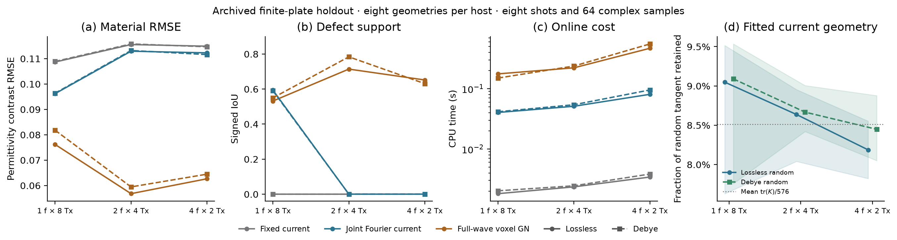

# R16 宽带电流与共享全像素材料的对照

沿用 R15 的外部板仿真档案。在同样 8 次发射、64 个复读数和单位总能量下，**每频 49 阶 Fourier 电流交替在单频 16 GHz 找到了全部缺陷对象的材料支撑，在两种宽频配置下均未达到支撑阈值**。对同样的宽频读数用完整正演拟合全图后，两宿主的双频幅度误差最低。几何计算显示，按本构权重合成的迹仍接近 49；本例把可表示方向的比例和宽频对材料恢复的帮助分开测量。

## 归档与三个采集方案

使用原始 48×48 细网格生成的 R15 无损板和正确 Debye 宿主读数。每个宿主包含同一组八种非空形状和一个空板。16 份非空结果是两组物理读数，几何形状逐例配对。反演仍使用 R15 的 24×24 有限板宿主消元算子，材料图有 **576 个实数自由度**。无损板 \(\varepsilon_h=2.25\)，空气孔相对空板的对比度为 \(-1.25\)。Debye 板使用 \(\varepsilon_h(f)=2.10+0.35/(1-i\,2\pi f\,10\,\mathrm{ps})\) 及储存的复数色散比例 \(\alpha_f=(\varepsilon_h(f)-1)/1.25\)，模型里的实际对比度为 \(\alpha_f m\)，实材料 \(m\in[-1.25,1.5]^{576}\) 在频率间共用。

| R15 设计 | 频率 GHz | 各频发射数 | 各频每次接收数 |
|---|---|---:|---:|
| 1 频 × 8 源 | 16 | 8 | 8 |
| 2 频 × 4 源 | 2、30 | 4 | 8 |
| 4 频 × 2 源 | 2、12、20、30 | 2 | 8 |

端口索引由 R15 的 designs.make 直接确定。两种宽频设计覆盖同一个 2–30 GHz 区间，频率密度和发射角密度同时变化。每次发射的归一能量为 \(1/8\)。原始加性噪声逐元素复用，读数噪声复 RMS 为 \(1.285075\times10^{-4}\)。该批原档案记录的是已校准的空板差分读数，未注入共同复增益误差，三种算法均使用固定单位增益。已知宿主、非频变增益和原噪声是本轮比较条件。

## 电流步与材料步

每个频率按 R15 的接收奇异值与旧读数 SNR 规则定亮子空间。固定电流基线始终使用其接收伪逆 \(J_{d,f}\)，随后对所有频率联合拟合一次实体素。交替臂另外在每个频率用 \(J_f=J_{d,f}+Q_f a_f\) 最小化数据与本构平方误差。\(Q_f\) 来自 \(7\times7\) Fourier 低频字典在亮空间正交补的投影。各次发射用 49 个复系数，三种设计每轮共 392 个复系数。

固定 \(J_f\) 后令 \(E_f=E_{h,f}+G_{h,f}J_f\)，在所有频率上同时最小化

$$
\sum_f\beta_f\|J_f-D_m\alpha_f E_f\|_F^2,\qquad
\beta_f=(.32\|S_{h,f}\|_2)^2.
$$

不加正则时，每个像素的解是在频率和照明上累加 \(\beta_f\Re\langle\alpha_f E_f,J_f\rangle\)，除以相应的 \(\sum_f\beta_f\|\alpha_f E_f\|^2\)，再投影到真实材料盒。实验三臂共用 R15 的二次可微近似 TV 及幅值惩罚参数 .0055 和 .0035，材料步在 576 个独立实变量上做盒优化。全波像素 GN 直接用 R15 的原投影实现。交替与 GN 从空板开始，迭代上限均为 24；以实际计算量比较。预测写出前不读取材料真值。完整物理残差通过重新正演最终材料得到。 [实现](src/broadband_current.py)

## 材料和读数

各格是八个非空物体的 **材料 RMSE / 签名支撑 IoU** 的中位数。材料 RMSE 的单位是无量纲介电对比度。签名 IoU 使用 R15 的 \(|m|\ge.20\) 阈值，只把符号正确的像素计入交集。

| 板模型 / 布局 | 固定电流 | Fourier 电流交替 | 全波像素 GN |
|---|---:|---:|---:|
| 无损 / 1 频 | .1086 / .000 | .0962 / .594 | .0762 / .531 |
| 无损 / 2 频 | .1155 / .000 | .1129 / .000 | .0568 / .714 |
| 无损 / 4 频 | .1149 / .000 | .1123 / .000 | .0626 / .652 |
| Debye / 1 频 | .1089 / .000 | .0963 / .590 | .0818 / .549 |
| Debye / 2 频 | .1158 / .000 | .1132 / .000 | .0594 / .784 |
| Debye / 4 频 | .1147 / .000 | .1116 / .000 | .0645 / .631 |

两种宽频配置下，交替的所有非空材料峰值均低于 .20，因而没有报出支撑。原读数不变，只把各频的 \(\beta_f\) 换成它们的平均、保持总系数不变，四个宽频组仍全部低于支撑阈值。该权重对照改善了两个四频组的中位 RMSE 至 .1087 和 .1085。展宽高权重区间这项单一改动不足以使交替臂恢复材料。

另在相同双频和四频读数上开放亮电流。每频用 \(L\) 个亮向量替换同数量的暗向量，总方向固定为 49，保留原本构权重、全像素更新和 24 轮预算。32 份非空的结果均低于 .20 支撑阈值，最大峰值 .0939。完整正演残差的四组中位数，从固定亮电流的 **12.62、9.40、6.00、4.89** 倍噪声 RMS 增至 **13.47、10.12、6.39、5.30**。按无损双频、无损四频、Debye 双频、Debye 四频排序。32/32 例末端本构代价下降，28/32 例联合代价下降，32/32 例重新正演残差上升。两个空板各两布局均无支撑标记。这个固定维数替换检验保留了两项不同的限制，允许亮分量变化，并减少等量暗模式。 [亮电流软更新逐案](results/broadband_current_soft.json)

非空物体的完整正演残差，以每通道噪声 RMS 为单位，交替的六组中位数为 **4.20–12.62**，全波 GN 为 **0.55–0.73**。全部 48 个非空布局–对象组合，GN 都落在名义 99% 加性噪声球内，交替和固定均无达标。将归档的评分真材料直接放入 24 网格正演，无损双频的残差中位数为 **3.21**，已超过名义球。细网格采集与粗网格反演的失配仍存在，GN 的低残差和成像精度需同时读取。空板另作检查：两个空板的三个布局上，两种电流法均未报出 \(|m|\ge.20\) 的像素，无损 16 GHz 的 GN 报出 3 个像素，其余空板布局没有标记。 [逐案结果](results/broadband_current.json) · [离线材料评分](results/broadband_current_scores.json) · [等频本构权重对照](results/broadband_current_flat.json)

## 加权几何与计算代价

在一个已知状态上，\(A_f=I-D_{\alpha_fm}G_{h,f}\)，令 \(P_f\) 投影到 \(A_fQ_f\) 的列空间。一个实材料方向 \(d\) 的加权本构切线是 \(t_f=\sqrt{\beta_f}D_d\alpha_f E_f\)。定义 \(g_{fi}=\beta_f|\alpha_f|^2\sum_s|E_{f,is}|^2\)。以各像素总照明能量标准化后，联合材料可表示算子的对角与迹为

$$
K_{ii}=\sum_f \frac{g_{fi}}{\sum_\nu g_{\nu i}}\,(P_f)_{ii},
\qquad
\operatorname{tr} K=\sum_{i,f}\frac{g_{fi}}{\sum_\nu g_{\nu i}}\,(P_f)_{ii}.
$$

这里的迹对应 \(\sum_f\|P_ft_f\|_F^2/\sum_f\|t_f\|_F^2\) 的标准化实二次型。按像素算投影能量，和独立计算提取的 \(P_f\) 对角线核对；另对四个固定实随机方向比较显式投影与应用实二次型的结果。共检查 **108** 个状态，包括 18 个已归档物体、三个布局、固定空板材料与全波拟合材料两个锚点。迹差最大 \(7.11\times10^{-15}\)，单像素和随机方向比率差最大 \(2.09\times10^{-16}\)。迹落在 **48.982–49.149**。拟合后，随机实方向的保留比例各组中位为 **8.19%–9.09%**。这是局部投影量，按频率数增加的模式总数和最终恢复质量分别统计。无损双频在拟合状态的典型对象里，任何像素分给 2 GHz 的本构权重最多约 **0.7%**；Debye 约 **3.9%**。等权消融仍漏报，因而证据支持一个共同读回权重偏置，但不足以把失效全部归因给它。

交替在线 CPU 的组中位数为 **.040–.095 秒**，全波 GN 为 **.150–.553 秒**。交替的组中位使用 184–192 个 **49 阶**复右端，在线更新使用零个 576 阶右端。最终完整正演每例另计至多 8 个右端。GN 在线组中位使用 **296–656 个 576 阶**复右端，含解析接收转置。两类宿主、合计十个不同宿主–频率首次构建共约 **.187 秒 CPU**，每次一个完整宿主因子分解和 600 个复右端。构建、材料更新、完整正演验证和加权迹检查的费用已分别记录。 [汇总数据](results/broadband_current_summary.json)

## 复现输入

将 R15 的研究目录作为同级目录，或用 --r15 指定该目录。最小输入为 R15 的 src/designs.py、src/ndt.py、src/inversion.py，以及 results/holdout_observations.npz、results/holdout_debye_observations.npz、results/holdout.npz 和 results/holdout_debye.npz。后两份只用于评分。此轮无需重新生成任何观测。

    python src/broadband_current.py fit
    python src/broadband_current.py score
    python src/broadband_current.py flat
    python src/broadband_current.py soft
    python src/broadband_current_figure.py
