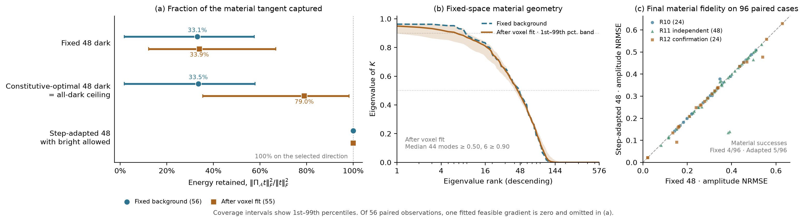

# 在电流域选方向，能否改善 576 格材料重建？

**可以用少量电流方向准确表示一次指定的材料更新。对整张材料图，目前观察到的改善较小，普通的电流—体素交替已经能取得同样或更高的恢复数。** 我们在 MAX-STRUCT 保存的环、壳、桥、多岛、梳齿和连续高对比材料上检验了这个差别。主样本为 96 份不同的带噪仿真读数，收发设置为 12 发、48 收。材料始终有 576 个独立实数。读者可从下面的两个具体问题理解这一轮。[网页版](https://migodam.github.io/b1-probabilistic-maxwell-imaging/research/research_z_alg_r16/) · [交给 ChatGPT](https://migodam.github.io/b1-probabilistic-maxwell-imaging/research/research_z_alg_r16/handoff.html)

## 一格材料，多个照明，怎样真正做两步更新？

第一步在**感应电流域**进行。已知当前材料和带噪复读数，用 FFT-TSOM 选择的空间模式更新每次发射在物体内部产生的电流。第二步在**体素域**进行。用新电流和固定 Green 算子算出总电场，对每一个格点求同一个实材料值，使它尽量同时解释各次发射的电流。再把这张材料图送入完整 Maxwell 正演，检查它能否解释接收端的数据。这样可以由使用者选电流阶数、强接收分量和本构权重，图上的环可以断开、桥可以连上，每个格点的取值仍由数据和共有的先验共同决定。

Z-ALG R3 的教训是，固定其余材料后找到的 538 个小块合法候选，直接改善完整数据最佳残差的次数为零。R10 的教训是，每条方程可以各自成立，却没有一份材料能把它们一起解释。R16 用所有发射共用一个实数的本构关系连接两个更新，并区分 R10 中旧照明未覆盖的响应方向与 FFT-TSOM 中接收器不敏感的电流方向。后者可以很多，实际材料仍受两者共同约束。[R3 与 R10 的逐式推导](MATHEMATICAL_THEORY.md)

## 一个数学问题可以精确回答

假设我已经选好了某个格点组合的材料变化，例如由旧观测给出的全图下降方向。**任意增加接收器不敏感的电流模式，最多能把这次变化表示到什么程度？** 记 \(L_m=I-D_mG\)，\(V\) 为被锁定的强接收方向，\(T=D_{\delta m}E\) 为材料变化希望产生的本构变化。把 \(T\) 投影掉 \(L_m^{-*}V\) 的分量，再用当前正演分解解一次多右端，就得到全部暗电流中最匹配的那次更新。结果最多包含与发射数相同的独立空间方向。本实验最多增加 12 个，可以保留 36 个已有 Fourier 方向。若准许强接收分量按数据一起变化，所选的这个材料方向可完全表示。

56 份历史观测给出了这个上限的量级。均匀初值处，固定 48 方向可表示 **33.11%** 的指定材料步能量（56 案中位数）；开放所有暗方向的上限也只有 **33.48%**。在体素拟合后，55 个非零可行梯度上，固定 48 方向为 **33.95%**，上限为 **78.96%**。按推导选取至多 48 个暗方向，就达到全部暗电流的上限，实际最大差 \(1.23\times10^{-15}\)。在另一个随机材料方向上，可表示比例仍约 8%–9%。

这个差别受一个总量控制。在固定单频步上，将每格按当地多源总场强度归一化，可表示能量对应于一个 \(576\times576\) 实矩阵 \(K\)。只要每格至少被一个源照亮，就有 \(\operatorname{tr}K=r\)，\(r\) 是所选电流空间的秩。因此可以把有限能力集中到当前想走的方向；换一个方向时需要重新判断。这个量衡量给定电流基与材料变化的相容性。它本身不能确定旧观测中有多少个材料解，也不能预知数据下降方向会不会接近真材料。[证明与适用条件](MATHEMATICAL_THEORY.md) · [逐案谱和方向](results/current_geometry.json)

## 回到整张图，得到了什么？

主样本中，每案允许至多 60 次完整 Maxwell 分解。直接全体素拟合有 **4/96** 达到历史材料标准；先用固定 48 个 Fourier 方向更新电流，再更新体素，得到 **6/96**。用新电流估计待选材料在接收器上的响应，同样为 **6/96**。强接收分量也可调整、能将当前指定材料方向表示到 100% 的方法为 **5/96**。将预算增至 180 次，纯体素、普通两步、传递新读数、最优暗电流四种方法分别为 **5、7、6、5**。同样的 8 个细网格生成、粗网格恢复对象，四种方法在两个预算下均为 0/8。[全部指标与耗时](EXPERIMENTAL_RESULTS.md)

有两份材料在 60 次比较中由传递新读数救回。高对比连续材料 \(\texttt{r12_confirm24_0018}\) 的幅度 NRMSE 从 .448 降为 .110，支撑交并比由 .210 升为 .708；另一份是混合开缝壳。也有明确退化的例子，混合水平集 \(\texttt{r12_confirm24_0002}\) 的 NRMSE 从 .453 升到 .540。全部 96 案中，传递法相对纯体素有 19 案改善至少 .01，9 案恶化至少 .01；两方法逐案误差差的中位数约为零。96 案并未显示每种对象都能从这种更新受益。[逐对象结果](results/current_cases.csv)

再把所有方法换回 MAX-STRUCT 原有的空间先验和全波优化器尺度。180 次分解时，直接体素拟合达标 **8/96**，普通两步更新达标 **11/96**，二者每案 CPU 中位数均约 **1.38 秒**。传递新读数及按上限构造暗模式均为 **9/96**。普通两步法相对体素法有 28 案的幅度 NRMSE 至少下降 .01，8 案至少上升 .01。按组拆开，R10 的普通两步与体素法分别为 2/24 和 4/24，R11 为 6/48 和 2/48，R12 为 3/24 和 2/24。电流域确实值得更新，准确表示某一个方向的数学收益，尚未转化成超出普通交替的材料收益。[档案原目标逐案对照](results/current_cases_archive180.csv)

## 原生 CIE 揭示的成本

在 24 个 MAX-STRUCT R10 对象上直接调用原版 GlobalDual FFT-CIE，固定阶段预算、材料更新和目标函数。末段 Fourier 坐标从 576 收窄至 144，**整次反演 CPU 只省 3.2%**。每一轮仍要在完整物理网格上算 Green 传播，并更新所有像素。完整接收误差中位数从 2.84% 升到 14.32%，材料 RMSE 中位数从 1.666 升到 1.845。用六个当前残差方向替换掉六个 Fourier 模式，材料 RMSE 在 21/24 例变坏。保留窄频全部模式再增加六个方向，增加 Fourier 或残差方向均有帮助，同维直接比较中增加 Fourier 的材料 RMSE 在 18/24 例更好。

对一个历史高对比环，源 1 第一轮更新的电流变化量达到原值的 80.6%，传到接收端却只有 0.465 倍该源噪声 RMS。在原 CIE 的坏端点上重新使用原物理目标，各电流臂均无法带这幅环图离开原终点。借助不同先验把误差降下去时，普通体素求解也能复现这个改善。作为参照，R10 长预算的原生 GlobalDual 加全波校正达到 10/24，另一个历史单权 CIE 达到 11/24。[原生 CIE 等预算消融](NATIVE_CURRENT.md) · [历史强基线](HISTORICAL_CIE.md) · [环案的真实电流与材料图](ALTERNATING.md)

## 测量与论文判断

主比较全部复用了已有读数，未购买任何新增测量，也未因减少电流坐标而减少物理曝光。R15 已在同覆盖 2–30 GHz 的设备几何上发现，等能量、等复读数的两种 MIMO 采样安排，对不同有限材料对的判别优劣可以反转。R16 的多频推导给出各频率局部场能量与电流空间投影对角元的加权和，用于评价共同材料更新的可表示性。两者解释的是测量分配和算法选模两个不同环节。[R15 宽带研究](../research_z_alg_r15/) · [多频公式](MATHEMATICAL_THEORY.md)

我们还把两步更新接到 R15 原宽带观测上。8 种非空缺陷各有一份无损和一份已知 Debye 色散观测，另有配对空板。三种安排均付出 8 次发射、64 个复读数和同样总发射能量。在无损板上，完整体素 GN 使用单频 16 GHz/8 个发射角、2 和 30 GHz/4 个角、4 个频率/2 个角，材料 RMSE 中位分别为 **.0762、.0568、.0626**。每频只更新 49 个暗电流方向、再共同更新 576 个材料格时分别为 **.0962、.1129、.1123**。已知色散下得到同样的排序。两个宽带安排中低秩交替的有符号支撑 IoU 中位数均为零。把本构项的频率权重拉平，也未恢复出超过对比度阈值的缺陷。相同测量对全波 GN 有用，两步法的电流选择与材料读出仍丢失了可用于恢复的信息。[宽带原始读数的对照](BROADBAND_CURRENT.md)

同样保持每频 49 维，把一部分暗电流方向换成可调的强接收方向。上述 8 种形状在两个宿主、两个宽带安排下共形成 32 次非空配置比较；32 次的完整物理残差均增加，均未取回超过阈值的材料支撑。这个对照把单频局部方向上限与宽带最终成像区分开来。[软更新原始记录](results/broadband_current_soft.json)

**值得保留的结果是特定材料方向的可计算上限，以及用少量电流模式恰好达到这个上限的构造。** 它把 R3 的传播度量和 R10 的共享材料条件直接变成可以检验的算法诊断。当前数据支持把它用于判断“继续加暗模式还有没有意义”；据此选择的方向尚不能更可靠地恢复严重错误的材料。这一构造使用投影最小二乘和响应快照，不能把一般投影代数或原有 FFT-TSOM 改称 Maxwell 新理论。

按目前证据，最接近 **Inverse Problems** 的内容是固定接收约束下的方向上限、达到条件及与实际可辨识性的差距。要形成强理论稿，还需证明它怎样界定一片材料域的可恢复精度，或给出连续模型下的稳定性。**SIAM JIS** 的算法稿需要在独立对象上、相同总成本下稳定胜过成熟 CIE 或正则化全波反演；现在只有少数对象得益。**IEEE TAP** 的成像稿还需要宽带实测、物理端口与误差说明，并展示相同硬件预算下的材料恢复优势。这轮可以独立发表的数据和推导目前适合作为较大研究的一个章节，尚不足以宣称形成上述强刊的完整突破。[下一轮数学交接](NEXT_PRO_HANDOFF.md)
