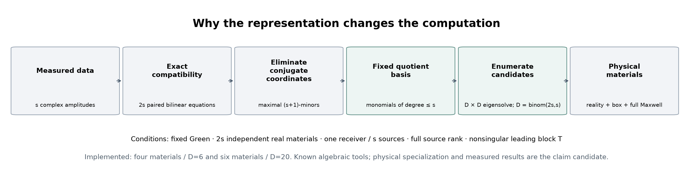
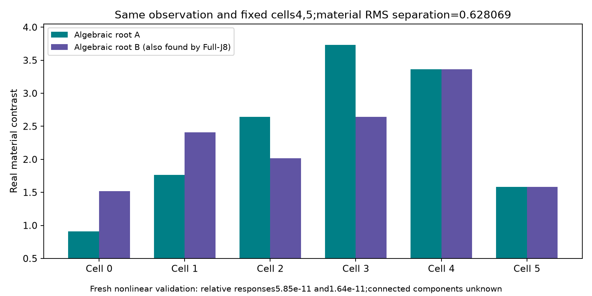
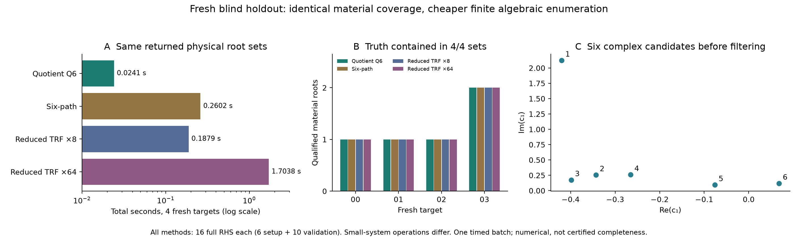
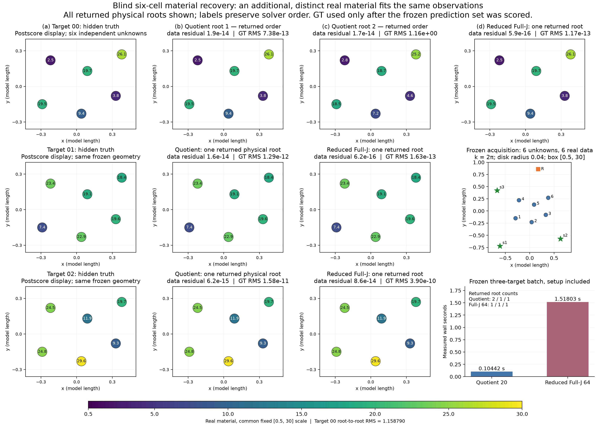
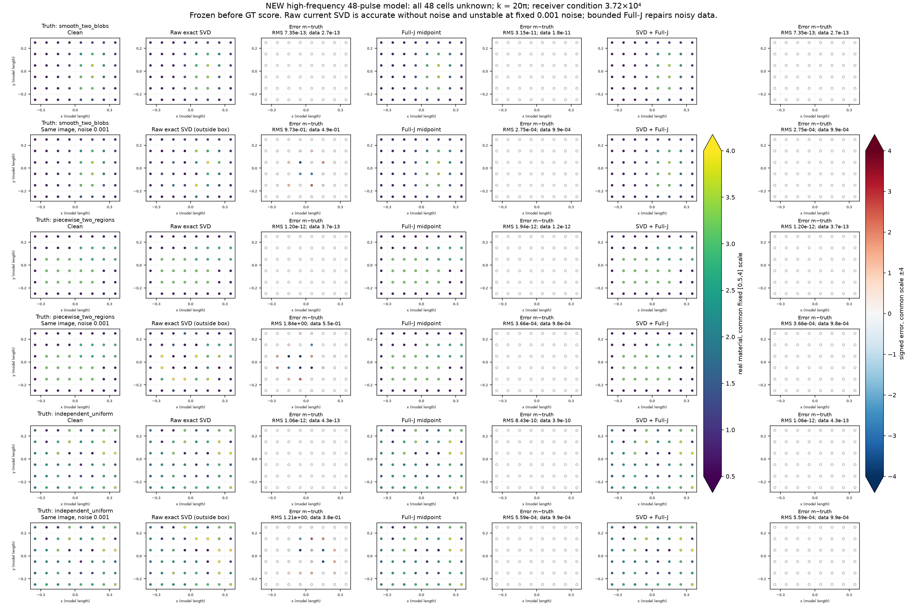

# Research Z-ALG-R2：用行列式商代数枚举 Maxwell 材料解

**2026-10-30（Asia/Singapore）。本轮得到一个可直接运行的代数求解器及其条件推导：固定Green、2s个独立实材料、s个独立照明和一个复接收下，在明确非退化条件成立时，完整非线性离散Maxwell逆问题可转为维数binom(2s,s)的商代数。四材料用6×6特征解，六材料用20×20特征解。** 它从观测产生材料候选，不需要已知GT或沿局部弱方向行走。

最重要的新实验是六材料盲确认：三份新观测上，20维商求解器返回2、1、1个合法材料根，固定64起点对照返回1、1、1个；两者的集合均包含隐藏GT。额外材料与另一根相距1.15879 RMS，完整非线性响应相对残差约1.8×10^-14。总wall为0.1044秒对1.5180秒。这支持本次有限协议下的计算与覆盖收益，不证明所有普通方法都无法找到额外根。

四材料新盲批次另有一致的速度证据；48单元完整盲成像也已完成，并保留了噪声下原始SVD失败。48单元使用标准SVD/Full-J，**不是20维商代数在48未知量上的应用**。

**论文裁决：保留“平衡采集的条件行列式商求解器”作为方法论文候选。** Eagon–Northcott、Hilbert–Burch、双线性消元、商乘法矩阵、CSI/SOM和SMW都有直接先例；可能的贡献在于共享实材料的物理压缩、明确退化条件和实际找根收益。全球新颖性与严格数值全根认证仍HOLD。

[完整复现包](https://raw.githubusercontent.com/migodam/b1-probabilistic-maxwell-imaging/main/research/research_z_alg_r2/FULL_REPRODUCIBILITY.zip) · [公式集](FORMULA_COMPENDIUM.md) · [完整理论](MATHEMATICAL_THEORY.md) · [算法与入口](ALGORITHM.md) · [机器结果](RESULTS_SUMMARY.json) · [费用](COST_LEDGER.md) · [复现](REPRODUCE.md) · [独立审查](audit/FINAL_SCIENTIFIC_REVIEW.md)

## 1. 这次改变了什么

一组散射数据可以对应多个材料。我们需要的是从观测直接找到这些材料，而不是只在一个已知材料旁边沿弱方向走动。

历史E1已经建立非对称六材料的局部二维等响应集合；直接材料与完整current方法覆盖相同，公平总节时只有13.6%。因此本轮没有扩大current未知量，也没有重新做概率积分。首先尝试直接材料多项式化，随后发现一个更小的兼容系统，最终把其根搜索进一步变成有限线性代数。

实际研究链条是：

1. 直接四材料多重仿射系统需要24条标准起始路径；分母清除产生很多非物理基点。
2. 先消掉两个复测量约束，再强制各照明共享同一实材料，得到四个双线性方程，只需6条标准多齐次路径。
3. 六路径仍比小型Full-J多起点慢，继续消元得到四个三次最大子式；它们有特殊的行列式理想结构，形成六维商环。随后通过Eagon–Northcott推导推广到平衡采集的商代数族，六材料20维实例完成了新的盲确认。
4. 用商环乘法矩阵直接求根，才同时获得明确成本收益与材料候选集合。

这两次表示改进均由推导和已支付的失败驱动，没有通过调学习率、放宽旧box或反复更换seed救结果。

## 2. 物理模型与历史继承

所有新候选都使用完整非线性标量TM、圆盘常数pulse的Hankel–Green VIE。固定源、接收和圆盘标签；每个源共享同一实对比度。它是有限离散波动物理模型，不是Born，不是三维矢量或连续PDE认证。

|任务|未知量与采集|材料支持|用途|
|---|---|---|---|
|E2公共模型|4材料，2源×1复接收|[.5,4]|旧观测的代数根结构，不当盲成像|
|E1新盲观测|6材料，2源×1复接收|[.5,4]|二维纤维的材料切片遍历|
|HIGH4|4材料，原非对称E2几何|**新**[.5,30]|独立高正对比度、多离散根任务|
|QH4新盲确认|同HIGH4，4个全新目标|[.5,30]|最终算法先冻结、后生成观测|
|GENERAL6新盲确认|全部6材料，3源×1复接收|新[.5,30]|20维商推广及64起点控制|
|INFO12|12材料，3源×16接收|[.5,4]|充分观测直接逆的小型盲成像|
|HIGHFREQ48|全部48材料未知，8源×96接收，k=20π，圆盘半径.01|[.5,4]|更大空间成像及固定噪声失败控制|

HIGH4是新声明的支持，不改变旧E2的唯一已发现合法根结论。HIGHFREQ48是新采集配置；原低频48单元接收矩阵条件数约10^16、数值秩不足，已保留负诊断，没有声称低频模型被直接SVD成功解决。高频配置只根据几何算子可辨识性选择，生成GT之前冻结；其接收条件数仍达3.72×10^4。

R5-B的真实CNN成像改善、R6的成本正结果、R7的有限竞争材料与A17X的高秩端口障碍均保留。[历史审计](HISTORY_AND_OPEN_PROBLEMS.md)在启动约9分钟内完成，未重算旧实验。

## 3. 核心推导为何能产生算法

### 3.1 固定Green确实能复用，但不能随意声称低秩

完整状态满足j=D(E0+Gj)。固定四个变化单元，通过精确Schur/SMW得到

\[
Y-Y_0=L(I-\Delta K)^{-1}\Delta q.
\]

K/L/q只依赖参考与活动支持。它们不随这四个材料变化；原完整resolvent与小resolvent的奇异性等价。一般稠密decoder方向并不具有这个秩；A17X历史中“七参数变化575像素”的障碍仍然成立。

### 3.2 先消掉测量，再处理真实材料

定义接收传递行w，则

\[
wq=Y-Y_0,\qquad w=(L+wK)\Delta.
\]

rank(q)=2时，第一式用固定子空间写成w=w0+cN，c有两个复坐标。材料为实数的条件给出四条双线性方程

\[
f_i(c,d)=w_i(c)\bar v_i(d)-v_i(c)\bar w_i(d)=0,\quad v=L+wK.
\]

d在求根时独立，之后检查d=conj(c)。这一步不能省略，否则复代数根会冒充真实材料。接收端表示转置后就是已有CSI/SOM的单照明形式；本轮不将它本身命名为新物理机制。

### 3.3 六维商环是主要新增计算结构

把四式写成A(x,y)(1,d1,d2)ᵀ=0。A是4×3线性矩阵，四个最大子式为三次式。将最高四个三次单项式的系数组成T，低次项组成R。

**已推导的条件定理：** T可逆时，最大子式理想的商空间恰为六维，基为1,x,y,x²,xy,y²。理由是T排除射影无穷远零点，Hilbert–Burch分解给出长度6。实材料兼容式特有的共轭交换性质还保证每个投影根唯一提升到有限d。

解一次Q=−T^{-1}R，就能构造乘x、乘y的两个6×6矩阵。若根简单且分离线性式有效，一次小特征分解恢复六个复候选，再过滤实性、节点、box、极点并完整验证。一般矩阵版本的提升反例、重根与有限精度边界都写入理论和独立审阅。

新目标仍会改变T/R；没有把整个T逆宣称为通用缓存。最高三次块对共轭观测仿射，模板可预计算；当前实现的所有在线系数构造均计价。

### 3.4 从六维特例到一般可计算公式族

最后一次理论整合发现，上述六点结构并非孤立技巧。2s材料、s源时，A(c)是2s×(s+1)矩阵，最大子式的数量与s变量的全部s+1次单项式数量一致。若对应最高次系数块T可逆，Eagon–Northcott分解给出

\[
\dim_{\mathbb C}\mathcal A=\binom{2s}{s},\qquad
\mathcal B=\{c^\alpha:|\alpha|\le s\}.
\]

这给出固定的商基和明确乘法矩阵，而不是只给一个候选根数上界。共轭交换保证唯一有限提升的证明同样适用。s=3时：15个四次最大子式、15×15线性解、20×20特征解。T不满足条件并不证明物理无解或不可辨识；一般有理核的唯一线性反例见数学附录。商维数仍呈组合增长，s=4及更大未运行。

这一步依赖成熟行列式代数。补充先例[Ito–Noma–Ohno](https://doi.org/10.1080/03081087.2014.959516)和[专门行列式Gröbner算法](https://arxiv.org/abs/2402.07353)进一步限制“数学工具本身原创”的说法。完整推导见[一般商定理](theory/general_quotient.md)。

## 4. 从失败到最终算法：真实数据账

### 4.1 六路径是表示进步，但尚不是速度胜利

第一批28切片中，三方法都仅得到3个合格材料根。六路径耗时1.483秒，标准24路径28.509秒，八起点Full-J为0.553秒。六路径减少RHS，却仍慢于强普通方法。

24路径的672条路径虽然都终止，8个切片存在端点碰撞，去重只有662个复端点。E2公共例的24个端点中，6个非分母基点、12个单侧分母基点、6个双侧基点；这解释了为什么材料分子表示会浪费路径。碰撞与分母分类是数值诊断，不是严格饱和证书。

粗自由坐标网格还造成大多数切片没有box内材料。它不能被解读为原观测没有纤维。

### 4.2 同一切片上找到了两个真实不同材料

从观测独立得到合法anchor后，固定同样的两个材料坐标，按预声明网格构造70个不同切片，精确Schur复用一次全核。

六路径返回19个合格材料，八起点对照18个。其中E1_LOW6_02的同一切片有两个合法材料，RMS距离0.62807；完整响应相对残差均小于5.9×10^-11，原resolvent稳定。这不是decoder gauge，也不是几何交换。

但总wall仍是5.288秒对2.231秒。**随后64起点的更强控制找回了两个被八起点漏掉的案例中的全部根。** 所以只声称“有限八起点未返回的根被枚举器找到”，不声称普通方法无法到达，更不声称两个材料属于不同连通分支。

### 4.3 商代数省掉路径跟踪后才形成总成本收益

最终Q6在101个已暴露切片/目标上与六路径返回集合全部一致：其中24个非空、合计27个合格端点；不是101个任务都有物理解。606个复候选数值分离，前导T条件数2.98–8.89，没有fallback，没有Newton polishing步骤。

另对冻结的6个代表任务，统一共享kernel、验收、保存和anchor费用，循环方法顺序，真实执行5次。普通ReducedFullJ8获准使用同一个精确小核和解析Jacobian。

|方法|5次总wall中位数|每次合格根|解释|
|---|---:|---:|---|
|Q6商代数|0.05935 s|9|相对缓存八起点节时67.18%|
|六路径|0.41871 s|9|数值候选集合相同|
|普通FullJ8|0.19457 s|7|八起点覆盖不足|
|缓存ReducedFullJ8|0.18085 s|7|未剥夺普通方法的SMW复用|

该表是已暴露数据的重复性能诊断，不能代替新盲确认。64起点控制已消除其中的覆盖差异，全部成本保留。

## 5. 最终算法的真正盲确认

冻结Q6、同伦及物理源文件后，独立生成4个新HIGH4观测。求解器只读取Y、几何和box。16份预测全部写入freeze receipt之后，评分器才打开私有GT。

|方法|四目标合法根数|GT在返回集合中|总wall，含准备/验收/保存|完整物理RHS|
|---|---|---|---:|---:|
|Q6商代数|1 / 1 / 1 / 2|4/4|0.02412 s|16|
|六路径|1 / 1 / 1 / 2|4/4|0.26022 s|16|
|缓存ReducedFullJ8|1 / 1 / 1 / 2|4/4|0.18791 s|16|
|缓存ReducedFullJ64|1 / 1 / 1 / 2|4/4|1.70385 s|16|

所有方法完整RHS相同：6准备+10候选验收，说明最终优势来自小系统上的代数求根，而不是给普通方法额外收费物理。Reduced8/64另分别支付7694/63926个小块RHS，不与完整物理RHS混算。

16个方法×目标集合都包含GT，最差最近根材料RMS为4.63×10^-10。双根目标的另一个合法根与GT相差约1.968 RMS，说明观测本身不能唯一挑出具体GT。这里评价的是**返回集合包含真值**，没有用GT选图或改算法。

该批次Q6比Reduced8约快7.79倍，比Reduced64约快70.65倍；只有4个小目标、一次总计时，不宣称统计总体加速倍数。由四目标批次的固定准备与均摊目标计时推算，经验交叉点为N=1；这是仿射成本模型的投影，不是另行测得的单目标交叉实验。分解和交点见[成本摊销记录](results/CROSSOVER.json)。所有中间目标系数准备、拒绝、验收与日志都包含，物理核的准备成本已包含。各方法表格均为同一Python进程内计时；公共模块导入和解释器进程启动未计入，也未单独测量。

### 5.1 决定性推广：六材料全部未知，64起点遗漏一个合法根

沿用E1六个非对称圆盘的几何，事前加入第三个固定照明。这里有六个实观测和六个独立未知材料；没有锁定两个弱坐标或提供oracle support。新[.5,30]材料box、64个中点/Sobol初始化和所有数值参数先冻结。新通用求解器源文件封存后才生成三份GT观测，六份预测封存后才评分。

|方法|三目标合法根数|GT在返回集合中|总wall含准备/验收/保存|完整RHS|
|---|---|---|---:|---:|
|20维商求解器|**2 / 1 / 1**|3/3|0.10442 s|21|
|缓存ReducedFullJ64|1 / 1 / 1|3/3|1.51803 s|18|

两者各支付9个setup RHS；代数法因多验证一个真实候选而多付3个RHS。目标生成另9个RHS，本追加研究共48个。对照可复用同一个精确小核，另外支付32,056个小系统RHS。192次优化尝试中24次达到max_nfev未收敛，均计费和保留。

每个目标均返回20个数值互异复候选，总60个；T条件数86.76–106.64，最大特征向量矩阵条件数约1.78×10^4，未执行polishing。这些是浮点稳定性诊断，不是认证全部根的证书。

GENERAL6_00额外材料与另一材料RMS相距1.158790，二者完整forward相对残差1.94×10^-14及1.71×10^-14，原resolvent最小奇异值0.356及0.317。不是微小扰动、decoder gauge或人工几何交换。所有根按求解器原返回顺序展示；GT仅在预测封存后作评分和图示。

本批次总wall比约14.54，但仅三目标一次计时；不作普遍速度推断。覆盖结论也限定于这组固定64起点和预算。更密起点、专门双线性/行列式求解器可能得到同一额外根，尚未比较。真正改进的结论是：**同一个条件代数机制已从四未知材料推进到六未知材料，并在新盲任务中找到了当前强普通对照遗漏的合法解。**

## 6. 空间盲成像与不能忽略的噪声失败

INFO12中，直接接收SVD和两种普通基线均恢复3个隐藏材料；这证明标准完整非线性直接逆可以落地，但不是新颖性。

HIGHFREQ48使用全部48个未知圆盘材料，三种事前冻结场型：平滑双团块、分段区域、独立随机材料。每个对象生成无噪和相对复噪声10^-3两份观测，参数与初始化在评分前固定。原低频48单元的秩失败也保留。

|场景|直接SVD|中点Full-J|SVD+Full-J|
|---|---|---|---|
|三份无噪观测|3/3通过原成像门|3/3通过|3/3通过|
|固定10^-3噪声|材料RMS0.973–1.842，越界且拟合差|材料RMS2.75×10^-4–5.59×10^-4|同等材料误差，与中点解一致|

噪声结果的相对数据残差约9.8–9.9×10^-4，符合这批观测的噪声尺度；原1e-8精确response-fit标志仍为false。**没有改门把带噪结果标为精确解PASS。** 直接SVD的病态失败与公式集的噪声放大界一致。

全部6输入计一次setup，中点Full-J用0.1636秒/4136 RHS，混合方法0.0685秒/1960 RHS。优势主要由无噪直接逆减少迭代带来；噪声下混合方法并非每例都少迭代。没有依据GT挑初始化或调正则参数。

该实验与Q6的关系是“固定物理算子可复用”的共同计算思想；它**不等于在48未知材料上执行六维商枚举**，也不是原P1/Full66反演。

## 7. 先例、原创性与论文资格

[Everett 1996](https://doi.org/10.1006/jcph.1996.0070)已有小Helmholtz逆问题多项式化和多根搜索；[Everett 2026](https://doi.org/10.1093/gji/ggag432)进一步讨论等拟合模型的路径搜索。不能声称首次代数逆散射或首次寻找多个材料解。

[CSI](https://doi.org/10.1088/0266-5611/13/6/013)和[SOM/TSOM作者综述](https://doi.org/10.4310/MAA.2010.v17.n4.a6)已建立电流、本构与固定子空间分解。SMW和Schur也都是标准公式。

[双线性系统的专门求解](https://doi.org/10.1145/2930889.2930919)、[稀疏双线性消元与特征方法](https://arxiv.org/abs/1805.05060)及经典Hilbert–Burch六点结构直接限制本轮的一般数学首创主张。针对本具体Maxwell实兼容商的检索没有找到完全相同的应用，但这只是有限检索结果，不是全球新颖性证明。ScholarQA检索/验证429的失败收据保留，后续采用明确标识的一手全文和出版元数据。

|候选主张|裁决|
|---|---|
|平衡2s材料的行列式商条件定理及共轭有限提升|**条件数学结论成立；物理应用优先权HOLD**|
|可运行的直接根枚举器，并在有限新观测下有成本收益|**限定实验支持**|
|比所有强普通方法发现更多根|**不成立；仅GENERAL6固定64起点遗漏一个，四材料强控制根集相同**|
|真正全域/全分支遍历或认证唯一性|**未建立**|
|原Full66、连续PDE或三维矢量推广|**NOT_RUN**|
|48单元SVD/Full-J混合成像是原创算法|**不作为原创性主张**|

更完整候选论文结构见[PAPER_CANDIDATE.md](PAPER_CANDIDATE.md)。

## 8. 失败、成本与执行透明度

本轮新增 **53,951个完整复RHS**，包括32,656前向源RHS、748独立验证RHS、14,621接收伴随RHS、5,088材料切向RHS、768参考准备RHS和70数据生成RHS。143,150个小系统RHS另列。旧anchor在方法比较中分摊，但总支付账只计一次。

保留48次已付费优化未收敛、24路径8次端点碰撞、粗切片大多数无根、六路径总wall不胜、SVD噪声失败、弱先例覆盖及28个仅有开发摘要的RHS。最后一项缺少完整原始端点，是明确证据缺口；没有藏为零成本。新盲驱动的一次文件guard误匹配在读取观测和物理调用前修复，0 RHS，原冻结与修复收据均保留。

硬件Apple M4、10 CPU、24 GiB，Python3.13.13、NumPy2.5.3、SciPy1.18.1，单线程CPU；无NN训练、无GPU、无云计算收费。已记录计算收据wall/CPU仅为部分算术窗口，不能冒充整个科研耗时。实际工作从2026-10-29 23:40:44 SGT开始，在180分钟硬限内交付；终止时间以CLOSURE.json为准。

原生运行日志确认：主代理gpt-6-astra/xhigh；理论Astra/max；独立审查Astra/high；求解器Sol/high；盲成像Sol/medium。原生并发上限为含主代理4个，故阶段轮换，未假装同时运行五个子代理；未使用DeepSeek。见[audit/AGENT_RUNTIME.json](audit/AGENT_RUNTIME.json)。

## 9. 最短的下一步

六材料推广已在本轮完成。现在最影响论文结论的缺口是：**让对照也使用专门双线性/行列式求解方法，并系统研究前导T退化时的图表切换或替代消元**。普通多起点的遗漏不能替代结构化代数方法之间的比较。应先验证方法优势来自物理兼容压缩还是通用消元实现，再决定是否投入更大未知量。

若需要严格有限box覆盖，还须把精确线性参数化、Hankel/系数误差、特征根认证与节点/极点排除连起来；目前浮点SVD得到的零空间和小残差不能替代此证书。48未知材料的商枚举、Full66、连续PDE、monodromy群与分支连通性均未建立。若后续强对照消除优势，应把本轮保留为范围明确的代数方法与可复现基准，不包装成通用成像突破。
