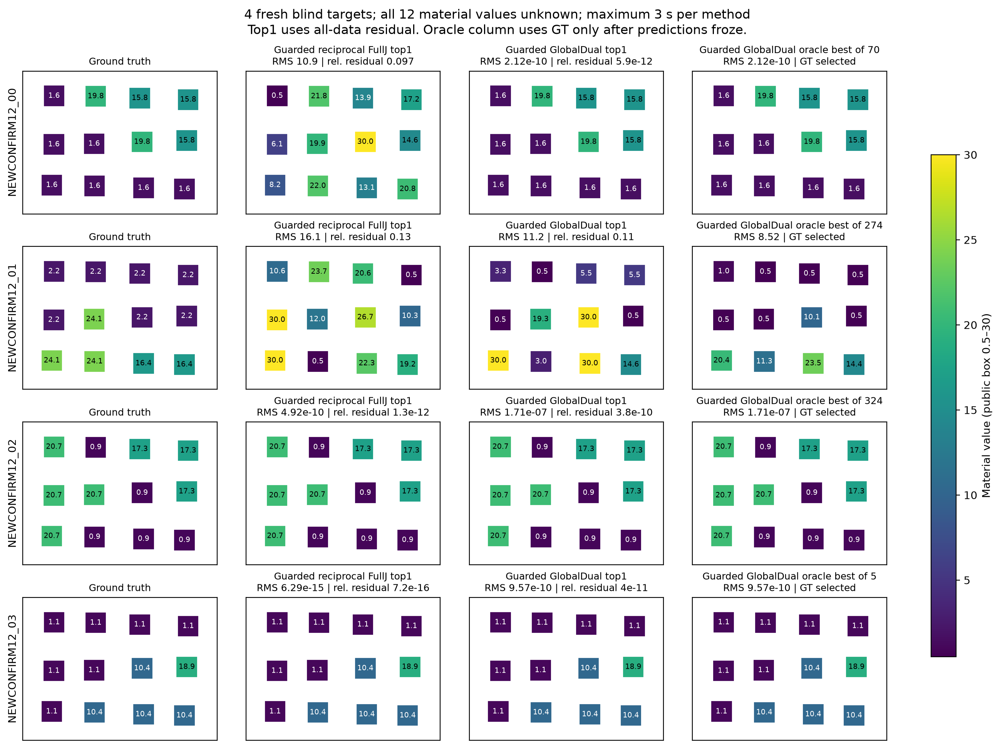
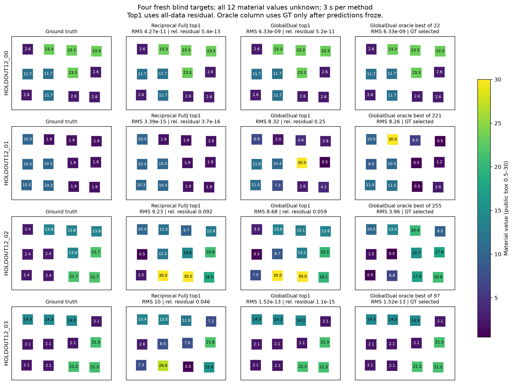
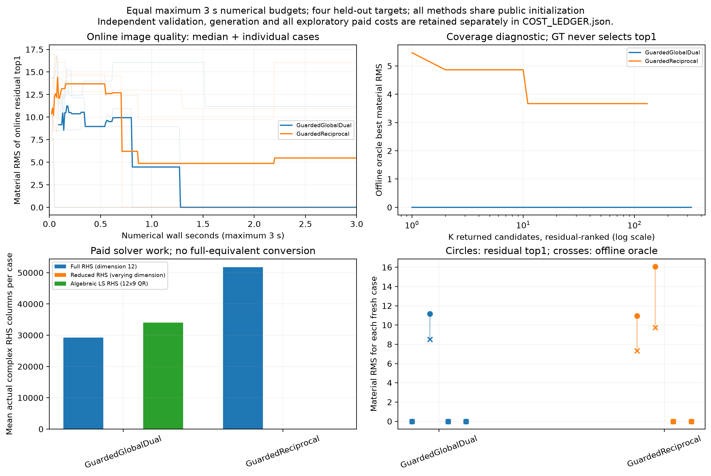

# Z-ALG-R3：代数候选如何帮助真正的 Maxwell 成像

**结论先说：我们实现并检验了两条路线。局部商代数确实产生很多不同材料，但本轮没有证明它改善 GT recovery；转向全观测本构兼容性与普通物理修正后，最终四个新盲目标中多恢复了一个目标。独立论文主张仍为 HOLD。**

最终冻结比较中，普通求解保护＋全接收兼容性候选达到3/4个预声明数据拟合门，保护＋倒数材料 Full-J 达到2/4。新增成功案例的在线材料 RMS 为 **2.12×10⁻¹⁰ 对10.94**。这是真正由观测排序的 top1，不是事后用GT从候选中挑选。另一方面，两种方法都失败了一例；总 wall 没有下降，而且有效路线与成熟 CSI/SOM、变量投影和约束松弛有直接关系。

所有实验都是 **12个实际材料单元全部未知、3源×3复接收、完整非线性二维 scalar-TM VIE**。没有扩大成Full66、24/48单元或连续/三维 Maxwell；没有神经网络训练。源代码、公开观测、原始预测、冻结记录、图、失败和成本已完整保存。科学实验在开始后33.4分钟封账，后续只做推导整理、复核、图与发布。

## 1. R3相对R2究竟增加了什么

R2建立的小型商代数仍然成立：4材料的Q6和6材料的Q20能把特定平衡观测下的兼容性方程变成小型乘法矩阵特征问题。R2六材料盲实验中，Q20在一例多找到一个合法等响应材料。这是重要正面结果，但没有回答更多未知材料的图像如何恢复。

本轮最初的想法是把这些小型求根器放进12材料搜索：固定当前其它材料，在4/6个实际单元上生成多个根，再用所有观测评分和全材料 Full-J 修正。这个方法已经实际实现，不是只写了一个方案。它遇到的关键困难正是用户指出的：固定的其它材料一般是错误的，选定的子数据可能不可达，即使有根，也未必对完整图像有帮助。

因此本轮没有继续放大商环。我们先用决定性实验检验小块路线，再作一次主要方向转换：保留全部材料和全部观测，用共享材料本构方程生成不同优化目标下的候选。最后增加一个便宜的普通求解保护阶段，并重新冻结、生成新数据验证。

## 2. 历史与公式复用，而非重做R2

前7.62分钟完成定向审计：核对已发布R2、R9公式库及独立复核、同级worktree目录、近期数学文件目录，并从公式索引读到A17X相关实现。近期328个文件是**目录检索记录**，不宣称逐个读完；实际采用来源逐项列于[FORMULA_REUSE_MAP.md](FORMULA_REUSE_MAP.md)。旧实验没有重跑，旧报告和源文件未修改。

真正用于本轮计算的资产如下。

|历史资产|本轮用途|不能由它推出什么|
|---|---|---|
|R2 F06/F11固定有理核与Schur复用|固定补集的小块求根、全部观测的小核精确评分|不能把条件切片当全材料域；变化补集仍有分解成本|
|R2 F09、F14/F15|Q6/Q20候选；全部接收的共享实材料兼容性|不能直接建立全12材料小商环或宣称全域枚举|
|R2 F12|精确有理单坐标最小化，成为必须面对的廉价强对照|坐标全局最优不等于多材料全局最优|
|R9 F-OP-008/010、F-OPT-002|正确的固定算子及Full-J费用；所有方法共享解析导数后端|不能用故意昂贵的Jacobian对照制造优势|
|R9 F-ERR系列|不交换性、实际物理缺陷、独立原方程验收|小辅助残差不能自动证明数据拟合或稳定性|
|R9 F-POST及A17X共同材料拟合|区分材料移动、覆盖、在线选择与事后GT几何；处理共同材料及节点|不以GT方向选择提案，不把current子空间成员当合法材料|

符号统一为 $G$ 表示原固定传播、$K$ 表示约化传播、$m$ 表示实际材料、$j$ 表示电流；latent Jacobian和电流不会共用一个含混的J。R9的576格点、ROI和Full66噪声归一化没有被搬到本轮12格点合同中。

## 3. 多重仿射带来的真正算法启发

用户给出的增广行列式关于每个独立材料的一次性，最有用的启发不是“它可以被称作代数簇”，而是：**固定其它材料后，全部测量沿一个材料坐标共同经过同一个一次分母。**

因此 $Y(t)=Y_c+at/(1-\kappa t)$。全观测平方损失是两个实二次式之比，导数最高次项抵消，驻点最多通过二次方程寻找。比较驻点与盒端点便能完成精确有理坐标更新。我们直接实现这条公式，没有为标准恒等式另做高精度测试。

另一个重要推导是子数据与完整目标的精确分解。若一个根拟合目标路径 $F_S(m)+\tau[y_S-F_S(m)]$，则

$$\Delta\mathcal L=-(2\tau-\tau^2)\|r_S\|^2+\Delta\|r_H\|^2.$$

所选观测的收益可能被剩余观测的恶化抵消。$\tau=0$允许寻找同子数据的远根，但不保证这样的根存在。我们还构造了互易、无极点而实根在短目标路径上碰撞消失的代数反例。完整假设与证明见[数学理论](MATHEMATICAL_THEORY.md)。

这使研究方向可裁决：问题不是求根器是否输出足够多的数字，而是这些根是否跨越了有用的材料吸引域。

## 4. 第一条路线的真实失败：远根很多，成像价值尚未成立

初始开发目标暴露出一个常见误判：只从材料盒中点和均匀起点出发，普通Full-J会失败；加入事前合理的低材料常数初值后，其中一个目标立即恢复。我们把同样的起点给所有方法，保留原先失败和费用，没有把初始化收益归给商代数。

随后修正了一个具体实现问题：重复incumbent不再占据每块有限的Full-J修正名额。新且较远的候选，即使原始完整误差较高，也可以得到一次普通物理修正，然后与保留结果比较。

在冻结V6的四个新目标中，ABAR4共执行864次Q6求根，产生538个新合法存档候选，其中462个相对其当前点的材料RMS至少为1。**原始Q6候选直接改善全局最佳完整数据残差的次数是0。** 后续普通Full-J带来部分改善，但没有增加达到数据门的目标数；ABAR和精确坐标法都仅1/4，而那一例在商根/坐标机制开始前就由共同普通初值解决。

这不证明小块商根永远无用。它证明了在本轮合同下，“很多合法远根”不足以支持成像贡献。若要隔离Q的因果作用，还需与相同成本的其它提案生成器比较；本轮不能把后续GN的改善全部归给Q。

## 5. 方向转换：全部观测先满足，再要求一个共同材料

小块路线固定了错误补集。替代路线则保留全部材料，先把观测约束写成

$$Wq=T,\qquad W=(L+WK)\operatorname{diag}(m-m_0).$$

其中每个接收行都必须对应同一个实材料。第一次方程通过固定零空间完全消去：$W=W_0+CZ$，$Zq=0$。给定材料，$C$只需一次共享复最小二乘。将它消去后，对12个实际材料做有界优化；每次内层为12×9 QR、三个复右端。没有搭建924维商环，也没有假装仍在枚举所有代数根。

最重要的理论解释是消元目标

$$\psi(m)=\operatorname{tr}\{R_d(Q_m^*Q_m)^{-1}R_d^*\},\qquad Q_m=(I-GD_m)^{-1}E^{inc}.$$

它与原数据误差在可逆域具有相同的精确零点，但用一个随材料变化的度量改变非零损失地形。因此它可能到达普通Full-J遗漏的区域，也可能丢失普通方法容易解决的区域。近极点时还可能虚降，不能作为停止验收或噪声likelihood。

实现始终用原完整Maxwell残差评价端点、按需要Full-J修正、在线选择top1。开发难例中，它先产生相对残差约1.29×10⁻⁶的材料，再由已计费的3次Full-J函数/导数评价进入近零残差。此前120次修正的费用也全部保留，不能只报最后成功的那3次。

## 6. 第一轮独立盲测：互补成立，支配不成立

V6在源码、采集、起点、预算全部冻结后生成四个新目标。每种方法每例最多3秒，普通法最多1024起点，并另加入倒数材料坐标的强对照；后者仍使用相同物理初值和精确导数。

|V6方法|达到完整相对残差≤10⁻⁶的目标|平均在线材料RMS|平均离线best@K RMS|平均数值wall秒|
|---|---:|---:|---:|---:|
|原材料Full-J|1/4|7.910|6.305|2.253|
|倒数材料Full-J|2/4|4.808|3.766|1.584|
|精确有理坐标|1/4|8.182|5.443|0.193|
|坐标＋Q6提案＋Full-J|1/4|8.680|4.572|1.064|
|全部观测兼容性＋Full-J|2/4|4.248|3.056|1.810|

新路线在case03恢复了普通方法遗漏的材料，却在case01失败，而普通低初值已能恢复case01。倒数Full-J在case00也成功，不能只挑原材料坐标的弱结果作展示。

因此这轮结果支持“不同吸引域的互补”，不支持新方法支配普通方法。数据拟合门和材料RMS分开报告，没有事后发明一个材料成功阈值。

## 7. 最终新盲测：用普通结果保护搜索

根据V6的明确失败，V7先运行一次便宜的原材料Full-J：最多80评价、最多0.20秒。若已达到停止门则直接保留；否则将实际剩余总预算交给兼容性候选，或交给强倒数Full-J对照。两臂共同保护阶段、总3秒、缓存和最后的原残差排序一致。

V6结果成为这个修订版的开发依据；它们没有再次被算作新的盲验证。V7另行冻结12份源码/配置，然后生成四个 **NEWCONFIRM12** 目标；八份预测全部冻结以后才验收和评分。

|新目标|保护＋兼容性：在线材料RMS|其完整相对残差|保护＋倒数Full-J：在线材料RMS|其完整相对残差|
|---|---:|---:|---:|---:|
|00|2.12×10⁻¹⁰|5.91×10⁻¹²|10.9402|0.0970|
|01|11.1686|0.1080|16.0621|0.1324|
|02|1.71×10⁻⁷|3.75×10⁻¹⁰|4.92×10⁻¹⁰|1.33×10⁻¹²|
|03|9.57×10⁻¹⁰|4.00×10⁻¹¹|6.29×10⁻¹⁵|7.22×10⁻¹⁶|

这批在预先规定的完整数据门10⁻⁶下是3/4对2/4；额外一例同时表现为明显的实际材料恢复。更严格的内部搜索停止门10⁻¹⁰则是双方2/4，新方法case02虽未触发停止门，却早已达到声明的数据接受门。两种门没有混用。

所有在线重建列都是冻结前按原数据残差选出的top1。oracle列和best@K只在预测冻结后使用GT。case01即使返回很多候选也仍未恢复，本轮明确保留失败。四例太少，不能推出一般成功概率或跨场景优势；四个保护阶段本身也均未直接成功，因此这批不单独隔离保护步骤的因果贡献。

## 8. 计算收益来自哪里，又没有来自哪里

|V7四目标合计|保护＋兼容性|保护＋倒数Full-J|
|---|---:|---:|
|总outer wall秒|6.8748|6.7698|
|完整12维复杂RHS列|116,994|207,213|
|额外12×9 QR|45,389|0|
|额外复最小二乘RHS|136,167|0|
|完整数据门通过|3/4|2/4|

完整物理RHS少约43.5%，**总wall却略高**。这说明计算被转移到兼容性线性代数，不能说成整体加速。合理的有限结论是在近似相同总计算时间下，本批多找到一个接近GT且通过数据门的在线结果。

所有开发、初版低效实现、负面路径、最终求解、生成和独立验收共计 **1,120,095个完整复杂RHS列**，另有23,316个约化RHS和289,302个复最小二乘RHS。完整系统维数均为12；这些数字不能直接与576格点物理RHS比较。全部求解器数值/outer wall合计63.008937秒；推导、编码、审阅与发布时间另外记录。V6/V7子进程启动与IO耗时也分别保存，不能与其包含的数值wall重复相加。

总计4,468个归档候选逐个独立重建并求解原完整矩阵，另验证49个去重前端点，13551个验收RHS全部计费。这里是独立求解、共用已知离散算子，不是独立离散化或连续PDE误差认证。最大终止原子操作/记账超时0.0128075秒；新增成功在时间门内已经到达，未靠超时制造结果。

## 9. 对复杂场景的回答：latent 与 characteristic subspace各负责什么

代数关系来自材料—电流—传播—观测；latent适合限定材料结构，固定传播/观测子空间适合消元和计算复用。一个latent同时改变许多单元时，材料对角更新可能仍是满秩；即使 $m_i=z$ 只有一个latent，$\det(I-zG)$一般也有N次。因此不能把四个latent直接当作Q6的四个独立材料单元。

更自然的接法是直接在合法decoder $m=\mathcal D(z)$ 中优化共同材料兼容性。内层变量投影不变，外层梯度变成 $J_{\mathcal D}^Tg_m$，并始终以 $F(\mathcal D(z))$ 的原物理目标修正。这保留材料结构，避免先生成不可表示的像素图再投影回latent破坏拟合。

若characteristic subspace是固定SVD空间，完整数据零空间表示可以精确；截断它则可能排除真实材料对应的传递矩阵。投影是可计算工具，不是自动的物理等价。所有条件、复材料decoder梯度、更新秩反例和嵌套子空间误差不等式已整理为[专门公式说明](theory/LATENT_AND_CHARACTERISTIC_SUBSPACES.md)。**这一迁移未实现、未运行Full66实验。**

## 10. 原创性裁决：成果真实，命名不能替代贡献

增广行列式、多重仿射、SMW、Schur、Hilbert–Burch/Eagon–Northcott、商环特征求根均有成熟数学来源。Everett1996已研究小型波动逆问题多项式化与多解同伦；R2不会因此成为“第一次代数逆散射”。

本轮有效的全材料方程经转置正好成为多照明contrast-source状态/数据方程，所以直接面对CSI/SOM先例。内层消元和梯度是标准变量投影；材料相关Gram加权误差又有van Leeuwen与Yang2025等直接分析。不能把这条路线包装为新的代数根枚举理论。[独立审查](audit/PAPER_NOVELTY.md)按原始资料分级核对，保留检索429及最终身份核验记录。

当前最有价值的是三个可复用结果：条件商根为何不能自动改善完整图像的推导与负面实验；全部观测兼容性目标的清楚实现、风险和费用；一个有严格盲测顺序的有限恢复增益。它们足以形成后续研究的可靠起点，尚不足以接受强独立论文主张。具体候选结构见[PAPER_CANDIDATE.md](PAPER_CANDIDATE.md)。

## 11. 交付、限制和最短下一步

- [算法与端到端入口](ALGORITHM.md)、[复现命令](REPRODUCE.md)、[实验合同与GT隔离](BLIND_EXPERIMENT.md)。
- [数学理论](MATHEMATICAL_THEORY.md)、[公式复用清单](FORMULA_REUSE_MAP.md)、[latent/子空间接口](theory/LATENT_AND_CHARACTERISTIC_SUBSPACES.md)。
- [机器结果](RESULTS_SUMMARY.json)、[完整费用](COST_LEDGER.md)、[最终独立科学复核](audit/FINAL_SCIENTIFIC_REVIEW.md)。

未运行：24/48/Full66、含噪新实验、NN、全12材料商环、严格全根认证、大规模或连续Maxwell验证。没有把R2旧结果或未执行计划填进这些空缺。

下一轮最短路径是保持原P3L/Full66 decoder与观测，将本轮兼容性梯度接到latent，并与成熟CSI/SOM/约束松弛及强latent Full-J作同预算对照。核心问题是受材料结构约束以后，吸引域互补是否仍可重复，以及能否在当前近立方的内层QR费用上取得真正的规模收益。若不成立，应接受本轮是一个有用的有限比较和失败机制研究。
