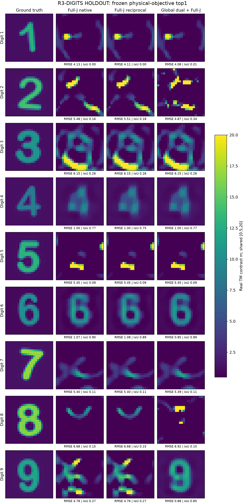
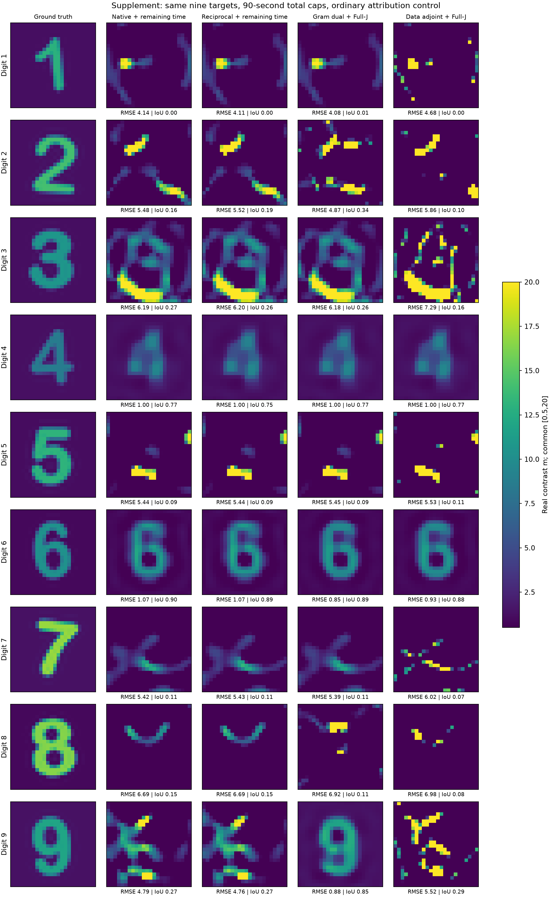
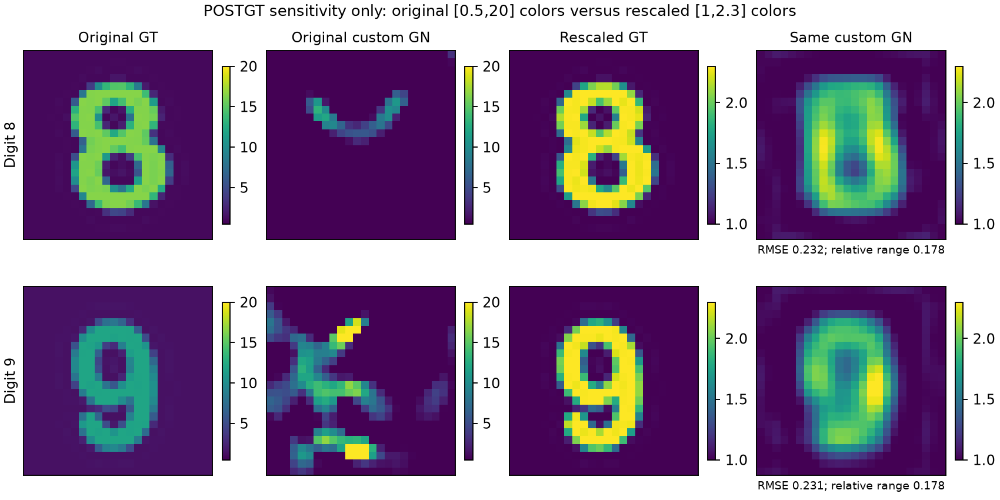

# 576 材料数字 1–9：真实成像、基线审计与有限的 GlobalDual 增量

**最终科学结论：完整实验已运行，但可靠九数字恢复尚未实现。** 所有九个数字都进入了24×24、576个独立实材料的完整非线性反演。自写普通GN清楚恢复4、6；GlobalDual还恢复了9的形状和近似材料，其余失败全部展示。不能把这一结果写成“九数字成功”，也不能把自写GN的表现当作成熟Full-J的性能上限。

用户质疑普通基线后，本轮实际读取了“推进 A18 Route A 科研”和“推进 A18 Route B 科研”的当前代码，并追加成熟SciPy TRF、相同公共初值和对比度控制。发现了自写边界步和停止逻辑的局限；但成熟TRF在受测高对比目标也未成功。最终判断是：**实现规模通过；特定目标的增量真实；普遍成像优势与独立论文原创性HOLD。**

## 1. 先看全部九图

下图是原始、在目标生成前冻结的27次反演结果。所有图共用材料色阶[0.5,20]，没有逐幅拉伸、模板分类或后处理修笔画。标题“Full-J native”指本轮自写的材料坐标GN，不指某个通用成熟软件。

下图加入剩余预算补足及普通数据伴随L-BFGS＋Full-J控制，仍按共同物理目标在线选top1。补足和控制是在观测生成后、任何主GT揭晓前另行冻结的补充，不冒称原预生成协议。

## 2. 实际问题和盲法

物理网格24×24，间距0.04，圆盘pulse半径0.018，波数$k=2\pi$；12个线源位于半径1.6圆周，48接收位于半径1.4圆周并错开角度。576个材料全部未知，最终使用单位参数基，未提供笔画支撑或已知数字掩模。外部均匀背景、网格和采集几何已知。

GT由本机字体12倍超采样生成，背景[0.8,1.5]、笔画[8,18]，带抗锯齿、宽度/平移/旋转变化。算法只有匿名观测、固定算子、材料box、通用平滑/TV和公共初值1。DEV用2、7与独立字体；原主测试为另一字体的1–9各一幅，没有挑选成功数字。主观测无噪声。GT的Born预测相对完整数据误差3.54–8.32，说明本组观测不能由Born替代。

原16份算法/配置先于九GT生成冻结；27个原预测、27个预算补足预测、9个普通伴随控制**全部63份封存后**才评分。盲法是进程输入和访问纪律，不是OS权限隔离。预算补充和普通控制的代码冻结发生在Y生成之后、GT揭晓之前，证据级别必须单列。见[实际盲协议](BLIND_PROTOCOL.md)、[冻结释放凭据](audit/EXPERIMENT_ALL_PREDICTIONS_FROZEN_GT_RELEASE.json)。

## 3. 从R3到576：省掉宽QR，保留完整物理

固定$G,E_0,S$，每次材料都实际解

$$M=I-D_mG,\quad J=M^{-1}D_mE_0,\quad Q=E_0+GJ,\quad F=SJ.$$

R3全观测变量投影的精确目标可写成

$$\psi=\operatorname{tr}[R(Q^*Q)^{-1}R^*],\quad R=F-Y.$$

旧接收对偶实现每步处理576×564的辅助QR。这里改成真实576阶物理解、576×12总场和12×12 Gram；病态时用总场薄QR回退，无固定jitter。令$A=R(Q^*Q)^{-1},C=A^*A$，复用物理LU解

$$M^*\Lambda=S^*A-G^*(QC),\quad \partial_i\psi=2\Re\sum_s\overline{\Lambda_{is}}Q_{is}.$$

目标/梯度需要1次完整LU、12源RHS、12伴随RHS。普通数据伴随梯度也可用12个伴随RHS，因此这不是优于一切普通算法的成本定理。单次公共材料状态计时：旧宽QR梯度66.85ms，新物理Gram梯度24.76ms，约2.70倍；旧固定准备48.85ms、每目标准备4.41ms另列。这仅为一次组件计时，不是端到端加速。

若$Q=U\Sigma V^*$，则$\psi=\|RV\Sigma^{-1}\|^2$：它比较按当前内部总场能量归一化的照明组合，改变非零残差的优化几何。它不增加测量信息，不保证消除局部极小点，并可能放大小奇异值方向噪声。最终排序始终回到原数据残差和共同正则，不能用小$\psi$冒充物理解。完整推导见[数学与成本](MATHEMATICAL_SCALING.md)、[公式来源](FORMULA_REUSE_MAP.md)。

## 4. 公平比较实际执行了什么

所有方法使用相同box[0.5,20]、固定物理图像平滑/TV权重$10^{-4}$、同一8→12→24参数化。公共粗层是每臂重新付费的Native GN，8/12层各最多320步；九个目标的三臂细层初始材料相同，普通伴随控制也逐元素匹配。

原方法每图90秒数值上限，普通GN却在8/9案例先碰到1000次迭代上限。因此额外补足仅使用$90-T_{original}$继续原尾部；不是再给90秒。另加普通数据目标的L-BFGS＋同一Full-J尾部，以检查仅更换优化器的混淆。它与Gram臂仍有迭代上限、继续时重启和输入计时的细微差别，不能宣称完美单因素因果隔离。

原数据目标为$\|F-Y\|^2/(2\|Y\|^2)+\mathcal R(m)$。所有top1只用该规则，不用GT。archive最多32个优化迭代点，不能叫32条分支。所有63个archive按RMS≥1的描述性去重都只有1个代表，最大oracle改善仅约0.0258；本轮没有证明多根覆盖增量。

## 5. 每个数字的实际材料与响应误差

每格依次为 **材料RMSE / IoU / 完整数据相对残差**。这是预算补足与普通伴随补充的实际top1；无任何GT排序。完整MAE、前景/背景RMS、SSIM、best@K、每步费用见[机器结果](RESULTS_SUMMARY.json)。

|数字|自写Full-J/GN(m)|自写Full-J/GN(1/m)|Gram＋Full-J|普通数据伴随＋Full-J|
|---:|---:|---:|---:|---:|
|1|4.136 / 0.000 / 0.599|4.113 / 0.000 / 0.6|4.083 / 0.014 / 0.601|4.681 / 0.000 / 0.59|
|2|5.479 / 0.161 / 0.68|5.518 / 0.190 / 0.679|4.868 / 0.336 / 0.384|5.863 / 0.097 / 0.838|
|3|6.188 / 0.267 / 0.122|6.199 / 0.264 / 0.122|6.177 / 0.262 / 0.123|7.290 / 0.157 / 0.106|
|4|1.002 / 0.769 / 0.000281|1.001 / 0.753 / 0.000281|0.998 / 0.769 / 0.000278|1.002 / 0.769 / 0.000281|
|5|5.444 / 0.086 / 0.766|5.444 / 0.094 / 0.766|5.447 / 0.086 / 0.767|5.526 / 0.110 / 0.755|
|6|1.065 / 0.897 / 0.000501|1.073 / 0.889 / 0.000568|0.850 / 0.889 / 0.000157|0.934 / 0.882 / 0.000346|
|7|5.425 / 0.112 / 0.334|5.425 / 0.112 / 0.334|5.393 / 0.112 / 0.336|6.020 / 0.072 / 0.326|
|8|6.692 / 0.150 / 0.899|6.693 / 0.149 / 0.899|6.921 / 0.109 / 0.801|6.976 / 0.077 / 0.89|
|9|4.787 / 0.274 / 0.422|4.764 / 0.273 / 0.424|0.885 / 0.850 / 0.000228|5.523 / 0.286 / 0.38|

预算补足后，平均RMSE为Native4.4686、Reciprocal4.4700、Gram3.9580、普通伴随控制4.8683。Gram比自写Native低约11.4%，但**数字9贡献了约84.9%的总配对改善**；去掉9，平均绝对改善仅0.0867。Gram在5、8的材料RMSE还更差，不能把均值包装成普遍改善。

数字9是最明确的有限正面案例：Gram在线top1 RMSE0.8849、IoU0.8496、数据残差$2.28\times10^{-4}$，自写Native补足后RMSE4.7872、残差0.4218；普通伴随控制RMSE5.5226、残差0.3804。两幅材料之间RMS位移约4.712，确实改变了材料配置。它们不是同观测下的两个精确等响应根：普通端点根本没有拟合数据。Gram结果也不是精确GT，仍有幅值和边界误差。

4、6、9的大体形状清楚；1、2、3、5、7、8没有可靠恢复。失败残差0.12–0.90时，已知合法GT能产生无噪声数据，因此首要是优化失败/计算策略，不能直接归因于“物理不可辨”。低残差但有图像偏差时，可能涉及弱可观测方向和正则偏差；本轮未证明精确非唯一性或Jacobian满秩。

IoU固定用重建$m\ge5$对比GT alpha≥0.5掩模；随机幅值使精确GT本身以该阈值评分也未必为1，GT-self-IoU均值约0.892，仅作参考，不能当全局上限或重新调整阈值。

## 6. 用户提出的Native代码质疑：实际做了哪些复核

我实际读了“推进 A18 Route A 科研”和“推进 A18 Route B 科研”当前代码。Route B的R11并非同任务：主要未知258参数、已知320个外部格点，宿主$0.1+0.04i$、典型前景约$1.4+0.145i$；本轮全部576未知、实笔画8–18。Route A当前采用三频、两个初值、约110未知量的缩放L-BFGS，也保留首个数字4失败。它们的正常图像不能直接证明同一高对比任务应当容易。

更重要的是，本轮“Native”只是自写GN：耦合LM步逐坐标裁剪，没有成熟反射边界模型；小步处理和有限阻尼试探有局限。原Native主要停止原因是1000次上限，而非8次拒绝。因此这些局限真实，但不能未经实验证明就说它们解释了所有失败。

追加成熟SciPy有界TRF、精确相同正则残差/解析Jacobian、Jacobian缩放：原8/9两目标仍得到残差0.890/1.058。再从数字9与Gram完全相同的公共粗层材料出发，只付剩余62.64秒做TRF，残差改善到0.39096，仍未恢复。失败端点Jacobian方向检查误差约$1.36\times10^{-9}$；三个TRF端点均另做完整总场验收。没有发现该检查中的导数接线错误，但这不是全代码无bug证明。

另将同两幅形状的材料统一改为$1+1.3\alpha$，其余算子、box、初值和正则不变，同一自写GN很快达到残差$2.13/1.88\times10^{-4}$，RMSE约0.232。图中低幅值控制另用[1,2.3]色标，绝不替换原高对比主图。细层只实际构建1次Jacobian、未接受新步，主要恢复来自粗层；不能说做了大量独立576细化。

这些都是**主GT已揭晓后的开发诊断**，不是新盲确认。结论应收窄为：未发现所检方向的Jacobian接线错误；高对比物理区间、初始化/局部盆地和自写优化器局限同时需要考虑；成熟普通方法的全面优势比较仍未完成。详见[跨session审查](audit/FULLJ_CROSS_SESSION_REVIEW.md)、[代码诊断](audit/FULLJ_DIAGNOSTIC_CODE_AUDIT.md)。

## 7. 真实费用与中断

|九目标方法|数值wall合计(s)|CPU合计(s)|完整576阶RHS|完整LU|
|---|---:|---:|---:|---:|
|Native＋补足|739.05|645.54|1,054,932|25,787|
|Reciprocal＋补足|739.04|649.72|1,075,716|26,255|
|Gram＋补足|761.29|673.94|1,041,180|28,578|
|普通数据伴随控制|448.84|344.29|533,220|15,098|

**没有总体加速。** Gram比自写Native的已付wall更长约3%，LU更多；少量RHS差异不能代替总耗时。上述是数值时间求和，不是两个worker并行的总历时。读盘、启动、JSON输出另记进程wall；所有方法单线程BLAS，两个worker。Green准备、生成、验收、失败和开发诊断也均入账。

$10^{-3}$配对噪声扩展曾在主GT揭晓前冻结方法，后因用户要求优先审计Native而中止：14/27预测及其全部可保留费用留档，13项NOT_RUN。没有按这个不平衡子集算噪声均值或伪造九图。8×32欠定配置和跨网格失配NOT_RUN。

封账已知下界为163,699次完整LU、6,381,144个显式完整RHS，94个不重复求解输出；数值wall求和5,002.70秒、CPU求和4,366.79秒。包含并行与开发费用，不能与实际总历时相加。总费用见[CSV账本](COST_LEDGER.csv)、[审计说明](COST_LEDGER.md)。一笔最早DEV失败的计数未被进程保存，保留UNKNOWN；LAPACK条件估计器的内部额外RHS也不公开。总计因此明确为已知下界，不伪称精确全费用。一个错误的1%噪声DEV草稿、原失败、修正版本和所有原始预测均保留。

## 8. 数学与论文贡献的最终裁决

可确认的成果是：576全未知材料完整非线性VIE的可运行盲测；避免宽辅助QR的精确小Gram伴随实现；有限的数字9材料搜索增量；成熟基线与物理区间的实际反证控制。原数据与独立总场验收一致，端点条件估计也不支持把巨大图像失败归因于浮点溢出。

这些并不是新物理定理。SMW、变量投影、QR、伴随、GN、多尺度及CSI/SOM都有直接先例；材料相关Gram度量亦见[van Leeuwen与Yang作者全文](https://arxiv.org/html/2403.15292v2)。本轮公式解释的是可实现的计算方式和度量变化，不证明全局收敛、完整根覆盖、普遍GT恢复或独立原创性。

**论文裁决HOLD。** 最短后续工作不是扩大Q20，而是先用成熟有界优化器、多公开初值与预声明的低频→高频真实测量continuation建立可靠强基线，再在新的高对比目标上复验Gram是否仍有独立增量。新增频率必须支付真实数据与Green成本，不能用不在物理像内的目标插值假装真实频率观测。

## 9. 直接复现与交付

[复现命令](REPRODUCE.md)提供从匿名复测量到材料的入口；[算法冻结说明](ALGORITHM.md)保留当时实现；[数学](MATHEMATICAL_SCALING.md)给出条件推导；[最终独立审查](audit/FINAL_SCIENTIFIC_REVIEW.md)保留审查纠错与限制。代码、全九数字图、GT后披露材料、失败、原预测与补充预测随现有B1仓库发布。私有生成seed不公开，公开材料数组足以重放评分。
