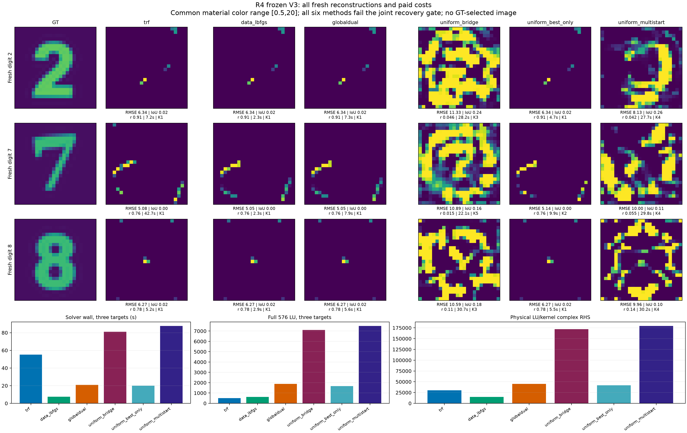

# Research Z-ALG-R4-BASIN

Frozen finite-discrete Maxwell study. **No fresh GT-recovery improvement; paper HOLD.**

- [Readable Chinese report](RESEARCH_REPORT_ZH.md)
- [Working formulas](FORMULA_COMPENDIUM.md) and [full derivation](MATHEMATICAL_THEORY.md)
- [Actual algorithm](ALGORITHM.md), [reproduction commands](REPRODUCE.md), and [blind protocol](BLIND_PROTOCOL.md)
- [All47 scored predictions](EXPERIMENT_RESULTS.json), [complete cost ledger](COST_LEDGER.csv), and [independent review](audit/FINAL_SCIENTIFIC_REVIEW.md)
- [Full source/raw-data release](https://github.com/migodam/b1-probabilistic-maxwell-imaging/releases/tag/research-z-alg-r4-basin-20261030)

The Git tree contains compact endpoint records in `published_results/`; complete trial JSON and full material trajectories are in the release ZIP. Source snapshots, negative outcomes, capped eigen attempts, original contracts and seedless disclosed materials are preserved. This is finite candidate search, not a posterior or all-root enumeration.

