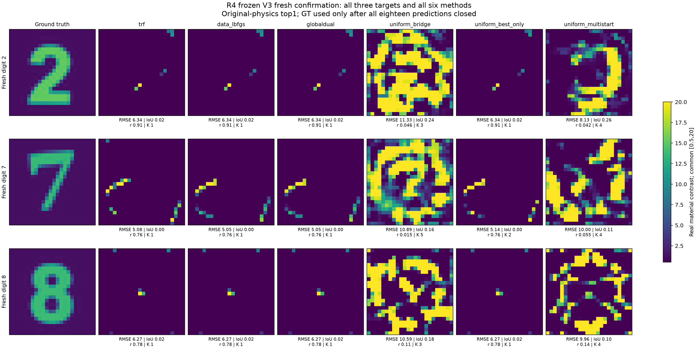
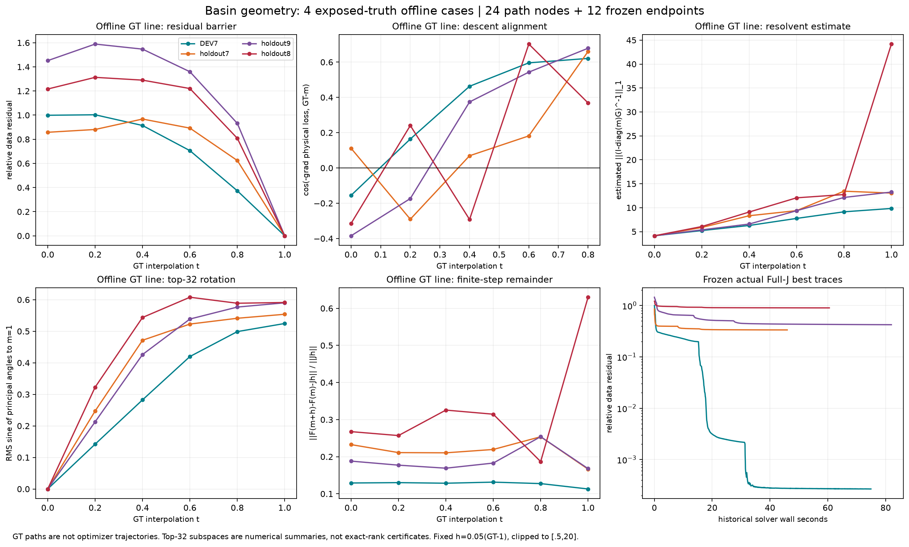
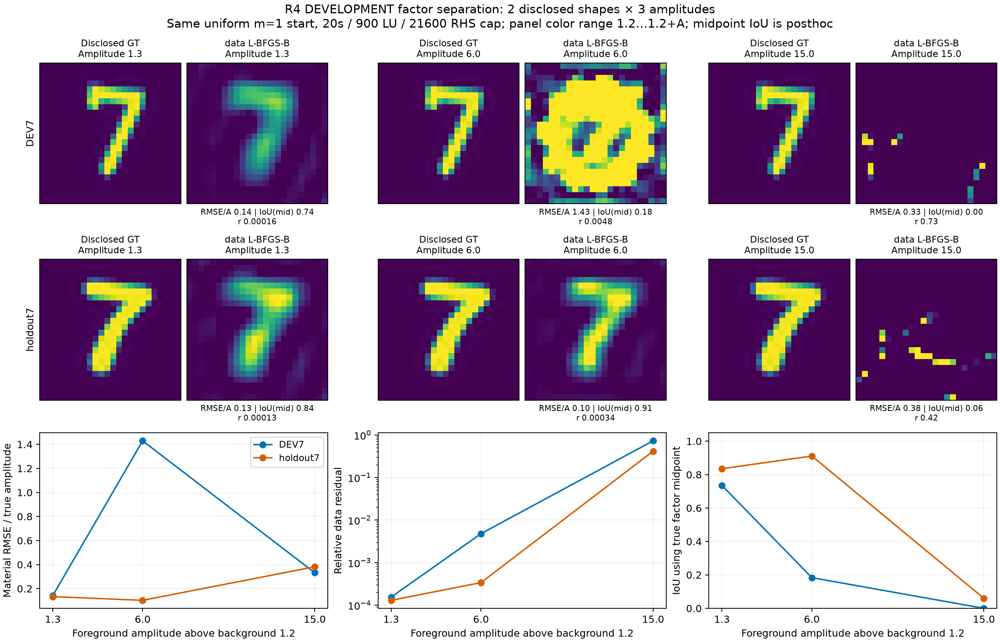
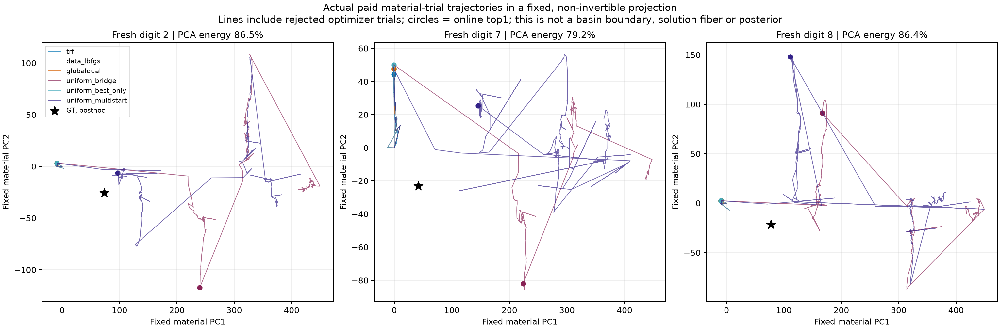

# R4-BASIN：从可预测的错误下降，到降低残差却恶化图像的非局部搜索

**本轮完成了576材料的真实代码、决定性诊断、非局部候选算法和独立新盲测，但没有实现GT恢复改善。论文级成像主张判定HOLD。**

最重要的发现有两层。第一，失败不能一概解释为Jacobian算错：成熟TRF和数据伴随方法会到达高残差、受材料盒活动面限制的区域；其中一些局部小步预测仍准确，局部下降却背离GT。第二，摆脱当前区域、把残差显著降下去，也不自动恢复材料。新的多低谷方法在三个新目标上都降低了残差，但在线top1材料误差全部恶化，best@K也没有增加GT覆盖。

## 1. 先看真正的新盲测

下图包含冻结后生成的数字2、7、8，以及全部六种方法。没有删除失败图，没有按单幅结果拉伸色阶，没有数字模板或已知笔画支撑。所有图共用材料范围[0.5,20]。图像本身就是本轮应当保留的负面证据。

所有18个预测在2026-10-30 03:15:35 UTC关闭，03:19:01 UTC才记录封存并开放评分。算法源在03:11:58 UTC冻结，03:12:27 UTC生成新观测。第一次生成因本机不存在Helvetica字体而失败，未做正演或保存目标；改用已安装Arial Bold后重新生成，逆解器和方法设置未改。这笔失败也保留。

|新目标|方法|材料 RMSE|IoU|全数据相对残差|K|best@K RMSE|联合门|
|---|---|---:|---:|---:|---:|---:|---|
|2|trf|6.3376|0.0160|0.911384|1|6.3376|FAIL|
|2|data_lbfgs|6.3371|0.0160|0.911386|1|6.3371|FAIL|
|2|globaldual|6.3371|0.0160|0.911386|1|6.3371|FAIL|
|2|uniform_bridge|11.3274|0.2405|0.045760|3|6.3376|FAIL|
|2|uniform_best_only|6.3376|0.0160|0.911384|1|6.3376|FAIL|
|2|uniform_multistart|8.1270|0.2589|0.041534|4|6.3371|FAIL|
|7|trf|5.0757|0.0000|0.762447|1|5.0757|FAIL|
|7|data_lbfgs|5.0503|0.0000|0.762510|1|5.0503|FAIL|
|7|globaldual|5.0503|0.0000|0.762510|1|5.0503|FAIL|
|7|uniform_bridge|10.8908|0.1553|0.015425|5|5.0503|FAIL|
|7|uniform_best_only|5.1400|0.0000|0.762235|2|5.0503|FAIL|
|7|uniform_multistart|9.9956|0.1069|0.054634|4|5.0503|FAIL|
|8|trf|6.2721|0.0211|0.780809|1|6.2721|FAIL|
|8|data_lbfgs|6.2721|0.0211|0.780809|1|6.2721|FAIL|
|8|globaldual|6.2721|0.0211|0.780809|1|6.2721|FAIL|
|8|uniform_bridge|10.5933|0.1804|0.111464|3|6.2721|FAIL|
|8|uniform_best_only|6.2721|0.0211|0.780809|1|6.2721|FAIL|
|8|uniform_multistart|9.9581|0.0961|0.137025|4|6.2721|FAIL|

联合门预先固定为：相对数据残差≤0.001、材料RMSE≤1.5、固定阈值IoU≥0.7。六种方法均为0/3；新方法连数据门也未通过。因此本轮没有找到新鲜目标的合格数据解，更没有得到GT或等响应材料分支。

`uniform_bridge`在新7上把残差约0.7625降到0.01542，却将材料RMSE从约5.05增到10.89。新8也是0.7808降到0.1115而材料误差6.27增到10.59。新2的普通多初值残差0.04153还低于代数射线方法0.04576，不能宣布新方法总体优于强普通搜索。三个对象中，best@K基本仍由原错误入口贡献；新增候选没有带来GT附近材料。

## 2. 研究对象和已有正面结果的边界

所有在线计算继续使用冻结R3-DIGITS的24×24、576个独立实材料、12源×48复接收、k=2π、disk-pulse scalar-TM VIE，材料box[0.5,20]。8→12→24仅改变材料参数化，物理矩阵始终576阶；新盲测的所有top1来自24阶段，全部运行都释放了576未知材料。没有改成Born，没有固定外部320单元，没有借用ROI256或数字decoder。

R3的DEV2/7正面图和旧正式数字9的GlobalDual成功仍然成立；它们是冻结历史。本轮没有把它们删除，也没有重新包装成新鲜成功。旧9的RMSE约0.885、IoU约0.850、残差2.28e-4继续作为不同目标几何可能进入不同区域的证据。

本轮历史7/9/8、两种7字形的幅度因子研究、GT路径、Hessian都属于已披露材料上的DEVELOPMENT/OFFLINE_DIAGNOSTIC。只有最后三个新匿名对象是独立确认。完整协议见[BLIND_PROTOCOL](BLIND_PROTOCOL.md)。

## 3. 真正解释了什么：有限步反馈与活动面

从两次完整电流方程相减，可以严格得到：有限材料步的响应使用更新后的接收resolvent，而一阶Jacobian使用当前resolvent。二者的精确差包含两次材料增量、中间Green传播、当前和更新后resolvent及内部总场。完整推导、乘法顺序和可逆条件见[数学理论T1–T2](MATHEMATICAL_THEORY.md)。它是标准resolvent恒等式，不能仅凭重写公式宣称原创。

这提供了一个明确的物理机制：同样大小的材料步，其反馈风险取决于当前内部场与传播耦合，而不只取决于欧氏步长。我们推导了充分的可逆性/下降界，并实际测量其可用性：16个有限步中，界资格通过7个，真实原数据下降10个。它是保守的充分条件；未通过不表示不可逆或必然失败。准备该证书需要完整逆作用的N个RHS，不能作为免费门控。

四目标×六个GT路径节点和12个真实冻结端点显示：

- 旧盲测7沿公共初值到GT的直线路径，残差先由0.858升到0.968再降到零；t=0.2处原数据下降方向与GT方向余弦为−0.291。
- 失败Full-J端点7/9/8的下降方向与GT方向余弦约−0.346/−0.251/−0.499；RMS=0.1的小步实际/预测下降比却接近1。局部模型可以准确预测一条背离GT的下降。
- 源总场Gram条件约556–1720，没有明显崩溃；领先32材料方向包含97.4%–99.5%的Jacobian平方奇异值能量。数值尾很弱，不能宣布576材料GT Jacobian良态满秩、精确nullspace或全局唯一。
- 在部分有限GT方向步上，线性模型预测的下降符号与真实下降相反。GT路径只用于离线解释，未被在线算法使用，也不是实际优化轨迹。
- 初始材料与采集相同时，最初的Jacobian本来与目标Y无关。因此DEV/新字形不同结果不能由“初始Jacobian条件数不同”单独解释；残差方向和后续材料状态变化不可省略。

## 4. 不是所有失败都是同一种局部极小

对新的历史7成熟端点，投影梯度约9.54e-9，537个材料在下界、8个在上界，仅31个自由变量。显式31维固定活动面Hessian最小三特征值约1.76e-8、2.41e-8、3.55e-8，未发现该面负曲率。这不是全材料盒严格局部最优的认证，但比只说“算法陷入局部极小”更具体。

对旧失败8，完整Maxwell二阶伴随作用找到负曲率−5.66e-6，而同方向GN加正则曲率为+8.64e-5，残差Hessian确实能翻转符号。不过该点投影梯度仍约2e-4，并非已证驻点；负曲率的合法正向幅度最多约0.058，小步只让残差0.90004降到0.89973，没有形成有效非局部逃逸。

Hessian作用由保留LU上的12个切向和12个增量伴随RHS得到，没有有限差分公式检验。前两次ARPACK达到250次作用上限而没有收敛特征对，失败成本完整保留；7的自由面只有31维，改用显式小矩阵后才得到上述谱，9自由维200则未追加。详见[Hessian机制](diagnostics/hessian_geometry.md)。

## 5. 形状与幅度分离，排除一句话归因

保持背景1.2、同一几何、公共初值1和普通数据L-BFGS，分别用DEV7与旧盲测7的已披露alpha形状，幅度1.3/6/15。低幅度两种形状均恢复；高幅度两种均失败。中等幅度时旧盲测7残差约3.39e-4、RMSE约0.617，而DEV7形状却在900LU预算处停止、残差0.00481、RMSE约8.57。难度并非随幅度单调，也不能把字形和对比度同时变化的旧对照当作单因素解释。

这里的低幅度面板单独采用1.2至1.2+A色阶，图中明确标注；不混入最终高对比图。因子IoU使用已知幅度中点，仅事后描述，不是线上选择器或新盲主门。

## 6. 新算法实际做了什么，为什么失败值得保留

V1沿当前错误图像的幅度方向和GN方向扫描完整合法有理曲线。旧7的幅度区间只允许向背景收缩；两条曲线都仅检出当前低谷，成熟TRF/数据L-BFGS/GlobalDual/射线五臂均失败。这直接否定了“更精确地沿当前错误形状扫幅度就足够”的希望。

唯一主要路线调整是：先用公共m=1求一个有界入口；原残差仍高且优化进展停滞时，在独立于错误形状的均匀材料族上查询精确完整VIE有理响应。每个目标得到多个检出低谷，然后分别从这些公开常数材料起步，运行共同的8→12→24完整物理校正。先校正，后用原数据加共同正则排序。它不要求连续路径上的损失单调。

V2旧7确实出现“原始损失较高的低谷，校正后反而更好”的有限数据目标证据，但材料恢复恶化。V2普通多初值还暴露首种子耗尽RHS的问题，因此这些运行全部保留为开发证据，不能用它制造优于普通多起点的结论。

最终V3修正了每种子、每尺度的wall/LU/RHS配额；所有L-BFGS使用同一材料归一化坐标，TRF保留Jacobian缩放；多低谷最多选四个按幅度位置分散的入口，普通对照追加4/8/12/16，m=1由已付公共入口代表。选中但未完成校正的候选如实记录，未选低谷标TRUNCATED。

这种操作属于标准多起点/盆地跳跃机制家族，精确有理核继承R2/R10。新增可检验特征是按完整传播响应产生入口、保留多个高原始损失低谷后再校正，并为其收费。结果支持“改变有限预算下可达的数据损失区域”，**不支持GT成像优势**。

## 7. 数学结论与先例的严格归因

本轮最清楚的条件结论是：局部可辨识、局部corrector收缩、跨区域可达、GT可恢复和全局唯一性不能混同。一个同材料box的单材料复系数有理VIE例子可以全局单射、处处非零导数和无实极点，却在box上界存在正残差严格约束局部极小；任何连续下降路径都无法到GT，独立向内的远端有理查询则可以到达。它严格证明逻辑分离，但所选系数不宣称由本轮Hankel圆盘几何产生。

另外给出一个光滑最小二乘反例，证明只校正整条射线的最低原始损失点可能失败，而较高线低谷一步GN可到零残差。这个例子只证明操作区别，不是Maxwell成像性能证据。

Transverse contraction分析明确限制在正则根附近和固定活动面；正残差处必须保留残差Hessian，冻结弱坐标还会人为产生单位模态。它没有提供进入未知好区域的保证。

[van den Berg与Kleinman的CSI](https://doi.org/10.1088/0266-5611/13/6/013)已经联合处理材料与散射源；[van Leeuwen与Yang的约束松弛分析](https://arxiv.org/html/2403.15292v2)直接解释了材料相关Gram加权残差；[Borges等递归线性化](https://doi.org/10.1137/16M1093562)使用真实多频率数据。R4没有新增频率，也不宣称发明这些方法。ScholarQA初检有429，之后三项书目身份成功解析；全文/摘要支持与单纯元数据严格区分，检索不完备。见[独立新颖性审查](PAPER_NOVELTY_REVIEW.md)。

## 8. 成本：不以少量RHS包装加速

|六方法，三目标合计|wall(s)|CPU(s)|完整 LU|物理 LU/kernel RHS|576阶三角 RHS|Schur|
|---|---:|---:|---:|---:|---:|---:|
|trf|55.10|54.26|505|30156|0|0|
|data_lbfgs|7.45|7.15|614|14736|0|0|
|globaldual|20.83|20.33|1880|45120|0|0|
|uniform_bridge|80.95|76.84|7096|171876|5328|3|
|uniform_best_only|20.05|19.69|1664|41664|5328|3|
|uniform_multistart|87.70|83.09|7500|179580|0|0|

这是三新目标的真实数值费用合计，不是并行总历时。完整稠密Schur和576阶三角传递RHS单列，后者不是免费的小型reduced求解。60000 RHS门约束原物理LU/核构造RHS；三角传递另受实际wall约束并全部计时，因此不是相同总flops证书。没有端到端加速结论。

全R4共47个求解输出，已知完整LU 54,027、暴露的物理LU/kernel RHS 1,377,960、576阶Schur 16、576阶三角传递RHS 23,328；含失败的673次精确Hessian作用。数值求解wall求和729.47秒、CPU求和710.00秒。外部进程/JSON输出开销和部分评分绘图未单独计时，LAPACK条件估计器内部RHS不透明；不把这些记为零。并行时间之和不等于科研冲刺历时。全部账目见[COST_LEDGER.csv](COST_LEDGER.csv)及[COST_TOTALS.json](COST_TOTALS.json)。

## 9. 公式库、可运行代码与未完成工作

[公式集](FORMULA_COMPENDIUM.md)保留有限步、严格风险椭球、精确Hessian作用、完整有理射线、均匀材料固定曲线、局部收缩和双端点可观测性。每项都说明计算代价和是否实际采用。主推导、两个独立理论附录与实际源码互相链接，不再堆砌只有名字的算子。

没有重跑Q6/Q20：未提出足以改进错误补集块搜索的价值判据。短块Krylov有理提案与直接Green-Schur跨目标缓存只完成推导，NOT_RUN；没有把它们的潜在加速写成实测。没有新频率、NN训练或后验采样。运行采用显式Sol/Max理论与Sol/High实现/诊断/审查；中途实验worker容量错误和线程上限使主代理接手已有runner，未启动Astra或更换provider。

最终输出是测量驱动的有限候选集合与原目标top1，不是概率解集、独立根枚举或候选平均图像。新候选均经过对应的一次完整VIE正演评价；评分进程独立，未重复相同正演充当独立模型验收。

**下一步最重要的一项工作**是构造不依赖当前错误图像、同时保留空间材料结构的非局部方向，并让同一结构先验也进入成熟普通基线。现有幅度/均匀入口已经证明能去到别处，却没有带来GT。继续增加射线数量、只追更低残差或多跑随机对象，都不能替代这一步。

[ALGORITHM](ALGORITHM.md)给出实际接口，[REPRODUCE](REPRODUCE.md)给出命令，[EXPERIMENT_RESULTS](EXPERIMENT_RESULTS.json)保留47个实际输出及所有失败。独立审查与主代理最终判断一致：**GT_IMPROVEMENT_NO，有限数据目标可达性有正证据，论文成像贡献HOLD。**
