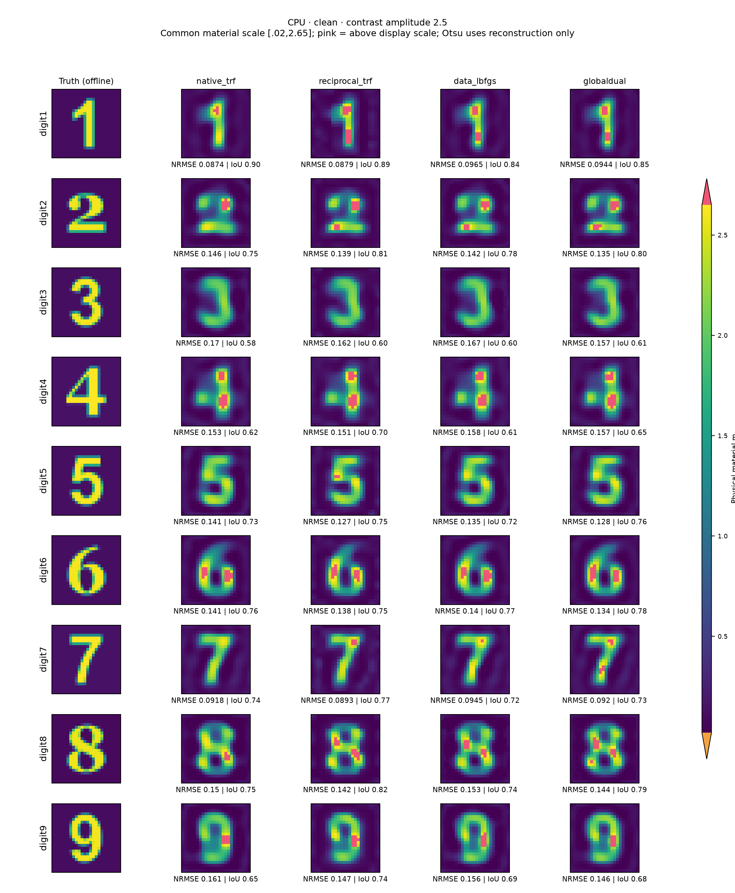
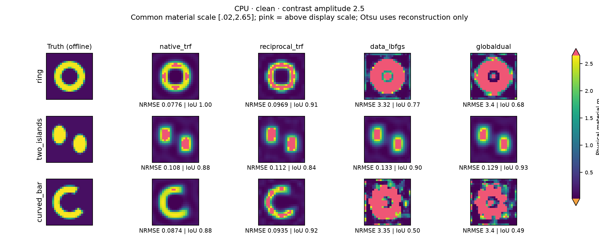
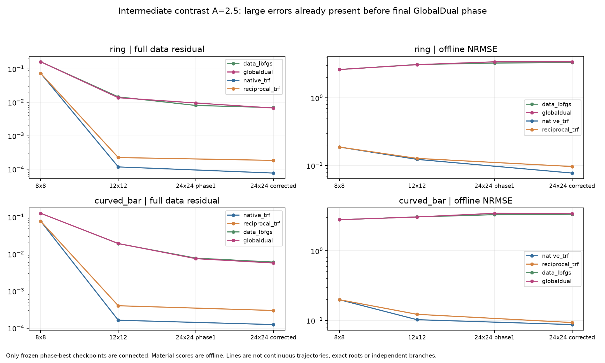
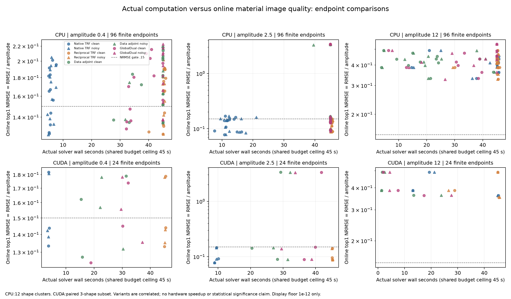

# R4-DIVERSITY：低中高材料对比度下，GlobalDual是否改善成像？

**结论：本轮完成了全部360项真实反演、29张PNG科研图与2份PDF导出和完整费用归档。低、中对比度下普通Full-J可以正常成像；GlobalDual有少数细节与成功门收益，但没有建立对成熟Full-J或匹配数据伴随优化的整体精度、成本优势。论文优势主张保持HOLD。**

## 1. 先直接回答这轮问题

上一轮R4-BASIN的新鲜确认确实只包括数字2、7、8；其余数字和幅度控制来自已披露的历史开发，不能冒充更多新盲测。本轮扩成数字1–9、环、双岛、弯条，共12种形状。每个形状有A=0.4、2.5、12三档笔画材料增量，以及无噪和相对复噪声10^-3两种观测。形状、背景和噪声方向按对象配对，避免同时改字形与对比度后强行归因。

它没有给GlobalDual一个数字decoder，也没有给普通Full-J较差的起点。所有方法使用同一576单元完整非线性VIE、公开初值0.1、材料box[0.02,20]、同一通用正则和8→12→24材料分辨率。所有360项实际进入24×24材料阶段，最终在线top1也全部来自该阶段；这仍不等于全部收敛或找到了唯一材料。

图中的Native为成熟有界TRF及解析Full-J。数字2、7等可以正常成像。不能再把Full-J这一类方法概括成“本来就很差”。但本轮同时更换了材料范围、背景和部分算法合同，因此也不能反向证明旧程序的所有失败都只由高对比度造成。

## 2. 真正冻结了什么，实际运行了多少

- 物理：二维scalar-TM、disk-pulse VIE，24×24=576个独立实材料，12源×48复接收，k=2π；所有阶段都解576阶非线性系统，多次散射没有删除。
- 材料：m=b+Aα，b∈[0.08,0.15]，A∈{0.4,2.5,12}，α为抗锯齿二维形状；不同幅度复用相同α与b。奇数数字Arial Bold，偶数Georgia Bold；另三种非数字形状不使用字体。
- 数据：36次完整正演生成72份观测，干净/带噪共用正演。12个形状是自然配对单位；72份观测不是72个独立重采样对象。
- CPU：i9-14900HX，四个不同P核上各一个单线程worker，完成72观测×4方法=288项。
- GPU：RTX4060 Laptop、complex128，两个worker使用另外两个P核作宿主，完成预定数字2、7、环的18份观测×4方法=72项；该子集不增加独立对象数。
- 每方法每观测上限：45秒、2000次完整LU、60000个完整系统复RHS。实际操作可在开始后跨过一个预算边界；超支与停止原因保留，没有增加预算救结果。

源与合同于2026-10-30 04:29:42 UTC冻结，随后才生成新GT。GT及生成状态只存本地，远端只收到匿名Y和公开算子。CPU正式前台计算04:38:08 UTC启动，GPU在A9任务释放设备后于05:07:58 UTC启动。全部计划于05:24 UTC后关闭，关闭收据为360 complete、0 failed、0 NOT_RUN，随后才运行独立评分。这里的complete仅表示任务返回，绝非科学成功。精确时间见audit/CLOSURE.json与ALL_PREDICTIONS_SEALED.json。

盲测隔离是实际文件与执行纪律，不是密码学不可篡改证明。没有增加hash、源码重复比对、有限差分精度实验或公式小数位检查。完整预测关闭后没有再跑反演、调参或替换对象。

## 3. 四种算法及可归因的差别

Native与Reciprocal都使用成熟SciPy bounded TRF、解析Full-J、共享物理LU和x_scale=jac。Reciprocal对粗层材料系数采用η=1/c，精确链式导数为−c²；不是把像素解码偷换成1/(Bη)。Data-L-BFGS与GlobalDual共用数据目标的8×8和12×12粗层；24×24层采用相同45%/55%的剩余预算分配与重启。唯一主要目标差异是GlobalDual首阶段使用材料相关总场Gram的兼容性目标，随后两者都用原始数据目标校正。所有在线top1都按原始完整数据目标加共同正则排序。

$$M=I-D_mG,\quad J=M^{-1}D_mE_0,\quad Q=E_0+GJ,\quad F=SJ,$$

$$\psi(m)=\operatorname{tr}\{[F(m)-Y](Q^*Q)^{-1}[F(m)-Y]^*\}.$$

Gram仍需真实Maxwell场与伴随计算，绝非免费小矩阵。两种TRF可拥有不同的粗层轨迹；它们是强基线，并不是只改变Gram这一个因素的消融。GlobalDual最直接的目标消融是匹配的Data-L-BFGS。本轮没有单独冻结固定Gram arm，不能把可能的收益全部归于材料动态权重。

## 4. 分幅度结果：普通方法在低中材料上表现正常

NRMSE=真实材料RMSE/A；绝对RMSE、MAE同时保留。IoU采用重建自身的Otsu阈值，GT掩模仅用于评分。联合门：NRMSE≤0.15、IoU≥0.7、完整相对残差clean≤0.001/noisy≤0.003。

| 后端 | A | 噪声 | 方法 | NRMSE均值 | RMSE均值 | IoU均值 | 联合PASS | 墙钟均值/s |
|---|---:|---|---|---:|---:|---:|---:|---:|
| cpu | 0.4 | clean | native_trf | 0.1644 | 0.0657 | 0.683 | 3/12 | 5.66 |
| cpu | 0.4 | clean | reciprocal_trf | 0.1615 | 0.0646 | 0.692 | 3/12 | 45.00 |
| cpu | 0.4 | clean | data_lbfgs | 0.1749 | 0.0700 | 0.672 | 3/12 | 41.07 |
| cpu | 0.4 | clean | globaldual | 0.1721 | 0.0689 | 0.670 | 4/12 | 37.67 |
| cpu | 0.4 | noisy | native_trf | 0.1671 | 0.0668 | 0.692 | 3/12 | 5.90 |
| cpu | 0.4 | noisy | reciprocal_trf | 0.1638 | 0.0655 | 0.695 | 3/12 | 45.32 |
| cpu | 0.4 | noisy | data_lbfgs | 0.1764 | 0.0706 | 0.672 | 3/12 | 42.95 |
| cpu | 0.4 | noisy | globaldual | 0.1787 | 0.0715 | 0.668 | 3/12 | 45.03 |
| cpu | 2.5 | clean | native_trf | 0.1261 | 0.3153 | 0.769 | 9/12 | 12.31 |
| cpu | 2.5 | clean | reciprocal_trf | 0.1238 | 0.3095 | 0.792 | 10/12 | 45.38 |
| cpu | 2.5 | clean | data_lbfgs | 0.6698 | 1.6746 | 0.720 | 6/12 | 45.02 |
| cpu | 2.5 | clean | globaldual | 0.6765 | 1.6912 | 0.730 | 7/12 | 45.02 |
| cpu | 2.5 | noisy | native_trf | 0.1257 | 0.3143 | 0.775 | 8/12 | 13.50 |
| cpu | 2.5 | noisy | reciprocal_trf | 0.1252 | 0.3130 | 0.795 | 9/12 | 45.35 |
| cpu | 2.5 | noisy | data_lbfgs | 0.6685 | 1.6712 | 0.725 | 6/12 | 44.57 |
| cpu | 2.5 | noisy | globaldual | 0.6794 | 1.6986 | 0.726 | 7/12 | 45.02 |
| cpu | 12 | clean | native_trf | 0.4138 | 4.9655 | 0.032 | 0/12 | 40.18 |
| cpu | 12 | clean | reciprocal_trf | 0.4094 | 4.9124 | 0.029 | 0/12 | 44.09 |
| cpu | 12 | clean | data_lbfgs | 0.4192 | 5.0306 | 0.029 | 0/12 | 19.96 |
| cpu | 12 | clean | globaldual | 0.4357 | 5.2279 | 0.048 | 0/12 | 34.30 |
| cpu | 12 | noisy | native_trf | 0.4136 | 4.9636 | 0.032 | 0/12 | 40.16 |
| cpu | 12 | noisy | reciprocal_trf | 0.4101 | 4.9215 | 0.027 | 0/12 | 44.03 |
| cpu | 12 | noisy | data_lbfgs | 0.4255 | 5.1059 | 0.030 | 0/12 | 22.04 |
| cpu | 12 | noisy | globaldual | 0.4329 | 5.1948 | 0.043 | 0/12 | 33.17 |
| cuda | 0.4 | clean | native_trf | 0.1530 | 0.0612 | 0.718 | 1/3 | 3.89 |
| cuda | 0.4 | clean | reciprocal_trf | 0.1520 | 0.0608 | 0.719 | 1/3 | 45.30 |
| cuda | 0.4 | clean | data_lbfgs | 0.1562 | 0.0625 | 0.738 | 1/3 | 20.85 |
| cuda | 0.4 | clean | globaldual | 0.1477 | 0.0591 | 0.748 | 1/3 | 27.03 |
| cuda | 0.4 | noisy | native_trf | 0.1539 | 0.0616 | 0.748 | 1/3 | 3.73 |
| cuda | 0.4 | noisy | reciprocal_trf | 0.1520 | 0.0608 | 0.746 | 1/3 | 45.18 |
| cuda | 0.4 | noisy | data_lbfgs | 0.1555 | 0.0622 | 0.732 | 1/3 | 25.04 |
| cuda | 0.4 | noisy | globaldual | 0.1565 | 0.0626 | 0.727 | 1/3 | 32.27 |
| cuda | 2.5 | clean | native_trf | 0.1051 | 0.2628 | 0.831 | 3/3 | 9.51 |
| cuda | 2.5 | clean | reciprocal_trf | 0.1086 | 0.2715 | 0.837 | 3/3 | 45.13 |
| cuda | 2.5 | clean | data_lbfgs | 1.2003 | 3.0007 | 0.734 | 2/3 | 25.97 |
| cuda | 2.5 | clean | globaldual | 1.1857 | 2.9642 | 0.734 | 2/3 | 39.40 |
| cuda | 2.5 | noisy | native_trf | 0.1046 | 0.2616 | 0.833 | 3/3 | 9.29 |
| cuda | 2.5 | noisy | reciprocal_trf | 0.1058 | 0.2646 | 0.838 | 3/3 | 45.17 |
| cuda | 2.5 | noisy | data_lbfgs | 1.1937 | 2.9842 | 0.713 | 2/3 | 30.21 |
| cuda | 2.5 | noisy | globaldual | 1.1806 | 2.9516 | 0.733 | 2/3 | 34.02 |
| cuda | 12 | clean | native_trf | 0.4131 | 4.9574 | 0.016 | 0/3 | 25.90 |
| cuda | 12 | clean | reciprocal_trf | 0.4100 | 4.9199 | 0.015 | 0/3 | 39.80 |
| cuda | 12 | clean | data_lbfgs | 0.4133 | 4.9599 | 0.016 | 0/3 | 5.45 |
| cuda | 12 | clean | globaldual | 0.4130 | 4.9564 | 0.016 | 0/3 | 8.95 |
| cuda | 12 | noisy | native_trf | 0.4130 | 4.9562 | 0.016 | 0/3 | 26.47 |
| cuda | 12 | noisy | reciprocal_trf | 0.4101 | 4.9212 | 0.015 | 0/3 | 39.14 |
| cuda | 12 | noisy | data_lbfgs | 0.4133 | 4.9598 | 0.016 | 0/3 | 9.21 |
| cuda | 12 | noisy | globaldual | 0.4133 | 4.9598 | 0.016 | 0/3 | 12.12 |

CPU是主样本，CUDA仅三形状子集。不能比较两张表的总均值来宣称硬件加速。中幅度CPU的Data/GD均值显著偏大，来自环和弯条的严重材料幅度错误，不能只看九数字图而漏掉这两项。

## 5. 个别真实收益要保留，但不能等同整体优势

- **低幅度、无噪弯条**：GlobalDual NRMSE约0.1476、IoU约0.762，跨过联合门；Native约0.1560/0.723、Reciprocal约0.1521/0.737、Data约0.1514/0.757均未过门。这是真实的门槛和细节收益。连续NRMSE差仍在预声明practical tie范围内，不能包装成大幅材料恢复提升。
- **中幅度有噪数字8**：GlobalDual NRMSE约0.1426并过联合门，Native约0.1521、Data约0.1520未过；Reciprocal也过门。无噪8中Native已过门。因此既不能说GD没有任何对象收益，也不能说它是强普通方法遗漏的唯一恢复机制。
- **低幅度环**：GlobalDual IoU约0.949高于Native约0.872，但Data-L-BFGS同样约0.949；因此此项形状改善不能全归因于GlobalDual的动态Gram。

主指标的实际差异阈值在生成前固定为|ΔNRMSE|≤max(0.02,0.1·min(NRMSE))判平，连续差仍逐条保留。这是描述性的实际差异规则，不是统计显著性或等价检验。

| 后端 | GlobalDual对照 | GD胜 | 平 | GD负 |
|---|---|---:|---:|---:|
| cpu | native_trf | 0 | 59 | 13 |
| cpu | reciprocal_trf | 0 | 54 | 18 |
| cpu | data_lbfgs | 0 | 69 | 3 |
| cuda | native_trf | 0 | 16 | 2 |
| cuda | reciprocal_trf | 0 | 16 | 2 |
| cuda | data_lbfgs | 0 | 18 | 0 |

**CPU72份配对中GlobalDual没有达到该NRMSE胜出阈值；它不是每一项数值都更差，也不意味着IoU没有局部改善。** GPU与匹配Data-L-BFGS的18份配对全部为practical tie。最终报告不从这些相关变体臆造72个独立成功率或置信区间。按形状平均的聚类表另存analysis/SHAPE_CLUSTERS.csv。

## 6. 中幅度严重失败从哪里开始

读取已经封存的阶段候选即可回答，无需重跑反演。环与弯条的Data/GD在8×8粗层就已进入错误材料区域：NRMSE分别约2.619和2.796；Native/Reciprocal粗层分别约0.188和0.199，再在12/24层修正。GlobalDual仅在最后24层启用，未修复这些继承的错误粗层路径。

因此本轮不能把环/弯条失败单独归罪于Gram目标，也不能据此否定所有可能的GlobalDual初始化。可成立的窄结论是：**这套固定的公共Data粗层+最终GlobalDual校正流程，没有把错误粗层候选带回正确材料区域，而成熟TRF路径成功。** 图中连线只是保存的阶段最优点，不是完整连续轨迹，也不是不同根分支。数据残差约0.006并非原方程的等响应解。

## 7. 低材料增量不等于Born区，也不保证加权目标更优

由生成阶段已付费的完整正演，可计算||F_Born−F_full||/||F_full||，没有再做一次物理求解。各档12形状的范围与中位数为：

| A | 最小Born/完整响应差 | 中位数 | 最大值 |
|---:|---:|---:|---:|
| 0.4 | 0.209 | 0.248 | 0.291 |
| 2.5 | 0.872 | 1.010 | 1.222 |
| 12 | 3.744 | 4.462 | 5.468 |

即使A=0.4，Born响应差也约21%–29%；本批没有偷偷换成Born反演，也不能把低幅度当成严格弱传播认证。中幅度的Born差约87%–122%，成熟TRF仍能有效成像。材料幅度、物理非线性和算法可达性必须分别讨论。

理论上，在固定背景b附近、resolvent可逆且源Gram稳定的足够小扰动区域，有Q(b+Aa)=Qb+A G Mb^-1 Da Qb+O(A²)，因此Q*Q趋于固定Hb。GlobalDual相应趋于源空间加权最小二乘。它改变曲率而不增加信息；权重条件良好时精确根的Jacobian零空间不变。完整推导和逆Gram扰动条件见THEORETICAL_EXPECTATION.md，本批并未证明每个对象满足小扰动界。

根附近、没有正则且噪声正确白化时，标准线性无偏估计论证表明任意其他正定加权的局部材料协方差相对普通最小二乘差为σ²DDᵀ≥0。这是已有最小二乘机制的直接推导，不是新Maxwell定理。它不否定远离根时目标变化可能进入更好盆地，但否定“Gram归一化本身必然提高低对比材料精度”的推断。

跨幅度还同时改变相对信号水平和正则的有效作用；虽然NRMSE按A归一化、形状噪声配对，也不能把所有变化单因果归于多次散射。

## 8. 费用：完整Jacobian每步较贵，不代表整个反演更贵

下表为每个方法所有实际任务的求解器墙钟之和，不是并发批次的实际历时。Source/adjoint/receiver RHS、Gram小系统、Full-J、操作计时与停止原因见COST_LEDGER.csv；这些不同时间列相互重叠，不应相加。

| 后端 | 方法 | 完整LU合计 | 完整系统复RHS合计 | 求解器墙钟合计/s | 联合PASS |
|---|---|---:|---:|---:|---:|
| cpu | native_trf | 5094 | 305256 | 1412.36 | 23/72 |
| cpu | reciprocal_trf | 12943 | 678660 | 3229.91 | 25/72 |
| cpu | data_lbfgs | 48684 | 1166400 | 2587.28 | 18/72 |
| cpu | globaldual | 52939 | 1268424 | 2882.56 | 21/72 |
| cuda | native_trf | 1087 | 65172 | 236.36 | 8/18 |
| cuda | reciprocal_trf | 4197 | 218412 | 779.17 | 8/18 |
| cuda | data_lbfgs | 19159 | 459684 | 350.19 | 6/18 |
| cuda | globaldual | 23878 | 572784 | 461.39 | 6/18 |

CPU低幅度无噪Native平均5.66秒，GD37.67秒；中幅度Native12.31秒，GD45.02秒。Native虽然每次需要Full-J，收敛所需的物理状态远少于伴随L-BFGS路径。不能以“没有Full-J”自动包装整体省算。GPU本批的GD同样未比匹配Data-L-BFGS节省综合费用；其有限子集、不同运行时间与资源环境不支持独立硬件加速结论。

正式360项没有传输/进程失败，但预算终止不是收敛保证。准备期真实失败保留：首次CUDA导入缺threadpoolctl（物理LU/RHS为0），仅安装到隔离vendor；首次Windows detached启动未存活，未留下预测，其已付工作无法恢复，计UNKNOWN，不写成0。随后使用A9同样的前台长SSH方式。生成36LU/432源RHS、旧公开DEV费用、未知原Green准备成本均单列，不混入新对象成功率。

## 9. 这不是概率解集，也没有发现多个真实解分支

当前方法是确定性的优化候选与原物理目标选择。online top1不知道GT；best@K仅由离线评分器在保存的有限阶段材料中寻找最近GT者。archive通常是同一路径的阶段点，不是独立后验样本、概率质量、完整材料fiber或已经验证的多根。高幅度下所有方法联合门为0，且多数原数据残差很高；这些失败端点更不能叫等响应物理解。

## 10. 科学裁决与最短下一步

本轮建立了更全面的同形状、跨材料增量、噪声配对的真实成像证据，也完成了i9 P核与4060的实际执行。新增的是实验范围和机制归因；没有发明新的商环理论、全局收敛定理或普适GlobalDual优势。独立Sol/high审查支持这一有限裁决，详见audit/FINAL_SCIENTIFIC_REVIEW.md。所有子任务使用Sol，没有Astra或DeepSeek。

最有价值的后续不是继续挑更多有利数字，而是冻结一个更小的机制消融：共同TRF粗层之后分别使用原数据、固定公开参考Gram、完整动态Gram，比较它们是否真正改变错误盆地的可达性；环与弯条是应保留的困难控制。该消融本轮未运行，不能用本批事后成绩调参再称新盲测。实际应用上，本批低中幅度优先选择成熟Native TRF，Reciprocal提供小幅精度/结构变化但往往用满预算；GlobalDual暂作辅助候选，而非默认优越的成像后端。

## 11. 代码、全部图与复现

- ALGORITHM.md：四方法完整合同；src/为冻结求解器和CPU/CUDA物理。
- REPRODUCE.md与run_one.py：从匿名观测直接运行、远端i9/4060、关闭、评分、绘图和费用命令。
- RESULTS_SUMMARY.json：360项逐案例材料误差、残差、成功门、top1与best@K。
- COST_LEDGER.csv：366行，含所有正式任务、准备和未知费用；analysis/包含配对分层、形状簇与粗层归因。
- predictions/endpoints.npz：所有在线top1；truth_after_freeze/仅在预测关闭后公开，不含生成entropy。
- public_data/：归档的精确匿名观测与物理算子。重新生成随机背景/噪声属于新对象，不能称逐字复现。
- figures/：全部低/中/高幅度、无噪/带噪、CPU/GPU图板，成本/误差与阶段归因图。

保留的局限：只有12个形状构造，每形状一个配对噪声方向；字体与数字奇偶混杂；未做跨网格失配、其他频率或三维矢量Maxwell；源相关弱方向、有限预算与正则偏差没有被分离成全局唯一性证明。原R2/R3/R4冻结历史未覆盖。
